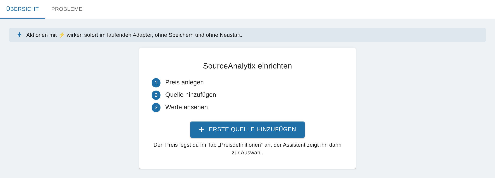

# Installation und Voraussetzungen

<!-- seite: gewicht=29; en=en/01.erste-schritte/01.installation.md -->

## Welche Voraussetzungen braucht SourceAnalytix (Node.js, js-controller, Admin)?

<!-- abschnitt: prio=B; gewicht=12; readme=partial; cluster=logs-install-26,upgrade-migration-other-14; features=req-versions,req-admin-ui-i18n -->
<!-- muss beantworten: Mindestversionen von Node.js, js-controller und Admin; Admin-Versionen, mit denen die Oberfläche läuft. -->

Du brauchst Node.js 22, js-controller 6.0.11 und Admin 8.0.0 oder neuer. Admin 8 ist nötig, weil die Einstellungsseite der Instanz aus Bausteinen von Admin 8 besteht.
<!-- quelle: code=io-package.json:161-170; code=package.json:11-13; issue=#1269 -->

Deine Versionen zeigt die Konsole mit `iobroker -v` (js-controller) und `node -v` (Node.js). Ist eine Komponente zu alt, aktualisiere zuerst sie und danach SourceAnalytix.
<!-- quelle: code=.github/ISSUE_TEMPLATE/BugReport.md:31-32; issue=#1202 -->

### SourceAnalytix startet nach einem Update von Node.js nicht

Meldet das Log `TypeError: Class extends value … is not a constructor or null`, ist meist der js-controller zu alt. Aktualisiere ihn, führe `iob fix` aus und starte die Instanz neu. In Docker aktualisierst du stattdessen das Container-Image.
<!-- quelle: forum=1195593; forum=218835 -->

**Siehe auch:** [Wie aktualisiere ich SourceAnalytix?](../02.anleitungen/05.betrieb-und-wartung.md#update-sourceanalytix-downgrade) · [Probleme bei Installation und Admin-Anzeige](../04.fehlerbehebung/01.log-meldungen.md#installation-admin-display-problems)

## Wie installiere ich SourceAnalytix und lege eine Instanz an?

<!-- abschnitt: prio=B; gewicht=12; readme=missing; cluster=logs-install-24,setup-ui-03; features=req-versions,req-admin-ui-i18n -->
<!-- muss beantworten: Installation über den Admin-Store oder GitHub; danach Instanz anlegen (nur eine Instanz nötig). -->

SourceAnalytix steht im Repository „latest“ (Beta), noch nicht in „stable“. Stelle „latest“ ein, installiere den Adapter und richte dann in den Instanz-Einstellungen deine erste Quelle ein.
<!-- quelle: interview=21; forum=1133140; forum=215063 -->

1. Wähle in Admin unter Systemeinstellungen › „Repositories“ das Repository „latest“.
2. Suche im Reiter „Adapter“ nach „SourceAnalytix“ und installiere es. Admin legt die Instanz `sourceanalytix.0` an und startet sie.
3. Öffne im Reiter „Instanzen“ die Einstellungen von `sourceanalytix.0`.
4. Lege im Tab „Preisdefinitionen“ mindestens einen Preis an, zum Beispiel für Strom in kWh, und speichere.
5. Klicke im Tab „Übersicht“ auf „Erste Quelle hinzufügen“. Weiter geht es unter [Mein erster Zähler](02.erster-zaehler.md#configure-sourceanalytix-datapoint).
<!-- quelle: interview=21; forum=1133140; forum=953340; code=admin/jsonConfig.json:1-45; code=src-admin/src/SourcesApp.tsx:245-279; code=src-admin/src/Wizard.tsx:553-595; code=src-admin/src/i18n/de.json -->

Die Tabs „Übersicht“ und „Probleme“ brauchen eine laufende Instanz. Ist sie gestoppt, steht oben „Instanz läuft nicht“ mit dem Knopf „Starten“.
<!-- quelle: code=src-admin/src/SourcesApp.tsx:111-140; code=src-admin/src/SourcesApp.tsx:474-476; code=src-admin/src/Wizard.tsx:955-961 -->

### Es gibt keine Instanz

Nach einer Installation über die Konsole oder eine GitHub-Adresse fehlt die Instanz. Lege sie im Reiter „Adapter“ mit dem Plus-Symbol an. Eine GitHub-Installation ist nur zum Testen gedacht, Admin zeigt dafür keine Updates an.
<!-- quelle: forum=1133140; forum=953340; forum=1143623; forum=215074; forum=378273; forum=213055; forum=938927; interview=21 -->

**Siehe auch:** [Brauche ich mehrere Instanzen?](#need-several-instances-versions-side)

## Brauche ich mehrere Instanzen oder Versionen nebeneinander?

<!-- abschnitt: prio=B; gewicht=5; readme=missing; cluster=setup-ui-16,upgrade-migration-other-23; features=source-enable -->
<!-- muss beantworten: Eine Instanz reicht für alle Datenpunkte; zwei Versionen parallel sind nicht möglich; Instanz löschen. -->

Nein. Eine Instanz verarbeitet beliebig viele Quellen. Zwei Versionen nebeneinander gibt es nicht, ioBroker installiert von jedem Adapter genau eine Version. Eine neue Version testest du deshalb nach einem Backup als Update.
<!-- quelle: code=main.js:126-145; forum=969466; issue=#158 -->

### Eine überzählige Instanz entfernen

1. Prüfe im Reiter „Objekte“, unter welcher Instanz deine Werte liegen, also `sourceanalytix.0` oder `sourceanalytix.1`.
2. Lösche im Reiter „Instanzen“ die andere Instanz mit dem Papierkorb-Symbol.
<!-- quelle: forum=938949; forum=567818 -->

> [!CAUTION]
> Mit einer Instanz verschwinden auch alle ihre Werte. Willst du nur eine Quelle stilllegen, nimm bei der Quelle „Deaktivieren“.
<!-- quelle: forum=938949; code=src-admin/src/i18n/de.json -->

**Siehe auch:** [Datenpunkt deaktivieren oder Quelle entfernen](../02.anleitungen/05.betrieb-und-wartung.md#disable-datapoint-remove-sources-states)
