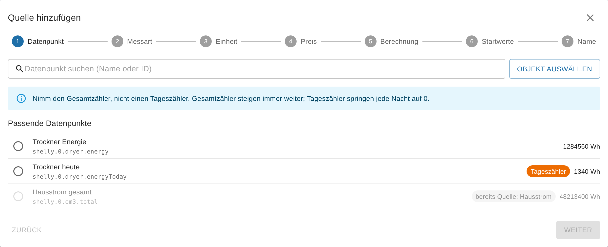

# Mein erster Zähler in 10 Minuten

<!-- seite: gewicht=109; en=en/01.erste-schritte/02.erster-zaehler.md -->

## Was trage ich bei den Startwerten ein (und in welcher Einheit)?

<!-- abschnitt: prio=A; gewicht=43; readme=partial; cluster=meter-readings-01,setup-ui-20,meter-readings-04,meter-readings-03; features=source-start-values,calc-first-activation-start-values,calc-consumption-formula,rollover-midnight-cron,log-first-activation -->
<!-- muss beantworten: Startwerte für Tag/Woche/Monat/Quartal/Jahr; Einheit (Wh/kWh); warum sonst der ganze Zählerstand als Verbrauch erscheint. -->

Meist nichts. Lässt du die Felder leer, zählt jede Periode ab der Aktivierung, und SourceAnalytix setzt die Startwerte danach bei jedem Periodenwechsel selbst. Trägst du etwas ein, ist es ein Zählerstand, kein Verbrauch: der Stand zu Beginn der Periode, in der Einheit der Preisdefinition.
<!-- quelle: code=lib/calculation.js:376-413; code=main.js; forum=561222; forum=731860 -->

Der Verbrauch einer Periode ist der Gesamtstand minus ihr Startwert. Deshalb gehört in jedes Feld der Stand zu diesem Zeitpunkt (Systemzeit des ioBroker-Rechners):

| Feld | Stand am |
|---|---|
| „Tag“ | heute, 0:00 Uhr |
| „Woche“ | Montag dieser Woche, 0:00 Uhr |
| „Monat“ | 1. dieses Monats, 0:00 Uhr |
| „Quartal“ | 1. Januar, April, Juli oder Oktober, 0:00 Uhr |
| „Jahr“ | 1. Januar, 0:00 Uhr |
<!-- quelle: code=main.js; interview=13b -->

> [!IMPORTANT]
> Die Einheit ist die der Preisdefinition, nicht die des Datenpunkts. Liefert dein Zähler 12.345.678 Wh und der Preis rechnet in kWh, gehört in „Tag“ zum Beispiel `12340`, nicht `12340000`. Assistent und Detailansicht zeigen die Einheit hinter jedem Feld.
<!-- quelle: code=src-admin/src/Wizard.tsx; code=src-admin/src/SourceDetail.tsx; issue=#1285; forum=214834; issue=#30 -->

### Wann du selbst etwas einträgst

Nur wenn der Verbrauch vor der Aktivierung mitzählen soll, zum Beispiel der ganze Monat, obwohl du erst am 15. einrichtest. Dafür brauchst du die echten Stände von damals, etwa von einem Foto des Zählers.
<!-- quelle: code=lib/calculation.js:376-413; forum=929460 -->

1. Wähle im Assistenten im Schritt „Startwerte“ die Karte „Verbrauch seit Periodenbeginn mitzählen“.
2. Trage die Stände ein, ohne Tausenderpunkt (`12475,5`). Ein einzelnes Komma oder ein einzelner Punkt ist immer das Dezimalzeichen. Kennst du einen Stand nicht, lass das Feld leer.
3. Unter jedem Feld steht „Verbrauch seit Beginn: …“ oder ein Fehler. Solange ein Feld einen Fehler zeigt, bleibt „Weiter“ gesperrt.
4. Schließe mit „⚡ Aktivieren“ ab.
<!-- quelle: code=src-admin/src/Wizard.tsx; code=src-admin/src/api.ts; issue=#1287 -->

Beispiel: Du aktivierst am Mittwoch, 15. März, der Gesamtstand ist 12.480 kWh.

| Feld | Eintrag | Verbrauch |
|---|---|---|
| „Tag“ | `12475` | 5 kWh |
| „Woche“ | `12440` | 40 kWh |
| „Monat“ | `12300` | 180 kWh |
| „Quartal“ | `11900` | 580 kWh |
| „Jahr“ | `11900` | 580 kWh |
<!-- quelle: code=main.js -->

Kein Startwert darf größer als der Gesamtstand sein. „Tag“ ist der größte, „Monat“ ist mindestens so groß wie „Quartal“ und „Quartal“ mindestens so groß wie „Jahr“. „Woche“ richtet sich nach ihrem Beginn. Passt ein Wert erst geteilt durch 1000, fragt die Seite zum Beispiel „Sieht nach Wh aus – gemeint 1,29 kWh?“.
<!-- quelle: interview=12; code=lib/source-checks.js; code=src-admin/src/api.ts -->

Bei einer laufenden Quelle änderst du die Startwerte in ihrer Detailansicht unter „Startwerte“ und übernimmst sie mit „⚡ Übernehmen“. Ein geleertes Feld zählt ab diesem Moment. Startwerte wirken nur bis zum nächsten Periodenwechsel, frühere Perioden lassen sich so nicht nachtragen. Bei einer Leistungsquelle (W) lässt du die Felder leer.
<!-- quelle: issue=#1285; issue=#1302; code=lib/calculation.js:404-413; interview=12; issue=#1267 -->

**Siehe auch:** [Warum sind meine Werte nach der Eingabe von Startwerten negativ?](../02.anleitungen/02.zaehlerstaende-korrigieren.md#values-negative-after-entering-start) · [Berechnet SourceAnalytix rückwirkend?](../05.hintergrund/03.perioden-und-zeit.md#sourceanalytix-calculate-retroactively-only-activation)

## Welchen Datenpunkt aktiviere ich: Zähler (kWh) oder Leistung (W)?

<!-- abschnitt: prio=A; gewicht=34; readme=covered; cluster=setup-ui-18,cumulative-power-01,outputs-viz-31; features=source-cumulative-meter,source-power-integration,consumption-vs-delivery,calc-consumption-formula -->
<!-- muss beantworten: Entscheidungshilfe Zählerstand vs. Leistungswert (z. B. GAS_ENERGY statt GAS_POWER); Empfehlung und Grenzen. -->

Nimm den Gesamtzähler deines Geräts, also den Wert in kWh, Wh oder m³, der nur steigt, zum Beispiel `ENERGY_Total` bei Tasmota oder `GAS_ENERGY` statt `GAS_POWER`. Einen Leistungswert in W nimmst du nur, wenn es keinen Zählerstand gibt.
<!-- quelle: code=main.js; forum=601453; forum=769264; forum=213760 -->

| | Zählerstand (kWh, m³ …) | Leistung (W, kW …) |
|---|---|---|
| Rechnung | Gesamtstand minus Startwert | Leistung mal Zeit bis zum nächsten Wert |
| Genauigkeit | so genau wie der Zähler | Schätzung, je besser, je öfter das Gerät sendet |
| SourceAnalytix war gestoppt | nichts fehlt | die Energie der Pause fehlt |
| Gerät startet bei 0 | wird als Reset erkannt | spielt keine Rolle |
<!-- quelle: code=main.js; code=lib/calculation.js -->

Tageswerte wie `ENERGY_Today` oder „Ertrag heute“ sind ungeeignet. Der Assistent markiert sie mit „Tageszähler“. Sie funktionieren zwar, aber was das Gerät um Mitternacht zählt, fehlt.
<!-- quelle: code=main.js; code=src-admin/src/Wizard.tsx; interview=4; forum=213760 -->

### Wenn du nur einen Leistungswert hast

Wähle im Assistenten die Messart „Leistung“ und eine Preisdefinition mit Energie-Einheit, zum Beispiel kWh. Der erste Wert ist nur der Ausgangspunkt, Verbrauch entsteht ab dem zweiten. In der Detailansicht unter „Einstellungen“ gibt es dafür drei Optionen:

- „Mittelwert bei Leistung“: rechnet mit dem Mittel aus zwei Werten. Passt zu Sensoren, die regelmäßig senden.
- „Negative Werte ignorieren“: für Wechselrichter, die im Standby negative Leistung melden.
- „Maximale Lücke zwischen Leistungswerten (Minuten)“: kommt länger kein Wert, zählt die Lücke als 0. Lass das Feld bei Geräten leer, die nur bei Änderung senden.
<!-- quelle: code=src-admin/src/Wizard.tsx; code=src-admin/src/SourceDetail.tsx; code=lib/calculation.js; interview=9; issue=#1266 -->

**Siehe auch:** [Wie rechnet SourceAnalytix Watt in kWh um?](../05.hintergrund/01.berechnung.md#sourceanalytix-convert-watts-kwh) · [Zähler, der täglich auf 0 zurückgesetzt wird](../05.hintergrund/02.zaehler-reset.md#counter-reset-0-daily-happens)

## Wo konfiguriere ich SourceAnalytix für einen Datenpunkt?

<!-- abschnitt: prio=A; gewicht=22; readme=covered; cluster=setup-ui-01,cumulative-power-28; features=source-enable,output-tree-layout,source-price-definition,source-calc-consumption,source-calc-costs -->
<!-- muss beantworten: Weg in Objekte -> Datenpunkt -> SourceAnalytix-Dialog; Haken Costs/Consumption/Meter values; Aktivieren. -->

In den Instanz-Einstellungen von SourceAnalytix. Im Tab „Übersicht“ startet „Quelle hinzufügen“ einen Assistenten, der die Quelle sofort aktiviert, ohne Neustart. Vorher brauchst du eine laufende Instanz und mindestens eine Preisdefinition.
<!-- quelle: code=src-admin/src/SourcesApp.tsx; code=src-admin/src/Wizard.tsx; code=main.js; issue=#1269 -->

1. **„Datenpunkt“:** Suche den Zählerstand oder wähle ihn über „Objekt auswählen“.
2. **„Messart“:** „Zählerstand“ oder „Leistung“. Bei einem Zählerstand fragt der Assistent, ob der Wert manchmal auf 0 springt. „Ja“ schaltet die Reset-Erkennung ein.
3. **„Einheit“:** Prüfe die erkannte Einheit.
4. **„Preis“:** Wähle die Preisdefinition. Unpassende Einheiten sind mit „andere Einheit“ markiert. Bei einem Impulszähler (Einheit Stück) trägst du hier die Impulse pro Einheit ein, zum Beispiel 1000 bei 1000 imp/kWh.
5. **„Berechnung“:** „Verbrauch“, „Kosten“ und „Zählerstände speichern“ sind vorbelegt.
6. **„Startwerte“:** Lass „Ab jetzt zählen“ gewählt.
7. **„Name“:** Gib einen Namen ein und klicke auf „⚡ Aktivieren“.
<!-- quelle: code=src-admin/src/Wizard.tsx; code=src-admin/src/i18n/de.json; issue=#1313 -->

Danach wartet der Assistent auf den ersten Wert. Dauert das, etwa bei PV in der Nacht, kannst du ihn schließen. Die Quelle läuft weiter. Ihre Werte liegen unter `sourceanalytix.0.<Gerät>`, wobei `<Gerät>` die „Technische ID“ aus dem Namen ist.
<!-- quelle: code=src-admin/src/Wizard.tsx; code=src-admin/src/api.ts; code=src-admin/src/i18n/de.json -->

Alle weiteren Einstellungen änderst du später in der Detailansicht der Quelle unter „Einstellungen“ und übernimmst sie mit „⚡ Übernehmen“. Löscht eine Änderung Daten, etwa wenn du „Verbrauch“ oder „Kosten“ ausschaltest, fragt die Seite vorher nach.
<!-- quelle: code=src-admin/src/SourceDetail.tsx; issue=#1311; issue=#1285 -->

### Und am Datenpunkt im Reiter „Objekte“?

Dort steht nur ein Schalter, damit du im Objektbaum siehst, welche Datenpunkte SourceAnalytix nutzt. Schaltest du ihn ein, fehlt noch die Preisdefinition; die Quelle erscheint dann im Tab „Probleme“. Schaltest du ihn aus, entfernt das die Einstellungen der Quelle samt Startwerten. Zum Pausieren nimm „Deaktivieren“ in den Instanz-Einstellungen.
<!-- quelle: issue=#1286; issue=#1306; code=admin/jsonCustom.json; code=admin/i18n/de.json -->

**Siehe auch:** [Was bewirken die Einstellungen am Datenpunkt?](../03.referenz/01.einstellungen.md#datapoint-settings-costs-consumption-meter) · [Datenpunkt aktiviert, aber es entstehen keine Ordner](../04.fehlerbehebung/01.log-meldungen.md#datapoint-enabled-but-no-folders)

## Wo finde ich meine Werte (Tagesverbrauch heute/gestern)?

<!-- abschnitt: prio=B; gewicht=10; readme=partial; cluster=outputs-viz-01,setup-ui-31; features=output-cumulative-reading,output-tree-layout,output-basic-period-states,output-cost-vs-earnings,price-basic-fee -->
<!-- muss beantworten: Der State-Baum in Kurzform: consumed/delivered, Tag/Woche/Monat; wann die ersten Werte erscheinen. -->

Im Tab „Übersicht“: Jede Karte zeigt „Heute“, „Monat“ und „Jahr“, die Detailansicht unter „Werte“ auch „Gestern“, „Vormonat“ und mehr. Als States liegen sie unter `sourceanalytix.0.<Gerät>.currentYear`.
<!-- quelle: code=src-admin/src/SourcesApp.tsx; code=src-admin/src/SourceDetail.tsx; code=main.js -->

| State unter `sourceanalytix.0.<Gerät>` | Inhalt |
|---|---|
| `cumulativeReading` | Gesamtstand |
| `currentYear.consumed.01_currentDay` bis `05_currentYear` | heute, diese Woche, Monat, Quartal, Jahr |
| `currentYear.consumed.01_previousDay` bis `05_previousYear` | gestern, letzte Woche, Vormonat, Vorquartal, Vorjahr |
| `currentYear.costs.…` | Kosten mit denselben Namen |
<!-- quelle: code=main.js -->

Bei einer Einspeisung heißen die Ordner `delivered` und `earnings`. Die laufenden Werte erscheinen mit dem ersten Wert der Quelle, „gestern“ und die anderen Vorperioden erst nach dem ersten Periodenwechsel. SourceAnalytix rechnet nur, wenn die Quelle einen neuen Wert sendet.
<!-- quelle: code=main.js; code=admin/jsonConfig.json; forum=799342; forum=275553 -->

**Siehe auch:** [Wo finde ich gestern, letzte Woche, letzten Monat?](../03.referenz/02.states-und-meldungen.md#yesterday-last-week-last-month) · [Werte live oder erst um Mitternacht?](../05.hintergrund/03.perioden-und-zeit.md#values-updated-live-midnight)
