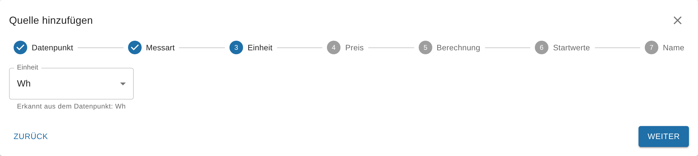

# Quellen, Einheiten und Vorzeichen

<!-- seite: gewicht=76; en=en/02.anleitungen/01.quellen-und-einheiten.md -->

## Wie trenne ich Bezug und Einspeisung (ein Datenpunkt mit Vorzeichen)?

<!-- abschnitt: prio=B; gewicht=20; readme=missing; cluster=prices-costs-19,cumulative-power-22,outputs-viz-34,cumulative-power-21,prices-costs-20; features=source-ignore-negative,source-power-integration,consumption-vs-delivery,source-multi-edit,calc-negative-values-cumulative -->
<!-- muss beantworten: Ein Datenpunkt für Bezug und Einspeisung: Einstellung "negative Werte ignorieren", zwei Quellen, Verhalten bei negativen Leistungen. -->

Mit zwei Quellen, denn SourceAnalytix wertet das Vorzeichen nicht aus. Die erste nimmt den Datenpunkt für den Bezug, die zweite einen Alias mit umgedrehtem Vorzeichen für die Einspeisung. Beide bekommen „Negative Werte ignorieren“.
<!-- quelle: interview=10; code=lib/calculation.js; code=main.js -->

1. Lege im Tab „Preisdefinitionen“ zwei Preise in `kWh` an: `Strom Bezug` mit Kostenart „Kosten“ und `Einspeisung` mit Kostenart „Erträge“. Bei der Einspeisung ist der „Preis pro Einheit“ deine Vergütung je kWh.
2. Lege im Reiter „Objekte“ einen Alias auf den Leistungs-Datenpunkt an, der das Vorzeichen umdreht (`-val`), mit der Einheit `W`.
3. Lege mit „Quelle hinzufügen“ eine Quelle für den Original-Datenpunkt mit Messart „Leistung“ und Preis `Strom Bezug` an.
4. Lege genauso eine Quelle für den Alias mit dem Preis `Einspeisung` an.
5. Setze bei beiden in der Detailansicht unter „Einstellungen“ „Negative Werte ignorieren“ und klicke auf „⚡ Übernehmen“.
<!-- quelle: interview=10; code=src-admin/src/Wizard.tsx; code=src-admin/src/SourceDetail.tsx; code=admin/jsonConfig.json -->

Der Bezug steht danach unter `currentYear.consumed`, die Einspeisung unter `currentYear.delivered` und die Erlöse unter `currentYear.earnings`.
<!-- quelle: code=main.js -->

> [!WARNING]
> Ohne „Negative Werte ignorieren“ zieht die Einspeisung den Gesamtstand des Bezugs herunter. Der Tagesverbrauch zeigt dann nur den Saldo und kann negativ werden.
<!-- quelle: code=lib/calculation.js; code=main.js; forum=434762 -->

Hat dein Stromzähler eigene Zählerstände für Bezug und Einspeisung, nimm lieber diese als zwei Zählerstand-Quellen. Das ist genauer.
<!-- quelle: code=lib/calculation.js; forum=636815 -->

**Siehe auch:** [PV-Ertrag, Einspeisung und Erlöse](#track-pv-yield-feed-earnings) · [Wie ordne ich Preise zu?](03.preise-und-kosten.md#assign-prices-create-custom-tariffs)

## Welche Einheit stelle ich am Datenpunkt ein (kWh statt Wh, m³ statt Liter)?

<!-- abschnitt: prio=B; gewicht=19; readme=missing; cluster=cumulative-power-24,outputs-viz-09,meter-readings-21; features=source-unit,unit-detection-conversion,supported-units,price-definitions-table -->
<!-- muss beantworten: Quelleinheit korrekt wählen; was bei nachträglicher Änderung passiert; warum kWh statt m³ erscheint. -->

Die Einheit, in der der Datenpunkt wirklich liefert. Meist erkennt der Assistent sie selbst („Erkannt aus dem Datenpunkt: …“). In welcher Einheit du die Werte siehst, bestimmt die Preisdefinition. Von Wh nach kWh oder von l nach m³ rechnet SourceAnalytix selbst um.
<!-- quelle: code=main.js; code=lib/calculation.js; code=src-admin/src/Wizard.tsx -->

Typische Fehler:

- **Zählerstand als `W` beschriftet:** Der Wert wird über die Zeit aufsummiert und wird absurd hoch. Wähle `Wh` oder `kWh`.
- **Leistung als `kWh` beschriftet:** Jeder Wert gilt als Zählerstand. Wähle `W` oder `kW`.
- **`Wh` und `kWh` verwechselt:** Alles ist um den Faktor 1.000 falsch.
<!-- quelle: code=main.js; code=lib/calculation.js; forum=575673; forum=951120 -->

Erkennt SourceAnalytix keine Einheit, meldet der Tab „Probleme“ „Einheit fehlt oder wird nicht erkannt“. Mit „Beheben“ wählst du sie aus.
<!-- quelle: code=lib/source-overview.js; code=src-admin/src/Dialogs.tsx -->

### Warum kWh statt m³ erscheint

Die gewählte Preisdefinition rechnet in `kWh`. Lege für Gas einen eigenen Preis in `m³` an und wähle ihn bei der Quelle. Kubikmeter Gas rechnet SourceAnalytix nicht in kWh um; passen die Einheiten nicht zusammen, kannst du den Preis gar nicht wählen.
<!-- quelle: code=main.js; code=lib/calculation.js; issue=#1278; forum=953404 -->

### Wenn du die Einheit nachträglich änderst

Gespeicherte Werte rechnet SourceAnalytix nicht um. Wechselst du zu einem Preis in einer anderen Einheit als die gespeicherten Daten, etwa von kWh zu MWh, startet die Quelle nicht. Der Tab „Probleme“ zeigt dann „Preisdefinition hat eine andere Einheit als die gespeicherten Daten“. Wähle einen Preis in der alten Einheit oder lösche die Daten der Quelle und beginne neu.
<!-- quelle: issue=#1310; code=main.js:2186-2195; code=lib/source-overview.js:56-106; code=src-admin/src/i18n/de.json -->

War die Einheit am Datenpunkt falsch, etwa Wh statt kWh, gilt die neue ab dem nächsten Wert. Gesamtstand und Perioden korrigierst du danach mit „Zählerstand angleichen“, siehe [Falsche Werte korrigieren](02.zaehlerstaende-korrigieren.md#correct-wrong-too-high-negative).
<!-- quelle: code=main.js; code=lib/calculation.js -->

**Siehe auch:** [Welche Einheiten werden unterstützt?](../03.referenz/01.einstellungen.md#units-supported-energy-volume-weight) · [Startwerte und ihre Einheit](../01.erste-schritte/02.erster-zaehler.md#start-values-unit)

## Kann SourceAnalytix aus Leistung (W) Verbrauch und Zählerstand berechnen?

<!-- abschnitt: prio=B; gewicht=12; readme=covered; cluster=cumulative-power-02; features=source-power-integration,unit-detection-conversion,source-cumulative-meter -->
<!-- muss beantworten: Leistung als Quelle: was entsteht, welche Einheit, wie genau; Verweis auf Hintergrund. -->

Ja. SourceAnalytix multipliziert jeden Leistungswert mit der Zeit bis zum nächsten und addiert das zu einem eigenen Gesamtstand. Daraus entstehen Verbrauch und Kosten in der Energie-Einheit der Preisdefinition, zum Beispiel kWh.
<!-- quelle: code=main.js; code=lib/calculation.js -->

Der Gesamtstand beginnt bei der Aktivierung bei 0, er ist also nicht der Stand deines Stromzählers. Wie genau er ist, hängt davon ab, wie oft das Gerät sendet. Startwerte und Reset-Erkennung brauchst du nicht.
<!-- quelle: code=main.js -->

Wähle im Assistenten die Messart „Leistung“ und einen Preis in `Wh`, `kWh` oder `MWh`. Die Optionen für Leistung stehen unter [Wenn du nur einen Leistungswert hast](../01.erste-schritte/02.erster-zaehler.md#datapoint-enable-meter-kwh-power). Mit „Zählerstand angleichen“ kannst du den Gesamtstand an einen echten Zähler anlehnen; danach laufen beide wieder auseinander.
<!-- quelle: code=src-admin/src/Wizard.tsx; code=main.js; code=lib/source-actions.js -->

**Siehe auch:** [Wie rechnet SourceAnalytix Watt in kWh um?](../05.hintergrund/01.berechnung.md#sourceanalytix-convert-watts-kwh) · [Welche Quelltypen gibt es?](../03.referenz/01.einstellungen.md#source-types-exist-meter-power)

## Wie erfasse ich PV-Ertrag, Einspeisung und Erlöse?

<!-- abschnitt: prio=B; gewicht=9; readme=partial; cluster=prices-costs-22,prices-costs-24; features=source-cumulative-meter,consumption-vs-delivery,output-cost-vs-earnings,source-enable,source-start-values -->
<!-- muss beantworten: Richtigen PV-Datenpunkt wählen, Startwert, Verbrauch vs. Lieferung, Erlöse. -->

Jeder Zähler wird eine eigene Quelle mit einem Preis der Kostenart „Erträge“. Dann schreibt SourceAnalytix Lieferung und Erlöse statt Verbrauch und Kosten.
<!-- quelle: code=main.js; forum=1157391; forum=1265526; forum=794768 -->

| Was | Datenpunkt | Preisdefinition |
|---|---|---|
| PV-Ertrag | Gesamtertrag des Wechselrichters in kWh | „Erträge“; ohne Geld lässt du „Kosten“ aus |
| Einspeisung und Erlöse | Einspeisezähler des Stromzählers | „Erträge“, Preis = Einspeisevergütung |
| Netzbezug | Bezugszähler des Stromzählers | „Kosten“ |
<!-- quelle: code=main.js; code=admin/jsonConfig.json -->

Nimm den Gesamtertrag, nicht „Ertrag heute“, der jede Nacht auf 0 springt. Die Werte stehen unter `currentYear.delivered` und `currentYear.earnings`, in der Detailansicht als „Einspeisung“ und „Erlös“. Eigenverbrauch und Autarkie berechnet SourceAnalytix nicht.
<!-- quelle: interview=4; code=main.js; code=src-admin/src/SourceDetail.tsx; issue=#643 -->

**Siehe auch:** [Bezug und Einspeisung aus einem Datenpunkt](#separate-import-feed-one-datapoint) · [Startwerte](../01.erste-schritte/02.erster-zaehler.md#start-values-unit)

## Wie leite ich einen Zähler aus Durchfluss, Laufzeit oder mehreren Geräten ab?

<!-- abschnitt: prio=B; gewicht=8; readme=missing; cluster=outputs-viz-14,cumulative-power-29,meter-readings-16; features=source-cumulative-meter,source-power-integration,supported-units,source-reset-detection,reset-confirmation -->
<!-- muss beantworten: Summen und abgeleitete Zähler (Phasen, Brenner, Füllstand), Reset-Erkennung dafür. -->

Mit einem Skript. SourceAnalytix wertet jeden Datenpunkt einzeln aus und summiert über die Zeit nur Leistung und Impulse pro Minute. Für alles andere schreibt ein Skript einen steigenden Zählerstand in einer unterstützten Einheit, und du aktivierst diesen Datenpunkt.
<!-- quelle: code=lib/calculation.js; code=main.js; forum=1241171 -->

| Fall | Was du tust |
|---|---|
| Mehrere Phasen | Gesamtzähler des Geräts nehmen, sonst die Phasen per Skript summieren |
| Mehrere Geräte | je Gerät eine Quelle; eine Summe bildet ein Skript |
| Durchfluss (`m³/h`, `l/min`) | Skript addiert Rate × Zeit zu `m³` oder `l` |
| Brennerlaufzeit | Skript rechnet Laufzeit × Verbrauch pro Stunde in `l` oder `kWh` |
| Brennerstarts | direkt als Zählerstand mit Einheit `piece` |
| Füllstand (Öltank) | Skript summiert nur die Abnahmen, ohne Nachtanken |
<!-- quelle: code=lib/calculation.js; issue=#304; forum=1241171; forum=581241; forum=680719 -->

Am saubersten ist eine Summe, die nie fällt: Das Skript addiert je Teilzähler nur den Zuwachs und ignoriert Rückgänge. Fällt die Summe doch, behandelt die Reset-Erkennung das wie bei jedem Zähler.
<!-- quelle: forum=938999; forum=919324; code=lib/calculation.js -->

**Siehe auch:** [Welche Einheiten werden unterstützt?](../03.referenz/01.einstellungen.md#units-supported-energy-volume-weight) · [Skript-Datenpunkte](#use-script-datapoints-unreliable-sources)

## Kann ich Skript-Datenpunkte oder unzuverlässige Quellen verwenden?

<!-- abschnitt: prio=B; gewicht=8; readme=missing; cluster=setup-ui-24,cumulative-power-18; features=source-cumulative-meter,source-enable,output-timestamps-ack,other-object-subscription,reset-jitter-ignore -->
<!-- muss beantworten: Skript-/Fremd-Datenpunkte (Simple-API, andere Adapter); Ausreißer und Nachkommastellen filtern. -->

Ja. Jeder Datenpunkt kann Quelle sein, ob Adapter, Skript, Alias oder Simple-API ihn schreibt. Er muss eine Zahl in einer unterstützten Einheit liefern; Text wie `"12,5"` geht auch.
<!-- quelle: code=main.js; forum=474030; issue=#1255; issue=#1288 -->

- Gib dem Datenpunkt den Typ Zahl und eine Einheit, zum Beispiel `kWh`. Dann zeigt ihn der Assistent unter „Passende Datenpunkte“.
- Schreibe einen Zählerstand, der nur steigt.
- Ist ein Wert keine Zahl, meldet der Tab „Probleme“ „Datenpunkt liefert Text statt einer Zahl“.
<!-- quelle: code=main.js; code=src-admin/src/Wizard.tsx; code=lib/source-overview.js -->

Ausreißer filtert nur die Reset-Erkennung: Kleine Rückgänge bis zur „Schwelle“ und eine kurze 0 werden ignoriert. Ein Sprung nach oben zählt sofort als Verbrauch. Liefert deine Quelle manchmal unsinnig hohe Werte, filtere sie vorher per Skript.
<!-- quelle: code=lib/calculation.js; issue=#1258; forum=938999 -->

Wie viele Nachkommastellen SourceAnalytix ausgibt, stellst du bei der Quelle unter „Für Experten“ ein.
<!-- quelle: code=src-admin/src/SourceDetail.tsx; code=lib/calculation.js -->

**Siehe auch:** [Was bedeutet „Device reset detected“?](../05.hintergrund/02.zaehler-reset.md#device-reset-detected-mean-reset) · [Falsche Werte korrigieren](02.zaehlerstaende-korrigieren.md#correct-wrong-too-high-negative)
