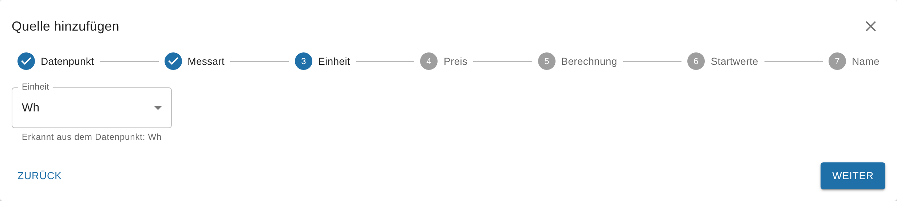

# Quellen, Einheiten und Vorzeichen

<!-- seite: gewicht=76; en=en/02.anleitungen/01.quellen-und-einheiten.md -->

## Wie trenne ich Bezug und Einspeisung (ein Datenpunkt mit Vorzeichen)?

<!-- abschnitt: prio=B; gewicht=20; readme=missing; cluster=prices-costs-19,cumulative-power-22,outputs-viz-34,cumulative-power-21,prices-costs-20; features=source-ignore-negative,source-power-integration,consumption-vs-delivery,source-multi-edit,calc-negative-values-cumulative -->
<!-- muss beantworten: Ein Datenpunkt für Bezug und Einspeisung: Einstellung "negative Werte ignorieren", zwei Quellen, Verhalten bei negativen Leistungen. -->

**Kurz:** SourceAnalytix erkennt Bezug und Einspeisung nicht am Vorzeichen. Du legst zwei Quellen an: den Datenpunkt selbst für den Bezug und einen Alias mit umgedrehtem Vorzeichen für die Einspeisung. Beide bekommen „Negative Werte ignorieren", die Einspeisung zusätzlich eine Preisdefinition mit der Kostenart „Erträge".
<!-- quelle: interview=10; code=lib/calculation.js:752-755; code=main.js:2145-2165 -->

Die Richtung einer Quelle kommt allein aus der Kostenart ihrer Preisdefinition. Bei „Kosten" schreibt SourceAnalytix Verbrauch und Kosten (`consumed`, `costs`), bei „Erträge" Lieferung und Erlöse (`delivered`, `earnings`). Ein negativer Leistungswert wird ohne Haken als negative Energie gezählt und senkt den Gesamtstand, denn Leistungsquellen haben keine Reset-Erkennung. Mit dem Haken „Negative Werte ignorieren" zählt er als 0 W.
<!-- quelle: code=main.js:2145-2165; code=main.js:3871-3880; code=lib/calculation.js:743-755; code=lib/calculation.js:766-783 -->

### So gehst du vor (ab v0.7.0)

1. Öffne die Instanz-Einstellungen von SourceAnalytix und lege im Tab „Preisdefinitionen" zwei Zeilen an, zum Beispiel `Strom Bezug` mit Kostenart „Kosten" und `Einspeisung` mit Kostenart „Erträge", beide mit der Einheit `kWh`. Bei der Einspeisung ist der „Preis pro Einheit" deine Einspeisevergütung je kWh. Speichern startet den Adapter neu.
2. Lege unter „Objekte" einen Alias auf deinen Leistungs-Datenpunkt an, der beim Lesen das Vorzeichen umdreht (`-val`), und gib ihm die Einheit `W`.
3. Wechsle in den Instanz-Einstellungen in den Tab „Übersicht" und klicke auf „Quelle hinzufügen". Wähle den Original-Datenpunkt, die Messart „Leistung" und den Preis `Strom Bezug`. Setze im Schritt „Berechnung" unter „Für Experten" den Haken „Negative Werte ignorieren" und aktiviere die Quelle.
4. Lege genauso eine zweite Quelle für den Alias an, mit dem Preis `Einspeisung` und ebenfalls „Negative Werte ignorieren".
5. Der Bezug steht danach unter `sourceanalytix.0.<Bezug>.currentYear.consumed`, die Einspeisung unter `sourceanalytix.0.<Einspeisung>.currentYear.delivered` und ihre Erlöse unter `…currentYear.earnings`.
<!-- quelle: interview=10; code=src-admin/src/Wizard.tsx:68; code=src-admin/src/Wizard.tsx:636-670; code=main.js:2145-2165; code=admin/jsonConfig.json:39-83 -->

Bei einer Quelle, die schon läuft, setzt du den Haken in ihrer Detailansicht unter „Einstellungen" und klickst auf „⚡ Übernehmen". Das wirkt sofort, ohne Neustart.
<!-- quelle: code=src-admin/src/SourceDetail.tsx:84-91; code=src-admin/src/SourceDetail.tsx:423-439; code=src-admin/src/SourceDetail.tsx:586-596 -->

> [!WARNING]
> Ohne „Negative Werte ignorieren" zieht die Einspeisung den Gesamtstand des Bezugs wieder herunter. Der Tagesverbrauch zeigt dann nur den Saldo und kann negativ werden.
<!-- quelle: code=lib/calculation.js:752-755; code=main.js:3871-3880; forum=434762 -->

Liefert dein Stromzähler zwei eigene Zählerstände für Bezug und Einspeisung, nimm lieber diese als zwei Quellen vom Typ Zählerstand. Das ist genauer als die Leistung, und ein Zählerstand mit Vorzeichen kommt dabei nicht vor: Fällt ein Zählerstand, behandelt SourceAnalytix das als Reset und nicht als Einspeisung. Warum der Zählerstand genauer ist, steht unter [Zähler (kWh) oder Leistung (W)?](../01.erste-schritte/02.erster-zaehler.md#datapoint-enable-meter-kwh-power).
<!-- quelle: code=lib/calculation.js:445-455; code=lib/calculation.js:766-783; forum=636815 -->

Eine eigene Einstellung, die Bezug und Einspeisung aus einem Datenpunkt trennt, ist geplant ([#1272](https://github.com/DrozmotiX/ioBroker.sourceanalytix/issues/1272)).
<!-- quelle: issue=#1272; interview=10 -->

**Bis v0.6.x:** Den Haken „Negative Leistungswerte ignorieren" findest du in den SourceAnalytix-Einstellungen am Datenpunkt (Objekte, Schraubenschlüssel) unter „Berechnungseinstellungen".
<!-- quelle: code=admin/jsonCustom.json:107-128@v0.6.1 -->

**Siehe auch:** [Wie erfasse ich PV-Ertrag, Einspeisung und Erlöse?](#track-pv-yield-feed-earnings) · [Kann SourceAnalytix aus Leistung Verbrauch berechnen?](#sourceanalytix-compute-consumption-meter-reading) · [Wie ordne ich Preise zu?](03.preise-und-kosten.md#assign-prices-create-custom-tariffs)

## Welche Einheit stelle ich am Datenpunkt ein (kWh statt Wh, m³ statt Liter)?

<!-- abschnitt: prio=B; gewicht=19; readme=missing; cluster=cumulative-power-24,outputs-viz-09,meter-readings-21; features=source-unit,unit-detection-conversion,supported-units,price-definitions-table -->
<!-- muss beantworten: Quelleinheit korrekt wählen; was bei nachträglicher Änderung passiert; warum kWh statt m³ erscheint. -->

**Kurz:** An der Quelle stellst du die Einheit ein, in der der Datenpunkt wirklich liefert, meist reicht „Automatisch erkennen". Die Einheit, in der du die Werte siehst, kommt aus der Preisdefinition. Von Wh nach kWh oder von l nach m³ rechnet SourceAnalytix selbst um.
<!-- quelle: code=main.js:2069-2092; code=main.js:2170-2171; code=lib/calculation.js:9-20 -->

Beide Einheiten und alle Umrechnungen stehen in der Tabelle unter [Welche Einheiten werden unterstützt?](../03.referenz/01.einstellungen.md#units-supported-energy-volume-weight).

### So gehst du vor (ab v0.7.0)

1. Beim Anlegen zeigt der Assistent im Schritt „Einheit" die Zeile „Erkannt aus dem Datenpunkt: …". Wähle die Einheit, in der der Datenpunkt zählt. Stimmt die erkannte Einheit, lass sie stehen.
2. Im Schritt „Preis" kannst du nur Preisdefinitionen wählen, deren Einheit dazu passt. Die anderen sind ausgegraut und tragen den Hinweis „andere Einheit".
3. Bei einer bestehenden Quelle änderst du die Einheit in ihrer Detailansicht unter „Einstellungen" im Feld „Einheit" und klickst auf „⚡ Übernehmen".
4. Erkennt SourceAnalytix keine Einheit, steht im Tab „Probleme" „Einheit fehlt oder wird nicht erkannt". Mit „Beheben" wählst du sie direkt aus.
<!-- quelle: code=src-admin/src/Wizard.tsx:513-535; code=src-admin/src/Wizard.tsx:545-590; code=src-admin/src/SourceDetail.tsx:388-404; code=src-admin/src/Dialogs.tsx:527-529; code=lib/source-overview.js:50-53 -->

Typische Fehler:

- **Zählerstand, aber als `W` beschriftet:** SourceAnalytix hält den Wert für eine Leistung und summiert ihn über die Zeit auf. Es entstehen absurd hohe Werte. Wähle `Wh` oder `kWh`.
- **Leistung, aber als `Wh` oder `kWh` beschriftet:** SourceAnalytix hält jeden Wert für einen Zählerstand. Wähle `W` oder `kW`.
- **`Wh` und `kWh` verwechselt:** Alle Werte sind um den Faktor 1.000 zu hoch oder zu niedrig.
<!-- quelle: code=main.js:2069-2092; code=main.js:3439-3470; code=lib/calculation.js:9-20; forum=575673; forum=951120 -->

### Warum kWh statt m³ erscheint

SourceAnalytix zeigt alle Werte in der Einheit der Preisdefinition. Siehst du kWh, obwohl dein Gaszähler m³ liefert, hat die gewählte Preisdefinition die Einheit `kWh`. Lege für Gas eine eigene Preisdefinition mit der Einheit `m³` und dem Preis je m³ an und wähle sie bei der Quelle. Liter und Kubikmeter rechnet SourceAnalytix ineinander um, m³ Gas in kWh dagegen nicht. Ab v0.6.2 startet eine Quelle mit `m³` und einer Preisdefinition in `kWh` gar nicht, im Log steht dann `Unit m³ of <Datenpunkt> cannot be converted to unit kWh of price definition <Name>`.
<!-- quelle: code=main.js:2108-2117; code=lib/calculation.js:139-158; issue=#1278; forum=953404 -->

Eine Umrechnung von m³ Gas in kWh ist geplant ([#6](https://github.com/DrozmotiX/ioBroker.sourceanalytix/issues/6)).
<!-- quelle: issue=#6; interview=19b -->

### Wenn du die Einheit nachträglich änderst

Eine neue Einheit an der Quelle oder in der Preisdefinition gilt ab dem nächsten Wert. Was schon gespeichert ist, rechnet SourceAnalytix nicht um: den Gesamtstand, die Startwerte und die Werte der laufenden und vergangenen Perioden. War die Einheit vorher falsch, stimmen Gesamtstand und Verbrauch deshalb auch nach der Änderung nicht. Korrigiere sie danach mit „Zählerstand angleichen" und repariere die Kosten, wie unter [Falsche Werte korrigieren](02.zaehlerstaende-korrigieren.md#correct-wrong-too-high-negative) beschrieben.
<!-- quelle: code=main.js:2065-2066; code=main.js:4550-4605; code=lib/calculation.js:445-455 -->

**Bis v0.6.x:** Die Einheit stellst du in den SourceAnalytix-Einstellungen am Datenpunkt unter „Wählen Sie Einheit" ein, Voreinstellung ist „Automatisch erkennen". Wie du dorthin kommst, steht unter [Wo konfiguriere ich SourceAnalytix?](../01.erste-schritte/02.erster-zaehler.md#configure-sourceanalytix-datapoint).
<!-- quelle: code=admin/jsonCustom.json:52-66@v0.6.1 -->

**Siehe auch:** [Startwerte und ihre Einheit](../01.erste-schritte/02.erster-zaehler.md#start-values-unit) · [Fehler „unit not supported" / „No unit defined"](../04.fehlerbehebung/01.log-meldungen.md#error-unit-not-supported-no)

## Kann SourceAnalytix aus Leistung (W) Verbrauch und Zählerstand berechnen?

<!-- abschnitt: prio=B; gewicht=12; readme=covered; cluster=cumulative-power-02; features=source-power-integration,unit-detection-conversion,source-cumulative-meter -->
<!-- muss beantworten: Leistung als Quelle: was entsteht, welche Einheit, wie genau; Verweis auf Hintergrund. -->

**Kurz:** Ja. SourceAnalytix multipliziert jeden Leistungswert mit der Zeit bis zum nächsten Wert und addiert das Ergebnis zu einem eigenen Gesamtstand. Daraus entstehen Verbrauch und Kosten für Tag, Woche, Monat, Quartal und Jahr, in der Energie-Einheit der Preisdefinition, zum Beispiel kWh.
<!-- quelle: code=main.js:3862-3935; code=lib/calculation.js:766-783; code=main.js:3488-3497 -->

Der Gesamtstand (`sourceanalytix.0.<Gerät>.cumulativeReading`) beginnt bei der Aktivierung bei 0. Er zeigt also die Energie seit der Aktivierung, nicht den Stand deines Stromzählers. Wie genau er ist, hängt davon ab, wie oft das Gerät sendet. Der erste Wert nach der Aktivierung und nach jedem Neustart von SourceAnalytix dient nur als Ausgangspunkt. Eine Reset-Erkennung gibt es für Leistungsquellen nicht, und Startwerte brauchst du keine.
<!-- quelle: code=main.js:2148-2150; code=main.js:3920-3930; code=main.js:2194-2197 -->

### So gehst du vor (ab v0.7.0)

1. Klicke in den Instanz-Einstellungen im Tab „Übersicht" auf „Quelle hinzufügen" und wähle den Datenpunkt mit der Leistung.
2. Wähle im Schritt „Messart" „Leistung". Bei den Einheiten `W` und `kW` schlägt der Assistent das schon vor.
3. Wähle im Schritt „Preis" eine Preisdefinition mit `Wh`, `kWh` oder `MWh`. Andere Einheiten sind ausgegraut.
4. Unter „Für Experten" im Schritt „Berechnung" findest du „Mittelwert bei Leistung" und „Negative Werte ignorieren". Was sie bewirken, steht unter [Wenn du nur einen Leistungswert hast](../01.erste-schritte/02.erster-zaehler.md#datapoint-enable-meter-kwh-power).
5. Im Schritt „Startwerte" ist nur „Ab jetzt zählen" möglich. Gib einen Namen ein und aktiviere die Quelle.
<!-- quelle: code=src-admin/src/Wizard.tsx:68-70; code=src-admin/src/Wizard.tsx:121-130; code=src-admin/src/Wizard.tsx:545-551; code=src-admin/src/Wizard.tsx:636-670; code=src-admin/src/Wizard.tsx:720 -->

Willst du den Gesamtstand trotzdem an einen echten Zähler anlehnen, nimm die Aktion „Zählerstand angleichen". Sie setzt den Gesamtstand, die Werte der laufenden Perioden bleiben gleich. Weil die Leistung nur eine Schätzung ist, laufen beide danach wieder auseinander. Die Aktion „Zähler getauscht" gibt es bei Leistungsquellen nicht.
<!-- quelle: code=main.js:4124-4160; code=lib/source-actions.js:33-47; code=src-admin/src/SourceDetail.tsx:612-619 -->

> [!TIP]
> Fällt das Gerät oder das WLAN aus, rechnet SourceAnalytix den letzten Wert über die ganze Pause hoch. Das verhinderst du mit „Maximale Lücke zwischen Leistungswerten (Minuten)" in der Detailansicht der Quelle unter „Einstellungen" (ab v0.7.0). Meldet eine Leistungsquelle lange keinen Wert, zeigt der Tab „Probleme" „Leistungsquelle meldet seit langem keinen Wert".
<!-- quelle: issue=#1266; issue=#1285; code=src-admin/src/SourceDetail.tsx:461-472; code=main.js:3898-3909; code=lib/source-overview.js:170 -->

**Siehe auch:** [Wie rechnet SourceAnalytix Watt in kWh um?](../05.hintergrund/01.berechnung.md#sourceanalytix-convert-watts-kwh) · [Zähler (kWh) oder Leistung (W)?](../01.erste-schritte/02.erster-zaehler.md#datapoint-enable-meter-kwh-power) · [Welche Quelltypen gibt es?](../03.referenz/01.einstellungen.md#source-types-exist-meter-power)

## Wie erfasse ich PV-Ertrag, Einspeisung und Erlöse?

<!-- abschnitt: prio=B; gewicht=9; readme=partial; cluster=prices-costs-22,prices-costs-24; features=source-cumulative-meter,consumption-vs-delivery,output-cost-vs-earnings,source-enable,source-start-values -->
<!-- muss beantworten: Richtigen PV-Datenpunkt wählen, Startwert, Verbrauch vs. Lieferung, Erlöse. -->

**Kurz:** Jeder Zähler wird eine eigene Quelle: der Gesamtertrag des Wechselrichters und der Einspeisezähler. Nimm jeweils den Zählerstand in kWh, der nur steigt, und eine Preisdefinition mit der Kostenart „Erträge". Dann schreibt SourceAnalytix Lieferung und Erlöse statt Verbrauch und Kosten.
<!-- quelle: code=main.js:2145-2165; forum=1157391; forum=1265526; forum=794768 -->

| Was du erfassen willst | Datenpunkt | Preisdefinition |
|---|---|---|
| PV-Ertrag | Gesamtertrag des Wechselrichters in kWh | Kostenart „Erträge". Willst du kein Geld sehen, lass bei der Quelle „Kosten" aus. |
| Einspeisung und Erlöse | Einspeisezähler deines Stromzählers | Kostenart „Erträge", „Preis pro Einheit" = Einspeisevergütung je kWh |
| Netzbezug | Bezugszähler deines Stromzählers | Kostenart „Kosten" |
<!-- quelle: code=main.js:2145-2165; code=main.js:3755-3775; code=admin/jsonConfig.json:67-83 -->

Die Werte stehen danach unter `sourceanalytix.0.<Gerät>.currentYear.delivered`, die Erlöse unter `…currentYear.earnings`. In der Detailansicht der Quelle heißen die Spalten „Einspeisung" und „Erlös".
<!-- quelle: code=main.js:2164-2165; code=src-admin/src/SourceDetail.tsx:333-341 -->

### So gehst du vor (ab v0.7.0)

1. Lege im Tab „Preisdefinitionen" eine Zeile mit Kostenart „Erträge" und Einheit `kWh` an. Speichern startet den Adapter neu.
2. Klicke im Tab „Übersicht" auf „Quelle hinzufügen" und wähle den Gesamtzähler. Datenpunkte, die nach einem Tageswert aussehen („heute", „today", „daily"), markiert der Assistent mit „Tageszähler".
3. Wähle die Messart „Zählerstand" und im Schritt „Preis" die neue Preisdefinition.
4. Im Schritt „Startwerte" ist „Ab jetzt zählen" richtig, wenn die Perioden ab heute zählen sollen. Soll der Ertrag seit Beginn des Tages oder Monats mitzählen, wähle „Verbrauch seit Periodenbeginn mitzählen" und trage die Zählerstände zum Periodenbeginn ein. Wie, steht unter [Was trage ich bei den Startwerten ein?](../01.erste-schritte/02.erster-zaehler.md#start-values-unit).
5. Gib einen Namen ein und aktiviere die Quelle. Für den Einspeisezähler wiederholst du die Schritte.
<!-- quelle: code=src-admin/src/Wizard.tsx:68; code=main.js:4648-4649; code=src-admin/src/Wizard.tsx:716-760; code=lib/calculation.js:365-390 -->

> [!IMPORTANT]
> Nimm nicht „Ertrag heute" oder einen ähnlichen Tageszähler. Er springt jede Nacht auf 0. Das klappt nur mit Reset-Erkennung, und bei jedem Sprung fehlt ein kleiner Teil des Ertrags. Mehr dazu unter [Zähler, der täglich auf 0 zurückgesetzt wird](../05.hintergrund/02.zaehler-reset.md#counter-reset-0-daily-happens).
<!-- quelle: interview=4; code=lib/calculation.js:445-455; code=src-admin/src/i18n/de.json:63-64 -->

Liefert dein Wechselrichter nur die momentane Leistung, nimm sie als Leistungsquelle, siehe [Kann SourceAnalytix aus Leistung Verbrauch berechnen?](#sourceanalytix-compute-consumption-meter-reading). Hast du nur einen Netz-Datenpunkt mit Vorzeichen, steht unter [Bezug und Einspeisung trennen](#separate-import-feed-one-datapoint), wie du daraus zwei Quellen machst.
<!-- quelle: interview=10; code=main.js:3862-3935 -->

Eigenverbrauch und Autarkie berechnet SourceAnalytix nicht. Das ist geplant ([#643](https://github.com/DrozmotiX/ioBroker.sourceanalytix/issues/643)).
<!-- quelle: issue=#643 -->

**Bis v0.6.x:** Du aktivierst die Datenpunkte einzeln in den SourceAnalytix-Einstellungen am Datenpunkt und wählst dort die Preisdefinition, siehe [Wo konfiguriere ich SourceAnalytix?](../01.erste-schritte/02.erster-zaehler.md#configure-sourceanalytix-datapoint).
<!-- quelle: code=admin/jsonCustom.json:37-51@v0.6.1 -->

**Siehe auch:** [Wie ordne ich Preise zu?](03.preise-und-kosten.md#assign-prices-create-custom-tariffs) · [Wo finde ich meine Werte?](../01.erste-schritte/02.erster-zaehler.md#values-consumption-today-yesterday)

## Wie leite ich einen Zähler aus Durchfluss, Laufzeit oder mehreren Geräten ab?

<!-- abschnitt: prio=B; gewicht=8; readme=missing; cluster=outputs-viz-14,cumulative-power-29,meter-readings-16; features=source-cumulative-meter,source-power-integration,supported-units,source-reset-detection,reset-confirmation -->
<!-- muss beantworten: Summen und abgeleitete Zähler (Phasen, Brenner, Füllstand), Reset-Erkennung dafür. -->

**Kurz:** Mit einem Skript. SourceAnalytix wertet jeden Datenpunkt einzeln aus und summiert über die Zeit nur Leistung (W) und Impulse pro Minute auf. Für Summen, Durchfluss, Laufzeit oder Füllstand schreibst du deshalb per Skript einen eigenen Zählerstand, der nur steigt, in einer unterstützten Einheit und aktivierst diesen Datenpunkt.
<!-- quelle: code=lib/calculation.js:9-20; code=lib/calculation.js:160-168; code=main.js:3441-3445; forum=1241171 -->

| Fall | Was du tust |
|---|---|
| Mehrere Phasen eines Zählers | Nimm den Gesamtzähler des Geräts. Gibt es keinen, bilde per Skript die Summe der Phasen-Zählerstände in kWh. |
| Mehrere Geräte zusammen | Jedes Gerät ist eine eigene Quelle. Brauchst du die Summe als Zähler, bilde sie per Skript. |
| Durchfluss (`m³/h`, `l/min`) | Raten werden nicht unterstützt. Das Skript addiert Rate × Zeit zu einem Volumen in `m³` oder `l`. |
| Brennerlaufzeit | Zeit wird nicht unterstützt. Das Skript rechnet Laufzeit × Verbrauch pro Stunde in `l` oder `kWh`. |
| Brennerstarts | Ab v0.7.0 direkt als Zählerstand mit der Einheit `piece`, siehe [Stück und Impulse](../03.referenz/01.einstellungen.md#units-supported-energy-volume-weight). |
| Füllstand (z. B. Öltank) | Den Füllstand selbst nicht verwenden, er fällt beim Verbrauch. Das Skript summiert nur die Abnahmen auf und lässt das Nachtanken weg. |
<!-- quelle: code=lib/calculation.js:9-20; issue=#304; forum=1241171; forum=581241; forum=680719 -->

Eine „Summe über alle Quellen" ist geplant ([#60](https://github.com/DrozmotiX/ioBroker.sourceanalytix/issues/60)).
<!-- quelle: code=src-admin/src/SourcesApp.tsx:676-679; issue=#60 -->

Wie du den Skript-Datenpunkt anlegst, damit SourceAnalytix ihn findet, steht im nächsten Abschnitt unter [Skript-Datenpunkte](#use-script-datapoints-unreliable-sources).

### Reset-Erkennung für Summen

Eine Summe ist für SourceAnalytix ein gewöhnlicher Zählerstand. Wird ein Teilzähler zurückgesetzt, fällt die Summe. Mit eingeschalteter Reset-Erkennung behandelt SourceAnalytix das wie jeden Reset: Es wartet auf den nächsten Wert und zählt dann auf den alten Gesamtstand weiter. Wie das abläuft, steht unter [Was bedeutet „Device reset detected"?](../05.hintergrund/02.zaehler-reset.md#device-reset-detected-mean-reset).
<!-- quelle: code=lib/calculation.js:445-455; code=lib/calculation.js:508-600; forum=919324 -->

> [!TIP]
> Am saubersten ist eine Summe, die gar nicht fällt: Das Skript addiert von jedem Teilzähler nur den Zuwachs seit dem letzten Wert und ignoriert Rückgänge. Dann bemerkt SourceAnalytix den Reset eines Teilzählers gar nicht.
<!-- quelle: forum=938999; code=lib/calculation.js:445-455 -->

**Siehe auch:** [Welche Einheiten werden unterstützt?](../03.referenz/01.einstellungen.md#units-supported-energy-volume-weight) · [Kann SourceAnalytix aus Leistung Verbrauch berechnen?](#sourceanalytix-compute-consumption-meter-reading)

## Kann ich Skript-Datenpunkte oder unzuverlässige Quellen verwenden?

<!-- abschnitt: prio=B; gewicht=8; readme=missing; cluster=setup-ui-24,cumulative-power-18; features=source-cumulative-meter,source-enable,output-timestamps-ack,other-object-subscription,reset-jitter-ignore -->
<!-- muss beantworten: Skript-/Fremd-Datenpunkte (Simple-API, andere Adapter); Ausreißer und Nachkommastellen filtern. -->

**Kurz:** Ja. Jeder Datenpunkt kann Quelle sein, egal ob ein Adapter, ein Skript, ein Alias oder die Simple-API ihn schreibt. Er muss nur eine Zahl in einer unterstützten Einheit liefern. Ob der Wert mit oder ohne Bestätigung (`ack`) geschrieben wurde, spielt keine Rolle.
<!-- quelle: code=main.js:2540-2565; code=main.js:3446-3453; forum=474030 -->

Werte von einer anderen ioBroker-Installation müssen zuerst auf dem System mit SourceAnalytix als Datenpunkt ankommen, zum Beispiel über die Simple-API oder ein Skript.
<!-- quelle: code=main.js:4624-4653 -->

### Skript-Datenpunkte

- Lege den Datenpunkt mit dem Typ Zahl und der Einheit im Objekt an, zum Beispiel `kWh`. Nur Datenpunkte mit einer erkannten Einheit zeigt der Assistent unter „Passende Datenpunkte". Ohne Einheit wählst du den Datenpunkt über „Objekt auswählen" und die Einheit im nächsten Schritt.
- Schreibe einen Zählerstand, der nur steigt, und setze ihn nicht täglich auf 0.
- Ab v0.6.2 liest SourceAnalytix auch Zählerstände, die als Text kommen, etwa `"12,5"`, ab v0.7.0 auch Leistungswerte wie `"1,5"` ([#1288](https://github.com/DrozmotiX/ioBroker.sourceanalytix/issues/1288)). Ist der Text keine Zahl, steht im Log `Value "…" of <Datenpunkt> is not a number, reading ignored`. Der Tab „Probleme" meldet dann „Datenpunkt liefert Text statt einer Zahl".
<!-- quelle: code=main.js:4624-4642; code=src-admin/src/Wizard.tsx:513-535; code=main.js:3446-3453; code=main.js:3870-3876; code=lib/source-overview.js:161; issue=#1255; issue=#1288 -->

### Ausreißer und Nachkommastellen

SourceAnalytix filtert Werte nur über die Reset-Erkennung:

- Ein Rückgang bis zur „Schwelle" gilt als Messschwankung und wird ignoriert.
- Ein einzelner tiefer Wert, etwa eine kurze 0, wird als Ausreißer verworfen, wenn der nächste Wert wieder beim alten Stand liegt.
- Ein Sprung nach oben wird sofort als Verbrauch übernommen. Dagegen gibt es keinen Filter.
<!-- quelle: code=lib/calculation.js:445-455; code=lib/calculation.js:508-600; issue=#1258 -->

Liefert deine Quelle manchmal unsinnig hohe Werte, filtere sie vorher mit einem Skript, das nur plausible, nicht fallende Werte in einen eigenen Datenpunkt schreibt, und aktiviere diesen. Ist ein falscher Wert schon übernommen, korrigierst du ihn wie unter [Falsche Werte korrigieren](02.zaehlerstaende-korrigieren.md#correct-wrong-too-high-negative).
<!-- quelle: code=lib/calculation.js:445-455; forum=938999 -->

Viele Nachkommastellen in der Quelle stören nicht. Wie viele SourceAnalytix ausgibt, stellst du bei der Quelle unter „Für Experten" mit „Nachkommastellen Verbrauch" und „Nachkommastellen Kosten" ein.
<!-- quelle: code=src-admin/src/SourceDetail.tsx:534-543; code=lib/calculation.js:257-295 -->

**Bis v0.6.1:** Datenpunkte, die Zahlen als Text liefern, rechnet SourceAnalytix nicht. Ab v0.6.2 liest es sie ([#1255](https://github.com/DrozmotiX/ioBroker.sourceanalytix/issues/1255)).
<!-- quelle: issue=#1255; pr=#1274 -->

**Siehe auch:** [Was bedeutet „Device reset detected"?](../05.hintergrund/02.zaehler-reset.md#device-reset-detected-mean-reset) · [So viele Nachkommastellen](../04.fehlerbehebung/02.falsche-werte-und-bekannte-fehler.md#so-many-decimals) · [Text statt Zahl](../04.fehlerbehebung/01.log-meldungen.md#source-delivers-text-instead-number)
