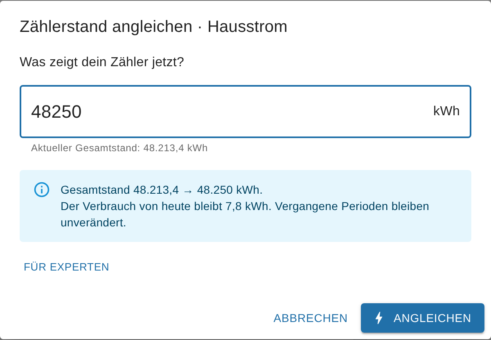
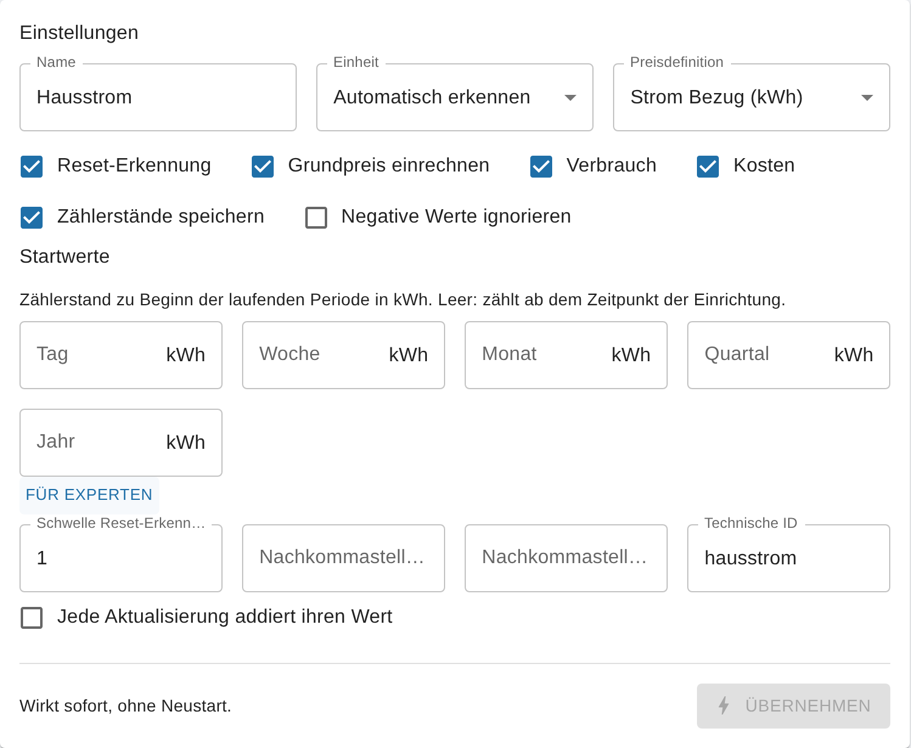
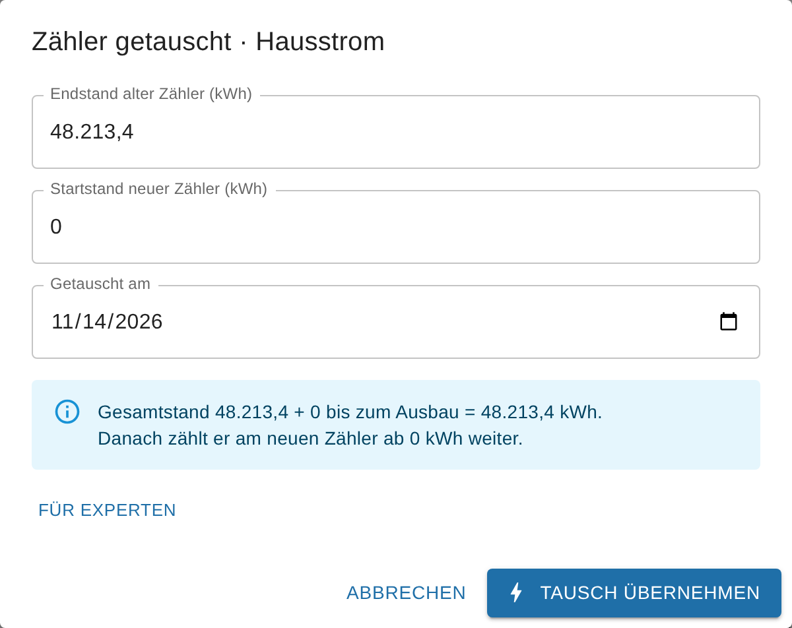

# Zählerstände korrigieren und Zähler tauschen

<!-- seite: gewicht=145; en=en/02.anleitungen/02.zaehlerstaende-korrigieren.md -->

## Wie korrigiere ich falsche, zu hohe oder negative Werte nach einem Reset?

<!-- abschnitt: prio=A; gewicht=54; readme=partial; cluster=meter-readings-18,cumulative-power-13,outputs-viz-26,periods-10,upgrade-migration-other-06; features=reset-manual-correction,source-start-values,output-cumulative-reading,reset-confirmation,source-hidden-reset-keys -->
<!-- muss beantworten: Instanz stoppen, Startwerte/cumulativeReading/valueAtDeviceReset setzen, vor Mitternacht korrigieren; abgeschlossene Perioden werden nicht neu berechnet. -->

Mit der Aktion „Zählerstand angleichen“ bei der Quelle. Du gibst den Stand ein, den dein Zähler gerade zeigt, und SourceAnalytix passt den Gesamtstand sofort an, ohne Neustart.
<!-- quelle: issue=#640; issue=#1269; interview=1; forum=603844 -->

1. Öffne in den Instanz-Einstellungen im Tab „Übersicht“ die Quelle.
2. Wähle bei „Aktionen“ „Zählerstand angleichen“.
3. Trage bei „Was zeigt dein Zähler jetzt?“ den abgelesenen Stand ein.
4. Prüfe die Vorschau mit altem und neuem Gesamtstand und klicke auf „⚡ Angleichen“.
<!-- quelle: issue=#640; issue=#1269 -->

Die Aktion verschiebt die Startwerte mit. Ein falscher Sprung, der schon im Verbrauch von heute oder diesem Monat steckt, bleibt deshalb stehen. Den entfernst du über die [Startwerte](#values-negative-after-entering-start).
<!-- quelle: code=lib/source-actions.js; code=main.js -->

### Kosten reparieren

Kosten werden mit jedem Wert gebucht, ein falscher Sprung steckt also auch in den Kosten. Wähle danach „Kosten ab Datum neu rechnen“ mit dem Tag, an dem der Fehler begann. SourceAnalytix rechnet die Kosten mit dem Preisverlauf neu, der Verbrauch bleibt gleich.
<!-- quelle: issue=#947; issue=#1269; interview=14; code=lib/source-actions.js; code=main.js -->

### Gestern und ältere Perioden

Abgeschlossene Perioden wie gestern, der Vormonat oder das Archiv unter `<Jahr>` rechnet das Angleichen nicht neu. Korrigierst du vor Mitternacht, bleibt der Fehler auf heute beschränkt. Ältere Werte und Werte in einer Historie wie InfluxDB änderst du von Hand.
<!-- quelle: code=main.js; forum=698416 -->

**Siehe auch:** [Zähler oder Gerät getauscht](#replaced-meter-device-avoid-negative) · [Vorperioden](../03.referenz/02.states-und-meldungen.md#yesterday-last-week-last-month)

## Warum sind meine Werte nach der Eingabe von Startwerten negativ?

<!-- abschnitt: prio=A; gewicht=27; readme=partial; cluster=cumulative-power-11,meter-readings-02,periods-05,meter-readings-08; features=source-start-values,calc-first-activation-start-values,calc-negative-values-cumulative,calc-consumption-formula,rollover-midnight-cron -->
<!-- muss beantworten: Typische Fehler bei Startwerten (Einheit, Zählerstand statt Periodenwert); Startwerte nachträglich korrigieren. -->

Ein Startwert ist größer als der Gesamtstand. Der Verbrauch ist Gesamtstand minus Startwert und wird dann negativ. Die Einstellungsseite lässt solche Werte nicht mehr zu, sie entstehen aber durch alte Einträge oder Skripte.
<!-- quelle: code=main.js; code=src-admin/src/SourceDetail.tsx; forum=559320; forum=420634 -->

| Eingetragen | Folge | Richtig |
|---|---|---|
| Verbrauch der Periode statt Zählerstand | fast der ganze Zählerstand erscheint als Verbrauch | Stand zu Beginn der Periode |
| Stand in Wh, Preis rechnet in kWh | stark negativ | Wert in kWh |
| Wert des Geräts statt Gesamtstand | zu hoch oder negativ | „Gesamtstand“ der Quelle als Maßstab |
| „Monat“ oder „Jahr“ über „Tag“ | die längere Periode wird negativ | „Tag“ ist der größte Startwert |
<!-- quelle: code=main.js; code=lib/calculation.js; interview=12; forum=1104554; forum=502434 -->

### So korrigierst du die Startwerte

1. Öffne die Quelle. Ganz oben steht der „Gesamtstand“.
2. Trage unter „Einstellungen“ › „Startwerte“ den Stand zu Beginn jeder Periode ein. Kennst du ihn nicht, leere das Feld; die Periode zählt dann ab jetzt.
3. Klicke auf „⚡ Übernehmen“. Passt ein Wert nicht, zeigt das Feld einen Fehler und die Schaltfläche bleibt gesperrt.
<!-- quelle: code=src-admin/src/SourceDetail.tsx; code=src-admin/src/api.ts; code=lib/calculation.js:404-413; issue=#1285; issue=#1302; interview=12; forum=248006 -->

Startwerte wirken nur bis zum nächsten Periodenwechsel. Stimmt der Gesamtstand selbst nicht, nimm [Zählerstand angleichen](#correct-wrong-too-high-negative).
<!-- quelle: code=main.js; interview=12 -->

**Siehe auch:** [Was trage ich bei den Startwerten ein?](../01.erste-schritte/02.erster-zaehler.md#start-values-unit) · [Werte viel zu hoch oder negativ](../04.fehlerbehebung/02.falsche-werte-und-bekannte-fehler.md#values-costs-far-too-high)

## Ich habe Zähler oder Gerät getauscht – wie vermeide ich negative Werte?

<!-- abschnitt: prio=A; gewicht=25; readme=missing; cluster=meter-readings-17,cumulative-power-26,meter-readings-26; features=reset-confirmation,source-reset-detection,source-start-values,reset-manual-correction,source-hidden-reset-keys -->
<!-- muss beantworten: Zählertausch ohne Datenverlust: Reset bestätigen, Offset, Alias statt Gerät loggen. -->

Mit der Aktion „Zähler getauscht“, am besten bevor der neue Zähler den ersten Wert liefert. Beginnt der neue Zähler bei 0 und ist die Reset-Erkennung an, zählt SourceAnalytix auch ohne die Aktion weiter.
<!-- quelle: code=lib/calculation.js; code=main.js; issue=#1269; forum=592553; forum=861280 -->

1. Öffne die Quelle und wähle bei „Aktionen“ „Zähler getauscht“.
2. Trage den Endstand des alten Zählers, den Startstand des neuen und das Datum ein.
3. Prüfe die Vorschau und klicke auf „⚡ Tausch übernehmen“. Der Gesamtstand läuft vom alten Endstand weiter.
<!-- quelle: issue=#1269; interview=2 -->

Hat der neue Zähler schon Werte geliefert und ist der Gesamtstand gesprungen, nimm „Zählerstand angleichen“ und rechne die Kosten neu, siehe [Falsche Werte korrigieren](#correct-wrong-too-high-negative).
<!-- quelle: issue=#640 -->

### Neues Gerät mit neuem Datenpunkt

Ein neuer Datenpunkt, etwa ein neuer Shelly, wäre eine neue Quelle. Das vermeidest du mit einem Alias: Aktiviere SourceAnalytix auf einem Alias (zum Beispiel unter `alias.0`) und stelle beim Tausch nur sein Ziel auf das neue Gerät um. Ordner und Gesamtstand bleiben.
<!-- quelle: code=main.js; forum=860930; forum=1120113; interview=7 -->

**Siehe auch:** [Was bedeutet „Device reset detected“?](../05.hintergrund/02.zaehler-reset.md#device-reset-detected-mean-reset) · [Name, Alias und Output-ID](../03.referenz/01.einstellungen.md#name-datapoint-alias-output-id)

## Mein Zähler startet nach Stromausfall oder täglich bei 0 – was stelle ich ein?

<!-- abschnitt: prio=A; gewicht=22; readme=partial; cluster=meter-readings-14,logs-install-04,setup-ui-25; features=source-reset-detection,reset-confirmation,source-threshold,log-reset-messages,source-power-integration -->
<!-- muss beantworten: Shelly/Tasmota/Steckdosen-Zähler; Meldung "Device reset detected"; Threshold und Reset-Erkennung passend einstellen. -->

Schalte die „Reset-Erkennung“ ein und stelle die Schwelle kleiner ein als den Betrag, um den der Zähler beim Neustart fällt. Dann zählt SourceAnalytix auf den alten Gesamtstand weiter. Bei Shelly und Tasmota schlägt der Assistent die Reset-Erkennung schon vor.
<!-- quelle: code=lib/calculation.js; code=src-admin/src/Wizard.tsx; code=src-admin/src/SourceDetail.tsx; forum=660139; forum=787115 -->

1. Öffne die Quelle und setze unter „Einstellungen“ „Reset-Erkennung“.
2. Prüfe unter „Für Experten“ die „Schwelle Reset-Erkennung“. Sie steht in der Einheit der Preisdefinition.
   - Zähler, der beim Stromausfall auf 0 fällt: Der Standard 1 passt.
   - Tageszähler: kleiner als dein kleinster Tagesverbrauch, zum Beispiel 0,1 kWh.
   - Kleine Einheiten wie m³: zum Beispiel 0,1 m³.
3. Klicke auf „⚡ Übernehmen“.
<!-- quelle: code=src-admin/src/SourceDetail.tsx; code=lib/calculation.js; forum=787115 -->

> [!WARNING]
> Fällt der Zähler um weniger als die Schwelle, gilt das als Messschwankung, und SourceAnalytix ignoriert neue Werte, bis sie den alten Stand übersteigen. Bei einem Tageszähler mit zu großer Schwelle fehlt so ein Teil des neuen Tages.
<!-- quelle: code=lib/calculation.js -->

Springt eine Quelle ohne Reset-Erkennung auf 0, zeigt der Tab „Probleme“ „Zähler springt auf 0, Reset-Erkennung ist aus“ mit „⚡ Einschalten“. Gibt es neben dem Tageszähler einen Gesamtzähler, nimm lieber den.
<!-- quelle: issue=#1269; code=lib/source-overview.js; interview=4; forum=990182 -->

**Siehe auch:** [Was bedeutet „Device reset detected“?](../05.hintergrund/02.zaehler-reset.md#device-reset-detected-mean-reset) · [Schwelle und Abschalten der Reset-Erkennung](../03.referenz/01.einstellungen.md#threshold-disabling-reset-detection-work)

## Wie übernehme ich meinen echten Zählerstand (cumulativeReading, RAW-Objekt)?

<!-- abschnitt: prio=B; gewicht=17; readme=partial; cluster=meter-readings-23,cumulative-power-12,meter-readings-19; features=reset-manual-correction,output-cumulative-reading,source-start-values,source-hidden-reset-keys,calc-first-activation-start-values -->
<!-- muss beantworten: cumulativeReading und Roh-Objekt bearbeiten; warum das RAW-Objekt gesperrt wirkt. -->

Mit „Zählerstand angleichen“, wie unter [Falsche Werte korrigieren](#correct-wrong-too-high-negative) beschrieben. Ein Objekt musst du dafür nicht bearbeiten. Zeigt dein Gerät schon den echten Stand, etwa über einen Lesekopf, ist nichts zu tun.
<!-- quelle: issue=#640; interview=1; code=lib/source-actions.js; code=main.js -->

Nur den State `cumulativeReading` zu ändern, hält nicht. Der Gesamtstand ist immer Gerätewert plus Offset, und der nächste Wert rechnet ihn neu. Die Aktion setzt beides passend zueinander.
<!-- quelle: code=lib/calculation.js; code=main.js; interview=2 -->

**Siehe auch:** [Was ist cumulativeReading?](../03.referenz/02.states-und-meldungen.md#meter-readings-cumulative) · [Die Begriffe](../05.hintergrund/02.zaehler-reset.md#device-reset-detected-mean-reset)
