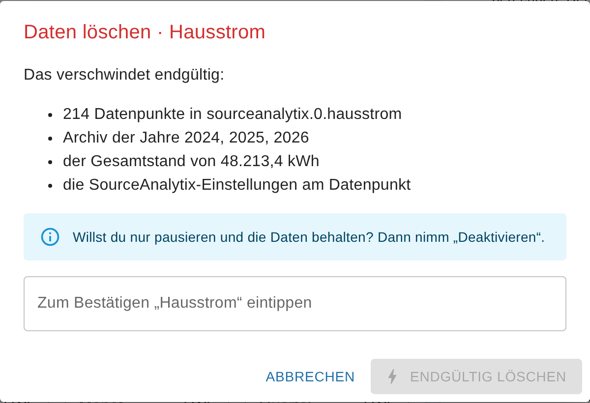
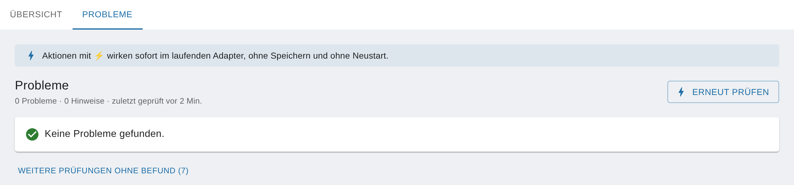
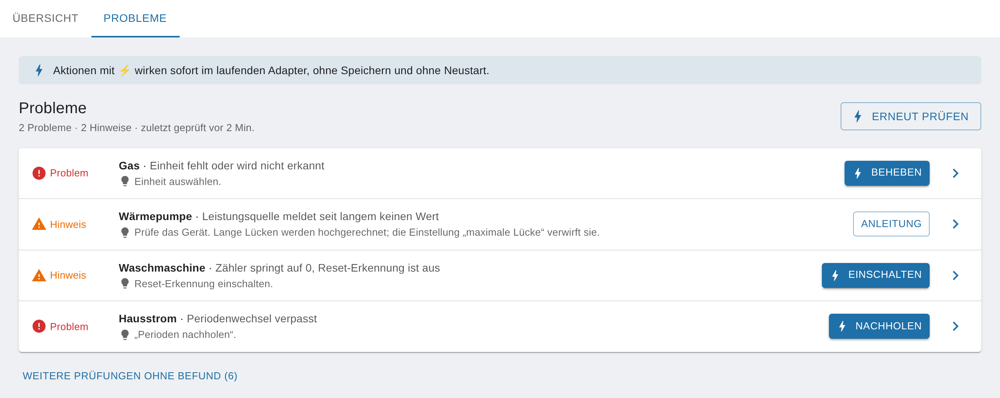

# Betrieb und Wartung

<!-- seite: gewicht=67; en=en/02.anleitungen/05.betrieb-und-wartung.md -->

<a id="update-sourceanalytix-downgrade"></a>

## Wie aktualisiere ich SourceAnalytix (und was ist ein Downgrade)?

<!-- abschnitt: prio=A; gewicht=23; readme=missing; cluster=upgrade-migration-other-18,upgrade-migration-other-22,upgrade-migration-other-19,upgrade-migration-other-13; features=req-versions,migration-output-id-default,migration-rounding-per-source,price-history-states -->
<!-- muss beantworten: Update nicht sichtbar, GitHub-Version, Versionssuffixe, Downgrade, Update-Risiken. -->

Wie jeden Adapter im Reiter „Adapter“, solange in den Systemeinstellungen das Repository „latest“ aktiv ist. In „stable“ ist SourceAnalytix noch nicht enthalten, dort siehst du kein Update. Werte und Einstellungen bleiben beim Update erhalten.
<!-- quelle: interview=21; forum=587033; forum=784125; forum=1361101; issue=#458; pr=#1276 -->

1. Mach ein Backup.
2. Wähle in den Systemeinstellungen unter „Repositories“ „latest“.
3. Klicke im Reiter „Adapter“ bei SourceAnalytix auf den Update-Knopf.
4. Prüfe danach im Tab „Probleme“ der Instanz-Einstellungen, ob etwas gemeldet wird.
<!-- quelle: interview=21; forum=587033; forum=866682; issue=#1269 -->

<!-- bild: Systemeinstellungen, Repository „latest" aktiv, und Update-Knopf bei SourceAnalytix im Reiter „Adapter" -->

Über die Konsole geht es mit `iobroker upgrade sourceanalytix`, ebenfalls nur mit „latest“. Bietet ioBroker kein Update an, prüfe die [Voraussetzungen](../01.erste-schritte/01.installation.md#requirements-sourceanalytix-have-node-js). Nach einer Installation von GitHub zeigt Admin keine Updates; installiere dann einmal aus „latest“ darüber.
<!-- quelle: forum=784125; forum=487733; forum=552764; code=io-package.json -->

### Downgrade

Ein Downgrade installiert eine ältere Version über die vorhandene, etwa wenn eine neue Version bei dir einen Fehler hat. Schalte im Reiter „Adapter“ den Expertenmodus ein und wähle bei SourceAnalytix „Bestimmte Version installieren“. In der Konsole: `iobroker upgrade sourceanalytix@<Version>`, ohne „v“ vor der Nummer.
<!-- quelle: forum=1105289; forum=412213; forum=224155 -->

> [!WARNING]
> Eine ältere Version kennt neuere Einstellungen nicht und schreibt Werte unter Umständen anders. Spiel im Zweifel das Backup ein, statt nur die Version zu wechseln.
<!-- quelle: forum=1105289; code=lib/output-id.js -->

Versionen mit Zusatz wie `-beta.0` sind Vorabversionen zum Testen. `0.8.0` ist neuer als `0.8.0-beta.0`.
<!-- quelle: forum=704956; forum=1267538 -->

**Siehe auch:** [Nach Update oder Restore sind Werte 0](../04.fehlerbehebung/02.falsche-werte-und-bekannte-fehler.md#after-update-restore-values-0) · [Wo liegen die Daten?](#data-back-up-move-new)

<a id="disable-datapoint-remove-sources-states"></a>

## Wie schalte ich einen Datenpunkt ab oder entferne Quellen und States?

<!-- abschnitt: prio=B; gewicht=15; readme=missing; cluster=setup-ui-02,logs-install-19,logs-install-21,outputs-viz-06; features=source-enable,output-state-deletion,year-statistics-archive,source-multi-edit,output-tree-layout -->
<!-- muss beantworten: Abschalten vs. Löschen; Massen-Aktivierung rückgängig; Fehler nach gelöschtem Gerät. -->

Öffne die Quelle in den Instanz-Einstellungen und wähle bei „Aktionen“ „Deaktivieren“ oder „Daten löschen“. „Deaktivieren“ pausiert die Quelle, alles bleibt erhalten. „Daten löschen“ entfernt Ordner und Einstellungen endgültig.
<!-- quelle: code=src-admin/src/SourceDetail.tsx; code=src-admin/src/i18n/de.json; code=main.js; issue=#1265; issue=#1306 -->

| | „Deaktivieren“ | „Daten löschen“ |
|---|---|---|
| Ordner `sourceanalytix.0.<Gerät>` mit allen Jahren | bleibt | wird gelöscht |
| Einstellungen der Quelle (Preis, Startwerte, Offset) | bleiben | werden gelöscht |
| Rückgängig | mit „Aktivieren“ | nicht möglich |
<!-- quelle: code=main.js; code=src-admin/src/i18n/de.json; issue=#1306 -->

Beim Löschen zeigt der Dialog, was verschwindet. Zur Bestätigung tippst du den Namen der Quelle ein und klickst auf „Endgültig löschen“.
<!-- quelle: code=src-admin/src/Dialogs.tsx; code=main.js; issue=#1312 -->



> [!CAUTION]
> „Daten löschen“ lässt sich nicht rückgängig machen. Willst du nur pausieren, nimm „Deaktivieren“.
<!-- quelle: code=main.js; code=src-admin/src/i18n/de.json -->

### Schalter am Datenpunkt im Reiter „Objekte“

Den Schalter dort kannst du für mehrere Datenpunkte auf einmal ausschalten, etwa nach einer versehentlichen Massen-Aktivierung. Das entfernt die Einstellungen dieser Quellen samt Startwerten, die Ordner mit den Werten bleiben stehen. Zum Pausieren ist „Deaktivieren“ der richtige Weg.
<!-- quelle: code=admin/jsonCustom.json; code=admin/i18n/de.json; issue=#1286; issue=#1306; forum=567100 -->

### Datenpunkt gelöscht

Löschst du den Quell-Datenpunkt, schaltet SourceAnalytix die Quelle ab, die Werte bleiben. Der Tab „Probleme“ meldet „Datenpunkt existiert nicht mehr“. Ein Ordner ohne Datenpunkt steht in der Übersicht als „Ordner ohne Datenpunkt“ und lässt sich dort löschen.
<!-- quelle: code=main.js; code=lib/source-overview.js; code=src-admin/src/i18n/de.json; forum=690622; forum=1212532; issue=#1009 -->

### Einzelne Perioden entfernen

Willst du etwa keine Quartale mehr, schalte die Option unter „Haupteinstellungen“ aus. Die Seite fragt nach, weil die States dieses Jahres gelöscht werden. Von Hand gelöschte States legt SourceAnalytix wieder an, solange die Option an ist.
<!-- quelle: code=main.js; code=admin/jsonConfig.json; issue=#128; issue=#217; issue=#1311 -->

**Siehe auch:** [Neu anfangen](#restart-datapoint-clean-up-old) · [Wo liegen die Daten?](#data-back-up-move-new)

<a id="data-back-up-move-new"></a>

## Wo liegen die Daten, wie sichere ich sie und ziehe ich um?

<!-- abschnitt: prio=B; gewicht=12; readme=missing; cluster=upgrade-migration-other-01,upgrade-migration-other-04; features=output-tree-layout,output-cumulative-reading,source-start-values,rollover-missed-recovery-start -->
<!-- muss beantworten: Speicherort der States, Backup-Inhalt, Umzug auf neue Hardware. -->

In ioBroker selbst, eine eigene Datenbank gibt es nicht. Ein vollständiges ioBroker-Backup, etwa mit BackItUp, enthält alles. Für einen Umzug spielst du es auf dem neuen System ein, nicht kurz vor Mitternacht.
<!-- quelle: code=main.js; interview=11c; forum=1157744; forum=457006 -->

| Was | Wo |
|---|---|
| Werte aller Perioden und Jahre | Ordner `sourceanalytix.0.<Gerät>` |
| Einstellungen der Quelle mit Startwerten und Offset | Objekt des Quell-Datenpunkts, `common.custom.sourceanalytix.0` |
| Preisdefinitionen und Optionen | Instanz-Einstellungen |
| Preisverlauf | `sourceanalytix.0.priceHistory` und `basicPriceHistory` |
| Aufgezeichnete Verläufe | dein History-Adapter |
<!-- quelle: code=main.js -->

Ein Backup nur von `sourceanalytix.0` reicht nicht, denn Startwerte und Offset stehen am Quell-Datenpunkt. Läuft ioBroker mit Redis, gehört die Redis-Sicherung dazu.
<!-- quelle: code=main.js; forum=430979; forum=533877; issue=#162; issue=#308 -->

### Umzug auf neue Hardware

1. Mach auf dem alten System ein vollständiges Backup.
2. Installiere auf dem neuen System ioBroker und SourceAnalytix und spiel das Backup ein.
3. Starte die Instanz. Verpasste Periodenwechsel holt sie einmal nach.
4. Prüfe den Tab „Probleme“ und vergleiche den Gesamtstand mit deinem Zähler.
<!-- quelle: interview=11c; code=main.js; code=lib/source-overview.js; forum=905118; forum=1274816; forum=894627 -->



Quellen auf dem neuen System neu anzulegen, ersetzt den Restore nicht: SourceAnalytix beginnt dann bei 0. Bekommt der Datenpunkt eine neue ID, ist er eine neue Quelle; der alte Ordner bleibt als Archiv.
<!-- quelle: forum=1253495; forum=229721; code=lib/calculation.js; interview=7 -->

**Siehe auch:** [ioBroker war um Mitternacht aus](#iobroker-was-down-midnight-recover) · [Werte nach Restore 0](../04.fehlerbehebung/02.falsche-werte-und-bekannte-fehler.md#after-update-restore-values-0)

<a id="restart-datapoint-clean-up-old"></a>

## Wie fange ich mit einem Datenpunkt neu an und räume alte Jahre auf?

<!-- abschnitt: prio=B; gewicht=10; readme=missing; cluster=meter-readings-24,logs-install-20; features=output-state-deletion,source-enable,calc-first-activation-start-values,source-hidden-reset-keys,log-first-activation -->
<!-- muss beantworten: States löschen, neu aktivieren, alte Jahres-/Wochenordner entfernen. -->

Lösche die Daten der Quelle mit „Daten löschen“ und lege sie mit „Quelle hinzufügen“ neu an, mit „Ab jetzt zählen“. Alle Perioden beginnen dann bei 0. Nur den Ordner im Reiter „Objekte“ zu löschen reicht nicht, denn die Einstellungen am Datenpunkt bleiben.
<!-- quelle: code=main.js; code=lib/calculation.js; code=src-admin/src/Wizard.tsx; interview=8; issue=#1265 -->

> [!CAUTION]
> Damit ist auch der bisherige Gesamtstand weg. Willst du nur falsche Zahlen reparieren, nimm [Zählerstand angleichen](02.zaehlerstaende-korrigieren.md#correct-wrong-too-high-negative).
<!-- quelle: code=src-admin/src/i18n/de.json; issue=#640 -->

### Alte Jahre aufräumen

Ordner abgeschlossener Jahre wie `sourceanalytix.0.<Gerät>.2023` sind reine Historie. Du darfst sie im Reiter „Objekte“ löschen. Lass `currentYear`, `cumulativeReading`, `periodMemory` und den Ordner des laufenden Jahres stehen. „Kosten ab Datum neu rechnen“ lässt gelöschte Jahre aus.
<!-- quelle: code=main.js; interview=8; forum=919699; forum=931836 -->

**Siehe auch:** [Startwerte](../01.erste-schritte/02.erster-zaehler.md#start-values-unit) · [Über mehrere Jahre auswerten](04.werte-auswerten.md#evaluate-across-years-adjusting-everything)

<a id="iobroker-was-down-midnight-recover"></a>

## ioBroker war um Mitternacht aus – wie hole ich den Tageswechsel nach?

<!-- abschnitt: prio=B; gewicht=7; readme=covered; cluster=periods-01; features=rollover-missed-recovery-start,rollover-hourly-safety-check,rollover-recover-periods-button,rollover-sendto-recoverperiods,rollover-midnight-cron -->
<!-- muss beantworten: recoverPeriods per Button/sendTo; stündliche Sicherheitsprüfung. -->

Meist gar nicht. SourceAnalytix holt verpasste Wechsel beim Start selbst nach und prüft außerdem jede Stunde, ob einer fehlt. Den Verbrauch über Mitternacht teilt es nach der Zeit auf den alten und den neuen Tag auf.
<!-- quelle: code=main.js; code=lib/calculation.js; forum=560905; forum=859930; issue=#904; issue=#905; issue=#1260 -->

Fehlt trotzdem ein Wechsel, meldet der Tab „Probleme“ „Periodenwechsel verpasst“ mit „Nachholen“. Dasselbe geht bei der Quelle mit der Aktion „Perioden nachholen“. Beides wirkt nur auf diese Quelle.
<!-- quelle: code=lib/source-overview.js; code=src-admin/src/SourceDetail.tsx; code=src-admin/src/i18n/de.json; issue=#1292 -->



Hat der Ausfall mehrere Tage gedauert, verarbeitet SourceAnalytix nur einen Wechsel; die Tage dazwischen bekommen keinen eigenen Wert. Werte, die während eines Wechsels kommen, werden danach in ihrer Reihenfolge verarbeitet.
<!-- quelle: code=main.js; code=lib/calculation.js; issue=#1270 -->

### Per Skript oder Knopf in VIS

Schreibe `true` in `sourceanalytix.0.info.recoverPeriods`, dann holt SourceAnalytix die Wechsel aller Quellen nach. Aus einem Skript geht es auch für eine Quelle:
<!-- quelle: code=main.js; issue=#1292 -->

```javascript
sendTo('sourceanalytix.0', 'recoverPeriods', {source: '<ID des Quell-Datenpunkts>'}, result => {
    if (result.error) log(result.message, 'warn');
});
```

Ohne `source` gilt der Aufruf für alle Quellen. Der Wechsel richtet sich nach der Systemzeit des ioBroker-Rechners; stimmt dort die Zeitzone nicht, wechselt SourceAnalytix zur falschen Stunde.
<!-- quelle: code=main.js; interview=13b -->

**Siehe auch:** [Gestern, letzte Woche, letzter Monat](../03.referenz/02.states-und-meldungen.md#yesterday-last-week-last-month) · [Wechsel zur falschen Zeit](../04.fehlerbehebung/01.log-meldungen.md#midnight-crash-rollover-wrong-time)
