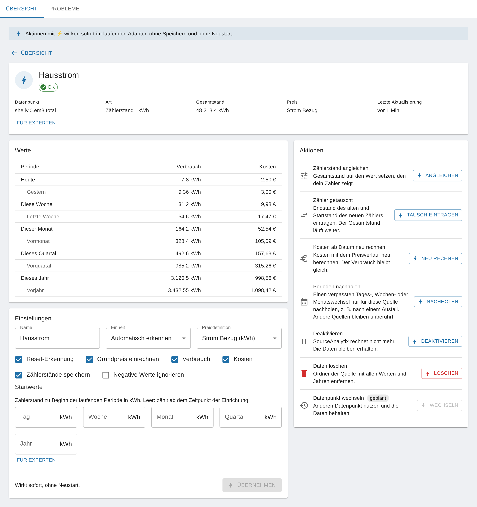

# Einstellungen (Instanz und Datenpunkt)

<!-- seite: gewicht=60; en=en/03.referenz/01.einstellungen.md -->

## Welche Einheiten werden unterstützt (Energie, Volumen, Gewicht, Länge)?

<!-- abschnitt: prio=A; gewicht=23; readme=covered; cluster=outputs-viz-10,cumulative-power-03,upgrade-migration-other-25; features=supported-units,unit-detection-conversion,price-definitions-table -->
<!-- muss beantworten: Tabelle der Einheiten und Umrechnung; Einheiten außerhalb der Liste. -->

Leistung, Energie, Volumen, Masse, Länge und Stück. Umgerechnet wird innerhalb derselben Größe und zwischen Litern und Kubikmetern. Leistung und Impulse pro Minute werden über die Zeit aufsummiert.
<!-- quelle: code=lib/calculation.js; code=main.js -->

| Größe | Einheiten | Umrechnung in |
|---|---|---|
| Leistung | `GW`, `MW`, `kW`, `W`, `mW` | Energie, über die Zeit aufsummiert |
| Energie | `GWh`, `MWh`, `kWh`, `Wh`, `mWh` | jede Energie-Einheit |
| Volumen | `km³`, `m³`, `dm³`, `cm³`, `mm³`, `hl`, `l`, `dl`, `cl`, `ml` | jede Volumen-Einheit (1 `m³` = 1.000 `l`) |
| Masse | `t`, `kg`, `g` | jede Masse-Einheit |
| Länge | `km`, `m`, `dm`, `cm`, `mm`, `µm`, `nm` | jede Länge-Einheit |
| Stück | `piece` | mit „Impulse pro Einheit“ in jede Einheit |
| Impulse pro Minute | `piece/min` | wie `piece`, über die Zeit aufsummiert |
<!-- quelle: code=lib/calculation.js; issue=#1278; issue=#304; issue=#74 -->

Am Objekt erkennt SourceAnalytix auch Schreibweisen wie `m3`, `kwh`, `L`, `Stk` oder `pulses/min`. Nicht unterstützt sind Zeit (`h`), Datenmengen, Raten wie `m³/h` und Größen wie `%` oder `V`.
<!-- quelle: code=lib/calculation.js; issue=#1264; issue=#304; issue=#74 -->

### Welche Einheit gilt wo?

| Einstellung | Bedeutung |
|---|---|
| „Einheit“ bei der Quelle | in der der Datenpunkt **liefert**, meist automatisch erkannt |
| „Einheit“ in der Preisdefinition | in der SourceAnalytix **rechnet und anzeigt**; Startwerte und Preis beziehen sich auf sie |
<!-- quelle: code=main.js; code=src-admin/src/SourceDetail.tsx; code=src-admin/src/i18n/de.json -->

Passen beide nicht zusammen, etwa `kg` und `kWh`, startet die Quelle nicht und der Tab „Probleme“ meldet es.
<!-- quelle: code=main.js; code=lib/source-overview.js; issue=#1278; issue=#1310 -->

### Stück und Impulse

- **Nur zählen**, etwa Brennerstarts: Preisdefinition in `piece`.
- **Impulse in kWh oder m³:** Trage „Impulse pro Einheit“ ein, zum Beispiel `1000` bei 1000 imp/kWh. Im Assistenten steht das Feld im Schritt „Preis“, in der Detailansicht unter „Einstellungen“.
- **Jedes Update ist ein Impuls:** Setze unter „Für Experten“ „Jede Aktualisierung addiert ihren Wert“. Dann zählt jedes Update, auch mit gleichem Wert.
<!-- quelle: issue=#74; issue=#479; issue=#1313; code=src-admin/src/Wizard.tsx; code=src-admin/src/SourceDetail.tsx; code=lib/calculation.js -->

**Siehe auch:** [Welche Einheit stelle ich am Datenpunkt ein?](../02.anleitungen/01.quellen-und-einheiten.md#unit-datapoint-kwh-wh-m3) · [Fehler „No unit defined“](../04.fehlerbehebung/01.log-meldungen.md#error-unit-not-supported-no)

## Welche Instanz-Einstellungen gibt es (Perioden, Nachkommastellen)?

<!-- abschnitt: prio=B; gewicht=10; readme=partial; cluster=outputs-viz-05,outputs-viz-02,prices-costs-12; features=current-year-weekday,rounding-instance-defaults,source-decimals,calc-rounding,current-year-months,year-statistics-archive,current-year-weeks,current-year-quarters,current-year-previous,price-definitions-table -->
<!-- muss beantworten: Wochen/Monate/Quartale speichern, Standard-Rundung; warum manche States fehlen. -->

Vier Tabs. „Haupteinstellungen“ legt fest, welche Wochen-, Monats- und Quartals-States entstehen und wie viele Nachkommastellen neue Quellen bekommen.
<!-- quelle: code=admin/jsonConfig.json; code=admin/i18n/de.json; issue=#1269 -->

| Tab | Inhalt | Wirkt |
|---|---|---|
| „Übersicht“ | alle Quellen mit Werten, „Quelle hinzufügen“, Detailansicht | Aktionen mit ⚡ sofort |
| „Probleme“ | Befunde mit Vorschlag zur Behebung | sofort |
| „Preisdefinitionen“ | Tabelle der Preise | nach „Speichern“ (Neustart) |
| „Haupteinstellungen“ | Perioden und Rundung | nach „Speichern“ (Neustart) |
<!-- quelle: code=admin/jsonConfig.json; code=src-admin/src/SourcesApp.tsx; code=src-admin/src/i18n/de.json -->

### Tab „Haupteinstellungen“

| Bereich | Option | Standard | Legt an |
|---|---|---|---|
| „Jahresstatistik“ | „Wochen“ | aus | `<Jahr>.<Kategorie>.weeks.01` bis `53` |
| „Jahresstatistik“ | „Monate“ | an | `<Jahr>.<Kategorie>.months.01_January` bis `12_December` |
| „Jahresstatistik“ | „Quartale“ | aus | `<Jahr>.<Kategorie>.quarters.Q1` bis `Q4` |
| „Laufendes Jahr“ | „Wochentag“ | an | `currentYear.<Kategorie>.currentWeek.01_Monday` bis `07_Sunday` |
| „Laufendes Jahr“ | „Wochen“, „Monate“, „Quartale“ | an | `currentYear.<Kategorie>.weeks`, `months`, `quarters` |
| „Laufendes Jahr“ | „Vorheriger Zeitraum“ | an | `01_previousDay` bis `05_previousYear` |
| „Rundung“ | Nachkommastellen Verbrauch / Kosten | 3 / 2 | Vorlage für neue Quellen |
<!-- quelle: code=admin/jsonConfig.json; code=admin/i18n/de.json; code=io-package.json; code=lib/calculation.js; code=main.js; issue=#1287 -->

> [!WARNING]
> Schaltest du eine Perioden-Option aus, löscht SourceAnalytix beim Speichern diese States aller Quellen für das laufende Jahr. Die Seite fragt vorher nach. Frühere Jahre und Aufzeichnungen im History-Adapter bleiben.
<!-- quelle: code=main.js; code=admin/jsonConfig.json; code=admin/i18n/de.json; issue=#1311 -->

Fehlt ein State, ist meist die Option aus oder an der Quelle fehlt „Verbrauch“, „Kosten“ oder „Zählerstände speichern“. Vorperioden stehen bis zum ersten Periodenwechsel auf 0.
<!-- quelle: code=main.js; code=lib/calculation.js -->

Die Nachkommastellen übernimmt jede Quelle einmal beim Anlegen. Danach änderst du sie in der Detailansicht unter „Für Experten“. Erlaubt sind 0 bis 15, -1 heißt ungerundet. `cumulativeReading` bleibt immer ungerundet.
<!-- quelle: code=main.js; code=lib/calculation.js; code=src-admin/src/SourceDetail.tsx -->

**Siehe auch:** [Warum so viele Nachkommastellen?](../04.fehlerbehebung/02.falsche-werte-und-bekannte-fehler.md#so-many-decimals) · [Über mehrere Jahre auswerten](../02.anleitungen/04.werte-auswerten.md#evaluate-across-years-adjusting-everything)

## Was bewirken die Einstellungen am Datenpunkt (Costs, Consumption, Meter values)?

<!-- abschnitt: prio=B; gewicht=9; readme=partial; cluster=setup-ui-21,outputs-viz-25; features=source-meter-values,output-cumulative-reading,source-calc-costs,source-calc-consumption,output-state-deletion,source-enable,source-alias,source-output-id,source-price-definition,source-unit,source-basic-rate,source-average-power,source-ignore-negative,source-reset-detection,source-threshold,source-decimals,source-start-values,source-multi-edit,source-hidden-reset-keys -->
<!-- muss beantworten: Jede Option am Datenpunkt mit Wirkung und Voreinstellung; wann der Meter-Readings-Ordner leer bleibt. -->

Sie legen fest, was SourceAnalytix für die Quelle rechnet und welche States entstehen. Du findest sie in der Detailansicht der Quelle unter „Einstellungen“; „⚡ Übernehmen“ wirkt sofort.
<!-- quelle: code=src-admin/src/SourceDetail.tsx; code=main.js; issue=#1269 -->

| Einstellung | Wirkung | Standard |
|---|---|---|
| „Name“ | Anzeigename, ändert keine State-ID | Name des Datenpunkts |
| „Einheit“ | Einheit, in der der Datenpunkt liefert | erkannt |
| „Preisdefinition“ | Pflicht; Zieleinheit, Kosten oder Erlös | – |
| „Verbrauch“ | States unter `consumed` oder `delivered` | an |
| „Kosten“ | States unter `costs` oder `earnings` | an |
| „Grundpreis einrechnen“ | bucht den „Preis pro Monat“ | an, wenn keine andere Quelle ihn bucht |
| „Zählerstände speichern“ | Stände je Periode unter `meterReadings` | an |
| „Reset-Erkennung“ | fängt Sprünge auf 0 ab | aus, bei Shelly und Tasmota an |
| „Negative Werte ignorieren“ | nur Leistung: negative Werte zählen als 0 | aus |
| „Mittelwert bei Leistung“ | nur Leistung: Mittel aus zwei Werten | aus |
| „Maximale Lücke zwischen Leistungswerten (Minuten)“ | nur Leistung: längere Pausen zählen als 0 | leer = aus |
| „Impulse pro Einheit“ | nur Stück: Umrechnung in die Zieleinheit | leer |
| „Startwerte“ | Stand zu Beginn der Perioden | leer = ab jetzt |
| Für Experten: „Schwelle Reset-Erkennung“ | größter Rückgang, der als Schwankung gilt | 1 |
| Für Experten: „Nachkommastellen“ | Rundung der States | 3 / 2 |
| Für Experten: „Jede Aktualisierung addiert ihren Wert“ | jedes Update zählt als Zuwachs | aus |
| Für Experten: „Technische ID“ | Ordner `sourceanalytix.0.<Gerät>` | aus dem Namen |
<!-- quelle: code=src-admin/src/SourceDetail.tsx; code=src-admin/src/Wizard.tsx; code=src-admin/src/i18n/de.json; code=main.js; issue=#1285; issue=#1266; issue=#74; issue=#479; interview=4 -->

Zahlen gehen mit Komma oder Punkt, ohne Tausendertrennung. Ungültige Felder markiert die Seite und speichert nicht. Löscht eine Änderung Daten, etwa „Verbrauch“ oder „Kosten“ ausschalten oder zwischen „Kosten“ und „Erträge“ wechseln, fragt die Seite vorher mit „Daten löschen?“ nach.
<!-- quelle: code=src-admin/src/api.ts; code=src-admin/src/SourceDetail.tsx; code=src-admin/src/i18n/de.json; issue=#1287; issue=#1311; issue=#1312 -->

Am Datenpunkt im Reiter „Objekte“ gibt es nur einen Schalter zum Ein- und Ausschalten. Ausschalten entfernt dort die Einstellungen der Quelle; zum Pausieren nimm „Deaktivieren“.
<!-- quelle: issue=#1286; issue=#1306; code=admin/jsonCustom.json; code=admin/i18n/de.json -->

### Wann `meterReadings` leer bleibt

`meterReadings` enthält den Gesamtstand am Ende einer Periode. Der Ordner bleibt leer, wenn „Zählerstände speichern“ aus ist, die Perioden-Optionen der Instanz aus sind oder der erste Periodenwechsel noch aussteht. Den aktuellen Stand findest du in `cumulativeReading`.
<!-- quelle: code=main.js; code=lib/calculation.js -->

**Siehe auch:** [Meter-Readings und cumulativeReading](02.states-und-meldungen.md#meter-readings-cumulative) · [Datenpunkt aktiviert, aber keine Ordner](../04.fehlerbehebung/01.log-meldungen.md#datapoint-enabled-but-no-folders)

## Wie funktionieren Threshold und Abschalten der Reset-Erkennung?

<!-- abschnitt: prio=B; gewicht=7; readme=covered; cluster=meter-readings-11,meter-readings-13; features=source-threshold,reset-jitter-ignore,reset-confirmation,source-reset-detection,reset-disabled-decrease,reset-rejected-glitch,reset-invalid-reading,reset-manual-correction,reset-dynamic-cost-tracker -->
<!-- muss beantworten: Reset-Erkennung pro Datenpunkt einstellen, Threshold und Jitter, abschalten. -->

Beides stellst du je Quelle ein: „Reset-Erkennung“ unter „Einstellungen“, die Schwelle unter „Für Experten“. Die Schwelle (Standard 1, in der Einheit der Preisdefinition) ist der größte Rückgang, der noch als Messschwankung gilt.
<!-- quelle: code=main.js; code=lib/calculation.js; code=src-admin/src/SourceDetail.tsx -->

| Rückgang | Reset-Erkennung an | aus |
|---|---|---|
| bis zur Schwelle | wird ignoriert | Gesamtstand fällt mit |
| größer | SourceAnalytix wartet auf den nächsten Wert und zählt dann weiter | Gesamtstand fällt, Perioden können negativ werden |
<!-- quelle: code=lib/calculation.js; code=main.js -->

Die Schwelle muss größer sein als das Rauschen des Geräts und kleiner als der Stand, mit dem es nach einem Reset neu beginnt. 0 heißt: Jeder Rückgang ist ein möglicher Reset. Leer gilt als Standard 1.
<!-- quelle: code=lib/calculation.js; code=main.js; issue=#1312 -->

Bei Leistung, `piece/min` und „Jede Aktualisierung addiert ihren Wert“ gibt es keine Reset-Erkennung. Springt eine Quelle ohne Reset-Erkennung auf 0, meldet der Tab „Probleme“ „Zähler springt auf 0, Reset-Erkennung ist aus“ mit „Einschalten“.
<!-- quelle: code=main.js; code=src-admin/src/Wizard.tsx; code=lib/source-overview.js; code=src-admin/src/i18n/de.json -->

**Siehe auch:** [Zähler startet nach Stromausfall bei 0](../02.anleitungen/02.zaehlerstaende-korrigieren.md#meter-restarts-after-power-loss) · [Was bedeutet „Device reset detected“?](../05.hintergrund/02.zaehler-reset.md#device-reset-detected-mean-reset)

## Wie ist eine Preisdefinition aufgebaut (Kategorien, Grundpreis, Dezimalzeichen)?

<!-- abschnitt: prio=B; gewicht=6; readme=missing; cluster=prices-costs-31,prices-costs-14,prices-costs-08; features=price-definitions-table,supported-units,source-price-definition,price-fixed,price-invalid-unit-price,price-scheduled-valid-from,price-state,price-tariff-selector,price-current-price-writable,price-split-over-intervals,price-basic-fee,price-history-states,price-dynamic-cost-memory,price-recalculate-unreachable -->
<!-- muss beantworten: Felder der Preisdefinition, Grundpreis anteilig oder voll, Komma/Punkt. -->

Als Zeile im Tab „Preisdefinitionen“ mit Name („Kategorie“), Einheit, Kostenart und Preis. Jede Quelle hat genau eine. Der Grundpreis wird einmal im Monat voll gebucht, nicht anteilig pro Tag.
<!-- quelle: code=admin/jsonConfig.json; code=main.js; code=lib/calculation.js -->

| Spalte | Bedeutung |
|---|---|
| „Kategorie“ | eindeutiger Name, zum Beispiel `Strom`; nicht leer und nicht doppelt |
| „Beschreibung“ | freier Text |
| „Kostenart“ | „Kosten“ (`consumed`, `costs`) oder „Erträge“ (`delivered`, `earnings`) |
| „Einheit“ | Einheit, in der gerechnet und angezeigt wird |
| „Preisquelle“ | „Festpreis“, „Datenpunkt“ oder „Tarifumschaltung“ |
| „Preis pro Einheit“ | zum Beispiel `0.32` für 0,32 €/kWh |
| „Preis-Datenpunkt“ | State mit Preis oder Tarif |
| „Aktiver Tarifpreis“, „Aktiver Auswahlwert“ | nur bei „Tarifumschaltung“ |
| „Gültig ab“ | ab 0:00 Uhr dieses Tages gelten die Preise |
| „Preis pro Monat“ | Grundpreis |
<!-- quelle: code=admin/jsonConfig.json; code=admin/i18n/de.json; code=main.js; code=lib/dynamic-pricing.js; issue=#1310 -->

Komma und Punkt gehen beide, ohne Tausenderpunkt. Ist ein Preis keine Zahl, rechnet SourceAnalytix mit 0 und meldet das im Log. Ob er richtig ankam, zeigt `sourceanalytix.0.priceDefinitions.<Kategorie>.currentPrice`. Änderungen gelten nach „Speichern“.
<!-- quelle: code=lib/dynamic-pricing.js; code=main.js -->

Details zu Preisquellen, „Gültig ab“ und Grundpreis stehen unter [Preise und Kosten](../02.anleitungen/03.preise-und-kosten.md#costs-recalculated-change-price-change).

**Siehe auch:** [Preise als States](02.states-und-meldungen.md#prices-read-written-as-states) · [Kosten bleiben 0](../04.fehlerbehebung/02.falsche-werte-und-bekannte-fehler.md#costs-stay-0-not-calculated)

## Wie benenne ich den Datenpunkt (Alias, Output-ID)?

<!-- abschnitt: prio=B; gewicht=5; readme=covered; cluster=setup-ui-23,outputs-viz-18; features=source-alias,source-output-id,migration-output-id-change,output-tree-layout -->
<!-- muss beantworten: Name und ID der erzeugten States; Folgen einer ID-Änderung. -->

Eine Quelle hat zwei Namen. Der „Name“ ist nur zur Anzeige und jederzeit änderbar. Die „Technische ID“ ist der Ordner `sourceanalytix.0.<Gerät>` mit allen States; leg sie am besten beim Anlegen fest.
<!-- quelle: code=main.js; code=lib/output-id.js; code=src-admin/src/i18n/de.json -->

Der Assistent bildet die Technische ID aus dem Namen, zum Beispiel `strom_haus` aus „Strom Haus“, und fällt sonst auf die Datenpunkt-ID zurück. Erlaubt sind Buchstaben, Ziffern, `_` und `-`. Die ID muss eindeutig sein; `info`, `priceDefinitions`, `priceHistory` und `basicPriceHistory` sind belegt.
<!-- quelle: code=src-admin/src/Wizard.tsx; code=src-admin/src/api.ts; code=lib/output-id.js; issue=#1287; issue=#1313 -->

Änderst du die ID in der Detailansicht unter „Für Experten“, kopiert SourceAnalytix den ganzen Ordner unter die neue ID und löscht danach den alten. Skripte, VIS-Views und History-Abfragen musst du selbst anpassen; alte Aufzeichnungen bleiben unter der alten ID.
<!-- quelle: issue=#1285; code=src-admin/src/SourceDetail.tsx; code=main.js; code=lib/output-id.js -->

**Siehe auch:** [Wo finde ich meine Werte?](../01.erste-schritte/02.erster-zaehler.md#values-consumption-today-yesterday) · [Werte im Skript lesen](../02.anleitungen/04.werte-auswerten.md#read-sourceanalytix-values-script)

## Welche Quelltypen gibt es (Zähler, Leistung)?

<!-- abschnitt: prio=B; gewicht=0; readme=covered; cluster=; features=source-cumulative-meter,source-power-integration,unit-detection-conversion,supported-units,consumption-vs-delivery -->
<!-- muss beantworten: Kurzreferenz der Quelltypen; Details in Erste Schritte und Hintergrund. -->

Zwei: Ein **Zählerstand** steigt immer weiter, der Verbrauch ist die Differenz. Eine **Leistung** ist ein Momentanwert, den SourceAnalytix über die Zeit aufsummiert. Die Art ergibt sich aus der Einheit.
<!-- quelle: code=lib/calculation.js; code=main.js; code=src-admin/src/i18n/de.json -->

| | Zählerstand | Leistung |
|---|---|---|
| Einheiten | Energie, Volumen, Masse, Länge, `piece` | Leistung, `piece/min` |
| `cumulativeReading` | Gerätewert + Offset | beginnt bei 0 |
| Reset-Erkennung, Startwerte | ja | nein |
| „Zähler getauscht“ | ja | nein |
<!-- quelle: code=lib/calculation.js; code=src-admin/src/SourceDetail.tsx; code=main.js; issue=#1267 -->

„Jede Aktualisierung addiert ihren Wert“ verhält sich wie eine Leistung. Ob Bezug oder Einspeisung gezählt wird, bestimmt die „Kostenart“ der Preisdefinition.
<!-- quelle: code=main.js; issue=#479 -->

**Siehe auch:** [Zähler oder Leistung?](../01.erste-schritte/02.erster-zaehler.md#datapoint-enable-meter-kwh-power) · [Watt in kWh](../05.hintergrund/01.berechnung.md#sourceanalytix-convert-watts-kwh)
