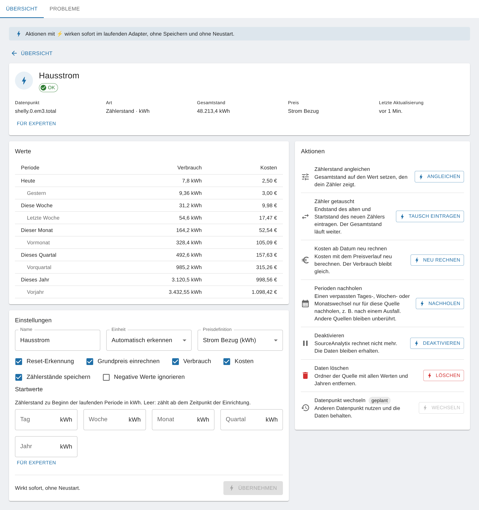

# Einstellungen (Instanz und Datenpunkt)

<!-- seite: gewicht=60; en=en/03.referenz/01.einstellungen.md -->

## Welche Einheiten werden unterstützt (Energie, Volumen, Gewicht, Länge)?

<!-- abschnitt: prio=A; gewicht=23; readme=covered; cluster=outputs-viz-10,cumulative-power-03,upgrade-migration-other-25; features=supported-units,unit-detection-conversion,price-definitions-table -->
<!-- muss beantworten: Tabelle der Einheiten und Umrechnung; Einheiten außerhalb der Liste. -->

**Kurz:** SourceAnalytix kennt 30 feste Einheiten für Leistung, Energie, Volumen, Masse und Länge. Umgerechnet wird nur innerhalb derselben Größe und zwischen Litern und Kubikmetern. Leistung wird über die Zeit zu Energie aufsummiert.
<!-- quelle: code=lib/calculation.js:8-33@v0.6.1; code=lib/calculation.js:42-65@v0.6.1; code=main.js:2993-2996@v0.6.1 -->

| Größe | Einheiten | Wird umgerechnet in |
|---|---|---|
| Leistung | `GW`, `MW`, `kW`, `W`, `mW` | Energie (`GWh` bis `mWh`), über die Zeit aufsummiert |
| Energie | `GWh`, `MWh`, `kWh`, `Wh`, `mWh` | jede andere Energie-Einheit |
| Volumen (Kubik) | `km³`, `m³`, `dm³`, `cm³`, `mm³` | jede andere Volumen-Einheit, auch Liter |
| Volumen (Liter) | `hl`, `l`, `dl`, `cl`, `ml` | jede andere Volumen-Einheit, auch Kubikmeter (1 `m³` = 1.000 `l`) |
| Masse | `t`, `kg`, `g` | jede andere Masse-Einheit |
| Länge | `km`, `m`, `dm`, `cm`, `mm`, `µm`, `nm` | jede andere Länge-Einheit |
<!-- quelle: code=lib/calculation.js:8-33@v0.6.1; code=lib/calculation.js:52-60@v0.6.1; code=admin/jsonConfig.json:186-225@v0.6.1; code=admin/jsonCustom.json:58@v0.6.1 -->

Bis v0.6.1 müssen die Zeichen genau so geschrieben sein: `m³` mit hochgestellter 3, `l` klein, `kWh` mit großem W. Welche Schreibweisen ab v0.6.2 zusätzlich erkannt werden, steht weiter unten.
<!-- quelle: code=main.js:1917-1924@v0.6.1; code=admin/jsonCustom.json:58@v0.6.1 -->

### Welche Einheit gilt wo?

Es gibt zwei Einheiten, und beide musst du kennen:

| Einstellung | Bedeutung |
|---|---|
| „Einheit“ bei der Quelle (ab v0.7.0 in der Detailansicht, bis v0.6.x im Objekt-Dialog „Wählen Sie Einheit“) | Die Einheit, in der das Gerät den Wert **liefert** (Quelleinheit). Voreinstellung ist „Automatisch erkennen“: SourceAnalytix nimmt dann die Einheit, die am Objekt des Datenpunkts steht. |
| „Einheit“ in der Preisdefinition | Die Einheit, in der SourceAnalytix **rechnet und anzeigt** (Zieleinheit). Alle Verbrauchs-States, Startwerte und der Preis pro Einheit beziehen sich auf sie. |
<!-- quelle: code=admin/jsonCustom.json:52-66@v0.6.1; code=main.js:1914-1930@v0.6.1; code=main.js:1982-1983@v0.6.1; code=admin/jsonConfig.json:186-225@v0.6.1; code=src-admin/src/SourceDetail.tsx:388-404; code=src-admin/src/i18n/de.json:81 -->

Beispiele:

- Wasserzähler liefert `l`, Preisdefinition hat `m³`: aus 1.000 `l` werden 1 `m³`.
- Stromzähler liefert `Wh`, Preisdefinition hat `kWh`: aus 1.000 `Wh` werden 1 `kWh`.
- Steckdose liefert `W`, Preisdefinition hat `kWh`: SourceAnalytix rechnet die Leistung über die Zeit in Energie um.
<!-- quelle: code=lib/calculation.js:52-64@v0.6.1; code=main.js:2993-2996@v0.6.1; code=main.js:3019-3021@v0.6.1 -->

> [!IMPORTANT]
> Bei einer Leistungs-Quelle (`W`, `kW` …) muss die Preisdefinition eine Energie-Einheit haben (`kWh`, `Wh` …). Passen Quelle und Preisdefinition nicht zusammen, zum Beispiel `kg` und `kWh` oder `kWh` und `W`, rechnet SourceAnalytix bis v0.6.1 nichts und schreibt bei jedem Wert ins Log: `reading incorrect after conversion contact DEV`. Bei `W` und `m³` rechnet es ohne Meldung falsch. Ab v0.6.2 startet der Datenpunkt dann nicht, und im Log steht `Unit <Einheit> of <Datenpunkt> cannot be converted to unit <Einheit> of price definition <Name>`.
<!-- quelle: code=lib/calculation.js:52-60@v0.6.1; code=main.js:2993-3009@v0.6.1; issue=#1278 -->

> [!WARNING]
> Bis v0.6.1 rechnet SourceAnalytix die Einheiten `km³`, `dm³`, `cm³`, `mm³`, `µm` und `nm` falsch um, sobald Quelle und Preisdefinition verschiedene Einheiten haben. Beispiel: 1.000 `dm³` werden zu 100 `m³` statt zu 1 `m³`. Wähle bei diesen Einheiten in der Preisdefinition dieselbe Einheit wie am Datenpunkt. `m³`, die Liter-Reihe und die Umrechnung zwischen `l` und `m³` stimmen. Ab v0.6.2 ist der Fehler behoben ([#1278](https://github.com/DrozmotiX/ioBroker.sourceanalytix/issues/1278)).
<!-- quelle: code=lib/calculation.js:64@v0.6.1; code=iobroker-adapter-helpers/definitions/units.js:43-50@0.0.8; code=iobroker-adapter-helpers/definitions/units.js:72-78@0.0.8; issue=#1278 -->

### Einheiten außerhalb der Liste

Nicht unterstützt sind:

- Zählerstände ohne Einheit, also Stück oder Impulse,
- Zeit, zum Beispiel Betriebsstunden in `h`,
- Datenmengen wie `MB` oder `GB`,
- Raten wie `m³/h`, `l/min` oder `kg/h`,
- alle anderen Größen, zum Beispiel `%`, `hPa`, `V` oder `A`.
<!-- quelle: code=lib/calculation.js:10-15@v0.6.1; code=admin/jsonCustom.json:58@v0.6.1; issue=#304; issue=#74 -->

Hat der Datenpunkt eine solche Einheit oder gar keine, startet er nicht, und im Log steht `No unit defined`. Wenn der Wert in Wahrheit in einer unterstützten Einheit vorliegt und nur das Objekt falsch beschriftet ist, wählst du die richtige Einheit selbst aus: ab v0.7.0 in der Detailansicht der Quelle unter „Einheit“ oder im Tab „Probleme“ bei „Einheit fehlt oder wird nicht erkannt“ mit „Beheben“, bis v0.6.x im Objekt-Dialog unter „Wählen Sie Einheit“. Wie das geht, steht unter [Fehler „unit not supported“ / „No unit defined“](../04.fehlerbehebung/01.log-meldungen.md#error-unit-not-supported-no).
<!-- quelle: code=main.js:1914-1930@v0.6.1; code=main.js:1954@v0.6.1; code=src-admin/src/SourceDetail.tsx:388-404; code=lib/source-overview.js:159; code=src-admin/src/i18n/de.json:114; code=src-admin/src/i18n/de.json:214 -->

**Ab v0.7.0** kommen Stück und Impulse dazu, siehe den nächsten Abschnitt. Zeit, Datenmengen, Raten wie `m³/h` und die übrigen Größen bleiben außerhalb der Liste.
<!-- quelle: interview=19b; issue=#304; issue=#74 -->

### Stück und Impulse (ab v0.7.0)

Ab v0.7.0 gibt es zwei weitere Einheiten ([#304](https://github.com/DrozmotiX/ioBroker.sourceanalytix/issues/304), [#74](https://github.com/DrozmotiX/ioBroker.sourceanalytix/issues/74)):

| Einheit | Wofür | Erkannte Schreibweisen am Objekt |
|---|---|---|
| `piece` | Zählerstände ohne physikalische Einheit, zum Beispiel Brennerstarts, und Impulszähler mit Gesamtzahl der Impulse | `pcs`, `pc`, `pieces`, `Stk`, `Stück`, `imp`, `impulse`, `pulses` |
| `piece/min` | Impulse pro Minute, zum Beispiel `pulses/min` bei einem ESPHome-Impulszähler. SourceAnalytix summiert sie über die Zeit auf, wie eine Leistung. | `pulses/min`, `imp/min`, `pcs/min` |
<!-- quelle: issue=#304; issue=#74; code=lib/calculation.js -->

So setzt du sie ein. Die Felder für Impulse stehen in der Detailansicht der Quelle: „Impulse pro <Einheit>“ im Bereich „Einstellungen“, sobald die Quelle in `piece` oder `piece/min` liefert und die Preisdefinition nicht in `piece` rechnet, „Jede Aktualisierung addiert ihren Wert“ unter „Für Experten“.
<!-- quelle: issue=#1285; code=src-admin/src/SourceDetail.tsx:173-175; code=src-admin/src/SourceDetail.tsx:473-484; code=src-admin/src/SourceDetail.tsx:560-570; code=src-admin/src/i18n/de.json:128; code=src-admin/src/i18n/de.json:216-217 -->

- **Nur zählen**, zum Beispiel Brennerstarts: Lege eine Preisdefinition mit der Einheit `piece` an. Ein Preis pro Stück ist möglich, aber nicht nötig.
- **Impulse in kWh oder m³ umrechnen:** Trage bei „Impulse pro <Einheit>“ ein, wie viele Impulse eine Einheit der Preisdefinition ergeben, zum Beispiel `1000` für einen Stromzähler mit 1000 imp/kWh und eine Preisdefinition in kWh. Ohne diesen Wert startet die Quelle nicht, und im Log steht `Unit piece of <Datenpunkt> cannot be converted to unit kWh of price definition <Name>`.
- **Jede Aktualisierung ist ein Impuls:** Sendet der Datenpunkt keinen Zählerstand, sondern bei jedem Impuls ein Update, zum Beispiel `1`, `true` oder `0.001` kWh, setze den Haken „Jede Aktualisierung addiert ihren Wert“. Dann zählt jedes Update, auch wenn sich der Wert nicht ändert ([#479](https://github.com/DrozmotiX/ioBroker.sourceanalytix/issues/479)). Negative Werte werden ignoriert, und der Wert, der beim Start von SourceAnalytix schon im Datenpunkt steht, zählt nicht noch einmal.
<!-- quelle: issue=#74; issue=#479; code=lib/calculation.js; code=main.js -->

Eine Quelle in `piece/min` und eine Quelle mit „Jede Aktualisierung addiert ihren Wert“ führen ihren Gesamtstand selbst, wie eine Leistungsquelle: Er beginnt bei 0, es gibt keine Reset-Erkennung, und Startwerte lässt du leer. Eine Quelle in `piece` mit Gesamtzahl der Impulse verhält sich wie ein Zählerstand, mit Reset-Erkennung.
<!-- quelle: issue=#74; issue=#479; code=main.js -->

**Ab v0.6.2:** SourceAnalytix erkennt am Objekt auch abweichende Schreibweisen ([#1264](https://github.com/DrozmotiX/ioBroker.sourceanalytix/issues/1264)): `m3`, `M3` und `m^3` gelten als `m³`, `kwh` und `KWH` als `kWh`, `L` als `l`. Eine Schreibweise, die auf zwei Einheiten passt, wird nicht umgedeutet: `mwh` kann `MWh` oder `mWh` sein. Ausgeschriebene Namen wie `Liter` oder `Watt` erkennt SourceAnalytix auch weiterhin nicht. Wenn eine Schreibweise umgedeutet wird, steht im Log zum Beispiel `Unit "m3" of <Datenpunkt> is used as m³`. Auch der Einstellungsdialog nimmt diese Schreibweisen bei „Automatisch erkennen“ an ([#1278](https://github.com/DrozmotiX/ioBroker.sourceanalytix/issues/1278)).
<!-- quelle: issue=#1264; pr=#1274; issue=#1278; code=lib/calculation.js:76-98@main; code=main.js:1945-1965@main -->

**Siehe auch:** [Welche Einheit stelle ich am Datenpunkt ein?](../02.anleitungen/01.quellen-und-einheiten.md#unit-datapoint-kwh-wh-m3) · [Startwerte und ihre Einheit](../01.erste-schritte/02.erster-zaehler.md#start-values-unit) · [Wie rechnet SourceAnalytix Watt in kWh um?](../05.hintergrund/01.berechnung.md#sourceanalytix-convert-watts-kwh)

## Welche Instanz-Einstellungen gibt es (Perioden, Nachkommastellen)?

<!-- abschnitt: prio=B; gewicht=10; readme=partial; cluster=outputs-viz-05,outputs-viz-02,prices-costs-12; features=current-year-weekday,rounding-instance-defaults,source-decimals,calc-rounding,current-year-months,year-statistics-archive,current-year-weeks,current-year-quarters,current-year-previous,price-definitions-table -->
<!-- muss beantworten: Wochen/Monate/Quartale speichern, Standard-Rundung; warum manche States fehlen. -->

**Kurz:** Die Instanz-Einstellungen von SourceAnalytix haben ab v0.7.0 vier Tabs. In „Haupteinstellungen“ legst du fest, welche Wochen-, Monats- und Quartals-States entstehen und wie viele Nachkommastellen neue Quellen bekommen. Fehlt ein State, ist meist die passende Option dort aus oder an der Quelle ist „Verbrauch“, „Kosten“ oder „Zählerstände speichern“ nicht gesetzt.
<!-- quelle: code=admin/jsonConfig.json:1-334; code=admin/i18n/de.json:33; code=admin/i18n/de.json:53; code=admin/i18n/de.json:129-130; code=main.js:3219-3330; issue=#1269 -->

### Die Tabs (ab v0.7.0)

| Tab | Inhalt | Wann wirkt eine Änderung |
|---|---|---|
| „Übersicht“ | Alle Quellen mit Status, Gesamtstand und den Werten für „Heute“, „Monat“ und „Jahr“. „Quelle hinzufügen“ startet den Assistenten, ein Klick auf eine Quelle öffnet ihre Detailansicht. | Aktionen mit ⚡ sofort, ohne Speichern und ohne Neustart |
| „Probleme“ | Prüft alle Quellen und schlägt zu jedem Befund eine Lösung vor | sofort |
| „Preisdefinitionen“ | Tabelle der Preise, siehe [Wie ist eine Preisdefinition aufgebaut?](#price-definition-structured-categories-base) | nach „Speichern“, die Instanz startet dabei neu |
| „Haupteinstellungen“ | Jahresstatistik, laufendes Jahr, Rundung (siehe unten) | nach „Speichern“, die Instanz startet dabei neu |
<!-- quelle: code=admin/jsonConfig.json:5-38; code=admin/jsonConfig.json:39-196; code=admin/jsonConfig.json:197-332; code=src-admin/src/SourcesApp.tsx:207-237; code=src-admin/src/i18n/de.json:135; code=src-admin/src/i18n/de.json:165; issue=#1269 -->

„Übersicht“ und „Probleme“ fragen die laufende Instanz ab. Ist sie gestoppt, steht dort „Instanz läuft nicht“, und die Sofort-Aktionen sind gesperrt. Was die Detailansicht einer Quelle enthält, steht unter [Was bewirken die Einstellungen am Datenpunkt?](#datapoint-settings-costs-consumption-meter).
<!-- quelle: code=src-admin/src/i18n/de.json:163; code=src-admin/src/i18n/de.json:172-173; code=src-admin/src/SourceDetail.tsx:592 -->

**Bis v0.6.x** gibt es nur die Tabs „Haupteinstellungen“ und „Preisdefinitionen“. Quellen richtest du dort im Objekt-Dialog des Datenpunkts ein.
<!-- quelle: code=admin/jsonConfig.json:5-7@v0.6.1; code=admin/jsonConfig.json:142-143@v0.6.1 -->

### Tab „Haupteinstellungen“

| Bereich | Option | Standard | Was SourceAnalytix anlegt |
|---|---|---|---|
| „Jahresstatistik“ | „Wochen“ | aus | Archiv `<Gerät>.<Jahr>.<Kategorie>.weeks.01` bis `53` |
| „Jahresstatistik“ | „Monate“ | an | Archiv `<Gerät>.<Jahr>.<Kategorie>.months.01_January` bis `12_December` |
| „Jahresstatistik“ | „Quartale“ | aus | Archiv `<Gerät>.<Jahr>.<Kategorie>.quarters.Q1` bis `Q4` |
| „Laufendes Jahr“ | „Wochentag“ | an | `currentYear.<Kategorie>.currentWeek.01_Monday` bis `07_Sunday` |
| „Laufendes Jahr“ | „Wochen“ | an | `currentYear.<Kategorie>.weeks.01` bis `53` |
| „Laufendes Jahr“ | „Monate“ | an | `currentYear.<Kategorie>.months.01_January` bis `12_December` |
| „Laufendes Jahr“ | „Quartale“ | an | `currentYear.<Kategorie>.quarters.Q1` bis `Q4` |
| „Laufendes Jahr“ | „Vorheriger Zeitraum“ | an | `01_previousDay` bis `05_previousYear`, mit „Wochentag“ auch `previousWeek.01_Monday` bis `07_Sunday` |
| „Rundung“ | „Nachkommastellen für Verbrauchswerte“ | 3 | Vorlage für neue Quellen |
| „Rundung“ | „Nachkommastellen für Kostenwerte“ | 2 | Vorlage für neue Quellen |
<!-- quelle: code=admin/jsonConfig.json:201-330; code=admin/i18n/de.json:17; code=admin/i18n/de.json:40; code=admin/i18n/de.json:52; code=admin/i18n/de.json:62; code=admin/i18n/de.json:81-84; code=admin/i18n/de.json:124-126; code=io-package.json:266-276; code=lib/calculation.js:393-433; code=main.js:2216-2235; issue=#1287 -->

**Bis v0.6.x** heißt die Option „Quartale“ in der deutschen Oberfläche „Viertel“.
<!-- quelle: issue=#1287; code=admin/i18n/de.json:62 -->

`<Kategorie>` ist `consumed` oder `delivered` für den Verbrauch, `costs` oder `earnings` für das Geld und `meterReadings` für Zählerstände. Ist eine der drei Optionen der „Jahresstatistik“ an, gibt es im Jahresordner zusätzlich die Jahressummen `<Jahr>.consumedCumulative` (oder `deliveredCumulative`), `<Jahr>.costsCumulative` (oder `earningsCumulative`) und den Zählerstand `<Jahr>.readingCumulative`. Was in den einzelnen States steht, beschreibt [Welche Wochen-, Monats- und Quartals-States gibt es?](02.states-und-meldungen.md#week-month-quarter-states-weekdays).
<!-- quelle: code=main.js:2232-2235; code=main.js:1133-1138; code=main.js:1206-1211; code=main.js:3640-3645 -->

### Warum manche States fehlen

- **Die Option ist aus.** Dann legt SourceAnalytix die States nicht an. Schaltest du eine Option aus, löscht es die vorhandenen States des laufenden Jahres, sobald die Quelle das nächste Mal startet, also beim Neustart der Instanz nach dem Speichern.
- **An der Quelle fehlt der Haken.** Verbrauchs-States gibt es nur mit „Verbrauch“, Kosten-States nur mit „Kosten“, Zählerstände nur mit „Zählerstände speichern“.
- **Die Woche gehört zum nächsten Jahr.** Vom 29. bis 31. Dezember kann schon die Kalenderwoche 01 des neuen Jahres laufen. Sie wird unter `currentYear.<Kategorie>.weeks` nicht geschrieben, siehe [Warum zeigt Woche 52/53 Werte im neuen Jahr?](../05.hintergrund/03.perioden-und-zeit.md#week-52-53-have-values).
- **Der erste Periodenwechsel steht noch aus.** Vorperioden-States stehen bis dahin auf 0, siehe [Wo finde ich gestern, letzte Woche, letzten Monat?](02.states-und-meldungen.md#yesterday-last-week-last-month).
<!-- quelle: code=main.js:29; code=main.js:2252-2264; code=main.js:2306-2315; code=main.js:3219-3330; code=main.js:1147; code=main.js:4022-4024; code=lib/calculation.js:393-433 -->

> [!WARNING]
> Schaltest du „Wochen“, „Monate“, „Quartale“, „Wochentag“ oder „Vorheriger Zeitraum“ aus, sind die Werte des laufenden Jahres in diesen States weg. Aufzeichnungen in einem History-Adapter und die Jahresordner früherer Jahre bleiben erhalten.
<!-- quelle: code=main.js:29; code=main.js:2216-2264; code=main.js:2306-2315 -->

### Nachkommastellen

Die beiden Werte unter „Rundung“ sind nur eine Vorlage. Jede Quelle übernimmt sie einmal beim Anlegen und speichert ihre eigenen Nachkommastellen. Änderst du die Vorlage später, behalten vorhandene Quellen ihren Wert. Ab v0.7.0 änderst du die Stellen einer Quelle in ihrer Detailansicht unter „Für Experten“: „Nachkommastellen Verbrauch“ und „Nachkommastellen Kosten“.
<!-- quelle: code=admin/i18n/de.json:127; code=main.js:2000-2009; code=main.js:1932-1955; code=lib/calculation.js:273-275; code=src-admin/src/SourceDetail.tsx:534-543; code=src-admin/src/i18n/de.json:68-69 -->

- Erlaubt sind 0 bis 15. Mit -1 speichert SourceAnalytix den Wert ungerundet. Größere Zahlen gelten als 15, jede negative als -1.
- Gerundet werden nur die geschriebenen States. Der Gesamtstand in `cumulativeReading` bleibt ungerundet.
- Zählerstände unter `meterReadings` werden mit den Nachkommastellen für Verbrauchswerte gerundet.
<!-- quelle: code=lib/calculation.js:257-264; code=lib/calculation.js:283-290; code=main.js:3633-3636; code=main.js:3670 -->

**Siehe auch:** [Warum so viele Nachkommastellen?](../04.fehlerbehebung/02.falsche-werte-und-bekannte-fehler.md#so-many-decimals) · [Was passiert beim Jahreswechsel?](02.states-und-meldungen.md#happens-turn-year) · [Wie werte ich Werte über mehrere Jahre aus?](../02.anleitungen/04.werte-auswerten.md#evaluate-across-years-adjusting-everything)

## Was bewirken die Einstellungen am Datenpunkt (Costs, Consumption, Meter values)?

<!-- abschnitt: prio=B; gewicht=9; readme=partial; cluster=setup-ui-21,outputs-viz-25; features=source-meter-values,output-cumulative-reading,source-calc-costs,source-calc-consumption,output-state-deletion,source-enable,source-alias,source-output-id,source-price-definition,source-unit,source-basic-rate,source-average-power,source-ignore-negative,source-reset-detection,source-threshold,source-decimals,source-start-values,source-multi-edit,source-hidden-reset-keys -->
<!-- muss beantworten: Jede Option am Datenpunkt mit Wirkung und Voreinstellung; wann der Meter-Readings-Ordner leer bleibt. -->

**Kurz:** Jede Quelle hat eigene Einstellungen: Preisdefinition, Einheit und die Haken „Verbrauch“, „Kosten“ und „Zählerstände speichern“, die festlegen, welche States entstehen. Ab v0.7.0 stellst du sie beim Anlegen im Assistenten ein und änderst sie später in der Detailansicht der Quelle. „Übernehmen“ wirkt sofort, ohne Neustart.
<!-- quelle: code=src-admin/src/SourceDetail.tsx:374-598; code=src-admin/src/Wizard.tsx:168-200; code=src-admin/src/i18n/de.json:40-41; code=main.js:4543-4600; issue=#1269 -->

### So kommst du zu den Einstellungen (ab v0.7.0)

1. Öffne die Instanz-Einstellungen von SourceAnalytix, Tab „Übersicht“.
2. Klicke auf die Quelle. Die Detailansicht zeigt oben Datenpunkt, Art, Gesamtstand, Preis und „Letzte Aktualisierung“, darunter die Bereiche „Werte“, „Einstellungen“ und „Aktionen“.
3. Ändere im Bereich „Einstellungen“ die Felder. Weitere Felder stehen unter „Für Experten“.
4. Klicke auf „Übernehmen“. Ist ein Feld ungültig, markiert die Seite es und speichert nichts.
<!-- quelle: code=src-admin/src/SourceDetail.tsx:236-308; code=src-admin/src/SourceDetail.tsx:374-598; code=src-admin/src/i18n/de.json:47; code=src-admin/src/i18n/de.json:129; code=src-admin/src/i18n/de.json:149; code=src-admin/src/i18n/de.json:230-232; code=main.js:4558-4579 -->

### Alle Einstellungen einer Quelle

Die Spalte „Standard“ nennt die Vorbelegung im Assistenten. Die letzte Spalte nennt für Umsteiger den Namen des Felds im Objekt-Dialog am Datenpunkt bis v0.6.x.

| Einstellung (ab v0.7.0) | Wirkung | Standard | Bis v0.6.x im Objekt-Dialog |
|---|---|---|---|
| „Name“ | Anzeigename des Ordners der Quelle. Ändert keine State-ID, siehe [Wie benenne ich den Datenpunkt?](#name-datapoint-alias-output-id) | Name des Datenpunkts | „Name“ |
| „Einheit“ | Einheit, in der der Datenpunkt liefert. „Automatisch erkennen“ nimmt die Einheit am Objekt, siehe [Welche Einheiten werden unterstützt?](#units-supported-energy-volume-weight) | erkannte Einheit | „Wählen Sie Einheit“ |
| „Preisdefinition“ | Pflicht. Legt die Zieleinheit fest und ob Verbrauch und Kosten oder Einspeisung und Erlös gezählt werden | – | „Preisdefinition auswählen“ |
| „Verbrauch“ | States unter `currentYear.consumed` oder `currentYear.delivered` | an | „Verbrauch berechnen“ |
| „Kosten“ | States unter `currentYear.costs` oder `currentYear.earnings` | an | „Kosten berechnen“ |
| „Grundpreis einrechnen“ | Bucht den „Preis pro Monat“ der Preisdefinition in die Kosten. Wirkt nur mit „Kosten“ | an, wenn keine andere Quelle derselben Preisdefinition ihn schon bucht | „Inklusive Grundpreis“ |
| „Zählerstände speichern“ | Zählerstände je Periode unter `currentYear.meterReadings` | an | „Zählerwerte speichern“ |
| „Reset-Erkennung“ | Fängt Sprünge des Zählers auf 0 ab, siehe [Threshold und Abschalten der Reset-Erkennung](#threshold-disabling-reset-detection-work) | nach der Frage „Springt der Wert manchmal auf 0 …?“ | „Erkennung der Zurücksetzung des Gerätewerts Aktiviert“ |
| „Negative Werte ignorieren“ | Nur bei Leistung: Negative Werte zählen als 0 W, zum Beispiel bei Wechselrichtern in der Nacht | aus | „Negative Leistungswerte ignorieren“ |
| „Schwelle Reset-Erkennung (<Einheit>)“ unter „Für Experten“ | Größter Rückgang, der noch als Messschwankung gilt | 1 | „Schwelle“ |
| „Nachkommastellen Verbrauch“ / „Nachkommastellen Kosten“ unter „Für Experten“ | Rundung der geschriebenen States, siehe [Instanz-Einstellungen](#instance-settings-exist-periods-decimals) | Vorlage der Instanz (3 / 2) | „Nachkommastellen für Verbrauchswerte“ / „… Kostenwerte“ |
<!-- quelle: code=src-admin/src/SourceDetail.tsx:84-91; code=src-admin/src/SourceDetail.tsx:383-439; code=src-admin/src/SourceDetail.tsx:529-543; code=src-admin/src/Wizard.tsx:82-94; code=src-admin/src/Wizard.tsx:125; code=src-admin/src/Wizard.tsx:151-157; code=src-admin/src/Wizard.tsx:168-200; code=src-admin/src/i18n/de.json:68-69; code=src-admin/src/i18n/de.json:122-129; code=src-admin/src/i18n/de.json:161; code=src-admin/src/i18n/de.json:201; code=src-admin/src/i18n/de.json:293; code=src-admin/src/i18n/de.json:298; code=admin/jsonCustom.json:12-227@v0.6.1; code=admin/i18n/de.json:8-12; code=admin/i18n/de.json:22; code=admin/i18n/de.json:30; code=admin/i18n/de.json:66; code=admin/i18n/de.json:69; code=admin/i18n/de.json:74; code=admin/i18n/de.json:91; code=admin/i18n/de.json:122-126; code=main.js:2150-2177 -->

Diese Einstellungen erscheinen nur bei passenden Quellen oder fragt der Assistent nicht ab. Ab v0.7.0 stehen sie alle in der Detailansicht ([#1285](https://github.com/DrozmotiX/ioBroker.sourceanalytix/issues/1285)):

| Einstellung | Wo in der Detailansicht | Wirkung | Standard |
|---|---|---|---|
| „Technische ID“ | unter „Für Experten“, auch im Assistenten | Name des Ordners `sourceanalytix.0.<Gerät>`. Erlaubt sind Buchstaben, Ziffern, `_` und `-`. Eine Änderung verschiebt alle Werte in den neuen Ordner, siehe [Wie benenne ich den Datenpunkt?](#name-datapoint-alias-output-id) | aus dem Namen gebildet |
| „Mittelwert bei Leistung“ | bei Leistungsquellen, auch im Assistenten | Rechnet je Abschnitt mit dem Mittel aus altem und neuem Wert statt mit dem alten Wert | aus |
| „Maximale Lücke zwischen Leistungswerten (Minuten)“ | bei Leistungsquellen | Längere Pausen ohne neuen Leistungswert zählen als 0 ([#1266](https://github.com/DrozmotiX/ioBroker.sourceanalytix/issues/1266)) | leer = aus |
| „Impulse pro <Einheit>“ | bei Quellen in `piece` oder `piece/min`, deren Preisdefinition nicht in `piece` rechnet | Rechnet Impulse in die Zieleinheit um, zum Beispiel `1000` bei 1000 imp/kWh | leer |
| „Jede Aktualisierung addiert ihren Wert“ | unter „Für Experten“ | Jedes Update zählt als Zuwachs statt als Zählerstand | aus |
| „Startwerte“ „Tag“ bis „Jahr“ | eigener Abschnitt „Startwerte“, im Assistenten nur bei Zählerstand | Gesamtstand zu Beginn der laufenden Periode, siehe [Startwerte](../01.erste-schritte/02.erster-zaehler.md#start-values-unit) | leer = ab jetzt zählen |
<!-- quelle: issue=#1285; issue=#1287; code=src-admin/src/SourceDetail.tsx:173-175; code=src-admin/src/SourceDetail.tsx:440-513; code=src-admin/src/SourceDetail.tsx:514-571; code=src-admin/src/Wizard.tsx:145-150; code=src-admin/src/Wizard.tsx:168-200; code=src-admin/src/Wizard.tsx:637-655; code=src-admin/src/Wizard.tsx:826-840; code=src-admin/src/i18n/de.json:89; code=src-admin/src/i18n/de.json:122; code=src-admin/src/i18n/de.json:128; code=src-admin/src/i18n/de.json:155-156; code=src-admin/src/i18n/de.json:180-181; code=src-admin/src/i18n/de.json:216-217; code=src-admin/src/i18n/de.json:251-252; issue=#1266; issue=#74; issue=#479 -->

Zahlen trägst du mit Komma oder Punkt ein. Ein einzelnes Komma oder ein einzelner Punkt ist immer das Dezimalzeichen: `1.283` heißt 1,283. Die Startwerte prüft die Detailansicht wie der Assistent; solange ein Startwert einen Fehler zeigt, bleibt „⚡ Übernehmen“ gesperrt.
<!-- quelle: issue=#1285; issue=#1287; code=src-admin/src/api.ts:191-214; code=src-admin/src/SourceDetail.tsx:176-188; code=src-admin/src/SourceDetail.tsx:592 -->

**Ab v0.7.0:** Im Objekt-Dialog am Datenpunkt (Reiter „Objekte“, Schraubenschlüssel) gibt es nur noch den Haken „aktiviert“, einen Hinweis und den Knopf „SourceAnalytix-Einstellungen öffnen“. Schaltest du eine Quelle dort ein, setzt SourceAnalytix „Verbrauch“, „Kosten“, „Zählerstände speichern“ und „Reset-Erkennung“ mit Schwelle 1. Weil noch keine Preisdefinition gewählt ist, erscheint die Quelle im Tab „Probleme“ mit „Keine Preisdefinition gewählt“. Bestehende Einstellungen bleiben dabei unverändert ([#1286](https://github.com/DrozmotiX/ioBroker.sourceanalytix/issues/1286)).
<!-- quelle: issue=#1286; code=admin/jsonCustom.json:1-55; code=admin/i18n/de.json:146-147; code=lib/source-overview.js:56; code=src-admin/src/i18n/de.json:204 -->

**Bis v0.6.x:** Legst du eine Quelle im Objekt-Dialog neu an, sind „Verbrauch berechnen“, „Kosten berechnen“ und „Zählerwerte speichern“ nicht vorbelegt. Ohne diese Haken pflegt SourceAnalytix nur `cumulativeReading` und `statisticsJson`.
<!-- quelle: code=admin/jsonCustom.json:80-88@v0.6.1; code=admin/jsonCustom.json:98-106@v0.6.1; code=admin/jsonCustom.json:129-137@v0.6.1; code=main.js:3219-3330; code=main.js:2316-2321 -->

> [!WARNING]
> Nimmst du „Verbrauch“, „Kosten“ oder „Zählerstände speichern“ wieder heraus, löscht SourceAnalytix die zugehörigen States der Quelle. Aufzeichnungen in einem History-Adapter bleiben erhalten.
<!-- quelle: code=main.js:3254-3328; code=main.js:2424-2449 -->

### Wann der Ordner `meterReadings` leer bleibt

`meterReadings` enthält den Gesamtstand am Ende einer Periode, nicht den Verbrauch. Er bleibt leer oder unvollständig, wenn:

- „Zählerstände speichern“ aus ist,
- du den aktuellen Stand suchst: Einen State `meterReadings.01_currentDay` gibt es nicht, der aktuelle Stand steht in `cumulativeReading`,
- in den Instanz-Einstellungen „Wochentag“, „Wochen“, „Monate“, „Quartale“ oder „Vorheriger Zeitraum“ aus sind, denn nur für diese Perioden entstehen Zählerstände,
- der erste Periodenwechsel noch aussteht: `01_previousDay` und die anderen Vorperioden werden erst dann gefüllt.
<!-- quelle: code=main.js:3280-3293; code=main.js:3667-3718; code=main.js:2600-2610; code=lib/calculation.js:393-433 -->

**Bis v0.6.1** wird ein Zählerstand von genau 0 nicht unter `meterReadings` geschrieben. Ab v0.6.2 ist das behoben ([#1253](https://github.com/DrozmotiX/ioBroker.sourceanalytix/issues/1253)).
<!-- quelle: issue=#1253; code=main.js:3672 -->

**Bis v0.6.x** gibt es die Detailansicht nicht. Alle Einstellungen stehen dann im Objekt-Dialog am Datenpunkt, wie unter [Wo konfiguriere ich SourceAnalytix für einen Datenpunkt?](../01.erste-schritte/02.erster-zaehler.md#configure-sourceanalytix-datapoint) beschrieben.
<!-- quelle: issue=#1269; code=admin/jsonCustom.json:1-252@v0.6.1 -->

**Siehe auch:** [Warum sind Meter-Readings kumuliert?](02.states-und-meldungen.md#meter-readings-cumulative) · [Welche Quelltypen gibt es?](#source-types-exist-meter-power) · [Datenpunkt aktiviert, aber es entstehen keine Ordner](../04.fehlerbehebung/01.log-meldungen.md#datapoint-enabled-but-no-folders)

## Wie funktionieren Threshold und Abschalten der Reset-Erkennung?

<!-- abschnitt: prio=B; gewicht=7; readme=covered; cluster=meter-readings-11,meter-readings-13; features=source-threshold,reset-jitter-ignore,reset-confirmation,source-reset-detection,reset-disabled-decrease,reset-rejected-glitch,reset-invalid-reading,reset-manual-correction,reset-dynamic-cost-tracker -->
<!-- muss beantworten: Reset-Erkennung pro Datenpunkt einstellen, Threshold und Jitter, abschalten. -->

**Kurz:** Die Reset-Erkennung und ihre Schwelle stellst du für jede Quelle einzeln ein. Lass die Erkennung an, wenn dein Zähler nach einem Neustart oder Stromausfall bei 0 beginnen kann. Die Schwelle (Standard 1, in der Zieleinheit) ist der größte Rückgang, der noch als Messschwankung gilt. Ausschalten ist nur für Quellen gedacht, die bewusst fallen dürfen.
<!-- quelle: code=main.js:2172; code=main.js:2176; code=lib/calculation.js:444-454; code=src-admin/src/SourceDetail.tsx:424-439; code=src-admin/src/SourceDetail.tsx:529-533 -->

### So stellst du es ein (ab v0.7.0)

1. Öffne in den Instanz-Einstellungen, Tab „Übersicht“, die Quelle.
2. Setze oder entferne im Bereich „Einstellungen“ den Haken „Reset-Erkennung“.
3. Klicke auf „Für Experten“ und trage unter „Schwelle Reset-Erkennung (<Einheit>)“ die Schwelle in der Zieleinheit ein, zum Beispiel `0.5` für 0,5 kWh.
4. Klicke auf „Übernehmen“.
<!-- quelle: code=src-admin/src/SourceDetail.tsx:423-571; code=src-admin/src/SourceDetail.tsx:581-597; code=src-admin/src/i18n/de.json:126; code=src-admin/src/i18n/de.json:293 -->

Beim Anlegen fragt der Assistent: „Springt der Wert manchmal auf 0, z. B. nach einem Stromausfall?“ Mit „Ja“ ist die Reset-Erkennung an, mit „Nein“ aus. Vorgewählt ist „Nein“, bei Datenpunkten von Shelly oder Tasmota „Ja“.
<!-- quelle: code=src-admin/src/Wizard.tsx:82; code=src-admin/src/Wizard.tsx:125; code=src-admin/src/Wizard.tsx:179; code=src-admin/src/i18n/de.json:230-231 -->

### Was bei einem Rückgang passiert

| Rückgang des Gerätewerts | Reset-Erkennung an | Reset-Erkennung aus |
|---|---|---|
| höchstens die Schwelle | Messschwankung: Der Wert wird ignoriert, der Gesamtstand bleibt stehen | Der Gesamtstand fällt mit |
| mehr als die Schwelle | Möglicher Reset: SourceAnalytix wartet auf den nächsten Wert und rechnet dann mit einem neuen Offset weiter | Der Gesamtstand fällt mit, der Verbrauch der Perioden kann negativ werden |
<!-- quelle: code=lib/calculation.js:444-454; code=main.js:3555-3604 -->

Wie die Bestätigung eines Resets im Einzelnen abläuft, steht unter [Was bedeutet „Device reset detected“?](../05.hintergrund/02.zaehler-reset.md#device-reset-detected-mean-reset). Eine Messschwankung steht nur im Debug-Log („Ignoring cumulative reading jitter“).
<!-- quelle: code=main.js:3581-3584 -->

### Welche Schwelle passt?

- **Größer als das normale Rauschen** des Geräts, damit kleine Rückgänge nicht als Reset gelten.
- **Kleiner als der Stand, mit dem das Gerät nach einem Reset oder Tausch wieder beginnt.** Fällt ein Zähler nur knapp unter den alten Stand, wird er sonst nicht als Reset erkannt.
- **0** heißt: Jeder Rückgang ist ein möglicher Reset.
<!-- quelle: code=lib/calculation.js:444-454; code=main.js:3540; code=main.js:3563 -->

Schwelle und Reset-Erkennung wirken nur bei Zählerständen. Bei Leistungsquellen (W), bei `piece/min` und bei „Jede Aktualisierung addiert ihren Wert“ führt SourceAnalytix den Gesamtstand selbst; dort gibt es keine Reset-Erkennung. Der Assistent zeigt die Schwelle bei Leistung deshalb nicht an.
<!-- quelle: code=main.js:261-263; code=main.js:3509; code=src-admin/src/Wizard.tsx:695-703 -->

> [!WARNING]
> Mit „Nein“ im Assistenten ist die Reset-Erkennung aus. Springt so ein Zähler doch einmal auf 0, fällt der Gesamtstand mit, und die Werte der laufenden Perioden werden negativ. Der Tab „Probleme“ meldet dann „Zähler springt auf 0, Reset-Erkennung ist aus“ und bietet „Einschalten“ an. Wie du die Werte danach korrigierst, steht unter [Falsche Werte korrigieren](../02.anleitungen/02.zaehlerstaende-korrigieren.md#correct-wrong-too-high-negative).
<!-- quelle: code=lib/source-overview.js:163-165; code=main.js:3598-3601; code=src-admin/src/i18n/de.json:120; code=src-admin/src/i18n/de.json:208 -->

**Ab v0.6.2:** Die Meldung „Cumulative reading for … decreased while reset detection is disabled“ steht nur noch im Debug-Log. Bis v0.6.1 stand sie bei jedem Rückgang im Info-Log ([#1262](https://github.com/DrozmotiX/ioBroker.sourceanalytix/issues/1262)).
<!-- quelle: issue=#1262; code=main.js:3601 -->

**Bis v0.6.x** stellst du beides im Objekt-Dialog am Datenpunkt ein: „Erkennung der Zurücksetzung des Gerätewerts Aktiviert“ (Standard an) und „Schwelle“ (Standard 1).
<!-- quelle: code=admin/jsonCustom.json:138-159@v0.6.1; code=admin/i18n/de.json:22; code=admin/i18n/de.json:91 -->

**Siehe auch:** [Mein Zähler startet nach Stromausfall bei 0](../02.anleitungen/02.zaehlerstaende-korrigieren.md#meter-restarts-after-power-loss) · [Zähler, der täglich auf 0 zurückgesetzt wird](../05.hintergrund/02.zaehler-reset.md#counter-reset-0-daily-happens) · [Zähler oder Gerät getauscht](../02.anleitungen/02.zaehlerstaende-korrigieren.md#replaced-meter-device-avoid-negative)

## Wie ist eine Preisdefinition aufgebaut (Kategorien, Grundpreis, Dezimalzeichen)?

<!-- abschnitt: prio=B; gewicht=6; readme=missing; cluster=prices-costs-31,prices-costs-14,prices-costs-08; features=price-definitions-table,supported-units,source-price-definition,price-fixed,price-invalid-unit-price,price-scheduled-valid-from,price-state,price-tariff-selector,price-current-price-writable,price-split-over-intervals,price-basic-fee,price-history-states,price-dynamic-cost-memory,price-recalculate-unreachable -->
<!-- muss beantworten: Felder der Preisdefinition, Grundpreis anteilig oder voll, Komma/Punkt. -->

**Kurz:** Eine Preisdefinition ist eine Zeile im Tab „Preisdefinitionen“ der Instanz-Einstellungen. Sie hat einen frei wählbaren Namen („Kategorie“), eine Einheit, eine Kostenart und einen Preis. Jede Quelle bekommt genau eine Preisdefinition. Der monatliche Grundpreis wird voll gebucht, einmal je Monat, nicht anteilig pro Tag.
<!-- quelle: code=admin/jsonConfig.json:39-196; code=main.js:1402-1478; code=lib/calculation.js:632-672 -->

### Die Felder

| Spalte | Bedeutung |
|---|---|
| „Kategorie“ | Name der Preisdefinition, zum Beispiel `Strom` oder `Waermepumpe`. Unter ihm wählst du sie an der Quelle aus. Jeder Name darf nur einmal vorkommen. |
| „Beschreibung“ | Freier Text, nur für dich |
| „Kostenart“ | „Kosten“ für Bezug (Verbrauch und Kosten) oder „Erträge“ für Einspeisung und Erlös. Bestimmt, ob die Werte unter `consumed` und `costs` oder unter `delivered` und `earnings` stehen. |
| „Einheit“ | Die Zieleinheit: In ihr rechnet und zeigt SourceAnalytix alles für die Quellen dieser Preisdefinition |
| „Preisquelle“ | „Festpreis“, „Datenpunkt“ oder „Tarifumschaltung“, siehe unten |
| „Preis pro Einheit“ | Preis je Zieleinheit, zum Beispiel `0.32` für 0,32 €/kWh |
| „Preis-Datenpunkt“ | Nur bei „Datenpunkt“ und „Tarifumschaltung“: der State, der den Preis oder den Tarif liefert |
| „Aktiver Tarifpreis“ | Nur bei „Tarifumschaltung“: Preis, solange der Tarif aktiv ist |
| „Aktiver Auswahlwert“ | Nur bei „Tarifumschaltung“: Wert des Preis-Datenpunkts, bei dem der Tarif aktiv ist |
| „Gültig ab“ | Ab wann Preis und Grundpreis gelten, ab 0:00 Uhr dieses Tages |
| „Preis pro Monat“ | Grundpreis je Monat |
<!-- quelle: code=admin/jsonConfig.json:52-193; code=admin/i18n/de.json:13; code=admin/i18n/de.json:15-16; code=admin/i18n/de.json:20; code=admin/i18n/de.json:23-26; code=admin/i18n/de.json:54-57; code=admin/i18n/de.json:70-72; code=admin/i18n/de.json:78; code=main.js:2158-2161; code=lib/dynamic-pricing.js:40-54 -->

Gibt es eine Kategorie doppelt, gilt nur die letzte Zeile. In State-IDs wird jedes Zeichen außer Buchstaben, Ziffern, `_` und `-` durch `_` ersetzt.
<!-- quelle: code=main.js:1412-1474; code=main.js:340-393 -->

### Preisquelle

| „Preisquelle“ | Woher der Preis kommt |
|---|---|
| „Festpreis“ | Aus „Preis pro Einheit“. Ein neuer Preis gilt ab „Gültig ab“ oder, ohne Datum, ab dem Speichern. Ältere Werte rechnet SourceAnalytix nicht von selbst neu. |
| „Datenpunkt“ | Aus dem „Preis-Datenpunkt“, zum Beispiel einem dynamischen Strompreis in €/kWh. Jede Änderung wird mit ihrem Zeitstempel gespeichert. Ist der State beim Start leer, gilt „Preis pro Einheit“ als Ersatz. |
| „Tarifumschaltung“ | Ein State schaltet zwischen „Preis pro Einheit“ und „Aktiver Tarifpreis“ um. Ohne „Aktiver Auswahlwert“ gilt der Tarif als aktiv bei `true`, bei einer Zahl ungleich 0 und bei jedem Text außer `0`, `false`, `off`, `no`, `closed` oder leer. Mit Auswahlwert muss der State genau diesen Wert haben. |
<!-- quelle: code=main.js:1414-1452; code=main.js:401-445; code=main.js:2478-2500; code=lib/dynamic-pricing.js:63-76; code=admin/i18n/de.json:24; code=admin/i18n/de.json:70-71 -->

Ändert sich der Preis zwischen zwei Werten der Quelle, teilt SourceAnalytix den Verbrauch nach Zeit auf alten und neuen Preis auf. Wie du einen Preis ab einem Datum änderst und Kosten nachträglich neu rechnest, steht unter [Werden Kosten neu berechnet, wenn ich den Preis ändere?](../02.anleitungen/03.preise-und-kosten.md#costs-recalculated-change-price-change). Dynamische Preise und Tag-/Nachttarif erklären [Dynamischer Strompreis](../02.anleitungen/03.preise-und-kosten.md#use-dynamic-electricity-price-tibber) und [Tag-/Nachttarif](../02.anleitungen/03.preise-und-kosten.md#bill-day-night-tariff).
<!-- quelle: code=lib/dynamic-pricing.js:165-200; code=main.js:1000-1050 -->

### Grundpreis: voll, einmal im Monat

- Der „Preis pro Monat“ wird voll gebucht: einmal an dem Tag, ab dem er gilt, danach am 1. jedes Monats um 0:00 Uhr. Eine Verteilung auf die Tage gibt es nicht.
- In den Tages- und Wochenwerten steht der ganze Betrag deshalb nur an dem Tag und in der Woche der Buchung.
- Hast du kein „Gültig ab“ eingetragen, gilt der Grundpreis beim ersten Einrichten ab dem 1. Januar des laufenden Jahres. Der Jahreswert enthält dann alle Monate seit Januar.
- Er zählt nur für Quellen mit „Grundpreis einrechnen“ und „Kosten“. Jede dieser Quellen bucht ihn voll. Haben zwei Quellen derselben Preisdefinition den Haken, zählt er doppelt.
<!-- quelle: code=lib/calculation.js:632-672; code=main.js:649-710; code=main.js:686-693; code=main.js:289-293; code=main.js:1713-1722 -->

**Ab v0.7.0:** Bucht schon eine andere Quelle den Grundpreis derselben Preisdefinition, warnen der Assistent und der Tab „Probleme“ („Grundpreis wird doppelt gebucht“, mit „Hier ausschalten“). Beim Start steht außerdem ein Hinweis im Log ([#1268](https://github.com/DrozmotiX/ioBroker.sourceanalytix/issues/1268)). Wie du den Grundpreis richtig zuordnest, steht unter [Wie rechne ich einen monatlichen Grundpreis ein?](../02.anleitungen/03.preise-und-kosten.md#include-monthly-base-fee).
<!-- quelle: issue=#1268; code=lib/source-overview.js:177-192; code=src-admin/src/i18n/de.json:45; code=src-admin/src/i18n/de.json:119; code=src-admin/src/i18n/de.json:199; code=main.js:1720; issue=#1286 -->

### Komma oder Punkt?

SourceAnalytix liest beide Schreibweisen: `0,32` und `0.32` ergeben denselben Preis. Das gilt für Preise aus der Tabelle, aus einem Preis-Datenpunkt und für geschriebene Werte in `currentPrice`. Lass den Tausenderpunkt weg. Ob der Preis richtig angekommen ist, siehst du nach dem Speichern im State `sourceanalytix.0.priceDefinitions.<Kategorie>.currentPrice`.
<!-- quelle: code=lib/dynamic-pricing.js:7-17; code=main.js:1416-1419; code=main.js:2510-2519; code=main.js:467-484 -->

> [!IMPORTANT]
> Ist ein Preis keine Zahl, rechnet SourceAnalytix mit 0 und schreibt `Price definition <Kategorie> has no valid unit price …, using 0 to avoid invalid cost calculations` ins Log. Die Kosten bleiben dann 0.
<!-- quelle: code=main.js:1454-1456; code=main.js:3660-3662 -->

Eine neue oder geänderte Preisdefinition gilt erst nach „Speichern“, dabei startet die Instanz neu. Erst danach kannst du sie bei einer Quelle auswählen.
<!-- quelle: code=main.js:114-115; code=main.js:1402-1478; code=src-admin/src/i18n/de.json:165 -->

**Siehe auch:** [Wie ordne ich Preise zu und lege eigene Tarife an?](../02.anleitungen/03.preise-und-kosten.md#assign-prices-create-custom-tariffs) · [Wie sind Preise als States lesbar und setzbar?](02.states-und-meldungen.md#prices-read-written-as-states) · [Kosten bleiben 0](../04.fehlerbehebung/02.falsche-werte-und-bekannte-fehler.md#costs-stay-0-not-calculated)

## Wie benenne ich den Datenpunkt (Alias, Output-ID)?

<!-- abschnitt: prio=B; gewicht=5; readme=covered; cluster=setup-ui-23,outputs-viz-18; features=source-alias,source-output-id,migration-output-id-change,output-tree-layout -->
<!-- muss beantworten: Name und ID der erzeugten States; Folgen einer ID-Änderung. -->

**Kurz:** Eine Quelle hat zwei Namen. Der „Name“ ist nur der Anzeigename und lässt sich jederzeit ändern. Die „Technische ID“ ist der Ordner `sourceanalytix.0.<Gerät>`, in dem alle States der Quelle liegen. Sie legst du am besten beim Anlegen fest, denn eine spätere Änderung zieht den ganzen Ordner um, und Skripte, VIS und History-Abfragen musst du dann anpassen.
<!-- quelle: code=main.js:2280-2296; code=lib/output-id.js:14-26; code=main.js:1810-1890; code=src-admin/src/i18n/de.json:161-162; code=admin/i18n/de.json:42-44 -->

| | „Name“ | „Technische ID“ |
|---|---|---|
| Wirkt auf | Anzeigename des Ordners und `source.name` in `statisticsJson` | State-IDs: `sourceanalytix.0.<Gerät>.cumulativeReading`, `sourceanalytix.0.<Gerät>.currentYear.…` |
| Im Assistenten (ab v0.7.0) | Schritt „Name“ | unter „Für Experten“ im Schritt „Name“; vorbelegt aus dem Namen, zum Beispiel `strom_haus` aus „Strom Haus“ |
| In der Detailansicht (ab v0.7.0) | „Name“ unter „Einstellungen“ | „Technische ID“ unter „Einstellungen“, „Für Experten“ |
| Bis v0.6.x im Objekt-Dialog | „Name“ | „Ausgabe-ID“, vorbelegt aus der ID des Datenpunkts, Punkte werden zu `__` |
| Leer gelassen | Name des Datenpunkts, ohne Namen `No name known, please provide alias` | ID des Datenpunkts mit `__` statt Punkten |
<!-- quelle: code=main.js:2165; code=main.js:2280-2296; code=main.js:1251-1258; code=src-admin/src/Wizard.tsx:145-150; code=src-admin/src/Wizard.tsx:813-840; code=src-admin/src/api.ts:332-343; code=src-admin/src/SourceDetail.tsx:383-387; code=src-admin/src/SourceDetail.tsx:544-558; code=admin/jsonCustom.json:12-36@v0.6.1; code=lib/output-id.js:14-26; issue=#1285 -->

### Regeln für die technische ID

- Erlaubt sind Buchstaben, Ziffern, `_` und `-`, höchstens 128 Zeichen. Der Vorschlag des Assistenten nutzt nur Kleinbuchstaben, Ziffern und `_`.
- Die ID muss eindeutig sein. Nutzt sie schon eine andere Quelle, lässt sich nicht speichern („Diese ID nutzt schon eine andere Quelle.“).
- `info`, `priceDefinitions`, `priceHistory` und `basicPriceHistory` sind belegt, weil SourceAnalytix dort eigene States anlegt.
<!-- quelle: code=src-admin/src/Wizard.tsx:146-150; code=src-admin/src/i18n/de.json:89-90; code=lib/output-id.js:3-8; code=lib/output-id.js:32-47; code=src-admin/src/api.ts:332-343; code=main.js:4571-4579; issue=#1287 -->

### Wenn du die technische ID änderst

Du änderst die ID in der Detailansicht der Quelle unter „Für Experten“ im Feld „Technische ID“ und klickst auf „⚡ Übernehmen“. Unter dem Feld steht dann „Beim Übernehmen werden alle Werte in den neuen Ordner verschoben. Skripte, Visualisierungen und Historien-Abfragen musst du anpassen.“ SourceAnalytix kopiert den ganzen Ordner mit allen Objekten und Werten unter die neue ID, prüft die Kopie und löscht erst danach den alten Ordner. Während der Kopie rechnet die Quelle nicht. Im Log steht `Migrated SourceAnalytix output for <Datenpunkt> from <alte ID> to <neue ID>`.
<!-- quelle: issue=#1285; code=src-admin/src/SourceDetail.tsx:544-558; code=src-admin/src/i18n/de.json:181; code=main.js:4550-4600; code=main.js:1810-1890; code=main.js:2558-2563; code=lib/output-id.js:98-114 -->

Klappt das nicht, behält SourceAnalytix die alte ID und meldet `Cannot use output ID "<neue ID>" for <Datenpunkt>: <Grund>; keeping "<alte ID>"`. Bricht die Instanz mitten im Umzug ab, räumt SourceAnalytix beim nächsten Start auf und versucht es erneut.
<!-- quelle: code=main.js:1903-1920; code=main.js:1580-1605 -->

> [!WARNING]
> Nach dem Umzug zeigen Skripte, VIS-Views, Aliase und History-Abfragen noch auf die alte ID. Passe sie von Hand an. Werte, die ein History-Adapter vor dem Umzug aufgezeichnet hat, bleiben unter der alten ID gespeichert.
<!-- quelle: code=admin/i18n/de.json:44; code=main.js:1810-1890 -->

Einen anderen Datenpunkt als Quelle zu nutzen und die Daten zu behalten, ist noch nicht möglich. In der Detailansicht steht die Aktion „Datenpunkt wechseln“ deshalb als „geplant“ ([#1271](https://github.com/DrozmotiX/ioBroker.sourceanalytix/issues/1271)).
<!-- quelle: code=src-admin/src/SourceDetail.tsx:658-665; code=src-admin/src/i18n/de.json:23-25; code=src-admin/src/i18n/de.json:199; issue=#1271; interview=7 -->

**Siehe auch:** [Wo finde ich meine Werte?](../01.erste-schritte/02.erster-zaehler.md#values-consumption-today-yesterday) · [Migration älterer Versionen und Altlasten](02.states-und-meldungen.md#migrating-older-versions-legacy-settings) · [Wie lese ich SourceAnalytix-Werte im Skript?](../02.anleitungen/04.werte-auswerten.md#read-sourceanalytix-values-script)

## Welche Quelltypen gibt es (Zähler, Leistung)?

<!-- abschnitt: prio=B; gewicht=0; readme=covered; cluster=; features=source-cumulative-meter,source-power-integration,unit-detection-conversion,supported-units,consumption-vs-delivery -->
<!-- muss beantworten: Kurzreferenz der Quelltypen; Details in Erste Schritte und Hintergrund. -->

**Kurz:** Es gibt zwei Arten von Quellen. Ein **Zählerstand** steigt immer weiter, SourceAnalytix rechnet den Verbrauch aus der Differenz. Eine **Leistung** zeigt den Momentanwert, SourceAnalytix summiert sie über die Zeit und führt den Gesamtstand selbst. Welche Art eine Quelle hat, ergibt sich aus ihrer Einheit.
<!-- quelle: code=lib/calculation.js:8-21; code=lib/calculation.js:160-163; code=main.js:249-263; code=src-admin/src/i18n/de.json:138-142 -->

| | Zählerstand | Leistung |
|---|---|---|
| Einheiten | Energie (`Wh`, `kWh` …), Volumen (`m³`, `l` …), Masse, Länge, `piece` | Leistung (`W`, `kW` …) und `piece/min` |
| Anzeige in der Detailansicht (ab v0.7.0) | „Zählerstand · kWh“ | „Leistung · W → kWh“ |
| Gesamtstand `cumulativeReading` | Gerätewert + Offset | beginnt bei 0 und wächst mit jeder Messung |
| Reset-Erkennung und Schwelle | ja | nein |
| Startwerte | möglich | nicht nötig, lass sie leer |
| „Zählerstand angleichen“ (ab v0.7.0) | ja | ja |
| „Zähler getauscht“ (ab v0.7.0) | ja | nein |
| Eigene Optionen | – | „Negative Werte ignorieren“, „Mittelwert bei Leistung“, „Maximale Lücke zwischen Leistungswerten (Minuten)“ |
<!-- quelle: code=lib/calculation.js:8-21; code=src-admin/src/SourceDetail.tsx:267-274; code=src-admin/src/SourceDetail.tsx:603-619; code=src-admin/src/i18n/de.json:140-143; code=src-admin/src/i18n/de.json:99; code=main.js:3509; code=main.js:2148-2150; code=main.js:4192-4196; code=admin/i18n/de.json:8-9; code=admin/i18n/de.json:122-123; code=admin/i18n/de.json:136-137; issue=#1267 -->

Eine Quelle mit „Jede Aktualisierung addiert ihren Wert“ verhält sich wie eine Leistung: SourceAnalytix führt den Gesamtstand selbst, es gibt keine Reset-Erkennung und keine Startwerte.
<!-- quelle: code=main.js:2093-2097; code=main.js:261-263; issue=#479 -->

Ob Bezug oder Einspeisung gezählt wird, hängt nicht vom Quelltyp ab, sondern von der „Kostenart“ der Preisdefinition: „Kosten“ füllt `consumed` und `costs`, „Erträge“ füllt `delivered` und `earnings`.
<!-- quelle: code=main.js:2158-2161; code=main.js:3254-3268 -->

Beim Anlegen schlägt der Assistent im Schritt „Messart“ die Art aus der Einheit vor. Welchen Datenpunkt du nehmen solltest, wenn ein Gerät beides liefert, steht unter [Zähler (kWh) oder Leistung (W)?](../01.erste-schritte/02.erster-zaehler.md#datapoint-enable-meter-kwh-power).
<!-- quelle: code=src-admin/src/Wizard.tsx:121-126; code=src-admin/src/i18n/de.json:144; code=src-admin/src/i18n/de.json:264 -->

**Siehe auch:** [Wie rechnet SourceAnalytix Watt in kWh um?](../05.hintergrund/01.berechnung.md#sourceanalytix-convert-watts-kwh) · [Welche Einheiten werden unterstützt?](#units-supported-energy-volume-weight) · [Was bedeutet „Device reset detected“?](../05.hintergrund/02.zaehler-reset.md#device-reset-detected-mean-reset)
