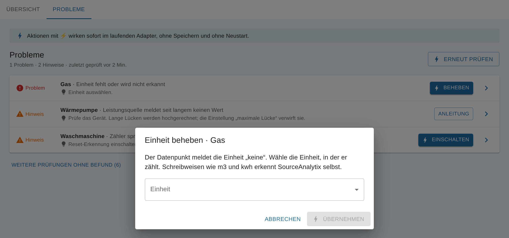

# Log-Meldungen und Fehler beim Einrichten

<!-- seite: gewicht=129; en=en/04.fehlerbehebung/01.log-meldungen.md -->

<a id="error-unit-not-supported-no"></a>

## Fehler "unit not supported" / "No unit defined" – wie trage ich die Einheit ein?

<!-- abschnitt: prio=A; gewicht=32; readme=partial; cluster=outputs-viz-07,logs-install-10,setup-ui-13; features=source-unit,unit-detection-conversion,supported-units,log-source-config-errors -->
<!-- muss beantworten: Ursachen (Einheit am Datenpunkt fehlt oder unbekannt), Lösung, Verweis auf Referenz Einheiten. -->

**Kurz:** SourceAnalytix findet für den Datenpunkt keine Einheit, mit der es rechnen kann, und berechnet ihn nicht. Ab v0.7.0 steht die Quelle dann in den Instanz-Einstellungen im Tab „Probleme“ mit „Einheit fehlt oder wird nicht erkannt“. Klicke dort auf „Beheben“ und wähle die Einheit, in der das Gerät den Wert liefert.
<!-- quelle: code=main.js:2072-2090; code=lib/source-overview.js:48-53; code=lib/source-overview.js:159; code=src-admin/src/SourcesApp.tsx:447-449; code=src-admin/src/i18n/de.json:114; code=src-admin/src/i18n/de.json:214; issue=#1269 -->

So sieht die Meldung im Log aus:

```text
No unit defined for <Datenpunkt>, cannot execute calculations !
Please choose unit manually in state configuration
Cannot handle calculations for <Datenpunkt>, check log messages and adjust settings!
```
<!-- quelle: code=main.js:2087-2088; code=main.js:2136; code=main.js:1927-1928@v0.6.1; code=main.js:1954@v0.6.1 -->

Der Datenpunkt wird dann nicht berechnet, und SourceAnalytix legt für ihn keine States an. Die Meldung `Sorry unite type … not supported` stammt aus alten Versionen bis v0.4.2. Seit v0.4.7 heißt sie `No unit defined`.
<!-- quelle: code=main.js:1954-1958@v0.6.1; code=main.js:327@0.4.2; code=main.js:251@v0.4.7 -->

### Woher die Meldung kommt

SourceAnalytix nimmt die Einheit, die du bei der Quelle gewählt hast (ab v0.7.0 in der Detailansicht der Quelle unter „Einheit“, bis v0.6.x im Dialog am Datenpunkt unter „Wählen Sie Einheit“). Steht dort „Automatisch erkennen“, nimmt es die Einheit am Objekt des Datenpunkts. Die Meldung erscheint, wenn beides nicht klappt:

- Das Objekt hat **keine Einheit**. Das ist oft bei Datenpunkten aus Skripten oder bei selbst angelegten Datenpunkten so.
- Die Einheit am Objekt ist **nicht in der Liste**, zum Beispiel `Watt` statt `W`, `m3` statt `m³` oder `m³/h`.
- Die Größe wird **gar nicht unterstützt**, zum Beispiel Stück, Impulse, Betriebsstunden oder `%`. **Ab v0.7.0** gibt es für Stück und Impulse die Einheiten `piece` und `piece/min` (siehe [Stück und Impulse](../03.referenz/01.einstellungen.md#units-supported-energy-volume-weight)).
<!-- quelle: code=main.js:1914-1930@v0.6.1; code=lib/calculation.js:8-33@v0.6.1; code=main.js:2072-2090; code=src-admin/src/SourceDetail.tsx:388-403; issue=#1264; issue=#304; issue=#74 -->

Welche Einheiten es gibt, steht in der [Referenz der Einheiten](../03.referenz/01.einstellungen.md#units-supported-energy-volume-weight).

### So gehst du vor (ab v0.7.0)

1. Öffne unter „Instanzen“ die Einstellungen der SourceAnalytix-Instanz und dort den Tab „Probleme“. Die Instanz muss laufen.
2. Suche die Zeile deiner Quelle mit „Einheit fehlt oder wird nicht erkannt“ und klicke auf „Beheben“.
3. Der Dialog „Einheit beheben“ zeigt, welche Einheit der Datenpunkt meldet. Wähle unter „Einheit“ die Einheit, in der das Gerät zählt. Liefert dein Gaszähler `m3`, wählst du `m³`. Liefert die Steckdose Watt, wählst du `W`.
4. Klicke auf „Übernehmen“. Die Einstellung wirkt sofort, ohne Neustart. Im Log steht danach `Enable SourceAnalytix for : <Datenpunkt>` ohne Fehlermeldung, und nach „Erneut prüfen“ ist die Zeile im Tab „Probleme“ verschwunden.
<!-- quelle: code=src-admin/src/SourcesApp.tsx:338-410; code=src-admin/src/SourcesApp.tsx:447-449; code=src-admin/src/Dialogs.tsx:515-572; code=src-admin/src/i18n/de.json:49; code=src-admin/src/i18n/de.json:114; code=src-admin/src/i18n/de.json:301-302; code=main.js:2432; issue=#1269 -->



Dieselbe Auswahl findest du in der Detailansicht der Quelle unter „Einstellungen“, Feld „Einheit“. Eine neue Quelle legst du am besten mit „Quelle hinzufügen“ an: Der Assistent geht erst weiter, wenn eine Einheit gewählt ist.
<!-- quelle: code=src-admin/src/SourceDetail.tsx:388-403; code=src-admin/src/Wizard.tsx:158-166; code=src-admin/src/i18n/de.json:30 -->

**Bis v0.6.x:** Öffne die SourceAnalytix-Einstellungen des Datenpunkts ([so findest du sie](../01.erste-schritte/02.erster-zaehler.md#configure-sourceanalytix-datapoint)), wähle unter „Wählen Sie Einheit“ die Einheit und speichere. Findet der Dialog keine passende Einheit, zeigt er „Keine passende Einheit erkannt. Bitte eine Einheit auswählen“ und speichert nicht.
<!-- quelle: code=admin/jsonCustom.json:52-66@v0.6.1; code=admin/jsonCustom.json:58-60@v0.6.1; code=admin/i18n/de.json:47@v0.6.1; code=main.js:2172-2173@v0.6.1 -->

> [!IMPORTANT]
> Wähle die Einheit, die das Gerät **liefert**, nicht die, die du sehen willst. In welcher Einheit SourceAnalytix rechnet und anzeigt, legt die Preisdefinition fest. Wählst du `kWh`, obwohl das Gerät `Wh` liefert, sind alle Werte 1.000-mal zu groß.
<!-- quelle: code=main.js:1982-1983@v0.6.1; code=lib/calculation.js:42-65@v0.6.1 -->

Steht im Log stattdessen `reading incorrect after conversion contact DEV`, passt die Einheit des Datenpunkts nicht zur Einheit der Preisdefinition, zum Beispiel `kg` und `kWh`. Ab v0.6.2 meldet SourceAnalytix das schon beim Start: `Unit <Einheit> of <Datenpunkt> cannot be converted to unit <Einheit> of price definition <Name>` ([#1278](https://github.com/DrozmotiX/ioBroker.sourceanalytix/issues/1278)). Wähle dann eine Preisdefinition mit passender Einheit. Ab v0.7.0 steht die Quelle in diesem Fall im Tab „Probleme“ mit „Einheit passt nicht zum Preis“. Bis v0.6.1 erscheint dieselbe Meldung auch, wenn die Quelle Text statt einer Zahl liefert (siehe [Quelle liefert Text statt Zahl](#source-delivers-text-instead-number)).
<!-- quelle: code=main.js:2997-3008@v0.6.1; code=lib/calculation.js:52-60@v0.6.1; code=main.js:2107-2119; code=lib/source-overview.js:59-60; code=src-admin/src/i18n/de.json:213; issue=#1255; issue=#1278 -->

**Ab v0.6.2:** SourceAnalytix erkennt am Objekt auch die Schreibweisen `m3`, `kwh` und ähnliche und rechnet mit `m³` bzw. `kWh` ([#1264](https://github.com/DrozmotiX/ioBroker.sourceanalytix/issues/1264)). Im Log steht dann `Unit "m3" of <Datenpunkt> is used as m³`. Auch der Einstellungsdialog nimmt diese Schreibweisen bei „Automatisch erkennen“ an ([#1278](https://github.com/DrozmotiX/ioBroker.sourceanalytix/issues/1278)). Ausgeschriebene Namen wie `Watt` oder `Liter` wählst du weiterhin von Hand aus.
<!-- quelle: issue=#1264; pr=#1274; issue=#1278; code=main.js:2072-2085; code=lib/calculation.js:25; code=lib/calculation.js:114 -->

**Siehe auch:** [Welche Einheiten werden unterstützt?](../03.referenz/01.einstellungen.md#units-supported-energy-volume-weight) · [Welche Einheit stelle ich am Datenpunkt ein?](../02.anleitungen/01.quellen-und-einheiten.md#unit-datapoint-kwh-wh-m3)

<a id="error-known-valueatdevicereset-known-cumulative"></a>

## Fehler "Known valueAtDeviceReset > known cumulative value"

<!-- abschnitt: prio=B; gewicht=19; readme=missing; cluster=logs-install-06,periods-09,meter-readings-20; features=log-source-config-errors,source-hidden-reset-keys,reset-manual-correction,calc-first-activation-start-values,source-start-values -->
<!-- muss beantworten: Offset und cumulativeReading in Einklang bringen. -->

**Kurz:** Der gespeicherte Offset (`valueAtDeviceReset`) ist größer als der Gesamtstand (`cumulativeReading`). Ab v0.6.2 ist das nur noch eine Warnung: Die Quelle läuft weiter, und SourceAnalytix richtet den Offset mit dem nächsten Wert selbst aus. Prüfe danach den Gesamtstand und gleiche ihn bei Bedarf mit der Aktion „Zählerstand angleichen“ an deinen Zähler an. Bis v0.6.1 startet die Quelle bei diesem Fehler nicht.
<!-- quelle: code=main.js:2121-2131; code=main.js:3520-3530; code=main.js:1943-1952@v0.6.1; issue=#1257; issue=#640 -->

Die Begriffe Gesamtstand, Gerätewert und Offset sind unter [Die Begriffe](../05.hintergrund/02.zaehler-reset.md#device-reset-detected-mean-reset) erklärt. Es gilt immer: Gesamtstand = Gerätewert + Offset.

### So sieht die Meldung aus

Ab v0.6.2 steht beim Start eine Warnung im Log, mit dem nächsten Wert der Quelle folgt die zweite Zeile:

```text
Known valueAtDeviceReset (<Offset>) of <Datenpunkt> is larger than the known cumulative value (<Gesamtstand>); the offset will be realigned with the next reading so the total continues from <Gesamtstand>
Realigned valueAtDeviceReset of <Datenpunkt> from <alter Offset> to <neuer Offset>: device value <Gerätewert>, total continues from <Gesamtstand>
```
<!-- quelle: code=main.js:2128; code=main.js:3524; issue=#1257; pr=#1274 -->

Bis v0.6.1 ist es ein Fehler, und die Quelle wird nicht gestartet:

```text
Check settings for <Datenpunkt> ! Known valueAtDeviceReset : (<Offset>) > known cumulative value (<Gesamtstand>) cannot proceed
Troubleshoot Data <Datenpunkt> custom Data : {…}
Cannot handle calculations for <Datenpunkt>, check log messages and adjust settings!
```
<!-- quelle: code=main.js:1946-1947@v0.6.1; code=main.js:1954@v0.6.1 -->

### Woher die Meldung kommt

Der Offset steht in den SourceAnalytix-Einstellungen des Datenpunkts, der Gesamtstand im State `sourceanalytix.0.<Gerät>.cumulativeReading`. Passen beide nicht mehr zusammen, kommt die Meldung. Typische Auslöser:

- Du hast nur `cumulativeReading` von Hand gesenkt oder auf 0 gesetzt, zum Beispiel nach einer alten Anleitung.
- Der State `cumulativeReading` oder der ganze Ordner der Quelle wurde gelöscht. Ein fehlender Gesamtstand zählt als 0, der Offset in den Einstellungen bleibt.
- Nach einem Zählertausch oder einem Restore stammen Gesamtstand und Einstellungen aus verschiedenen Zeitpunkten.
<!-- quelle: code=main.js:2062-2066; code=lib/calculation.js:319@v0.6.1; forum=558368; forum=602307; forum=959873; forum=1097776 -->

Leistungsquellen (W) und andere Quellen, deren Gesamtstand SourceAnalytix selbst aufsummiert, haben keinen Offset. Für sie gibt es die Meldung nicht.
<!-- quelle: code=main.js:2125-2127; code=main.js:1944@v0.6.1 -->

### So gehst du vor (ab v0.7.0)

1. Öffne unter „Instanzen“ die Einstellungen der SourceAnalytix-Instanz und im Tab „Übersicht“ deine Quelle.
2. Vergleiche den „Gesamtstand“ mit deinem Zähler. Stimmt er, musst du nichts tun. Den Offset richtet SourceAnalytix mit dem nächsten Wert selbst aus.
3. Stimmt er nicht, wähle bei „Aktionen“ den Eintrag „Zählerstand angleichen“, trage bei „Was zeigt dein Zähler jetzt?“ den abgelesenen Stand ein und klicke auf „Angleichen“. SourceAnalytix setzt Gesamtstand und Offset passend zueinander, sofort und ohne Neustart.
<!-- quelle: code=src-admin/src/SourceDetail.tsx:275-278; code=src-admin/src/SourceDetail.tsx:602-611; code=src-admin/src/Dialogs.tsx:112-200; code=main.js:4124-4175; issue=#640; issue=#1269 -->

Solange der nächste Wert noch nicht da ist, steht die Quelle auch im Tab „Probleme“ mit „Gesamtstand passt nicht zum Zähler“. Der Knopf „Angleichen“ in dieser Zeile öffnet dieselbe Aktion. Den aktuellen Offset zeigt die Detailansicht der Quelle unter „Für Experten“ als `valueAtDeviceReset`.
<!-- quelle: code=lib/source-overview.js:162; code=main.js:4464; code=src-admin/src/SourcesApp.tsx:450-452; code=src-admin/src/SourceDetail.tsx:289-306; code=src-admin/src/i18n/de.json:117; code=src-admin/src/i18n/de.json:205 -->

> [!WARNING]
> Die automatische Ausrichtung zählt vom gespeicherten Gesamtstand weiter, auch wenn dieser falsch ist. Wurde `cumulativeReading` auf 0 gesetzt oder gelöscht, beginnt der Gesamtstand also bei 0. Gleiche ihn dann mit „Zählerstand angleichen“ an deinen Zähler an.
<!-- quelle: code=main.js:3520-3526; code=main.js:2062-2066 -->

**Bis v0.6.1:** Aktualisiere auf v0.6.2 oder neuer (siehe [Wie aktualisiere ich SourceAnalytix?](../02.anleitungen/05.betrieb-und-wartung.md#update-sourceanalytix-downgrade)). Geht das nicht, korrigierst du Gesamtstand und Offset bei gestoppter Instanz von Hand, wie unter [Falsche Werte korrigieren](../02.anleitungen/02.zaehlerstaende-korrigieren.md#correct-wrong-too-high-negative) im Teil „Bis v0.6.x“ beschrieben.
<!-- quelle: issue=#1257; pr=#1274 -->

**Siehe auch:** [Falsche Werte korrigieren](../02.anleitungen/02.zaehlerstaende-korrigieren.md#correct-wrong-too-high-negative) · [Zähler oder Gerät getauscht](../02.anleitungen/02.zaehlerstaende-korrigieren.md#replaced-meter-device-avoid-negative) · [Nach Update oder Restore sind Werte 0](02.falsche-werte-und-bekannte-fehler.md#after-update-restore-values-0)

<a id="error-no-cost-type-defined"></a>

## Fehler "No cost type defined" – Preisdefinition fehlt

<!-- abschnitt: prio=B; gewicht=17; readme=covered; cluster=logs-install-27,setup-ui-12; features=source-price-definition,log-source-config-errors,price-definitions-table -->
<!-- muss beantworten: Preisdefinition anlegen und zuordnen. -->

**Kurz:** Jede Quelle braucht eine Preisdefinition, auch wenn du nur den Verbrauch willst. Ihre Einheit ist die Zieleinheit, in der SourceAnalytix rechnet. Ab v0.7.0 steht eine Quelle ohne gültige Preisdefinition im Tab „Probleme“. Mit „Preis wählen“ öffnest du die Quelle und wählst unter „Preisdefinition“ eine aus.
<!-- quelle: code=main.js:2099-2111; code=lib/source-overview.js:54-58; code=lib/source-overview.js:159; code=src-admin/src/SourcesApp.tsx:456-458; code=src-admin/src/i18n/de.json:112; forum=214572; forum=769206 -->

### So sieht die Meldung aus

Ist bei der Quelle keine Preisdefinition gewählt:

```text
No cost type defined for <Datenpunkt>, please Select Type of calculation at state setting
Cannot handle calculations for <Datenpunkt>, check log messages and adjust settings!
```
<!-- quelle: code=main.js:2100; code=main.js:2136 -->

Ist eine Preisdefinition gewählt, die es nicht mehr gibt, zum Beispiel weil ihre „Kategorie“ umbenannt oder gelöscht wurde:

```text
Selected Type <Name> does not exist in Price Definitions
Please choose proper type for state <Datenpunkt>
Or add price definition <Name> in adapter settings
```
<!-- quelle: code=main.js:2102-2105; code=main.js:1459 -->

In beiden Fällen wird die Quelle nicht berechnet, und es entstehen keine States. Im Tab „Probleme“ heißen die Fälle „Keine Preisdefinition gewählt“ und „Preisdefinition gibt es nicht mehr“. Die alte Meldung `Error in case handling of cost type identification: undefined` gibt es in aktuellen Versionen nicht mehr.
<!-- quelle: code=main.js:2134-2140; code=src-admin/src/i18n/de.json:204; code=src-admin/src/i18n/de.json:207; code=CHANGELOG_OLD.md:120; forum=214572; issue=#116 -->

### So gehst du vor (ab v0.7.0)

1. Gibt es noch keine passende Preisdefinition, lege sie in den Instanz-Einstellungen im Tab „Preisdefinitionen“ an. Wichtig ist die „Einheit“: Sie muss zur Quelle passen, zum Beispiel `kWh` für einen Stromzähler oder eine Leistung in W. Speichern startet den Adapter neu.
2. Öffne den Tab „Probleme“ und klicke in der Zeile der Quelle auf „Preis wählen“. Die Detailansicht der Quelle öffnet sich.
3. Wähle unter „Einstellungen“ bei „Preisdefinition“ eine Kategorie. Die Liste zeigt die Einheit in Klammern, zum Beispiel `Strom (kWh)`.
4. Klicke auf „Übernehmen“. Die Quelle startet sofort, ohne Neustart.
<!-- quelle: code=admin/jsonConfig.json:38-43; code=admin/i18n/de.json:53; code=src-admin/src/i18n/de.json:165; code=src-admin/src/SourcesApp.tsx:456-458; code=src-admin/src/SourceDetail.tsx:405-421; code=src-admin/src/SourceDetail.tsx:582-596; code=main.js:2394-2440 -->

Passt die Einheit der Preisdefinition nicht zur Quelle, meldet der Tab „Probleme“ danach „Einheit passt nicht zum Preis“ (siehe [Fehler „unit not supported“ / „No unit defined“](#error-unit-not-supported-no)). Der Assistent „Quelle hinzufügen“ bietet nur Preisdefinitionen mit passender Einheit an und geht ohne Auswahl nicht weiter.
<!-- quelle: code=lib/source-overview.js:59-60; code=src-admin/src/Wizard.tsx:158-166; code=src-admin/src/Wizard.tsx:553-570 -->

**Bis v0.6.x:** Wähle im Dialog am Datenpunkt bei „Preisdefinition auswählen“ eine Kategorie und speichere ([so findest du den Dialog](../01.erste-schritte/02.erster-zaehler.md#configure-sourceanalytix-datapoint)). Seit v0.6.0 lässt sich der Dialog ohne Preisdefinition nicht mehr speichern.
<!-- quelle: code=admin/jsonCustom.json:37-51@v0.6.1; issue=#1202 -->

**Siehe auch:** [Wie ist eine Preisdefinition aufgebaut?](../03.referenz/01.einstellungen.md#price-definition-structured-categories-base) · [Preise zuordnen und eigene Tarife anlegen](../02.anleitungen/03.preise-und-kosten.md#assign-prices-create-custom-tariffs) · [Kosten bleiben 0](02.falsche-werte-und-bekannte-fehler.md#costs-stay-0-not-calculated)

<a id="messages-initialization-failed-cannot-handle"></a>

## Meldungen "Initialization failed" / "Cannot handle calculations" / "reading incorrect"

<!-- abschnitt: prio=B; gewicht=13; readme=missing; cluster=logs-install-07,logs-install-08; features=log-startup-summary,log-source-config-errors,log-lifecycle-info,source-enable,source-hidden-reset-keys -->
<!-- muss beantworten: Bedeutung beim Start und bei Konvertierung; Ursachen prüfen. -->

**Kurz:** Das sind Sammelmeldungen. Sie sagen nur, dass SourceAnalytix eine Quelle nicht gestartet hat oder einen Wert nicht rechnen konnte. Die Ursache steht in den Log-Zeilen direkt davor. Ab v0.7.0 zeigt der Tab „Probleme“ in den Instanz-Einstellungen die Ursache mit einem Vorschlag zur Lösung.
<!-- quelle: code=main.js:160-213; code=main.js:2134-2140; code=lib/source-overview.js:135-196; forum=565033; forum=649964 -->

### Meldungen beim Start und beim Aktivieren

| Meldung | Bedeutung |
|---|---|
| `Initialization of <Datenpunkt> successfully` | Die Quelle läuft. |
| `Initialization of <Datenpunkt> failed, check warn messages !` | Die Quelle wurde nicht gestartet. Der Grund steht davor. |
| `Cannot handle calculations for <Datenpunkt>, check log messages and adjust settings!` | Dasselbe für eine einzelne Quelle, direkt nach dem Grund. |
| `Cannot handle calculations for <n> of <m> enabled states, check error messages` | Zusammenfassung am Ende des Starts: n von m Quellen laufen nicht. |
| `Partially activated SourceAnalytix for <k> of <m> states, check error messages!` | Die übrigen Quellen laufen. |
| `[Cannot enable SourceAnalytix for <Datenpunkt>, check settings and error messages` | Eine Quelle, die du im laufenden Betrieb aktiviert oder geändert hast, konnte nicht starten. |
| `Cannot handle initialisation for <Datenpunkt>` | Folgemeldung: Für die Quelle liegen keine geprüften Einstellungen vor. Auch hier steht der Grund davor. |
<!-- quelle: code=main.js:165-181; code=main.js:206-212; code=main.js:2136; code=main.js:2432-2439; code=main.js:2273-2275 -->

Häufige Gründe in den Zeilen davor:

- `No unit defined for …`: siehe [Fehler „unit not supported“ / „No unit defined“](#error-unit-not-supported-no).
- `No cost type defined for …` oder `Selected Type … does not exist in Price Definitions`: siehe [Fehler „No cost type defined“](#error-no-cost-type-defined).
- `Unit … of … cannot be converted to unit … of price definition …`: Einheit und Preisdefinition passen nicht zusammen, siehe ebenfalls [Fehler „unit not supported“](#error-unit-not-supported-no).
- `Cannot use output ID … no existing output tree to keep`: Die gewünschte technische ID ist ungültig oder schon vergeben, siehe [Name, Alias und Output-ID](../03.referenz/01.einstellungen.md#name-datapoint-alias-output-id).
- Bis v0.6.1 auch `Check settings for … Known valueAtDeviceReset …`: siehe [Fehler „Known valueAtDeviceReset > known cumulative value“](#error-known-valueatdevicereset-known-cumulative).
<!-- quelle: code=main.js:2087; code=main.js:2100-2103; code=main.js:2111; code=main.js:1903-1921; code=main.js:1946@v0.6.1 -->

Sobald du die Ursache in den Einstellungen behebst und übernimmst, startet SourceAnalytix die Quelle ohne Neustart. Im Log steht dann `Enable SourceAnalytix for : <Datenpunkt>` ohne Fehler danach.
<!-- quelle: code=main.js:2394-2440; code=src-admin/src/i18n/de.json:40 -->

### Meldung „reading incorrect after conversion“

```text
[calculationHandler] reading incorrect after conversion contact DEV and provide these info | Reading : null | start reading {…} | stateDetails {…}
```
<!-- quelle: code=main.js:3476; code=main.js:3007@v0.6.1 -->

Bis v0.6.1 kommt sie bei jedem Wert, wenn die Quelle keine Zahl liefert (zum Beispiel `null` oder Text wie `"12,5"`) oder wenn die Einheit der Quelle nicht zur Preisdefinition passt, zum Beispiel `kg` und `kWh`. Die Quelle läuft, rechnet aber nichts. Schau im Verlauf des Quell-Datenpunkts nach, was zur Zeit der Meldung ankam, und prüfe die Einheit.
<!-- quelle: code=main.js:2995-3008@v0.6.1; code=lib/calculation.js:43-65@v0.6.1; forum=558176; forum=1315010; forum=1333372 -->

**Ab v0.6.2** fängt SourceAnalytix beide Ursachen vorher ab: Zahlen in Text liest es selbst, einen Wert ohne Zahl überspringt es mit der Warnung `Value <Wert> of <Datenpunkt> is not a number, reading ignored` (siehe [Quelle liefert Text statt Zahl](#source-delivers-text-instead-number)). Unpassende Einheiten lehnt es schon beim Start ab. Erscheint die Meldung trotzdem, melde sie mit der ganzen Log-Zeile als Issue im Adapter-Repository.
<!-- quelle: code=main.js:3446-3453; code=main.js:2107-2119; issue=#1255; issue=#1278 -->

**Siehe auch:** [Datenpunkt aktiviert, aber es entstehen keine Ordner](#datapoint-enabled-but-no-folders) · [Hohe CPU-Last und zu viel Log-Ausgabe](#high-cpu-memory-use-too)

<a id="source-delivers-text-instead-number"></a>

## Quelle liefert Text statt Zahl (string statt number, Dezimalpunkt)

<!-- abschnitt: prio=B; gewicht=12; readme=missing; cluster=logs-install-09,outputs-viz-32; features=log-calculation-errors,unit-detection-conversion,source-cumulative-meter,reset-invalid-reading,source-alias -->
<!-- muss beantworten: Quelle/Skript/Alias so umstellen, dass eine Zahl ankommt. -->

**Kurz:** Ab v0.6.2 liest SourceAnalytix Zahlen aus Text selbst, mit Komma oder Punkt, zum Beispiel `"12,5"` oder `".14"`. Text mit Einheit oder Tausenderpunkt, zum Beispiel `"12,5 kWh"` oder `"1.234,5"`, kann es nicht lesen und überspringt den Wert mit einer Warnung. Am sichersten ist ein Quell-Datenpunkt vom Typ Zahl.
<!-- quelle: code=main.js:3446-3453; code=lib/dynamic-pricing.js:7-17; issue=#1255; pr=#1274 -->

### So erkennst du es

- **Ab v0.7.0** steht die Quelle im Tab „Probleme“ mit dem Hinweis „Datenpunkt liefert Text statt einer Zahl“, solange der letzte Wert Text ist. Der Knopf „Anleitung“ führt hierher.
- **Ab v0.6.2** steht bei einem Text ohne lesbare Zahl im Log `Value "<Wert>" of <Datenpunkt> is not a number, reading ignored`. Der Wert zählt nicht, der nächste lesbare Wert schon.
- **Bis v0.6.1** rechnet SourceAnalytix mit keinem Text-Wert. Bei Zählerständen steht bei jedem Wert `reading incorrect after conversion contact DEV … Reading : null` im Log, die Quelle bleibt ohne Werte.
<!-- quelle: code=lib/source-overview.js:161; code=src-admin/src/i18n/de.json:131; code=src-admin/src/i18n/de.json:212; code=src-admin/src/SourcesApp.tsx:414-418; code=src-admin/src/SourcesApp.tsx:437-440; code=main.js:3452; code=lib/calculation.js:43@v0.6.1; code=main.js:3007@v0.6.1; issue=#1255 -->

**Ab v0.7.0** liest SourceAnalytix auch bei Leistungsquellen (W) Text mit Komma oder Punkt, zum Beispiel `"1,5"`, so wie bei Zählerständen. Ist der Text keine Zahl, steht `Value "<Wert>" of <Datenpunkt> is not a number, reading ignored` im Log, und der Wert zählt nicht ([#1288](https://github.com/DrozmotiX/ioBroker.sourceanalytix/issues/1288)).
<!-- quelle: issue=#1288; code=main.js:3870-3876; code=lib/dynamic-pricing.js:7-17 -->

**Bis v0.6.x** wandelt SourceAnalytix Text bei Leistungsquellen nur mit Dezimalpunkt um (`"12.5"`). Mit Komma steht bei jedem Wert `[wattToWattHour] Invalid power reading interval for <Datenpunkt>, using current reading as new baseline` im Log, und es entsteht kein Verbrauch.
<!-- quelle: code=main.js:3335@v0.6.1; code=main.js:3366@v0.6.1; code=lib/calculation.js:766-781; issue=#1288 -->

### So stellst du auf eine Zahl um

1. Prüfe zuerst, ob der Quell-Adapter eine Einstellung für Zahlen hat oder einen anderen Datenpunkt mit dem Zählerstand als Zahl anbietet. Den nimmst du.
2. Sonst legst du einen eigenen Datenpunkt vom Typ „Zahl“ an, zum Beispiel einen Alias vom Typ Zahl, dessen Lesefunktion den Text umwandelt, oder ein Skript, das den Text mit `parseFloat` umwandelt und in den neuen Datenpunkt schreibt. Ersetze dabei vorher das Komma durch einen Punkt.
3. Gib dem neuen Datenpunkt die Einheit, in der das Gerät zählt, zum Beispiel `kWh`.
4. Richte den neuen Datenpunkt mit „Quelle hinzufügen“ als Quelle ein.
<!-- quelle: forum=559520; forum=590394; forum=1284986; forum=943059; forum=870108; issue=#468; code=src-admin/src/i18n/de.json:30 -->

> [!NOTE]
> Der neue Datenpunkt ist für SourceAnalytix eine neue Quelle mit einem eigenen Ordner. Die Werte der alten Quelle bleiben in ihrem Ordner stehen. Den Zählerstand übernimmst du mit [Startwerten](../01.erste-schritte/02.erster-zaehler.md#start-values-unit) oder mit „Zählerstand angleichen“.
<!-- quelle: interview=7; issue=#1271; issue=#640 -->

**Siehe auch:** [Skript-Datenpunkte und unzuverlässige Quellen](../02.anleitungen/01.quellen-und-einheiten.md#use-script-datapoints-unreliable-sources) · [Meldung „reading incorrect after conversion“](#messages-initialization-failed-cannot-handle)

<a id="datapoint-enabled-but-no-folders"></a>

## Datenpunkt aktiviert, aber es entstehen keine Ordner oder States

<!-- abschnitt: prio=B; gewicht=10; readme=missing; cluster=setup-ui-15,setup-ui-27,cumulative-power-25; features=source-enable,log-source-config-errors,output-tree-layout,source-calc-consumption,source-price-definition -->
<!-- muss beantworten: Checkliste: Kostenart, Einheit, Meldungen, Aktivierung, Objektliste. -->

**Kurz:** Fast immer hat SourceAnalytix die Quelle abgelehnt, meist wegen einer fehlenden Preisdefinition oder Einheit. Ab v0.7.0 siehst du das in den Instanz-Einstellungen: Im Tab „Übersicht“ hat die Quelle den Status „Problem“, im Tab „Probleme“ stehen der Grund und ein Knopf zur Lösung.
<!-- quelle: code=main.js:2134-2140; code=lib/source-overview.js:135-196; code=lib/source-overview.js:206-214; code=src-admin/src/i18n/de.json:257-260; forum=866427; forum=694176; issue=#1008 -->

### Checkliste (ab v0.7.0)

1. **Läuft die Instanz?** Ohne laufende Instanz rechnet SourceAnalytix nicht, und die Übersicht zeigt „Die Übersicht braucht eine laufende Instanz.“
2. **Steht die Quelle im Tab „Übersicht“?** Wenn nicht, ist der Datenpunkt nicht für diese Instanz eingerichtet, zum Beispiel für `sourceanalytix.1` statt `sourceanalytix.0`. Richte ihn mit „Quelle hinzufügen“ ein. Der Assistent prüft Einheit und Preis, bevor er speichert.
3. **Welchen Status hat sie?** „Deaktiviert“: Öffne die Quelle und wähle bei „Aktionen“ den Eintrag „Aktivieren“. „Problem“ oder „Hinweis“: weiter mit Schritt 4.
4. **Was steht im Tab „Probleme“?** „Keine Preisdefinition gewählt“, „Preisdefinition gibt es nicht mehr“, „Einheit fehlt oder wird nicht erkannt“, „Einheit passt nicht zum Preis“ oder „Datenpunkt existiert nicht mehr“. Der Knopf in der Zeile behebt das Problem oder öffnet die passende Stelle.
5. **Was steht im Log?** Nach `Enable SourceAnalytix for : <Datenpunkt>` folgt bei einem Fehler der Grund, siehe [Meldungen „Initialization failed“ / „Cannot handle calculations“](#messages-initialization-failed-cannot-handle).
6. **Ist „Verbrauch“ angehakt?** Ohne den Haken bei „Verbrauch“ in den Einstellungen der Quelle entstehen keine Verbrauchswerte für Tag, Woche, Monat, Quartal und Jahr.
<!-- quelle: code=src-admin/src/SourcesApp.tsx:474-476; code=src-admin/src/i18n/de.json:163; code=main.js:4426-4433; code=src-admin/src/Wizard.tsx:158-166; code=src-admin/src/SourceDetail.tsx:639-646; code=lib/source-overview.js:150-160; code=main.js:2432-2439; code=src-admin/src/SourceDetail.tsx:84-91; code=main.js:2789-2870@v0.6.1 -->

Läuft die Quelle, legt SourceAnalytix sofort den Ordner `sourceanalytix.0.<Gerät>` an. Die ersten Werte erscheinen mit dem nächsten Wert des Datenpunkts. Siehst du den Ordner im Reiter „Objekte“ trotzdem nicht, lade die Ansicht neu und prüfe, ob ein Filter der Objektliste aktiv ist.
<!-- quelle: code=main.js:2267-2330; forum=694176; forum=1217092 -->

**Ab v0.7.0:** Hast du die Quelle im Reiter „Objekte“ am Datenpunkt über „aktiviert“ eingeschaltet, ist noch keine Preisdefinition gewählt. Die Quelle steht dann im Tab „Probleme“ mit „Keine Preisdefinition gewählt“. Wähle die Preisdefinition in ihrer Detailansicht und klicke auf „⚡ Übernehmen“ ([#1286](https://github.com/DrozmotiX/ioBroker.sourceanalytix/issues/1286)).
<!-- quelle: issue=#1286; code=admin/jsonCustom.json:1-55; code=admin/i18n/de.json:146; code=lib/source-overview.js:56; code=src-admin/src/i18n/de.json:204; code=src-admin/src/SourceDetail.tsx:405-421 -->

**Bis v0.6.x:** Prüfe dieselben Punkte im Dialog am Datenpunkt und im Log. Seit v0.6.0 speichert der Dialog nicht ohne Preisdefinition und Einheit. Alte Hinweise, man müsse einen Startwert eintragen, gelten nicht mehr: Leere Startwerte setzt SourceAnalytix bei der ersten Aktivierung selbst.
<!-- quelle: issue=#1202; code=lib/calculation.js:199-221@v0.6.1; forum=212657 -->

**Siehe auch:** [Wo konfiguriere ich SourceAnalytix für einen Datenpunkt?](../01.erste-schritte/02.erster-zaehler.md#configure-sourceanalytix-datapoint) · [Wo finde ich meine Werte?](../01.erste-schritte/02.erster-zaehler.md#values-consumption-today-yesterday)

<a id="high-cpu-memory-use-too"></a>

## Hohe CPU-/Speicherlast und zu viel Log-Ausgabe

<!-- abschnitt: prio=B; gewicht=8; readme=missing; cluster=logs-install-14,logs-install-13; features=source-power-integration,source-average-power,other-object-subscription,calc-calc-block,log-startup-summary -->
<!-- muss beantworten: Anzahl Datenpunkte, Log-Level. -->

**Kurz:** SourceAnalytix rechnet bei jedem neuen Wert jeder Quelle. Viel Last entsteht durch Quellen, die sehr oft senden. Bis v0.6.1 kam eine Dauerlast durch ständiges Neu-Initialisieren dazu, die ab v0.6.2 behoben ist. Für weniger Log-Ausgabe stellst du die Instanz auf die Log-Stufe „warn“.
<!-- quelle: code=main.js:2527-2566; issue=#1233; pr=#1238; interview=5 -->

### Last senken

- **Aktualisieren:** Bis v0.6.1 baut SourceAnalytix bei jeder Änderung am Objekt einer aktiven Quelle die Quelle neu auf, auch wenn sich nichts geändert hat. **Ab v0.6.2** übergeht es solche Änderungen und schreibt Objekte nur, wenn sich ihre Definition ändert ([#1233](https://github.com/DrozmotiX/ioBroker.sourceanalytix/issues/1233)).
- **Seltener senden:** Jede Aktualisierung des Quell-Datenpunkts löst eine Berechnung aus. Sendet ein Gerät jede Sekunde, stelle im Quell-Adapter ein längeres Intervall ein, wenn das geht.
- **Zählerstand statt Leistung:** Liefert dein Gerät einen Zählerstand (kWh), nimm ihn statt der Leistung (W). Siehe [Zähler (kWh) oder Leistung (W)?](../01.erste-schritte/02.erster-zaehler.md#datapoint-enable-meter-kwh-power).
- **Nur nötige Quellen:** Quellen, die du nicht brauchst, schaltest du ab v0.7.0 bei der Quelle mit „Deaktivieren“ ab. Die Daten bleiben erhalten.
<!-- quelle: code=main.js:2144-2190@v0.6.1; code=main.js:2394-2415; code=main.js:2527-2566; code=src-admin/src/i18n/de.json:8-10; issue=#1233; pr=#1238; forum=411981; forum=294377; issue=#109 -->

### Weniger Log-Ausgabe

Eine neue Instanz startet mit der Log-Stufe „info“. Dann schreibt SourceAnalytix beim Start mehrere Zeilen je Quelle. Für den Dauerbetrieb empfiehlt sich „warn“: Warnungen und Fehler siehst du weiter. Die Log-Stufe stellst du im Reiter „Instanzen“ bei der SourceAnalytix-Instanz ein (im Expertenmodus).
<!-- quelle: code=io-package.json:145; code=main.js:165-181; interview=5; forum=406676 -->

**Bis v0.6.1** schreibt eine Quelle mit ausgeschalteter Reset-Erkennung bei jedem fallenden Wert `Cumulative reading for … decreased while reset detection is disabled` auf Stufe Info. **Ab v0.6.2** steht die Meldung nur noch im Debug-Log ([#1262](https://github.com/DrozmotiX/ioBroker.sourceanalytix/issues/1262)).
<!-- quelle: code=main.js:3073@v0.6.1; code=main.js:3601; issue=#1262 -->

Füllt ein anderer Adapter das Log, zum Beispiel ein History-Adapter, hilft dessen Log-Stufe, nicht die von SourceAnalytix.
<!-- quelle: forum=382814 -->

**Siehe auch:** [Warnung zum Objektlimit](#object-limit-warning-5000) · [Bekannte Fehler älterer Versionen](02.falsche-werte-und-bekannte-fehler.md#known-bugs-older-versions-please)

<a id="installation-admin-display-problems"></a>

## Probleme bei Installation und Admin-Anzeige

<!-- abschnitt: prio=B; gewicht=8; readme=missing; cluster=upgrade-migration-other-24,logs-install-25,setup-ui-10,setup-ui-28; features=req-admin-ui-i18n,req-versions -->
<!-- muss beantworten: GitHub-Installation 404/422, Adapter nach Neuinstallation nicht sichtbar, "nicht gepflegt", Multihost. -->

**Kurz:** Installiere SourceAnalytix aus dem Repository „latest“ (Beta), nicht direkt von GitHub. Ab v0.7.0 braucht es Admin 8.0.0 oder neuer, js-controller 6.0.11 und Node.js 22. Fehlt nach der Installation etwas in Admin, lade die Adapterdateien in der Konsole mit `iobroker upload sourceanalytix` neu hoch.
<!-- quelle: interview=21; code=io-package.json:161-170; code=package.json:12; forum=311540; issue=#870 -->

Wie die Installation geht, steht unter [Installation und Instanz anlegen](../01.erste-schritte/01.installation.md#install-sourceanalytix-create-instance).

### Installation von GitHub bricht mit 404 oder 422 ab

Das ist ein Problem der ioBroker-Installation, nicht von SourceAnalytix. In den gemeldeten Fällen half ein Update des js-controllers. Einfacher ist die Installation aus dem Repository „latest“.
<!-- quelle: forum=635126; forum=656505; interview=21 -->

### SourceAnalytix oder seine Einstellungen fehlen in Admin

- **Kein Eintrag unter „Instanzen“:** Nach der Installation musst du eine Instanz anlegen.
- **`Cannot load jsonConfig of sourceanalytix: Not exists` oder `index_m.html not found`:** Admin findet die Dateien der Einstellungsseite nicht. Führe `iobroker upload sourceanalytix` aus und lade die Admin-Seite neu. Bei Versionen vor v0.4.9 fehlte diese Seite ganz, dann hilft nur ein Update.
- **Tabs „Übersicht“ und „Probleme“ leer (ab v0.7.0):** Steht dort „Die Übersicht braucht eine laufende Instanz.“ oder „Quellen konnten nicht geladen werden“, starte die Instanz und klicke auf „Erneut versuchen“. Ist die Instanz gestoppt, sind die Aktionen gesperrt. Einstellungen kannst du weiter ändern und speichern.
<!-- quelle: issue=#465; issue=#472; issue=#453; issue=#870; forum=311540; code=CHANGELOG_OLD.md:58-60; code=src-admin/src/i18n/de.json:151-152; code=src-admin/src/i18n/de.json:163; code=src-admin/src/i18n/de.json:172-173; code=src-admin/src/i18n/de.json:232 -->

### „Nicht gepflegt“ und unterschiedlich große Symbole

Das Kennzeichen „nicht gepflegt“ hängt am Repository, aus dem du installiert hast. Bei einer Installation von GitHub fehlen diese Angaben. Unterschiedlich große Ordner-Symbole sind ein Darstellungseffekt von Admin im Browser am Handy. Beides ändert nichts an der Funktion von SourceAnalytix.
<!-- quelle: forum=1318812; forum=1259911 -->

### Multihost: „admin not found“

SourceAnalytix setzt Admin voraus, ab v0.7.0 in Version 8.0.0 oder neuer. Meldet ein Host beim Start oder bei der Installation „admin not found“, installiere oder aktualisiere Admin. Im gemeldeten Fall fehlte Admin auf dem Host, auf dem die Instanz laufen sollte.
<!-- quelle: code=io-package.json:161-165; forum=522269 -->

**Siehe auch:** [Was brauche ich für SourceAnalytix?](../01.erste-schritte/01.installation.md#requirements-sourceanalytix-have-node-js) · [Wie aktualisiere ich SourceAnalytix?](../02.anleitungen/05.betrieb-und-wartung.md#update-sourceanalytix-downgrade)

<a id="midnight-crash-rollover-wrong-time"></a>

## Mitternacht: Absturz oder Tageswechsel zur falschen Zeit

<!-- abschnitt: prio=B; gewicht=5; readme=missing; cluster=logs-install-17,periods-28; features=rollover-midnight-cron,rollover-hourly-safety-check,rollover-missed-recovery-start,rollover-recover-periods-button -->
<!-- muss beantworten: ENOENT-Fehler, Zeitumstellung. -->

**Kurz:** Der Periodenwechsel läuft um 0:00 Uhr nach der Systemzeit des Rechners oder Containers, auf dem ioBroker läuft. Ein Absturz mit `ENOENT` um Mitternacht kommt vom js-controller, nicht von SourceAnalytix. Einen verpassten Wechsel holt SourceAnalytix selbst nach. Ab v0.7.0 holst du ihn auch mit „Nachholen“ im Tab „Probleme“ nach.
<!-- quelle: code=main.js:3014; code=main.js:3025-3033; code=lib/source-overview.js:172-174; interview=13b; forum=892050; forum=965788 -->

### Absturz mit ENOENT um Mitternacht

Um Mitternacht wechselt der js-controller die Log-Datei. Fehlt die Datei dabei, kann ein Adapter mit `ENOENT` abstürzen. Das lässt sich in SourceAnalytix nicht verhindern. Wichtig ist nur, dass der verpasste Wechsel nachgeholt wird.
<!-- quelle: forum=892050; forum=965788 -->

### So holt SourceAnalytix einen Wechsel nach

- Beim Start prüft SourceAnalytix jede Quelle und holt einen verpassten Wechsel sofort nach.
- Läuft der Adapter, prüft er zusätzlich jede Stunde, ob ein Wechsel fehlt.
- **Ab v0.7.0** steht ein verpasster Wechsel im Tab „Probleme“ als „Periodenwechsel verpasst“. Der Knopf „Nachholen“ holt ihn für diese Quelle nach. Dasselbe macht die Aktion „Perioden nachholen“ bei der Quelle.
- In allen Versionen ab v0.5.5 geht es auch über den Knopf-State `sourceanalytix.0.info.recoverPeriods`.
<!-- quelle: code=main.js:2324-2325; code=main.js:3025-3033; code=lib/source-overview.js:172-174; code=src-admin/src/SourcesApp.tsx:463-466; code=src-admin/src/i18n/de.json:17-19; code=src-admin/src/i18n/de.json:115; code=src-admin/src/i18n/de.json:209; code=main.js:3154-3171; code=README.md:98 -->

Im Log steht dann `Processing calendar rollover for <Datenpunkt>: {…}`. Mehr dazu unter [ioBroker war über Mitternacht aus](../02.anleitungen/05.betrieb-und-wartung.md#iobroker-was-down-midnight-recover).
<!-- quelle: code=main.js:2771 -->

**Ab v0.6.2:** War ioBroker über Mitternacht aus, verteilt SourceAnalytix den Verbrauch der Lücke nach der Zeit auf beide Tage. Bis v0.6.1 landete alles im neuen Tag ([#1260](https://github.com/DrozmotiX/ioBroker.sourceanalytix/issues/1260)).
<!-- quelle: issue=#1260; pr=#1274; code=main.js:2867-2895 -->

### Der Tageswechsel kommt zur falschen Uhrzeit

SourceAnalytix hat keine eigene Zeitzone. Der Wechsel folgt der Zeitzone des Prozesses, in dem ioBroker läuft. Steht ein Docker-Container zum Beispiel auf UTC, wechselt der Tag in Deutschland um 1:00 oder 2:00 Uhr. Stelle dann die Zeitzone des Rechners oder Containers richtig ein, bei Docker etwa mit der Umgebungsvariable `TZ=Europe/Berlin`, und starte den Container neu.
<!-- quelle: code=main.js:3014; interview=13b; forum=516634; issue=#490 -->

**Siehe auch:** [Werden die Werte live aktualisiert, was passiert um Mitternacht?](../05.hintergrund/03.perioden-und-zeit.md#values-updated-live-midnight) · [Vorperioden (previous-States)](../03.referenz/02.states-und-meldungen.md#yesterday-last-week-last-month)

<a id="object-limit-warning-5000"></a>

## Warnung zum Objektlimit (5000)

<!-- abschnitt: prio=B; gewicht=3; readme=missing; cluster=logs-install-18,upgrade-migration-other-15; features=output-tree-layout,other-object-subscription,year-statistics-archive -->
<!-- muss beantworten: js-controller-Warnung und Anheben. -->

**Kurz:** Die Warnung kommt vom js-controller, nicht von SourceAnalytix. Der Adapter selbst kennt kein Objektlimit. Jede aktive Quelle legt einen eigenen Ordner mit vielen States an. Prüfe zuerst, welche Optionen und Quellen du brauchst, und hebe das Limit nur an, wenn die Zahl gewollt ist.
<!-- quelle: forum=1343567; forum=1313361; code=main.js:2216-2245 -->

### Weniger Objekte

- In den Instanz-Einstellungen unter „Haupteinstellungen“ legen die Bereiche „Jahresstatistik“ („Wochen“, „Monate“, „Quartale“) und „Laufendes Jahr“ („Wochentag“, „Wochen“, „Monate“, „Quartale“, „Vorheriger Zeitraum“) fest, welche States jede Quelle bekommt. Schaltest du eine Option ab, entfernt SourceAnalytix die zugehörigen States.
- Quellen, die du nicht mehr brauchst, entfernst du ab v0.7.0 mit der Aktion „Daten löschen“ samt Ordner und allen Jahren.
- Alte Jahres- und Wochenordner kannst du gefahrlos löschen.
<!-- quelle: code=admin/jsonConfig.json:195-295; code=admin/i18n/de.json:17; code=admin/i18n/de.json:33; code=admin/i18n/de.json:40; code=admin/i18n/de.json:52; code=admin/i18n/de.json:62; code=admin/i18n/de.json:81-84; code=main.js:2216-2245; code=CHANGELOG_OLD.md:12; code=src-admin/src/i18n/de.json:11-13; issue=#1265; interview=8 -->

> [!CAUTION]
> „Daten löschen“ entfernt den Ordner der Quelle mit allen Werten und Jahren endgültig. Willst du nur pausieren, nimm „Deaktivieren“.
<!-- quelle: code=src-admin/src/i18n/de.json:11-13; code=src-admin/src/i18n/de.json:73; issue=#1265 -->

### Limit anheben

Das Limit gehört zum js-controller. Im gemeldeten Fall ließ es sich im Expertenmodus am Objekt der Instanz (`system.adapter.sourceanalytix.0`) anheben.
<!-- quelle: forum=1343567 -->

**Siehe auch:** [Welche Einstellungen hat die Instanz?](../03.referenz/01.einstellungen.md#instance-settings-exist-periods-decimals) · [Quelle deaktivieren oder entfernen](../02.anleitungen/05.betrieb-und-wartung.md#disable-datapoint-remove-sources-states)

<a id="source-adapter-history-shows-0"></a>

## Quell-Adapter oder History zeigt 0 oder alte Werte

<!-- abschnitt: prio=B; gewicht=2; readme=missing; cluster=logs-install-22,logs-install-23; features=source-enable,source-cumulative-meter,output-tree-layout -->
<!-- muss beantworten: Wechselwirkung mit Quell-Adapter und History. -->

**Kurz:** SourceAnalytix liest nur den Datenpunkt, den du als Quelle eingerichtet hast, und schreibt nie in dessen Wert. Zeigt SourceAnalytix 0 oder alte Werte, kommt am Quell-Datenpunkt meist nichts mehr an. Nullen im Verlauf des Quell-Datenpunkts stammen vom Quell-Adapter oder von einem Skript.
<!-- quelle: code=main.js:2339; code=main.js:2527-2566; forum=1337092; forum=511730 -->

### Der Quell-Adapter hat seine Datenpunkte umbenannt

Benennt ein Adapter nach einem Update seine Datenpunkte um, kommen die Werte in neuen Datenpunkten an. SourceAnalytix hört weiter auf den alten, und seine Werte bleiben stehen.

1. Öffne in den Instanz-Einstellungen die Quelle und prüfe „Letzte Aktualisierung“.
2. Ist der alte Datenpunkt gelöscht, steht die Quelle ab v0.7.0 im Tab „Probleme“ mit „Datenpunkt existiert nicht mehr“. Der Knopf „Deaktivieren“ hält die Quelle an, die Daten bleiben erhalten.
3. Richte den neuen Datenpunkt mit „Quelle hinzufügen“ als neue Quelle ein und übernimm den Zählerstand mit „Zählerstand angleichen“.
4. Passe Verknüpfungen in VIS oder Skripten auf den neuen Ordner an. Der alte Ordner bleibt als Archiv stehen.
<!-- quelle: code=src-admin/src/SourceDetail.tsx:283-286; code=lib/source-overview.js:155-157; code=src-admin/src/SourcesApp.tsx:459-462; code=src-admin/src/i18n/de.json:210; code=src-admin/src/i18n/de.json:276; interview=7; forum=1337092 -->

Die Aktion „Datenpunkt wechseln“, die die Daten zum neuen Datenpunkt mitnimmt, ist geplant ([#1271](https://github.com/DrozmotiX/ioBroker.sourceanalytix/issues/1271)).
<!-- quelle: issue=#1271; code=src-admin/src/i18n/de.json:23-25; code=src-admin/src/i18n/de.json:199 -->

### Nullen im Verlauf des Quell-Datenpunkts

SourceAnalytix schreibt Werte nur in seinen eigenen Ordner `sourceanalytix.0.<Gerät>`. Am Objekt des Quell-Datenpunkts ändert es nur seine eigenen Einstellungen, zum Beispiel den Offset, nicht den Wert. Eine 0 im Verlauf des Quell-Datenpunkts schreibt also ein anderer Adapter oder ein Skript.
<!-- quelle: code=main.js:3528-3529; code=main.js:1844; code=main.js:4329; forum=511730 -->

**Siehe auch:** [Datenpunkt aktiviert, aber es entstehen keine Ordner](#datapoint-enabled-but-no-folders) · [Quelle deaktivieren oder entfernen](../02.anleitungen/05.betrieb-und-wartung.md#disable-datapoint-remove-sources-states)
