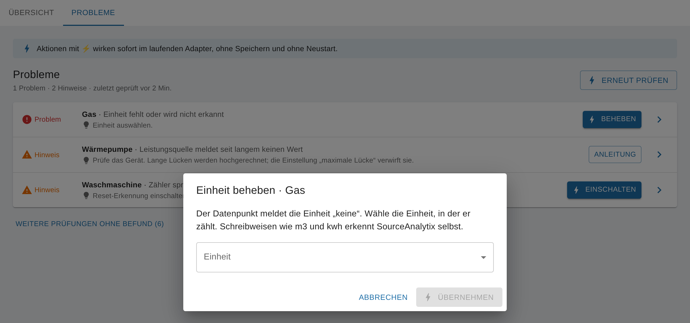

# Log-Meldungen und Fehler beim Einrichten

<!-- seite: gewicht=129; en=en/04.fehlerbehebung/01.log-meldungen.md -->

## Fehler "unit not supported" / "No unit defined" – wie trage ich die Einheit ein?

<!-- abschnitt: prio=A; gewicht=32; readme=partial; cluster=outputs-viz-07,logs-install-10,setup-ui-13; features=source-unit,unit-detection-conversion,supported-units,log-source-config-errors -->
<!-- muss beantworten: Ursachen (Einheit am Datenpunkt fehlt oder unbekannt), Lösung, Verweis auf Referenz Einheiten. -->

SourceAnalytix findet keine Einheit, mit der es rechnen kann, und lässt die Quelle aus. Klicke im Tab „Probleme“ bei „Einheit fehlt oder wird nicht erkannt“ auf „Beheben“ und wähle die Einheit, in der das Gerät liefert.
<!-- quelle: code=main.js; code=lib/source-overview.js; code=src-admin/src/SourcesApp.tsx; code=src-admin/src/i18n/de.json; issue=#1269 -->

Im Log steht dazu `No unit defined for <Datenpunkt>, cannot execute calculations !`.
<!-- quelle: code=main.js -->

Ursachen: Das Objekt hat keine Einheit (oft bei Skript-Datenpunkten), die Einheit ist ausgeschrieben wie `Watt`, oder die Größe wird nicht unterstützt, etwa `%` oder `h`. Schreibweisen wie `m3` oder `kwh` erkennt SourceAnalytix selbst.
<!-- quelle: code=main.js; code=lib/calculation.js; issue=#1264 -->

> [!IMPORTANT]
> Wähle die Einheit, die das Gerät **liefert**, nicht die, die du sehen willst. Die Anzeige-Einheit kommt aus der Preisdefinition. `kWh` statt `Wh` macht alle Werte 1.000-mal zu groß.
<!-- quelle: code=main.js; code=lib/calculation.js -->

Meldet der Tab „Probleme“ stattdessen „Einheit passt nicht zum Preis“, etwa `kg` und `kWh`, wähle eine Preisdefinition mit passender Einheit.
<!-- quelle: code=main.js; code=lib/source-overview.js; code=src-admin/src/i18n/de.json; issue=#1278 -->

**Siehe auch:** [Welche Einheiten werden unterstützt?](../03.referenz/01.einstellungen.md#units-supported-energy-volume-weight) · [Welche Einheit am Datenpunkt?](../02.anleitungen/01.quellen-und-einheiten.md#unit-datapoint-kwh-wh-m3)

## Fehler "Known valueAtDeviceReset > known cumulative value"

<!-- abschnitt: prio=B; gewicht=19; readme=missing; cluster=logs-install-06,periods-09,meter-readings-20; features=log-source-config-errors,source-hidden-reset-keys,reset-manual-correction,calc-first-activation-start-values,source-start-values -->
<!-- muss beantworten: Offset und cumulativeReading in Einklang bringen. -->

Der gespeicherte Offset ist größer als der Gesamtstand. Die Quelle läuft trotzdem weiter, und SourceAnalytix richtet den Offset mit dem nächsten Wert selbst aus. Prüfe danach den „Gesamtstand“ der Quelle.
<!-- quelle: code=main.js; issue=#1257 -->

Das passiert meist, wenn `cumulativeReading` von Hand gesenkt oder gelöscht wurde oder nach einem Restore Gesamtstand und Einstellungen nicht zusammenpassen. Bei Leistungsquellen kommt die Meldung nicht vor.
<!-- quelle: code=main.js; forum=558368; forum=602307; forum=959873; forum=1097776 -->

1. Öffne die Quelle und vergleiche den „Gesamtstand“ mit deinem Zähler.
2. Stimmt er nicht, wähle „Zählerstand angleichen“ und trage den abgelesenen Stand ein. Das geht auch über „Angleichen“ im Tab „Probleme“ bei „Gesamtstand passt nicht zum Zähler“.
<!-- quelle: code=src-admin/src/SourceDetail.tsx; code=src-admin/src/Dialogs.tsx; code=lib/source-overview.js; code=main.js; issue=#640; issue=#1269 -->

Die automatische Ausrichtung zählt vom gespeicherten Gesamtstand weiter. Wurde er auf 0 gesetzt, beginnt er bei 0, bis du ihn angleichst.
<!-- quelle: code=main.js -->

**Siehe auch:** [Falsche Werte korrigieren](../02.anleitungen/02.zaehlerstaende-korrigieren.md#correct-wrong-too-high-negative) · [Nach Restore sind Werte 0](02.falsche-werte-und-bekannte-fehler.md#after-update-restore-values-0)

## Fehler "No cost type defined" – Preisdefinition fehlt

<!-- abschnitt: prio=B; gewicht=17; readme=covered; cluster=logs-install-27,setup-ui-12; features=source-price-definition,log-source-config-errors,price-definitions-table -->
<!-- muss beantworten: Preisdefinition anlegen und zuordnen. -->

Der Quelle fehlt eine Preisdefinition. Die braucht jede Quelle, auch wenn du nur den Verbrauch willst, denn sie legt die Einheit fest. Klicke im Tab „Probleme“ auf „Preis wählen“ und wähle unter „Preisdefinition“ eine aus.
<!-- quelle: code=main.js; code=lib/source-overview.js; code=src-admin/src/SourcesApp.tsx; code=src-admin/src/i18n/de.json; forum=214572; forum=769206 -->

Der Tab „Probleme“ unterscheidet zwei Fälle:

- „Keine Preisdefinition gewählt“, im Log `No cost type defined for <Datenpunkt> …`. Das ist auch so, wenn du die Quelle am Datenpunkt im Reiter „Objekte“ eingeschaltet hast.
- „Preisdefinition gibt es nicht mehr“, im Log `Selected Type <Name> does not exist in Price Definitions`, etwa nach dem Umbenennen einer Kategorie.
<!-- quelle: code=main.js; code=src-admin/src/i18n/de.json; issue=#1286 -->

Gibt es noch keinen passenden Preis, lege ihn im Tab „Preisdefinitionen“ an und speichere. Die Quelle startet nach „⚡ Übernehmen“ sofort.
<!-- quelle: code=admin/jsonConfig.json; code=src-admin/src/SourceDetail.tsx; code=main.js -->

**Siehe auch:** [Preisdefinition](../03.referenz/01.einstellungen.md#price-definition-structured-categories-base) · [Kosten bleiben 0](02.falsche-werte-und-bekannte-fehler.md#costs-stay-0-not-calculated)

## Meldungen "Initialization failed" / "Cannot handle calculations" / "reading incorrect"

<!-- abschnitt: prio=B; gewicht=13; readme=missing; cluster=logs-install-07,logs-install-08; features=log-startup-summary,log-source-config-errors,log-lifecycle-info,source-enable,source-hidden-reset-keys -->
<!-- muss beantworten: Bedeutung beim Start und bei Konvertierung; Ursachen prüfen. -->

Das sind Sammelmeldungen: Eine Quelle wurde nicht gestartet. Die Ursache steht in den Log-Zeilen davor und im Tab „Probleme“, dort mit Vorschlag zur Lösung.
<!-- quelle: code=main.js; code=lib/source-overview.js; forum=565033; forum=649964 -->

Häufige Ursachen davor:

- `No unit defined …`: siehe [Einheit fehlt](#error-unit-not-supported-no).
- `No cost type defined …` oder `Selected Type … does not exist …`: siehe [Preisdefinition fehlt](#error-no-cost-type-defined).
- `Unit … cannot be converted …` oder `The data of … is stored in …`: Einheit und Preisdefinition passen nicht, siehe [Einheit nachträglich ändern](../02.anleitungen/01.quellen-und-einheiten.md#unit-datapoint-kwh-wh-m3).
- `Cannot use output ID …`: Technische ID ungültig oder belegt, siehe [Name und Output-ID](../03.referenz/01.einstellungen.md#name-datapoint-alias-output-id).
<!-- quelle: code=main.js; issue=#1310 -->

Behebst du die Ursache und übernimmst, startet die Quelle ohne Neustart.
<!-- quelle: code=main.js -->

Die Meldung `reading incorrect after conversion contact DEV` sollte nicht vorkommen, weil Text und unpassende Einheiten vorher abgefangen werden. Erscheint sie doch, melde sie mit der ganzen Log-Zeile als Issue.
<!-- quelle: code=main.js; issue=#1255; issue=#1278 -->

**Siehe auch:** [Keine Ordner oder States](#datapoint-enabled-but-no-folders)

## Quelle liefert Text statt Zahl (string statt number, Dezimalpunkt)

<!-- abschnitt: prio=B; gewicht=12; readme=missing; cluster=logs-install-09,outputs-viz-32; features=log-calculation-errors,unit-detection-conversion,source-cumulative-meter,reset-invalid-reading,source-alias -->
<!-- muss beantworten: Quelle/Skript/Alias so umstellen, dass eine Zahl ankommt. -->

Zahlen in Text liest SourceAnalytix selbst, mit Komma oder Punkt, etwa `"12,5"`. Text mit Einheit oder Tausenderpunkt wie `"12,5 kWh"` überspringt es. Am sichersten ist ein Datenpunkt vom Typ Zahl.
<!-- quelle: code=main.js; code=lib/dynamic-pricing.js; issue=#1255; issue=#1288 -->

Der Tab „Probleme“ zeigt dann „Datenpunkt liefert Text statt einer Zahl“, das Log `Value "<Wert>" of <Datenpunkt> is not a number, reading ignored`.
<!-- quelle: code=lib/source-overview.js; code=src-admin/src/i18n/de.json; code=main.js -->

1. Prüfe, ob der Quell-Adapter den Wert auch als Zahl anbietet.
2. Sonst lege einen Alias vom Typ Zahl oder ein Skript mit `parseFloat` an, das den Text umwandelt, mit der Einheit des Geräts.
3. Richte den neuen Datenpunkt mit „Quelle hinzufügen“ ein und übernimm den Zählerstand mit „Zählerstand angleichen“.
<!-- quelle: forum=559520; forum=590394; forum=1284986; forum=943059; forum=870108; issue=#468; interview=7; issue=#640 -->

**Siehe auch:** [Skript-Datenpunkte](../02.anleitungen/01.quellen-und-einheiten.md#use-script-datapoints-unreliable-sources)

## Datenpunkt aktiviert, aber es entstehen keine Ordner oder States

<!-- abschnitt: prio=B; gewicht=10; readme=missing; cluster=setup-ui-15,setup-ui-27,cumulative-power-25; features=source-enable,log-source-config-errors,output-tree-layout,source-calc-consumption,source-price-definition -->
<!-- muss beantworten: Checkliste: Kostenart, Einheit, Meldungen, Aktivierung, Objektliste. -->

Fast immer hat SourceAnalytix die Quelle abgelehnt, meist wegen fehlender Preisdefinition oder Einheit. Im Tab „Übersicht“ hat sie dann den Status „Problem“, im Tab „Probleme“ stehen Grund und Lösung.
<!-- quelle: code=main.js; code=lib/source-overview.js; code=src-admin/src/i18n/de.json; forum=866427; forum=694176; issue=#1008 -->

1. **Läuft die Instanz?** Sonst rechnet SourceAnalytix nicht.
2. **Steht die Quelle in der „Übersicht“?** Wenn nicht, ist sie für eine andere Instanz eingerichtet. Lege sie mit „Quelle hinzufügen“ an.
3. **Status „Deaktiviert“?** Wähle bei der Quelle „Aktivieren“.
4. **Status „Problem“?** Der Knopf im Tab „Probleme“ behebt es oder führt zur passenden Stelle.
5. **Ist „Verbrauch“ an?** Ohne den Haken entstehen keine Verbrauchswerte.
<!-- quelle: code=src-admin/src/SourcesApp.tsx; code=src-admin/src/SourceDetail.tsx; code=src-admin/src/i18n/de.json; code=lib/source-overview.js; code=main.js -->

Läuft die Quelle, entsteht der Ordner `sourceanalytix.0.<Gerät>` sofort, die Werte mit dem nächsten Wert des Datenpunkts. Fehlt der Ordner im Reiter „Objekte“, lade die Ansicht neu und prüfe die Filter.
<!-- quelle: code=main.js; forum=694176; forum=1217092 -->

**Siehe auch:** [Wo konfiguriere ich SourceAnalytix?](../01.erste-schritte/02.erster-zaehler.md#configure-sourceanalytix-datapoint)

## Hohe CPU-/Speicherlast und zu viel Log-Ausgabe

<!-- abschnitt: prio=B; gewicht=8; readme=missing; cluster=logs-install-14,logs-install-13; features=source-power-integration,source-average-power,other-object-subscription,calc-calc-block,log-startup-summary -->
<!-- muss beantworten: Anzahl Datenpunkte, Log-Level. -->

SourceAnalytix rechnet bei jedem neuen Wert jeder Quelle. Last entsteht vor allem durch Quellen, die sehr oft senden. Für weniger Log-Ausgabe stellst du die Instanz auf die Stufe „warn“.
<!-- quelle: code=main.js; issue=#1233; pr=#1238; interview=5 -->

- Stelle im Quell-Adapter ein längeres Sendeintervall ein, wenn das geht.
- Nimm einen Zählerstand statt der Leistung, wenn das Gerät beides liefert.
- Pausiere Quellen, die du nicht brauchst, mit „Deaktivieren“.
<!-- quelle: code=main.js; code=src-admin/src/i18n/de.json; forum=411981; forum=294377; issue=#109 -->

Die Log-Stufe stellst du im Reiter „Instanzen“ im Expertenmodus ein. Füllt ein anderer Adapter das Log, hilft dessen Log-Stufe.
<!-- quelle: code=io-package.json; interview=5; forum=406676; forum=382814 -->

**Siehe auch:** [Objektlimit](#object-limit-warning-5000)

## Probleme bei Installation und Admin-Anzeige

<!-- abschnitt: prio=B; gewicht=8; readme=missing; cluster=upgrade-migration-other-24,logs-install-25,setup-ui-10,setup-ui-28; features=req-admin-ui-i18n,req-versions -->
<!-- muss beantworten: GitHub-Installation 404/422, Adapter nach Neuinstallation nicht sichtbar, "nicht gepflegt", Multihost. -->

Installiere aus dem Repository „latest“, nicht von GitHub, und prüfe die [Voraussetzungen](../01.erste-schritte/01.installation.md#requirements-sourceanalytix-have-node-js). Fehlt danach etwas in Admin, lade die Dateien mit `iobroker upload sourceanalytix` neu hoch.
<!-- quelle: interview=21; code=io-package.json; code=package.json; forum=311540; issue=#870 -->

| Symptom | Lösung |
|---|---|
| GitHub-Installation bricht mit 404 oder 422 ab | js-controller aktualisieren oder aus „latest“ installieren |
| keine Instanz unter „Instanzen“ | Instanz anlegen |
| `Cannot load jsonConfig of sourceanalytix: Not exists` | `iobroker upload sourceanalytix`, Seite neu laden |
| „Übersicht“ leer, „Instanz läuft nicht“ | Instanz starten, „Erneut versuchen“ |
| „nicht gepflegt“ | kommt von einer GitHub-Installation, ohne Wirkung |
| Multihost: „admin not found“ | Admin auf dem Host installieren oder aktualisieren |
<!-- quelle: forum=635126; forum=656505; issue=#465; issue=#472; issue=#453; issue=#870; forum=311540; code=src-admin/src/i18n/de.json; forum=1318812; forum=1259911; code=io-package.json; forum=522269 -->

**Siehe auch:** [Installation](../01.erste-schritte/01.installation.md#install-sourceanalytix-create-instance) · [Update](../02.anleitungen/05.betrieb-und-wartung.md#update-sourceanalytix-downgrade)

## Mitternacht: Absturz oder Tageswechsel zur falschen Zeit

<!-- abschnitt: prio=B; gewicht=5; readme=missing; cluster=logs-install-17,periods-28; features=rollover-midnight-cron,rollover-hourly-safety-check,rollover-missed-recovery-start,rollover-recover-periods-button -->
<!-- muss beantworten: ENOENT-Fehler, Zeitumstellung. -->

Der Wechsel läuft um 0:00 Uhr nach der Systemzeit des ioBroker-Rechners. Kommt er zur falschen Stunde, stimmt dort die Zeitzone nicht. Einen Absturz mit `ENOENT` um Mitternacht verursacht der js-controller beim Wechsel der Log-Datei; den verpassten Wechsel holt SourceAnalytix danach selbst nach.
<!-- quelle: code=main.js; interview=13b; forum=892050; forum=965788 -->

Läuft ioBroker in Docker auf UTC, wechselt der Tag in Deutschland um 1:00 oder 2:00 Uhr. Setze dann die Umgebungsvariable `TZ=Europe/Berlin` und starte den Container neu.
<!-- quelle: code=main.js; interview=13b; forum=516634; issue=#490 -->

Fehlt ein Wechsel, zeigt der Tab „Probleme“ „Periodenwechsel verpasst“ mit „Nachholen“, siehe [ioBroker war um Mitternacht aus](../02.anleitungen/05.betrieb-und-wartung.md#iobroker-was-down-midnight-recover).
<!-- quelle: code=lib/source-overview.js; code=src-admin/src/i18n/de.json -->

## Warnung zum Objektlimit (5000)

<!-- abschnitt: prio=B; gewicht=3; readme=missing; cluster=logs-install-18,upgrade-migration-other-15; features=output-tree-layout,other-object-subscription,year-statistics-archive -->
<!-- muss beantworten: js-controller-Warnung und Anheben. -->

Die Warnung kommt vom js-controller, SourceAnalytix selbst kennt kein Limit. Jede Quelle legt viele States an. Prüfe zuerst, was du brauchst:
<!-- quelle: forum=1343567; forum=1313361; code=main.js -->

- Schalte unter „Haupteinstellungen“ Perioden-Optionen aus, die du nicht nutzt.
- Lösche nicht mehr gebrauchte Quellen mit „Daten löschen“.
- Lösche alte Jahresordner.
<!-- quelle: code=admin/jsonConfig.json; code=main.js; code=src-admin/src/i18n/de.json; issue=#1265; interview=8 -->

Ist die Zahl gewollt, lässt sich das Limit im Expertenmodus am Objekt `system.adapter.sourceanalytix.0` anheben.
<!-- quelle: forum=1343567 -->

**Siehe auch:** [Instanz-Einstellungen](../03.referenz/01.einstellungen.md#instance-settings-exist-periods-decimals)

## Quell-Adapter oder History zeigt 0 oder alte Werte

<!-- abschnitt: prio=B; gewicht=2; readme=missing; cluster=logs-install-22,logs-install-23; features=source-enable,source-cumulative-meter,output-tree-layout -->
<!-- muss beantworten: Wechselwirkung mit Quell-Adapter und History. -->

Am Quell-Datenpunkt kommt meist nichts mehr an. SourceAnalytix liest ihn nur und schreibt nie in seinen Wert; eine 0 im Verlauf des Quell-Datenpunkts stammt vom Adapter oder einem Skript.
<!-- quelle: code=main.js; forum=1337092; forum=511730 -->

Hat der Quell-Adapter seine Datenpunkte umbenannt, hört SourceAnalytix weiter auf den alten:

1. Prüfe bei der Quelle „Letzte Aktualisierung“. Ist der alte Datenpunkt gelöscht, meldet der Tab „Probleme“ „Datenpunkt existiert nicht mehr“.
2. Lege den neuen Datenpunkt mit „Quelle hinzufügen“ an und übernimm den Stand mit „Zählerstand angleichen“.
3. Passe VIS und Skripte auf den neuen Ordner an. Der alte bleibt als Archiv.
<!-- quelle: code=src-admin/src/SourceDetail.tsx; code=lib/source-overview.js; code=src-admin/src/i18n/de.json; interview=7; forum=1337092 -->
