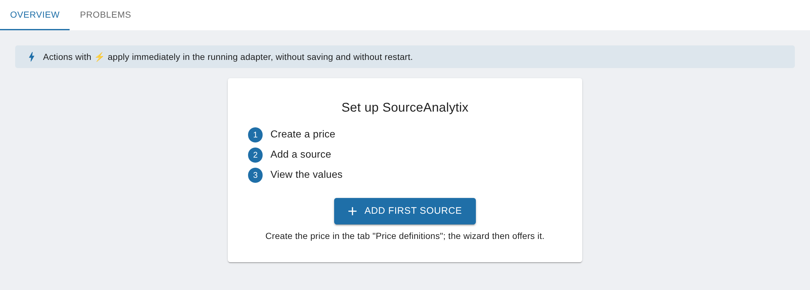

# Installation and requirements

<!-- seite: gewicht=29; en=en/01.erste-schritte/01.installation.md -->

## What does SourceAnalytix require (Node.js, js-controller, Admin)?

<!-- abschnitt: prio=B; gewicht=12; readme=partial; cluster=logs-install-26,upgrade-migration-other-14; features=req-versions,req-admin-ui-i18n -->
<!-- muss beantworten: Mindestversionen von Node.js, js-controller und Admin; Admin-Versionen, mit denen die Oberfläche läuft. -->

You need Node.js 22, js-controller 6.0.11 and Admin 8.0.0 or newer. Admin 8 is required because the instance settings page is built from Admin 8 components.
<!-- quelle: code=io-package.json:161-170; code=package.json:11-13; issue=#1269 -->

The console shows your versions with `iobroker -v` (js-controller) and `node -v` (Node.js). If a component is too old, update it first and SourceAnalytix afterwards.
<!-- quelle: code=.github/ISSUE_TEMPLATE/BugReport.md:31-32; issue=#1202 -->

### SourceAnalytix does not start after a Node.js update

If the log shows `TypeError: Class extends value … is not a constructor or null`, js-controller is usually too old. Update it, run `iob fix` and restart the instance. In Docker, update the container image instead.
<!-- quelle: forum=1195593; forum=218835 -->

**See also:** [How do I update SourceAnalytix?](../02.anleitungen/05.betrieb-und-wartung.md#update-sourceanalytix-downgrade) · [Problems with installation and the Admin display](../04.fehlerbehebung/01.log-meldungen.md#installation-admin-display-problems)

## How do I install SourceAnalytix and create an instance?

<!-- abschnitt: prio=B; gewicht=12; readme=missing; cluster=logs-install-24,setup-ui-03; features=req-versions,req-admin-ui-i18n -->
<!-- muss beantworten: Installation über den Admin-Store oder GitHub; danach Instanz anlegen (nur eine Instanz nötig). -->

SourceAnalytix is in the "latest" repository (beta), not yet in "stable". Switch to "latest", install the adapter and then set up your first source in the instance settings.
<!-- quelle: interview=21; forum=1133140; forum=215063 -->

1. In Admin, choose the "latest" repository under System settings › "Repositories".
2. Search for "SourceAnalytix" on the "Adapters" tab and install it. Admin creates the instance `sourceanalytix.0` and starts it.
3. Open the settings of `sourceanalytix.0` on the "Instances" tab.
4. Create at least one price on the "Price definitions" tab, for example for electricity in kWh, and save.
5. Click "Add first source" on the "Overview" tab. Continue with [My first meter](02.erster-zaehler.md#configure-sourceanalytix-datapoint).
<!-- quelle: interview=21; forum=1133140; forum=953340; code=admin/jsonConfig.json:1-45; code=src-admin/src/SourcesApp.tsx:245-279; code=src-admin/src/Wizard.tsx:553-595; code=src-admin/src/i18n/en.json -->

The "Overview" and "Problems" tabs need a running instance. If it is stopped, "Instance is not running" appears at the top with a "Start" button.
<!-- quelle: code=src-admin/src/SourcesApp.tsx:111-140; code=src-admin/src/SourcesApp.tsx:474-476; code=src-admin/src/Wizard.tsx:955-961 -->

### There is no instance

After installing from the console or a GitHub URL, the instance is missing. Create it on the "Adapters" tab with the plus icon. A GitHub installation is only meant for testing, and Admin shows no updates for it.
<!-- quelle: forum=1133140; forum=953340; forum=1143623; forum=215074; forum=378273; forum=213055; forum=938927; interview=21 -->

**See also:** [Do I need several instances?](#need-several-instances-versions-side)

## Do I need several instances or versions side by side?

<!-- abschnitt: prio=B; gewicht=5; readme=missing; cluster=setup-ui-16,upgrade-migration-other-23; features=source-enable -->
<!-- muss beantworten: Eine Instanz reicht für alle Datenpunkte; zwei Versionen parallel sind nicht möglich; Instanz löschen. -->

No. One instance handles any number of sources. Two versions side by side are not possible, because ioBroker installs exactly one version of each adapter. To test a new version, make a backup and update.
<!-- quelle: code=main.js:126-145; forum=969466; issue=#158 -->

### Removing a surplus instance

1. On the "Objects" tab, check which instance holds your values, `sourceanalytix.0` or `sourceanalytix.1`.
2. Delete the other instance on the "Instances" tab with the bin icon.
<!-- quelle: forum=938949; forum=567818 -->

> [!CAUTION]
> Deleting an instance also deletes all its values. To only take a source out of service, use "Deactivate" on that source.
<!-- quelle: forum=938949; code=src-admin/src/i18n/en.json -->

**See also:** [Disable a datapoint or remove a source](../02.anleitungen/05.betrieb-und-wartung.md#disable-datapoint-remove-sources-states)
