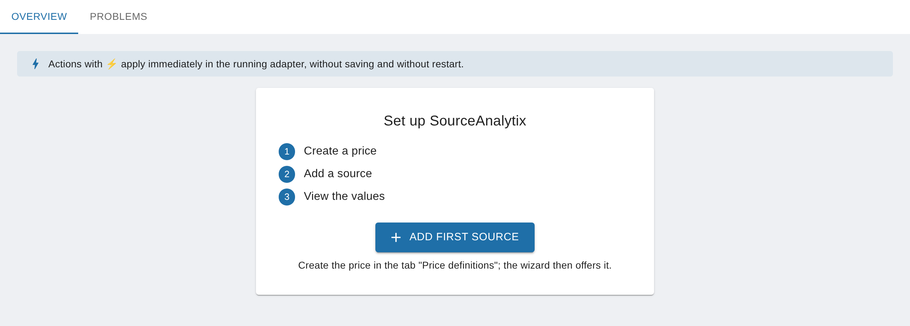

# Installation and requirements

<!-- seite: gewicht=29; en=en/01.erste-schritte/01.installation.md -->

## What does SourceAnalytix require (Node.js, js-controller, Admin)?

<!-- abschnitt: prio=B; gewicht=12; readme=partial; cluster=logs-install-26,upgrade-migration-other-14; features=req-versions,req-admin-ui-i18n -->
<!-- muss beantworten: Mindestversionen von Node.js, js-controller und Admin; Admin-Versionen, mit denen die Oberfläche läuft. -->

**In short:** From v0.7.0, SourceAnalytix needs Node.js 22, js-controller 6.0.11 and Admin 8.0.0 or newer. Admin 8 is required because the instance settings page, with its "Overview" and "Problems" tabs, is built from Admin 8 components.
<!-- quelle: code=io-package.json:161-170; code=package.json:11-13; issue=#1269 -->

| | from v0.7.0 | v0.6.0 to v0.6.x |
|---|---|---|
| Node.js | 22 or newer | 22 or newer |
| js-controller | 6.0.11 or newer | 6.0.11 or newer |
| Admin | 8.0.0 or newer | 7.8.23 or newer |
<!-- quelle: code=io-package.json:161-170; code=package.json:11-13; code=io-package.json:161-170@v0.6.1; code=package.json:11-13@v0.6.1 -->

Check the versions in the console with `iobroker -v` (js-controller) and `node -v` (Node.js). If your system doesn't meet a requirement, update that component first and then SourceAnalytix. v0.6.0 to v0.6.x work with Admin 7.8 and with Admin 8. Older statements from the forum such as "works with Admin 6" no longer apply.
<!-- quelle: code=.github/ISSUE_TEMPLATE/BugReport.md:31-32; code=io-package.json:161-170@v0.6.1; issue=#1202; forum=938927 -->

### If SourceAnalytix doesn't start after a Node.js update

If the log shows `TypeError: Class extends value … is not a constructor or null` after a Node.js update, the js-controller is usually too old. Update the js-controller, run `iob fix` in the console and restart the instance. If ioBroker runs in Docker, update the container image instead and restore your backup if necessary.
<!-- quelle: forum=1195593; forum=218835 -->

**See also:** [How do I update SourceAnalytix (and what is a downgrade)?](../02.anleitungen/05.betrieb-und-wartung.md#update-sourceanalytix-downgrade) · [Problems with installation and the Admin display](../04.fehlerbehebung/01.log-meldungen.md#installation-admin-display-problems)

## How do I install SourceAnalytix and create an instance?

<!-- abschnitt: prio=B; gewicht=12; readme=missing; cluster=logs-install-24,setup-ui-03; features=req-versions,req-admin-ui-i18n -->
<!-- muss beantworten: Installation über den Admin-Store oder GitHub; danach Instanz anlegen (nur eine Instanz nötig). -->

**In short:** In the ioBroker system settings, switch the repository to "latest" (beta) and install SourceAnalytix on the "Adapters" tab. Admin creates the instance `sourceanalytix.0` for you. Then open the instance settings and set up your first source on the "Overview" tab.
<!-- quelle: interview=21; forum=1133140; forum=215063 -->

At the moment SourceAnalytix is only available in the "latest" repository, not in "stable". It moves to "stable" after a test phase. With "stable" selected, you won't find it in the adapter list.
<!-- quelle: interview=21; forum=1133140 -->

### How to do it (from v0.7.0)

1. Check the [requirements](#requirements-sourceanalytix-have-node-js), especially Admin 8.
2. In Admin, open the system settings and select the "latest" (beta) repository under "Repositories" as the active repository.
3. Open the "Adapters" tab, refresh the adapter list and search for "SourceAnalytix".
4. Install the adapter. Admin creates the instance `sourceanalytix.0` and starts it.
5. On the "Instances" tab, open the settings of `sourceanalytix.0`. The "Overview" tab shows the "Set up SourceAnalytix" card with the steps "Create a price", "Add a source" and "View the values".
6. On the "Price definitions" tab, create at least one price definition, for example for electricity in kWh, and save. Saving restarts the adapter.
7. On the "Overview" tab, click "Add first source". For what to do next, see [Where do I configure SourceAnalytix for a datapoint?](02.erster-zaehler.md#configure-sourceanalytix-datapoint).
<!-- quelle: interview=21; forum=1133140; forum=953340; code=admin/jsonConfig.json:1-45; code=src-admin/src/SourcesApp.tsx:245-279; code=src-admin/src/Wizard.tsx:553-595; code=src-admin/src/i18n/de.json -->

The "Overview" and "Problems" tabs need a running instance. If it is stopped, "Instance is not running" appears at the top with a "Start" button. All actions marked with ⚡ are locked until then.
<!-- quelle: code=src-admin/src/SourcesApp.tsx:111-140; code=src-admin/src/SourcesApp.tsx:474-476; code=src-admin/src/Wizard.tsx:955-961 -->

### There is no instance

If you installed SourceAnalytix from the console with npm or from a GitHub URL, ioBroker doesn't create an instance. Create it yourself with the plus icon, which adds an instance in Admin. One instance is enough for all sources.
<!-- quelle: forum=1133140; forum=953340; forum=1143623; forum=215074; forum=378273 -->

> [!NOTE]
> Installing from a GitHub URL is only meant for testing, when the developer asks for it. Admin doesn't show updates for such an installation. To get back to the "latest" repository, see [How do I update SourceAnalytix (and what is a downgrade)?](../02.anleitungen/05.betrieb-und-wartung.md#update-sourceanalytix-downgrade).
<!-- quelle: forum=213055; forum=938927; interview=21 -->

**Up to v0.6.x:** The instance settings only contain "Main settings" and "Price definitions". You enable sources there, on the datapoint on the "Objects" tab, with the wrench icon.
<!-- quelle: code=admin/jsonConfig.json:1-8@v0.6.1; code=admin/jsonConfig.json:142-143@v0.6.1; code=main.js:106-137@v0.6.1 -->

**See also:** [Do I need several instances or versions side by side?](#need-several-instances-versions-side) · [My first meter](02.erster-zaehler.md#configure-sourceanalytix-datapoint)

## Do I need several instances or versions side by side?

<!-- abschnitt: prio=B; gewicht=5; readme=missing; cluster=setup-ui-16,upgrade-migration-other-23; features=source-enable -->
<!-- muss beantworten: Eine Instanz reicht für alle Datenpunkte; zwei Versionen parallel sind nicht möglich; Instanz löschen. -->

**In short:** No. One instance handles any number of sources, each with its own settings. You can't run two versions of SourceAnalytix side by side, because ioBroker installs exactly one version of each adapter.
<!-- quelle: code=main.js:126-145; forum=969466; issue=#158 -->

### One instance for everything

The settings of a source apply per instance. They are stored on the datapoint under `common.custom.sourceanalytix.<instance>`, and each instance only calculates the sources that are enabled for it. The "Overview" and "Problems" tabs also show only the sources of that instance. A second instance gains you nothing, unless you deliberately want separate folders `sourceanalytix.0` and `sourceanalytix.1`.
<!-- quelle: code=main.js:126-145; code=main.js:4426-4433; code=main.js:4624-4632; forum=969466 -->

Multiple instances always run the same installed version. So you can't test a new version next to the old one. Install it as an update after making a backup. To go back if something goes wrong, see [Downgrade](../02.anleitungen/05.betrieb-und-wartung.md#update-sourceanalytix-downgrade).
<!-- quelle: issue=#158 -->

### Removing an extra instance

A second instance often appears unnoticed, for example when you install SourceAnalytix from the repository again after a GitHub installation. To clean up:

1. On the "Objects" tab, check which instance holds your values, that is, whether your folders are under `sourceanalytix.0` or under `sourceanalytix.1`.
2. On the "Instances" tab, delete the extra instance with the trash icon.
<!-- quelle: forum=938949; forum=567818 -->

> [!CAUTION]
> Deleting an instance also removes its folders with all values. Never delete the instance that holds your data. If you only want to retire a single source, use the "Deactivate" action on that source.
<!-- quelle: forum=938949; code=src-admin/src/i18n/de.json -->

**See also:** [Disable a datapoint or remove sources](../02.anleitungen/05.betrieb-und-wartung.md#disable-datapoint-remove-sources-states)
