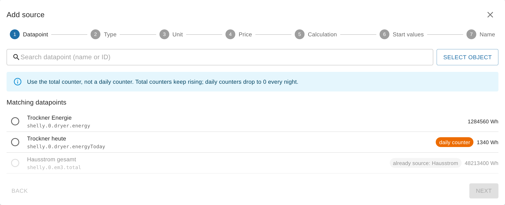

# My first meter in 10 minutes

<!-- seite: gewicht=109; en=en/01.erste-schritte/02.erster-zaehler.md -->

## What do I enter for the start values (and in which unit)?

<!-- abschnitt: prio=A; gewicht=43; readme=partial; cluster=meter-readings-01,setup-ui-20,meter-readings-04,meter-readings-03; features=source-start-values,calc-first-activation-start-values,calc-consumption-formula,rollover-midnight-cron,log-first-activation -->
<!-- muss beantworten: Startwerte für Tag/Woche/Monat/Quartal/Jahr; Einheit (Wh/kWh); warum sonst der ganze Zählerstand als Verbrauch erscheint. -->

**In short:** For a new meter you usually don't need to enter anything. If you leave the fields empty, SourceAnalytix sets them to the current meter reading when the source is first activated and updates them itself at every period change. If you do enter something, each start value is a meter reading, not a consumption: it is the total at the beginning of the period, in the target unit, which is the unit of the price definition.
<!-- quelle: code=main.js:1967@v0.6.1; code=main.js:3079-3096@v0.6.1; code=lib/calculation.js:199-221@v0.6.1; code=main.js:2570-2576@v0.6.1; forum=561222; forum=731860 -->

### What is a start value?

The terms total, target unit and start value are explained under [The terms](../05.hintergrund/02.zaehler-reset.md#device-reset-detected-mean-reset). For start values this means: the consumption of a period is the total minus the start value of that period. So each field takes the reading your meter had at the beginning of the period.
<!-- quelle: code=main.js:3192-3203@v0.6.1; code=admin/jsonCustom.json:193-252@v0.6.1 -->

| Field | Total at this point in time |
|---|---|
| "Day" | today at 0:00 |
| "Week" | this week's Monday at 0:00 |
| "Month" | the 1st of this month at 0:00 |
| "Quarter" | January 1, April 1, July 1 or October 1 at 0:00 |
| "Year" | January 1 at 0:00 |
<!-- quelle: code=main.js:2454-2465@v0.6.1; code=main.js:3460-3475@v0.6.1; code=main.js:2650-2660@v0.6.1 -->

The time is the system time of the computer or container that ioBroker runs on.
<!-- quelle: code=main.js:2653@v0.6.1; interview=13b -->

### Which unit do I use?

Use the unit of the price definition you assigned to the source, not the unit of your datapoint. SourceAnalytix first converts every value of the source into this target unit and only then compares it with the start values. From v0.7.0, the target unit is shown after each field in the wizard and in the source detail. Above the fields, the wizard says "Enter the meter reading at the start of each period (0:00) in kWh." and the source detail says "Meter reading at the start of the current period in kWh." Up to v0.6.x, the heading in the custom settings dialog of the datapoint tells you: "Start values for the respective period, unit scale (e.g. Wh or kWh) must match the target unit!"
<!-- quelle: code=main.js:2997-3002@v0.6.1; code=main.js:1983@v0.6.1; code=admin/jsonCustom.json:186-191@v0.6.1; code=src-admin/src/Wizard.tsx:758-800; code=src-admin/src/SourceDetail.tsx:487-512; code=src-admin/src/i18n/de.json:249; code=src-admin/src/i18n/de.json:252; issue=#1285; forum=933289; issue=#30 -->

> [!IMPORTANT]
> Example: your meter reports 12,345,678 Wh and the price definition calculates in kWh. The total is then 12,345.678 kWh, and the "Day" field takes something like `12340`, not `12340000`. A start value in Wh makes the consumption wrong or negative.
<!-- quelle: code=main.js:2997-3002@v0.6.1; forum=214834 -->

### When do I enter something myself?

When the source is first activated, SourceAnalytix replaces every field that is empty or contains 0 with the current total. The log then says "Initialized empty period start values for … from current reading …". All periods therefore count from the moment of activation. Fields with any other value stay as you entered them. You don't have to set the meter itself to 0.
<!-- quelle: code=lib/calculation.js:199-221@v0.6.1; code=main.js:3079-3096@v0.6.1; forum=683422; issue=#148 -->

Entering values yourself only makes sense if the consumption of the current period before activation should count too, for example the whole month even though you only set up SourceAnalytix on the 15th. For that you need the real meter readings from back then, for example from your notes, a photo of the meter or the history of the datapoint.
<!-- quelle: code=lib/calculation.js:199-221@v0.6.1; forum=929460 -->

1. Convert each reading to the target unit.
2. In the "Add a source" wizard, go to the "Start values" step and choose the "Include consumption since the start of the period" card (see [Where do I configure SourceAnalytix for a datapoint?](#configure-sourceanalytix-datapoint)).
3. Enter the readings in the "Day", "Week", "Month", "Quarter" and "Year" fields. Each field names the day at whose start the reading applies. If you don't know a reading, leave the field empty. That period then counts from activation.
4. Below each field you see "Consumption since start: …". If a value doesn't fit, the error appears there and "Next" stays disabled.
5. Finish the wizard with "⚡ Activate".
6. When the source delivers its next value, check the states under `sourceanalytix.0.<device>.currentYear.consumed`, for example `01_currentDay` and `03_currentMonth`. No value may be negative.
<!-- quelle: code=src-admin/src/Wizard.tsx:709-805; code=src-admin/src/Wizard.tsx:139-142; code=src-admin/src/Wizard.tsx:187-194; code=main.js:3192-3203@v0.6.1; code=lib/calculation.js:199-221@v0.6.1 -->

For a source that is already running, enter the start values in its source detail, in the "Start values" section, and save them with "⚡ Apply". How to do that is described under [How to correct the start values](../02.anleitungen/02.zaehlerstaende-korrigieren.md#values-negative-after-entering-start).
<!-- quelle: issue=#1285; code=src-admin/src/SourceDetail.tsx:487-513; code=src-admin/src/SourceDetail.tsx:586-596; code=src-admin/src/i18n/de.json:251 -->

**Up to v0.6.x:** The start values of a running source are in the custom settings dialog of the datapoint (the "Objects" tab, wrench icon), in the "Start values for the respective period" section.
<!-- quelle: code=admin/jsonCustom.json:186-252@v0.6.1 -->

An example: you activate the source on Wednesday, March 15. The total is currently 12,480 kWh.

| Field | Entry | Where it comes from |
|---|---|---|
| "Day" | `12475` | Reading today at 0:00 |
| "Week" | `12440` | Reading on Monday, March 13 |
| "Month" | `12300` | Reading on March 1 |
| "Quarter" | `11900` | Reading on January 1 |
| "Year" | `11900` | Reading on January 1 |

SourceAnalytix then shows 5 kWh for today, 40 kWh for the week, 180 kWh for March and 580 kWh for the quarter and the year.
<!-- quelle: code=main.js:3192-3203@v0.6.1 -->

The values have to fit together. No start value is larger than the total, "Day" is the largest, "Month" is at least as large as "Quarter", and "Quarter" is at least as large as "Year". Place "Week" by its start date: if the week begins in the previous month, its start value is smaller than the one for the month.
<!-- quelle: interview=12 -->

> [!WARNING]
> A start value above the total makes the consumption negative. A start value that is too small makes it too high, and a 0 after the first activation shows the whole meter reading as consumption, because it is only replaced the first time. To repair such values, see [Why are my values negative after I entered start values?](../02.anleitungen/02.zaehlerstaende-korrigieren.md#values-negative-after-entering-start) and [Correct wrong, too high or negative values](../02.anleitungen/02.zaehlerstaende-korrigieren.md#correct-wrong-too-high-negative).
<!-- quelle: code=main.js:3192-3203@v0.6.1; code=main.js:1967@v0.6.1; code=lib/calculation.js:214-217@v0.6.1; forum=774744; issue=#813 -->

### Start values only apply to the current period

At every period change, SourceAnalytix overwrites the start value of the new period with the current total. What you enter therefore only takes effect until the end of the current period. You can't use start values to add data for earlier days, weeks or months.
<!-- quelle: code=main.js:2570-2576@v0.6.1; code=main.js:2588-2594@v0.6.1; interview=12 -->

For a power source (W), leave the fields empty. Its total starts at 0 on activation.
<!-- quelle: code=main.js:1910-1911@v0.6.1; code=main.js:1967@v0.6.1; code=main.js:3019-3021@v0.6.1 -->

**Up to v0.6.x** this only applies to the unit `W`: for `kW`, `MW` or `mW`, SourceAnalytix fills empty start values with the current total at every start. **From v0.7.0** it treats all power units like `W` ([#1267](https://github.com/DrozmotiX/ioBroker.sourceanalytix/issues/1267)).
<!-- quelle: code=main.js:1967@v0.6.1; issue=#1267 -->

**From v0.7.0:** The start values no longer default to 0. An empty field now counts from the moment of activation. Both comma and period work as the decimal separator. A single comma or a single period is always the decimal separator: `1.283` means 1.283, not 1283. So write meter readings without a thousands separator (`12475,5`). The wizard and the source detail check the values the same way, against the current total and against the order shown above. If a start value only fits when divided by 1000, they report something like "Looks like Wh – did you mean 1.29 kWh?". As long as a field shows an error, "Next" in the wizard and "⚡ Apply" in the source detail stay disabled. SourceAnalytix also writes unsuitable start values to the log as a warning at startup, for example `Start value day (600) of <datapoint> is larger than the current total 510; the day values will be negative` ([#1267](https://github.com/DrozmotiX/ioBroker.sourceanalytix/issues/1267)).
<!-- quelle: issue=#1267; issue=#1285; issue=#1287; interview=12; code=lib/source-checks.js; code=src-admin/src/Wizard.tsx:141-144; code=src-admin/src/SourceDetail.tsx:176-184; code=src-admin/src/SourceDetail.tsx:592; code=src-admin/src/api.ts:191-214; code=src-admin/src/api.ts:242-286; code=src-admin/src/i18n/de.json:85 -->

**See also:** [Does SourceAnalytix calculate retroactively or only from activation?](../05.hintergrund/03.perioden-und-zeit.md#sourceanalytix-calculate-retroactively-only-activation) · [How do I apply my real meter reading (cumulativeReading, RAW object)?](../02.anleitungen/02.zaehlerstaende-korrigieren.md#apply-real-meter-reading-cumulativereading)

## Which datapoint do I activate: meter (kWh) or power (W)?

<!-- abschnitt: prio=A; gewicht=34; readme=covered; cluster=setup-ui-18,cumulative-power-01,outputs-viz-31; features=source-cumulative-meter,source-power-integration,consumption-vs-delivery,calc-consumption-formula -->
<!-- muss beantworten: Entscheidungshilfe Zählerstand vs. Leistungswert (z. B. GAS_ENERGY statt GAS_POWER); Empfehlung und Grenzen. -->

**In short:** Use your device's total counter, meaning the datapoint with the energy in kWh or Wh (for gas or water, the volume in m³) that only goes up. Examples are `ENERGY_Total` on Tasmota, or `GAS_ENERGY` instead of `GAS_POWER`. Only use a power value in W if your device doesn't provide a meter reading.
<!-- quelle: code=main.js:2948-3253@v0.6.1; forum=601453; forum=769264; forum=213760 -->

### The difference

| | Meter reading (kWh, Wh, m³ …) | Power (W, kW …) |
|---|---|---|
| How SourceAnalytix calculates | Consumption = total − start value of the period | Each power value is multiplied by the time until the next value and added to the total |
| Accuracy | as accurate as the meter | an estimate: how good it is depends on how often the device sends |
| SourceAnalytix was stopped | nothing is lost, the next value contains the consumption of the pause | the energy of the pause is missing, the first value after the start only serves as a new starting point |
| Device restarts at 0 | detected as a reset, counting continues | doesn't matter, there is no reset detection |
<!-- quelle: code=main.js:3192-3203@v0.6.1; code=lib/calculation.js:559-577@v0.6.1; code=main.js:3326-3395@v0.6.1; code=main.js:2005-2009@v0.6.1; code=main.js:3031@v0.6.1 -->

### Which datapoint not to use

Daily values such as `ENERGY_Today` or "Yield today" go back to 0 every day. SourceAnalytix builds day, week, month, quarter and year itself and needs a total that keeps running. A counter that is reset daily does work, because SourceAnalytix detects the drop as a reset. But whatever the device counts between its last value before midnight and its first value after is then missing. If there is a total counter, use it.
<!-- quelle: code=lib/calculation.js:301-390@v0.6.1; interview=4; forum=213760 -->

From v0.7.0, the wizard flags datapoints whose ID or name looks like a daily value (for example `today` or `heute`) with "daily counter" and advises you to use the total counter instead.
<!-- quelle: code=main.js:4643-4651; code=src-admin/src/Wizard.tsx:356-376; code=src-admin/src/i18n/de.json -->

### If you only have a power value

1. Start the "Add a source" wizard (see [Where do I configure SourceAnalytix for a datapoint?](#configure-sourceanalytix-datapoint)) and choose the power datapoint.
2. In the "Type" step, choose the "Power" card, and in the "Unit" step choose `W` or `kW`.
3. In the "Price" step, choose a price definition with an energy unit, for example kWh. Only those can be selected. SourceAnalytix converts the power into this unit.
4. In the "Calculation" step, under "For experts", set "Average power values" if needed. Without the checkmark, each value applies until the next one. With it, SourceAnalytix uses the average of the two. The checkmark suits sensors that send regularly, not devices that often switch abruptly on and off.
5. Also under "For experts", set "Ignore negative values" if your device, for example an inverter, reports negative power when it is switched off. Negative values then count as 0 W.
6. In the "Start values" step, only "Count from now" is available for a power source.
<!-- quelle: code=src-admin/src/Wizard.tsx:413-512; code=src-admin/src/Wizard.tsx:542-560; code=src-admin/src/Wizard.tsx:617-660; code=src-admin/src/Wizard.tsx:709-725; code=main.js:3019-3021@v0.6.1; code=lib/calculation.js:752-787; code=main.js:3335-3339@v0.6.1 -->

**Up to v0.6.x**, the two checkmarks in the custom settings dialog are called "Average power values between updates" and "Ignore negative power values".
<!-- quelle: code=admin/jsonCustom.json:107-128@v0.6.1 -->

The first value after activation or after a restart of SourceAnalytix is only the starting point and doesn't yet add any consumption. Devices that only send when the value changes are still calculated correctly, because the last value applies until the next one.
<!-- quelle: code=main.js:3350-3385@v0.6.1; interview=9 -->

**Up to v0.6.1:** For sources in W, the energy between the last value before midnight and the first value after it is missing at every day rollover. **From v0.6.2**, SourceAnalytix books this part to the old day and continues calculating in the new day from midnight with the same value ([#1254](https://github.com/DrozmotiX/ioBroker.sourceanalytix/issues/1254)).
<!-- quelle: code=main.js:2577-2581@v0.6.1; issue=#1254; pr=#1274; code=main.js:2980-2990@ff9e352 -->

**From v0.7.0:** Under "Maximum gap between power values (minutes)" you set how long a power value may apply at most. If no new value arrives for longer, for example because the device or the Wi-Fi went down, that stretch counts as 0 instead of being extrapolated from the last value. The log then says `No new power value from <datapoint> for <n> min, longer than the maximum gap of <m> min; this interval is not counted`. Empty or 0 means off, as before. The setting is in the source detail of the power source under "Settings", not in the wizard. If a power source doesn't report a value for a long time, the "Problems" tab shows "Power source has not reported for a long time". Leave the setting off for devices that only send when the value changes, or set it well above the longest normal interval ([#1266](https://github.com/DrozmotiX/ioBroker.sourceanalytix/issues/1266)).
<!-- quelle: issue=#1266; interview=9; code=lib/calculation.js:789-815; code=main.js:3893-3903; code=src-admin/src/SourceDetail.tsx:461-472; code=src-admin/src/i18n/de.json:155-156; issue=#1285; code=lib/source-overview.js:169-171 -->

**See also:** [How does SourceAnalytix convert watts to kWh?](../05.hintergrund/01.berechnung.md#sourceanalytix-convert-watts-kwh) · [Which source types are there (meter, power)?](../03.referenz/01.einstellungen.md#source-types-exist-meter-power) · [Counter that is reset to 0 daily](../05.hintergrund/02.zaehler-reset.md#counter-reset-0-daily-happens)

## Where do I configure SourceAnalytix for a datapoint?

<!-- abschnitt: prio=A; gewicht=22; readme=covered; cluster=setup-ui-01,cumulative-power-28; features=source-enable,output-tree-layout,source-price-definition,source-calc-consumption,source-calc-costs -->
<!-- muss beantworten: Weg in Objekte -> Datenpunkt -> SourceAnalytix-Dialog; Haken Costs/Consumption/Meter values; Aktivieren. -->

**In short:** From v0.7.0, in the instance settings of SourceAnalytix: on the "Overview" tab, "Add a source" starts a wizard with seven steps. It saves the settings on the datapoint and activates the source right away, without a restart. Up to v0.6.x, you go through the "Objects" tab and the wrench icon on the datapoint (see below).
<!-- quelle: code=src-admin/src/SourcesApp.tsx:636-640; code=src-admin/src/Wizard.tsx:68; code=src-admin/src/Wizard.tsx:203-223; code=main.js:4550-4602; issue=#1269 -->

### Before you start

- The SourceAnalytix instance is running. Without a running instance, the "Overview" tab shows no sources and "⚡ Activate" is disabled.
- On the "Price definitions" tab there is at least one price definition with the unit you want to calculate in, for example kWh. It becomes the target unit of this source. If it is missing, the wizard says "There is no price definition yet."
<!-- quelle: code=src-admin/src/SourcesApp.tsx:474-476; code=src-admin/src/Wizard.tsx:553; code=src-admin/src/Wizard.tsx:955-961; code=src-admin/src/i18n/de.json -->

### How to do it (from v0.7.0)

1. Under "Instances", open the settings of `sourceanalytix.0` and click "Add a source" on the "Overview" tab.
2. **"Datapoint":** Search for the datapoint with the meter reading, or pick it with "Select object". The "Matching datapoints" list only shows datapoints with a known unit. Which one to choose is explained under [Which datapoint do I activate: meter (kWh) or power (W)?](#datapoint-enable-meter-kwh-power).
3. **"Type":** Choose "Meter reading" or "Power". The wizard suggests a type based on the unit. For a meter reading, you answer "Does the value sometimes drop to 0, e.g. after a power failure?". "Yes" switches on reset detection.
4. **"Unit":** Check the unit of the datapoint. Below it you see "Detected from the datapoint: …".
5. **"Price":** Choose the price definition. Price definitions with a non-matching unit are marked "other unit" and can't be selected. If needed, set "Include the basic fee of this price definition".
6. **"Calculation":** Choose what SourceAnalytix should calculate: "Consumption", "Costs" and "Store meter readings". All three are preselected.
7. **"Start values":** Leave "Count from now" selected (the reason is explained under [What do I enter for the start values (and in which unit)?](#start-values-unit)).
8. **"Name":** Give the source a name. Check the summary and click "⚡ Activate".
<!-- quelle: code=src-admin/src/Wizard.tsx:68; code=src-admin/src/Wizard.tsx:121-130; code=src-admin/src/Wizard.tsx:168-201; code=src-admin/src/Wizard.tsx:289-808; code=src-admin/src/Wizard.tsx:809-890; code=src-admin/src/i18n/de.json -->

After activation, the wizard shows "… is active. Waiting for the first value …". As soon as the source delivers its first value, it says "First value received: …", and "To source" opens its source detail. SourceAnalytix creates the folder `sourceanalytix.0.<device>`. `<device>` is the "Technical ID" that the wizard builds from the name: lowercase letters, digits and `_`, with umlauts turned into `ae`, `oe`, `ue`. Under "For experts" in the last step, you can change it, using letters, digits, `_` and `-`.
<!-- quelle: code=src-admin/src/Wizard.tsx:225-283; code=src-admin/src/Wizard.tsx:809-845; code=src-admin/src/Wizard.tsx:145-150; code=src-admin/src/api.ts:332-343; code=src-admin/src/i18n/de.json:89; issue=#1287 -->

You change the settings of a source later in its source detail under "Settings" and save them with "⚡ Apply". This also takes effect immediately, without a restart. You can enter numbers there with a comma or a period.
<!-- quelle: code=src-admin/src/SourceDetail.tsx:374-597; code=src-admin/src/SourceDetail.tsx:190-213; code=src-admin/src/api.ts:191-214 -->

> [!WARNING]
> Without "Consumption", no consumption values are created for day, week, month, quarter and year. If you later switch "Consumption" or "Costs" off again, SourceAnalytix deletes the corresponding states.
<!-- quelle: code=main.js:3254-3280; code=main.js:2789-2870@v0.6.1; code=main.js:2865-2909@v0.6.1; forum=551266 -->

The source detail contains all settings of the source, including the ones the wizard doesn't ask for: the "Start values", for power sources "Average power values" and "Maximum gap between power values (minutes)", for sources in pieces (`piece`, `piece/min`) "Pulses per <unit>", and under "For experts" "Each update adds its value" and the "Technical ID".
<!-- quelle: issue=#1285; code=src-admin/src/SourceDetail.tsx:174-175; code=src-admin/src/SourceDetail.tsx:440-513; code=src-admin/src/SourceDetail.tsx:514-571; code=src-admin/src/i18n/de.json -->

### Up to v0.6.x: via the "Objects" tab

1. In the admin, open the "Objects" tab and search for the datapoint with the meter reading.
2. Click the wrench icon in its row and expand the `sourceanalytix.0` section.
3. Tick "enabled" and choose a category under "Select price definition". The field is required, even if you only want the consumption. The selection stays empty if the instance is stopped.
4. Leave "Select Unit" on "Detect automatically" if the datapoint has a suitable unit.
5. Under "Calculation settings", tick "Calculate consumption", "Calculate costs", if needed "Including basic rate", and "Store Meter Values". Leave the start values empty and save.
<!-- quelle: code=admin/jsonCustom.json:37-137@v0.6.1; code=admin/jsonCustom.json:186-252@v0.6.1; code=main.js:3505-3514@v0.6.1; code=main.js:2144-2217@v0.6.1 -->

The folder is then named after the "Output ID" that the dialog builds from the ID of the datapoint: periods become `__`.
<!-- quelle: code=admin/jsonCustom.json:22-36@v0.6.1; code=main.js:2063-2141@v0.6.1 -->

**From v0.7.0:** The custom settings dialog of the datapoint only keeps the "enabled" checkmark, a note and the "Open SourceAnalytix settings" button. This way you can still see in the "Objects" tab which datapoints SourceAnalytix uses, as with History or InfluxDB. If you switch a source on there, SourceAnalytix sets "Consumption", "Costs", "Store meter readings" and reset detection with threshold 1. A price definition is still missing at that point, so the source appears in the "Problems" tab with "No price definition selected". Choose one in the source detail. You make all other settings only on the settings page ([#1286](https://github.com/DrozmotiX/ioBroker.sourceanalytix/issues/1286)).
<!-- quelle: issue=#1286; code=admin/jsonCustom.json:1-55; code=admin/i18n/de.json:146-147; code=lib/source-overview.js:56; code=src-admin/src/i18n/de.json:204 -->

**See also:** [What do the datapoint settings do (Costs, Consumption, Meter values)?](../03.referenz/01.einstellungen.md#datapoint-settings-costs-consumption-meter) · [How is a price definition structured (categories, basic fee, decimal mark)?](../03.referenz/01.einstellungen.md#price-definition-structured-categories-base) · [Datapoint enabled, but no folders appear](../04.fehlerbehebung/01.log-meldungen.md#datapoint-enabled-but-no-folders)

## Where do I find my values (daily consumption today/yesterday)?

<!-- abschnitt: prio=B; gewicht=10; readme=partial; cluster=outputs-viz-01,setup-ui-31; features=output-cumulative-reading,output-tree-layout,output-basic-period-states,output-cost-vs-earnings,price-basic-fee -->
<!-- muss beantworten: Der State-Baum in Kurzform: consumed/delivered, Tag/Woche/Monat; wann die ersten Werte erscheinen. -->

**In short:** From v0.7.0, you see the values right in the instance settings: each card on the "Overview" tab shows "Today", "Month" and "Year", and the source detail under "Values" also shows "Yesterday", "Last week", "Last month" and so on. As states they are under `sourceanalytix.0.<device>.currentYear`. Today's consumption, for example, is in `currentYear.consumed.01_currentDay` and yesterday's in `currentYear.consumed.01_previousDay`.
<!-- quelle: code=src-admin/src/SourcesApp.tsx:165-240; code=src-admin/src/SourceDetail.tsx:61-82; code=src-admin/src/SourceDetail.tsx:329-371; code=main.js:2155-2170; code=main.js:2580-2610 -->

### The most important states

| State under `sourceanalytix.0.<device>` | Content |
|---|---|
| `cumulativeReading` | Total in the target unit |
| `currentYear.consumed.01_currentDay` to `05_currentYear` | Consumption today, this week, this month, this quarter, this year |
| `currentYear.consumed.01_previousDay` to `05_previousYear` | Consumption yesterday, last week, last month, last quarter, last year |
| `currentYear.costs.…` | Costs, with the same state names |
<!-- quelle: code=main.js:2155-2170; code=main.js:2580-2610; code=main.js:3710-3740 -->

If the price definition describes a feed-in ("Earnings"), the folders are called `delivered` and `earnings` instead of `consumed` and `costs`. All folders, the weekdays, weeks and months, and the archive per year are listed under [Where do I find yesterday, last week, last month (previous states)?](../03.referenz/02.states-und-meldungen.md#yesterday-last-week-last-month).
<!-- quelle: code=main.js:2164-2165; code=src-admin/src/i18n/de.json -->

### When the first values appear

- **Today, week, month, quarter, year:** with the first value the source delivers after activation. For a power source in W, the first value is only the starting point, and consumption starts with the second.
- **Yesterday, last week, etc.:** only after the first period change, so after the next midnight at the earliest. For this, "Previous period" must be switched on in the instance settings under "Main settings" (it is by default).
- SourceAnalytix only calculates when the source sends a new value. If none arrives, the last value stays.
<!-- quelle: code=main.js:3862-3935; code=main.js:2580-2610; code=admin/jsonConfig.json:285-292; code=io-package.json:270; code=main.js:2527-2566; forum=799342; forum=275553 -->

**Up to v0.6.x**, the overview in the instance settings doesn't exist. You then see the values in the "Objects" tab under `sourceanalytix.0`.
<!-- quelle: code=admin/jsonConfig.json:1-8@v0.6.1 -->

**See also:** [How is consumption calculated, and why is currentYear lower than my meter reading?](../05.hintergrund/01.berechnung.md#consumption-calculated-currentyear-lower-than) · [When are values updated: live or at midnight?](../05.hintergrund/03.perioden-und-zeit.md#values-updated-live-midnight)
