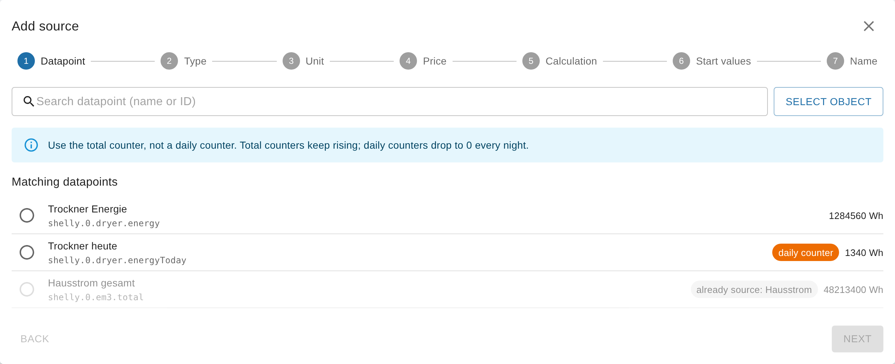

# My first meter in 10 minutes

<!-- seite: gewicht=109; en=en/01.erste-schritte/02.erster-zaehler.md -->

## What do I enter for the start values (and in which unit)?

<!-- abschnitt: prio=A; gewicht=43; readme=partial; cluster=meter-readings-01,setup-ui-20,meter-readings-04,meter-readings-03; features=source-start-values,calc-first-activation-start-values,calc-consumption-formula,rollover-midnight-cron,log-first-activation -->
<!-- muss beantworten: Startwerte für Tag/Woche/Monat/Quartal/Jahr; Einheit (Wh/kWh); warum sonst der ganze Zählerstand als Verbrauch erscheint. -->

Usually nothing. If you leave the fields empty, every period counts from activation, and SourceAnalytix then sets the start values itself at each period rollover. If you do enter something, it is a meter reading, not a consumption: the reading at the start of the period, in the unit of the price definition.
<!-- quelle: code=lib/calculation.js:376-413; code=main.js; forum=561222; forum=731860 -->

A period's consumption is the total minus its start value. So each field takes the reading at this point in time (system time of the ioBroker host):

| Field | Reading on |
|---|---|
| "Day" | today, 0:00 |
| "Week" | Monday of this week, 0:00 |
| "Month" | the 1st of this month, 0:00 |
| "Quarter" | 1 January, April, July or October, 0:00 |
| "Year" | 1 January, 0:00 |
<!-- quelle: code=main.js; interview=13b -->

> [!IMPORTANT]
> The unit is that of the price definition, not that of the datapoint. If your meter reports 12,345,678 Wh and the price uses kWh, "Day" takes `12340`, for example, not `12340000`. The wizard and the detail view show the unit next to every field.
<!-- quelle: code=src-admin/src/Wizard.tsx; code=src-admin/src/SourceDetail.tsx; issue=#1285; forum=214834; issue=#30 -->

### When to enter something yourself

Only if consumption before activation should count too, for example the whole month although you set up on the 15th. For that you need the real readings from back then, say from a photo of the meter.
<!-- quelle: code=lib/calculation.js:376-413; forum=929460 -->

1. In the wizard's "Start values" step, choose the "Include consumption since the start of the period" card.
2. Enter the readings without a thousands separator (`12475.5`). A single comma or a single dot is always the decimal mark. If you don't know a reading, leave the field empty.
3. Each field shows "Consumption since start: …" or an error underneath. As long as a field shows an error, "Next" stays locked.
4. Finish with "⚡ Activate".
<!-- quelle: code=src-admin/src/Wizard.tsx; code=src-admin/src/api.ts; issue=#1287 -->

Example: you activate on Wednesday, 15 March, and the total is 12,480 kWh.

| Field | Entry | Consumption |
|---|---|---|
| "Day" | `12475` | 5 kWh |
| "Week" | `12440` | 40 kWh |
| "Month" | `12300` | 180 kWh |
| "Quarter" | `11900` | 580 kWh |
| "Year" | `11900` | 580 kWh |
<!-- quelle: code=main.js -->

No start value may be greater than the total. "Day" is the largest, "Month" is at least as large as "Quarter", and "Quarter" at least as large as "Year". "Week" depends on when it started. If a value only fits after dividing by 1000, the page asks something like "Looks like Wh – did you mean 1.29 kWh?".
<!-- quelle: interview=12; code=lib/source-checks.js; code=src-admin/src/api.ts -->

For a running source, change the start values in its detail view under "Start values" and confirm with "⚡ Apply". An emptied field counts from that moment. Start values only apply until the next period rollover, so earlier periods cannot be filled in this way. For a power source (W), leave the fields empty.
<!-- quelle: issue=#1285; issue=#1302; code=lib/calculation.js:404-413; interview=12; issue=#1267 -->

**See also:** [Why are my values negative after I entered start values?](../02.anleitungen/02.zaehlerstaende-korrigieren.md#values-negative-after-entering-start) · [Does SourceAnalytix calculate retroactively?](../05.hintergrund/03.perioden-und-zeit.md#sourceanalytix-calculate-retroactively-only-activation)

## Which datapoint do I activate: meter (kWh) or power (W)?

<!-- abschnitt: prio=A; gewicht=34; readme=covered; cluster=setup-ui-18,cumulative-power-01,outputs-viz-31; features=source-cumulative-meter,source-power-integration,consumption-vs-delivery,calc-consumption-formula -->
<!-- muss beantworten: Entscheidungshilfe Zählerstand vs. Leistungswert (z. B. GAS_ENERGY statt GAS_POWER); Empfehlung und Grenzen. -->

Use your device's total counter, the value in kWh, Wh or m³ that only goes up, for example `ENERGY_Total` on Tasmota or `GAS_ENERGY` instead of `GAS_POWER`. Only use a power value in W if there is no meter reading.
<!-- quelle: code=main.js; forum=601453; forum=769264; forum=213760 -->

| | Meter reading (kWh, m³ …) | Power (W, kW …) |
|---|---|---|
| Calculation | total minus start value | power times time until the next value |
| Accuracy | as accurate as the meter | an estimate, better the more often the device sends |
| SourceAnalytix was stopped | nothing is missing | the energy during the pause is missing |
| Device restarts at 0 | detected as a reset | does not matter |
<!-- quelle: code=main.js; code=lib/calculation.js -->

Daily values such as `ENERGY_Today` or "yield today" are not suitable. The wizard marks them as "daily counter". They do work, but whatever the device counts around midnight is lost.
<!-- quelle: code=main.js; code=src-admin/src/Wizard.tsx; interview=4; forum=213760 -->

### If you only have a power value

In the wizard, choose the type "Power" and a price definition with an energy unit, for example kWh. The first value is only the starting point; consumption starts with the second. The detail view has three options for this under "Settings":

- "Average power values": calculates with the average of two values. Suits sensors that send regularly.
- "Ignore negative values": for inverters that report negative power in standby.
- "Maximum gap between power values (minutes)": if no value arrives for longer, the gap counts as 0. Leave the field empty for devices that only send on change.
<!-- quelle: code=src-admin/src/Wizard.tsx; code=src-admin/src/SourceDetail.tsx; code=lib/calculation.js; interview=9; issue=#1266 -->

**See also:** [How does SourceAnalytix convert watts to kWh?](../05.hintergrund/01.berechnung.md#sourceanalytix-convert-watts-kwh) · [Counter that is reset to 0 every day](../05.hintergrund/02.zaehler-reset.md#counter-reset-0-daily-happens)

## Where do I configure SourceAnalytix for a datapoint?

<!-- abschnitt: prio=A; gewicht=22; readme=covered; cluster=setup-ui-01,cumulative-power-28; features=source-enable,output-tree-layout,source-price-definition,source-calc-consumption,source-calc-costs -->
<!-- muss beantworten: Weg in Objekte -> Datenpunkt -> SourceAnalytix-Dialog; Haken Costs/Consumption/Meter values; Aktivieren. -->

In the SourceAnalytix instance settings. On the "Overview" tab, "Add source" starts a wizard that activates the source right away, without a restart. You need a running instance and at least one price definition first.
<!-- quelle: code=src-admin/src/SourcesApp.tsx; code=src-admin/src/Wizard.tsx; code=main.js; issue=#1269 -->

1. **"Datapoint":** search for the meter reading or pick it with "Select object".
2. **"Type":** "Meter reading" or "Power". For a meter reading, the wizard asks whether the value sometimes drops to 0. "Yes" turns reset detection on.
3. **"Unit":** check the detected unit.
4. **"Price":** choose the price definition. Unsuitable units are marked "other unit". For a pulse counter (unit pcs), enter the pulses per unit here, for example 1000 for 1000 imp/kWh.
5. **"Calculation":** "Consumption", "Costs" and "Store meter readings" are preselected.
6. **"Start values":** leave "Count from now" selected.
7. **"Name":** enter a name and click "⚡ Activate".
<!-- quelle: code=src-admin/src/Wizard.tsx; code=src-admin/src/i18n/en.json; issue=#1313 -->

The wizard then waits for the first value. If that takes a while, say for PV at night, you can close it. The source keeps running. Its values are under `sourceanalytix.0.<device>`, where `<device>` is the "Technical ID" derived from the name.
<!-- quelle: code=src-admin/src/Wizard.tsx; code=src-admin/src/api.ts; code=src-admin/src/i18n/en.json -->

You change all other settings later in the source's detail view under "Settings" and confirm with "⚡ Apply". If a change deletes data, for example switching off "Consumption" or "Costs", the page asks first.
<!-- quelle: code=src-admin/src/SourceDetail.tsx; issue=#1311; issue=#1285 -->

### What about the datapoint on the "Objects" tab?

There is only a switch there, so you can see in the object tree which datapoints SourceAnalytix uses. If you switch it on, the price definition is still missing, and the source shows up on the "Problems" tab. Switching it off removes the source's settings, including the start values. To pause a source, use "Deactivate" in the instance settings.
<!-- quelle: issue=#1286; issue=#1306; code=admin/jsonCustom.json; code=admin/i18n/en.json -->

**See also:** [What do the datapoint settings do?](../03.referenz/01.einstellungen.md#datapoint-settings-costs-consumption-meter) · [Datapoint enabled, but no folders appear](../04.fehlerbehebung/01.log-meldungen.md#datapoint-enabled-but-no-folders)

## Where do I find my values (daily consumption today/yesterday)?

<!-- abschnitt: prio=B; gewicht=10; readme=partial; cluster=outputs-viz-01,setup-ui-31; features=output-cumulative-reading,output-tree-layout,output-basic-period-states,output-cost-vs-earnings,price-basic-fee -->
<!-- muss beantworten: Der State-Baum in Kurzform: consumed/delivered, Tag/Woche/Monat; wann die ersten Werte erscheinen. -->

On the "Overview" tab: every card shows "Today", "Month" and "Year", and the detail view under "Values" also shows "Yesterday", "Last month" and more. As states they are under `sourceanalytix.0.<device>.currentYear`.
<!-- quelle: code=src-admin/src/SourcesApp.tsx; code=src-admin/src/SourceDetail.tsx; code=main.js -->

| State under `sourceanalytix.0.<device>` | Content |
|---|---|
| `cumulativeReading` | total |
| `currentYear.consumed.01_currentDay` to `05_currentYear` | today, this week, month, quarter, year |
| `currentYear.consumed.01_previousDay` to `05_previousYear` | yesterday, last week, last month, last quarter, last year |
| `currentYear.costs.…` | costs with the same names |
<!-- quelle: code=main.js -->

For feed-in, the folders are called `delivered` and `earnings`. The running values appear with the source's first value; "yesterday" and the other previous periods only after the first period rollover. SourceAnalytix only calculates when the source sends a new value.
<!-- quelle: code=main.js; code=admin/jsonConfig.json; forum=799342; forum=275553 -->

**See also:** [Where do I find yesterday, last week, last month?](../03.referenz/02.states-und-meldungen.md#yesterday-last-week-last-month) · [Values live or only at midnight?](../05.hintergrund/03.perioden-und-zeit.md#values-updated-live-midnight)
