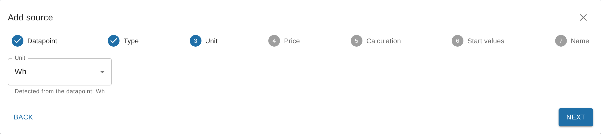

# Sources, units and signs

<!-- seite: gewicht=76; en=en/02.anleitungen/01.quellen-und-einheiten.md -->

## How do I separate consumption from the grid and feed-in (one datapoint with a sign)?

<!-- abschnitt: prio=B; gewicht=20; readme=missing; cluster=prices-costs-19,cumulative-power-22,outputs-viz-34,cumulative-power-21,prices-costs-20; features=source-ignore-negative,source-power-integration,consumption-vs-delivery,source-multi-edit,calc-negative-values-cumulative -->
<!-- muss beantworten: Ein Datenpunkt für Bezug und Einspeisung: Einstellung "negative Werte ignorieren", zwei Quellen, Verhalten bei negativen Leistungen. -->

**In short:** SourceAnalytix doesn't tell consumption from the grid and feed-in apart by the sign. You create two sources: the datapoint itself for consumption, and an alias with the sign flipped for feed-in. Both get "Ignore negative values", and the feed-in source also gets a price definition with the cost type "Earnings".
<!-- quelle: interview=10; code=lib/calculation.js:752-755; code=main.js:2145-2165 -->

The direction of a source comes only from the cost type of its price definition. With "Costs", SourceAnalytix writes consumption and costs (`consumed`, `costs`). With "Earnings", it writes delivery and earnings (`delivered`, `earnings`). Without the checkmark, a negative power value is counted as negative energy and lowers the total, because power sources have no reset detection. With "Ignore negative values" ticked, it counts as 0 W.
<!-- quelle: code=main.js:2145-2165; code=main.js:3871-3880; code=lib/calculation.js:743-755; code=lib/calculation.js:766-783 -->

### How to do it (from v0.7.0)

1. Open the instance settings of SourceAnalytix and add two rows on the "Price definitions" tab, for example `Strom Bezug` with the cost type "Costs" and `Einspeisung` with the cost type "Earnings", both with the unit `kWh`. For the feed-in, the "Price per unit" is your feed-in tariff per kWh. Saving restarts the adapter.
2. Under "Objects", create an alias for your power datapoint that flips the sign when read (`-val`), and give it the unit `W`.
3. In the instance settings, switch to the "Overview" tab and click "Add a source". Choose the original datapoint, the type "Power" and the price `Strom Bezug`. In the "Calculation" step, under "For experts", tick "Ignore negative values" and activate the source.
4. Create a second source for the alias in the same way, with the price `Einspeisung` and also with "Ignore negative values".
5. Consumption is then under `sourceanalytix.0.<import>.currentYear.consumed`, feed-in under `sourceanalytix.0.<feedin>.currentYear.delivered` and its earnings under `…currentYear.earnings`.
<!-- quelle: interview=10; code=src-admin/src/Wizard.tsx:68; code=src-admin/src/Wizard.tsx:636-670; code=main.js:2145-2165; code=admin/jsonConfig.json:39-83 -->

For a source that is already running, tick the checkmark in its source detail under "Settings" and click "⚡ Apply". It takes effect immediately, without a restart.
<!-- quelle: code=src-admin/src/SourceDetail.tsx:84-91; code=src-admin/src/SourceDetail.tsx:423-439; code=src-admin/src/SourceDetail.tsx:586-596 -->

> [!WARNING]
> Without "Ignore negative values", the feed-in pulls the total of the consumption source back down. The daily consumption then only shows the net balance and can go negative.
<!-- quelle: code=lib/calculation.js:752-755; code=main.js:3871-3880; forum=434762 -->

If your electricity meter provides two separate meter readings for consumption and feed-in, use those instead, as two sources of the type meter reading. That is more accurate than power, and a meter reading with a sign doesn't occur: if a meter reading drops, SourceAnalytix treats it as a reset, not as feed-in. Why the meter reading is more accurate is explained under [Which datapoint do I activate: meter (kWh) or power (W)?](../01.erste-schritte/02.erster-zaehler.md#datapoint-enable-meter-kwh-power).
<!-- quelle: code=lib/calculation.js:445-455; code=lib/calculation.js:766-783; forum=636815 -->

A dedicated setting that separates consumption and feed-in from a single datapoint is planned ([#1272](https://github.com/DrozmotiX/ioBroker.sourceanalytix/issues/1272)).
<!-- quelle: issue=#1272; interview=10 -->

**Up to v0.6.x:** You find the "Ignore negative power values" checkmark in the SourceAnalytix settings of the datapoint (Objects, wrench) under "Calculation settings".
<!-- quelle: code=admin/jsonCustom.json:107-128@v0.6.1 -->

**See also:** [How do I track PV yield, feed-in and earnings?](#track-pv-yield-feed-earnings) · [Can SourceAnalytix calculate consumption and a meter reading from power (W)?](#sourceanalytix-compute-consumption-meter-reading) · [How do I assign prices and create my own tariffs (e.g. heat pump)?](03.preise-und-kosten.md#assign-prices-create-custom-tariffs)

## Which unit do I set on the datapoint (kWh instead of Wh, m³ instead of liters)?

<!-- abschnitt: prio=B; gewicht=19; readme=missing; cluster=cumulative-power-24,outputs-viz-09,meter-readings-21; features=source-unit,unit-detection-conversion,supported-units,price-definitions-table -->
<!-- muss beantworten: Quelleinheit korrekt wählen; was bei nachträglicher Änderung passiert; warum kWh statt m³ erscheint. -->

**In short:** On the source, you set the unit the datapoint actually delivers. "Detect automatically" is usually enough. The unit you see the values in comes from the price definition. SourceAnalytix converts from Wh to kWh or from l to m³ itself.
<!-- quelle: code=main.js:2069-2092; code=main.js:2170-2171; code=lib/calculation.js:9-20 -->

Both units and all conversions are listed in the table under [Which units are supported (energy, volume, weight, length)?](../03.referenz/01.einstellungen.md#units-supported-energy-volume-weight).

### How to do it (from v0.7.0)

1. When you create a source, the wizard shows the line "Detected from the datapoint: …" in the "Unit" step. Choose the unit the datapoint counts in. If the detected unit is right, leave it.
2. In the "Price" step, you can only choose price definitions whose unit matches. The others are greyed out and carry the note "other unit".
3. For an existing source, change the unit in its source detail under "Settings" in the "Unit" field and click "⚡ Apply".
4. If SourceAnalytix doesn't detect a unit, the "Problems" tab shows "Unit missing or not recognised". Use "Fix" to choose it right there.
<!-- quelle: code=src-admin/src/Wizard.tsx:513-535; code=src-admin/src/Wizard.tsx:545-590; code=src-admin/src/SourceDetail.tsx:388-404; code=src-admin/src/Dialogs.tsx:527-529; code=lib/source-overview.js:50-53 -->

Typical mistakes:

- **Meter reading, but labeled `W`:** SourceAnalytix takes the value for a power and sums it up over time. This produces absurdly high values. Choose `Wh` or `kWh`.
- **Power, but labeled `Wh` or `kWh`:** SourceAnalytix takes every value for a meter reading. Choose `W` or `kW`.
- **`Wh` and `kWh` mixed up:** All values are too high or too low by a factor of 1,000.
<!-- quelle: code=main.js:2069-2092; code=main.js:3439-3470; code=lib/calculation.js:9-20; forum=575673; forum=951120 -->

### Why kWh shows up instead of m³

SourceAnalytix shows all values in the unit of the price definition. If you see kWh even though your gas meter delivers m³, the price definition you chose has the unit `kWh`. For gas, create a separate price definition with the unit `m³` and the price per m³, and choose it on the source. SourceAnalytix converts liters and cubic meters into each other, but not m³ of gas into kWh. From v0.6.2, a source with `m³` and a price definition in `kWh` doesn't start at all, and the log says `Unit m³ of <datapoint> cannot be converted to unit kWh of price definition <name>`.
<!-- quelle: code=main.js:2108-2117; code=lib/calculation.js:139-158; issue=#1278; forum=953404 -->

A conversion from m³ of gas to kWh is planned ([#6](https://github.com/DrozmotiX/ioBroker.sourceanalytix/issues/6)).
<!-- quelle: issue=#6; interview=19b -->

### If you change the unit later

A new unit on the source or in the price definition applies from the next value. SourceAnalytix doesn't convert what is already stored: the total, the start values, and the values of the current and past periods. If the unit was wrong before, total and consumption are therefore still wrong after the change. Correct them afterwards with "Align meter reading" and repair the costs as described under [Correct wrong values](02.zaehlerstaende-korrigieren.md#correct-wrong-too-high-negative).
<!-- quelle: code=main.js:2065-2066; code=main.js:4550-4605; code=lib/calculation.js:445-455 -->

**Up to v0.6.x:** You set the unit in the SourceAnalytix settings of the datapoint under "Select Unit". The default is "Detect automatically". How to get there is described under [Where do I configure SourceAnalytix for a datapoint?](../01.erste-schritte/02.erster-zaehler.md#configure-sourceanalytix-datapoint).
<!-- quelle: code=admin/jsonCustom.json:52-66@v0.6.1 -->

**See also:** [Start values and their unit](../01.erste-schritte/02.erster-zaehler.md#start-values-unit) · ["unit not supported" / "No unit defined" error](../04.fehlerbehebung/01.log-meldungen.md#error-unit-not-supported-no)

## Can SourceAnalytix calculate consumption and a meter reading from power (W)?

<!-- abschnitt: prio=B; gewicht=12; readme=covered; cluster=cumulative-power-02; features=source-power-integration,unit-detection-conversion,source-cumulative-meter -->
<!-- muss beantworten: Leistung als Quelle: was entsteht, welche Einheit, wie genau; Verweis auf Hintergrund. -->

**In short:** Yes. SourceAnalytix multiplies each power value by the time until the next value and adds the result to its own total. From that it produces consumption and costs for day, week, month, quarter and year, in the energy unit of the price definition, for example kWh.
<!-- quelle: code=main.js:3862-3935; code=lib/calculation.js:766-783; code=main.js:3488-3497 -->

The total (`sourceanalytix.0.<device>.cumulativeReading`) starts at 0 on activation. So it shows the energy since activation, not the reading of your electricity meter. How accurate it is depends on how often the device sends. The first value after activation and after every restart of SourceAnalytix only serves as a starting point. There is no reset detection for power sources, and you don't need any start values.
<!-- quelle: code=main.js:2148-2150; code=main.js:3920-3930; code=main.js:2194-2197 -->

### How to do it (from v0.7.0)

1. In the instance settings, click "Add a source" on the "Overview" tab and choose the datapoint with the power.
2. In the "Type" step, choose "Power". For the units `W` and `kW`, the wizard already suggests it.
3. In the "Price" step, choose a price definition with `Wh`, `kWh` or `MWh`. Other units are greyed out.
4. Under "For experts" in the "Calculation" step, you find "Average power values" and "Ignore negative values". What they do is explained under [If you only have a power value](../01.erste-schritte/02.erster-zaehler.md#datapoint-enable-meter-kwh-power).
5. In the "Start values" step, only "Count from now" is available. Enter a name and activate the source.
<!-- quelle: code=src-admin/src/Wizard.tsx:68-70; code=src-admin/src/Wizard.tsx:121-130; code=src-admin/src/Wizard.tsx:545-551; code=src-admin/src/Wizard.tsx:636-670; code=src-admin/src/Wizard.tsx:720 -->

If you still want to tie the total to a real meter, use the "Align meter reading" action. It sets the total, and the values of the current periods stay the same. Because power is only an estimate, the two drift apart again afterwards. The "Meter swapped" action doesn't exist for power sources.
<!-- quelle: code=main.js:4124-4160; code=lib/source-actions.js:33-47; code=src-admin/src/SourceDetail.tsx:612-619 -->

> [!TIP]
> If the device or the Wi-Fi goes down, SourceAnalytix extrapolates the last value over the whole outage. You can prevent that with "Maximum gap between power values (minutes)" in the source detail under "Settings" (from v0.7.0). If a power source doesn't report a value for a long time, the "Problems" tab shows "Power source has not reported for a long time".
<!-- quelle: issue=#1266; issue=#1285; code=src-admin/src/SourceDetail.tsx:461-472; code=main.js:3898-3909; code=lib/source-overview.js:170 -->

**See also:** [How does SourceAnalytix convert watts to kWh?](../05.hintergrund/01.berechnung.md#sourceanalytix-convert-watts-kwh) · [Which datapoint do I activate: meter (kWh) or power (W)?](../01.erste-schritte/02.erster-zaehler.md#datapoint-enable-meter-kwh-power) · [Which source types are there (meter, power)?](../03.referenz/01.einstellungen.md#source-types-exist-meter-power)

## How do I track PV yield, feed-in and earnings?

<!-- abschnitt: prio=B; gewicht=9; readme=partial; cluster=prices-costs-22,prices-costs-24; features=source-cumulative-meter,consumption-vs-delivery,output-cost-vs-earnings,source-enable,source-start-values -->
<!-- muss beantworten: Richtigen PV-Datenpunkt wählen, Startwert, Verbrauch vs. Lieferung, Erlöse. -->

**In short:** Each meter becomes its own source: the inverter's total yield and the feed-in meter. In each case, use the meter reading in kWh that only goes up, and a price definition with the cost type "Earnings". SourceAnalytix then writes delivery and earnings instead of consumption and costs.
<!-- quelle: code=main.js:2145-2165; forum=1157391; forum=1265526; forum=794768 -->

| What you want to track | Datapoint | Price definition |
|---|---|---|
| PV yield | Total yield of the inverter in kWh | Cost type "Earnings". If you don't want to see money, leave "Costs" off on the source. |
| Feed-in and earnings | Feed-in meter of your electricity meter | Cost type "Earnings", "Price per unit" = feed-in tariff per kWh |
| Grid consumption | Import meter of your electricity meter | Cost type "Costs" |
<!-- quelle: code=main.js:2145-2165; code=main.js:3755-3775; code=admin/jsonConfig.json:67-83 -->

The values are then under `sourceanalytix.0.<device>.currentYear.delivered`, and the earnings under `…currentYear.earnings`. In the source detail, the columns are called "Delivery" and "Earnings".
<!-- quelle: code=main.js:2164-2165; code=src-admin/src/SourceDetail.tsx:333-341 -->

### How to do it (from v0.7.0)

1. On the "Price definitions" tab, add a row with the cost type "Earnings" and the unit `kWh`. Saving restarts the adapter.
2. Click "Add a source" on the "Overview" tab and choose the total counter. The wizard flags datapoints that look like a daily value ("heute", "today", "daily") with "daily counter".
3. Choose the type "Meter reading" and, in the "Price" step, the new price definition.
4. In the "Start values" step, "Count from now" is right if the periods should count from today. If the yield since the start of the day or month should count too, choose "Include consumption since the start of the period" and enter the meter readings at the start of the period. How to do that is described under [What do I enter for the start values (and in which unit)?](../01.erste-schritte/02.erster-zaehler.md#start-values-unit).
5. Enter a name and activate the source. For the feed-in meter, repeat the steps.
<!-- quelle: code=src-admin/src/Wizard.tsx:68; code=main.js:4648-4649; code=src-admin/src/Wizard.tsx:716-760; code=lib/calculation.js:365-390 -->

> [!IMPORTANT]
> Don't use "Yield today" or a similar daily counter. It drops to 0 every night. That only works with reset detection, and at every drop a small part of the yield is missing. More on this under [Counter that is reset to 0 daily](../05.hintergrund/02.zaehler-reset.md#counter-reset-0-daily-happens).
<!-- quelle: interview=4; code=lib/calculation.js:445-455; code=src-admin/src/i18n/de.json:63-64 -->

If your inverter only provides the instantaneous power, use it as a power source, see [Can SourceAnalytix calculate consumption and a meter reading from power (W)?](#sourceanalytix-compute-consumption-meter-reading). If you only have a grid datapoint with a sign, see [Separate consumption and feed-in](#separate-import-feed-one-datapoint) for how to turn it into two sources.
<!-- quelle: interview=10; code=main.js:3862-3935 -->

SourceAnalytix doesn't calculate self-consumption and self-sufficiency. This is planned ([#643](https://github.com/DrozmotiX/ioBroker.sourceanalytix/issues/643)).
<!-- quelle: issue=#643 -->

**Up to v0.6.x:** You activate the datapoints one by one in the SourceAnalytix settings of the datapoint and choose the price definition there, see [Where do I configure SourceAnalytix for a datapoint?](../01.erste-schritte/02.erster-zaehler.md#configure-sourceanalytix-datapoint).
<!-- quelle: code=admin/jsonCustom.json:37-51@v0.6.1 -->

**See also:** [How do I assign prices and create my own tariffs (e.g. heat pump)?](03.preise-und-kosten.md#assign-prices-create-custom-tariffs) · [Where do I find my values (daily consumption today/yesterday)?](../01.erste-schritte/02.erster-zaehler.md#values-consumption-today-yesterday)

## How do I derive a counter from flow rate, run time or several devices?

<!-- abschnitt: prio=B; gewicht=8; readme=missing; cluster=outputs-viz-14,cumulative-power-29,meter-readings-16; features=source-cumulative-meter,source-power-integration,supported-units,source-reset-detection,reset-confirmation -->
<!-- muss beantworten: Summen und abgeleitete Zähler (Phasen, Brenner, Füllstand), Reset-Erkennung dafür. -->

**In short:** With a script. SourceAnalytix evaluates each datapoint on its own, and over time it only sums up power (W) and pulses per minute. For sums, flow rate, run time or fill level, you therefore write your own meter reading with a script that only goes up, in a supported unit, and activate that datapoint.
<!-- quelle: code=lib/calculation.js:9-20; code=lib/calculation.js:160-168; code=main.js:3441-3445; forum=1241171 -->

| Case | What you do |
|---|---|
| Several phases of one meter | Use the total counter of the device. If there is none, build the sum of the phase meter readings in kWh with a script. |
| Several devices together | Each device is its own source. If you need the sum as a counter, build it with a script. |
| Flow rate (`m³/h`, `l/min`) | Rates are not supported. The script adds rate × time to a volume in `m³` or `l`. |
| Burner run time | Time is not supported. The script calculates run time × consumption per hour in `l` or `kWh`. |
| Burner starts | From v0.7.0, directly as a meter reading with the unit `piece`, see [Pieces and pulses](../03.referenz/01.einstellungen.md#units-supported-energy-volume-weight). |
| Fill level (e.g. oil tank) | Don't use the fill level itself, it drops as you consume. The script only sums up the decreases and leaves out refills. |
<!-- quelle: code=lib/calculation.js:9-20; issue=#304; forum=1241171; forum=581241; forum=680719 -->

A "Sum of all sources" is planned ([#60](https://github.com/DrozmotiX/ioBroker.sourceanalytix/issues/60)).
<!-- quelle: code=src-admin/src/SourcesApp.tsx:676-679; issue=#60 -->

How to create the script datapoint so that SourceAnalytix finds it is described in the next section under [Script datapoints](#use-script-datapoints-unreliable-sources).

### Reset detection for sums

To SourceAnalytix, a sum is an ordinary meter reading. If a sub-meter is reset, the sum drops. With reset detection switched on, SourceAnalytix treats this like any other reset: it waits for the next value and then keeps counting on top of the old total. How this works is explained under [What does "Device reset detected" mean and how does reset detection work?](../05.hintergrund/02.zaehler-reset.md#device-reset-detected-mean-reset).
<!-- quelle: code=lib/calculation.js:445-455; code=lib/calculation.js:508-600; forum=919324 -->

> [!TIP]
> The cleanest option is a sum that never drops: the script adds only the increase of each sub-meter since its last value and ignores decreases. SourceAnalytix then doesn't notice the reset of a sub-meter at all.
<!-- quelle: forum=938999; code=lib/calculation.js:445-455 -->

**See also:** [Which units are supported (energy, volume, weight, length)?](../03.referenz/01.einstellungen.md#units-supported-energy-volume-weight) · [Can SourceAnalytix calculate consumption and a meter reading from power (W)?](#sourceanalytix-compute-consumption-meter-reading)

## Can I use script datapoints or unreliable sources?

<!-- abschnitt: prio=B; gewicht=8; readme=missing; cluster=setup-ui-24,cumulative-power-18; features=source-cumulative-meter,source-enable,output-timestamps-ack,other-object-subscription,reset-jitter-ignore -->
<!-- muss beantworten: Skript-/Fremd-Datenpunkte (Simple-API, andere Adapter); Ausreißer und Nachkommastellen filtern. -->

**In short:** Yes. Any datapoint can be a source, whether an adapter, a script, an alias or the Simple API writes it. It just has to deliver a number in a supported unit. It doesn't matter whether the value was written with or without acknowledgment (`ack`).
<!-- quelle: code=main.js:2540-2565; code=main.js:3446-3453; forum=474030 -->

Values from another ioBroker installation first have to arrive as a datapoint on the system running SourceAnalytix, for example via the Simple API or a script.
<!-- quelle: code=main.js:4624-4653 -->

### Script datapoints

- Create the datapoint with the type number and the unit in the object, for example `kWh`. The wizard only shows datapoints with a detected unit under "Matching datapoints". Without a unit, pick the datapoint via "Select object" and choose the unit in the next step.
- Write a meter reading that only goes up, and don't reset it to 0 daily.
- From v0.6.2, SourceAnalytix also reads meter readings that arrive as text, such as `"12,5"`, and from v0.7.0 power values like `"1,5"` too ([#1288](https://github.com/DrozmotiX/ioBroker.sourceanalytix/issues/1288)). If the text isn't a number, the log says `Value "…" of <datapoint> is not a number, reading ignored`. The "Problems" tab then reports "Datapoint delivers text instead of a number".
<!-- quelle: code=main.js:4624-4642; code=src-admin/src/Wizard.tsx:513-535; code=main.js:3446-3453; code=main.js:3870-3876; code=lib/source-overview.js:161; issue=#1255; issue=#1288 -->

### Outliers and decimal places

SourceAnalytix only filters values through reset detection:

- A drop of up to the "Threshold" counts as measurement noise and is ignored.
- A single low value, such as a brief 0, is discarded as an outlier if the next value is back at the old level.
- A jump upwards is taken over immediately as consumption. There is no filter against that.
<!-- quelle: code=lib/calculation.js:445-455; code=lib/calculation.js:508-600; issue=#1258 -->

If your source sometimes delivers absurdly high values, filter them beforehand with a script that only writes plausible, non-decreasing values to a datapoint of its own, and activate that one. If a wrong value has already been taken over, correct it as described under [Correct wrong values](02.zaehlerstaende-korrigieren.md#correct-wrong-too-high-negative).
<!-- quelle: code=lib/calculation.js:445-455; forum=938999 -->

Many decimal places in the source are not a problem. You set how many SourceAnalytix outputs on the source under "For experts" with "Decimals for consumption" and "Decimals for costs".
<!-- quelle: code=src-admin/src/SourceDetail.tsx:534-543; code=lib/calculation.js:257-295 -->

**Up to v0.6.1:** SourceAnalytix doesn't calculate datapoints that deliver numbers as text. From v0.6.2, it reads them ([#1255](https://github.com/DrozmotiX/ioBroker.sourceanalytix/issues/1255)).
<!-- quelle: issue=#1255; pr=#1274 -->

**See also:** [What does "Device reset detected" mean and how does reset detection work?](../05.hintergrund/02.zaehler-reset.md#device-reset-detected-mean-reset) · [So many decimals](../04.fehlerbehebung/02.falsche-werte-und-bekannte-fehler.md#so-many-decimals) · [Text instead of a number](../04.fehlerbehebung/01.log-meldungen.md#source-delivers-text-instead-number)
