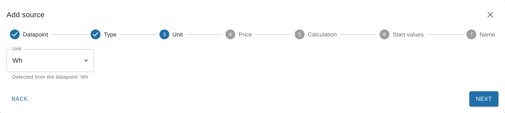

# Sources, units and signs

<!-- seite: gewicht=76; en=en/02.anleitungen/01.quellen-und-einheiten.md -->

## How do I separate consumption from the grid and feed-in (one datapoint with a sign)?

<!-- abschnitt: prio=B; gewicht=20; readme=missing; cluster=prices-costs-19,cumulative-power-22,outputs-viz-34,cumulative-power-21,prices-costs-20; features=source-ignore-negative,source-power-integration,consumption-vs-delivery,source-multi-edit,calc-negative-values-cumulative -->
<!-- muss beantworten: Ein Datenpunkt für Bezug und Einspeisung: Einstellung "negative Werte ignorieren", zwei Quellen, Verhalten bei negativen Leistungen. -->

With two sources, because SourceAnalytix does not evaluate the sign. The first uses the datapoint for grid import, the second an alias with the sign flipped for feed-in. Both get "Ignore negative values".
<!-- quelle: interview=10; code=lib/calculation.js; code=main.js -->

1. On the "Price definitions" tab, create two prices in `kWh`: `Grid import` with cost type "Costs" and `Feed-in` with cost type "Earnings". For feed-in, the "Price per unit" is your feed-in tariff per kWh.
2. On the "Objects" tab, create an alias on the power datapoint that flips the sign (`-val`), with the unit `W`.
3. Use "Add source" to create a source for the original datapoint with type "Power" and the price `Grid import`.
4. Create a source for the alias in the same way, with the price `Feed-in`.
5. For both, set "Ignore negative values" in the detail view under "Settings" and click "⚡ Apply".
<!-- quelle: interview=10; code=src-admin/src/Wizard.tsx; code=src-admin/src/SourceDetail.tsx; code=admin/jsonConfig.json -->

Grid import then appears under `currentYear.consumed`, feed-in under `currentYear.delivered` and the earnings under `currentYear.earnings`.
<!-- quelle: code=main.js -->

> [!WARNING]
> Without "Ignore negative values", feed-in pulls the import total down. The daily consumption then only shows the balance and can turn negative.
<!-- quelle: code=lib/calculation.js; code=main.js; forum=434762 -->

If your electricity meter has separate readings for import and feed-in, use those as two meter-reading sources instead. That is more accurate.
<!-- quelle: code=lib/calculation.js; forum=636815 -->

**See also:** [PV yield, feed-in and earnings](#track-pv-yield-feed-earnings) · [How do I assign prices?](03.preise-und-kosten.md#assign-prices-create-custom-tariffs)

## Which unit do I set on the datapoint (kWh instead of Wh, m³ instead of liters)?

<!-- abschnitt: prio=B; gewicht=19; readme=missing; cluster=cumulative-power-24,outputs-viz-09,meter-readings-21; features=source-unit,unit-detection-conversion,supported-units,price-definitions-table -->
<!-- muss beantworten: Quelleinheit korrekt wählen; was bei nachträglicher Änderung passiert; warum kWh statt m³ erscheint. -->

The unit the datapoint really delivers. The wizard usually detects it itself ("Detected from the datapoint: …"). The price definition decides which unit you see the values in. SourceAnalytix converts from Wh to kWh or from l to m³ on its own.
<!-- quelle: code=main.js; code=lib/calculation.js; code=src-admin/src/Wizard.tsx -->

Typical mistakes:

- **Meter reading labelled `W`:** the value is summed up over time and becomes absurdly high. Choose `Wh` or `kWh`.
- **Power labelled `kWh`:** every value counts as a meter reading. Choose `W` or `kW`.
- **`Wh` and `kWh` mixed up:** everything is off by a factor of 1,000.
<!-- quelle: code=main.js; code=lib/calculation.js; forum=575673; forum=951120 -->

If SourceAnalytix detects no unit, the "Problems" tab reports "Unit missing or not recognised". Use "Fix" to choose it.
<!-- quelle: code=lib/source-overview.js; code=src-admin/src/Dialogs.tsx -->

### Why kWh appears instead of m³

The chosen price definition uses `kWh`. Create a separate gas price in `m³` and choose it for the source. SourceAnalytix does not convert cubic metres of gas into kWh; if the units don't match, you can't choose the price at all.
<!-- quelle: code=main.js; code=lib/calculation.js; issue=#1278; forum=953404 -->

### If you change the unit later

SourceAnalytix does not convert stored values. If you switch to a price whose unit differs from the stored data, say from kWh to MWh, the source does not start. The "Problems" tab then shows "The price definition uses another unit than the stored data". Choose a price in the old unit, or delete the source's data and start over.
<!-- quelle: issue=#1310; code=main.js:2186-2195; code=lib/source-overview.js:56-106; code=src-admin/src/i18n/en.json -->

If the unit on the datapoint was wrong, say Wh instead of kWh, the new one applies from the next value. Afterwards, correct the total and the periods with "Align meter reading", see [Correcting wrong values](02.zaehlerstaende-korrigieren.md#correct-wrong-too-high-negative).
<!-- quelle: code=main.js; code=lib/calculation.js -->

**See also:** [Which units are supported?](../03.referenz/01.einstellungen.md#units-supported-energy-volume-weight) · [Start values and their unit](../01.erste-schritte/02.erster-zaehler.md#start-values-unit)

## Can SourceAnalytix calculate consumption and a meter reading from power (W)?

<!-- abschnitt: prio=B; gewicht=12; readme=covered; cluster=cumulative-power-02; features=source-power-integration,unit-detection-conversion,source-cumulative-meter -->
<!-- muss beantworten: Leistung als Quelle: was entsteht, welche Einheit, wie genau; Verweis auf Hintergrund. -->

Yes. SourceAnalytix multiplies each power value by the time until the next one and adds that to its own total. This gives consumption and costs in the energy unit of the price definition, for example kWh.
<!-- quelle: code=main.js; code=lib/calculation.js -->

The total starts at 0 on activation, so it is not your electricity meter's reading. How accurate it is depends on how often the device sends. You don't need start values or reset detection.
<!-- quelle: code=main.js -->

In the wizard, choose the type "Power" and a price in `Wh`, `kWh` or `MWh`. The power options are described under [If you only have a power value](../01.erste-schritte/02.erster-zaehler.md#datapoint-enable-meter-kwh-power). With "Align meter reading" you can match the total to a real meter; after that the two drift apart again.
<!-- quelle: code=src-admin/src/Wizard.tsx; code=main.js; code=lib/source-actions.js -->

**See also:** [How does SourceAnalytix convert watts to kWh?](../05.hintergrund/01.berechnung.md#sourceanalytix-convert-watts-kwh) · [Which source types are there?](../03.referenz/01.einstellungen.md#source-types-exist-meter-power)

## How do I track PV yield, feed-in and earnings?

<!-- abschnitt: prio=B; gewicht=9; readme=partial; cluster=prices-costs-22,prices-costs-24; features=source-cumulative-meter,consumption-vs-delivery,output-cost-vs-earnings,source-enable,source-start-values -->
<!-- muss beantworten: Richtigen PV-Datenpunkt wählen, Startwert, Verbrauch vs. Lieferung, Erlöse. -->

Each meter becomes its own source with a price of cost type "Earnings". SourceAnalytix then writes delivery and earnings instead of consumption and costs.
<!-- quelle: code=main.js; forum=1157391; forum=1265526; forum=794768 -->

| What | Datapoint | Price definition |
|---|---|---|
| PV yield | the inverter's total yield in kWh | "Earnings"; without money, leave "Costs" off |
| Feed-in and earnings | the feed-in register of the electricity meter | "Earnings", price = feed-in tariff |
| Grid import | the import register of the electricity meter | "Costs" |
<!-- quelle: code=main.js; code=admin/jsonConfig.json -->

Use the total yield, not "yield today", which drops to 0 every night. The values are under `currentYear.delivered` and `currentYear.earnings`, and in the detail view as "Delivery" and "Earnings". SourceAnalytix does not calculate self-consumption or self-sufficiency.
<!-- quelle: interview=4; code=main.js; code=src-admin/src/SourceDetail.tsx; issue=#643 -->

**See also:** [Import and feed-in from one datapoint](#separate-import-feed-one-datapoint) · [Start values](../01.erste-schritte/02.erster-zaehler.md#start-values-unit)

## How do I derive a counter from flow rate, run time or several devices?

<!-- abschnitt: prio=B; gewicht=8; readme=missing; cluster=outputs-viz-14,cumulative-power-29,meter-readings-16; features=source-cumulative-meter,source-power-integration,supported-units,source-reset-detection,reset-confirmation -->
<!-- muss beantworten: Summen und abgeleitete Zähler (Phasen, Brenner, Füllstand), Reset-Erkennung dafür. -->

With a script. SourceAnalytix evaluates each datapoint on its own and only sums power and pulses per minute over time. For everything else, a script writes a rising meter reading in a supported unit, and you activate that datapoint.
<!-- quelle: code=lib/calculation.js; code=main.js; forum=1241171 -->

| Case | What you do |
|---|---|
| Several phases | use the device's total counter, otherwise sum the phases in a script |
| Several devices | one source per device; a script builds a sum |
| Flow rate (`m³/h`, `l/min`) | a script adds rate × time to `m³` or `l` |
| Burner run time | a script calculates run time × consumption per hour in `l` or `kWh` |
| Burner starts | directly as a meter reading with unit `piece` |
| Fill level (oil tank) | a script only sums the decreases, without refills |
<!-- quelle: code=lib/calculation.js; issue=#304; forum=1241171; forum=581241; forum=680719 -->

Cleanest is a sum that never falls: the script only adds the increase of each sub-meter and ignores decreases. If the sum does fall, reset detection handles it like for any meter.
<!-- quelle: forum=938999; forum=919324; code=lib/calculation.js -->

**See also:** [Which units are supported?](../03.referenz/01.einstellungen.md#units-supported-energy-volume-weight) · [Script datapoints](#use-script-datapoints-unreliable-sources)

## Can I use script datapoints or unreliable sources?

<!-- abschnitt: prio=B; gewicht=8; readme=missing; cluster=setup-ui-24,cumulative-power-18; features=source-cumulative-meter,source-enable,output-timestamps-ack,other-object-subscription,reset-jitter-ignore -->
<!-- muss beantworten: Skript-/Fremd-Datenpunkte (Simple-API, andere Adapter); Ausreißer und Nachkommastellen filtern. -->

Yes. Any datapoint can be a source, whether an adapter, a script, an alias or Simple-API writes it. It has to deliver a number in a supported unit; text such as `"12,5"` works too.
<!-- quelle: code=main.js; forum=474030; issue=#1255; issue=#1288 -->

- Give the datapoint the type number and a unit, for example `kWh`. The wizard then lists it under "Matching datapoints".
- Write a meter reading that only goes up.
- If a value is not a number, the "Problems" tab reports "Datapoint delivers text instead of a number".
<!-- quelle: code=main.js; code=src-admin/src/Wizard.tsx; code=lib/source-overview.js -->

Only reset detection filters outliers: small drops up to the "Threshold" and a brief 0 are ignored. A jump upwards counts as consumption right away. If your source sometimes delivers absurdly high values, filter them in a script first.
<!-- quelle: code=lib/calculation.js; issue=#1258; forum=938999 -->

You set how many decimals SourceAnalytix outputs for the source under "For experts".
<!-- quelle: code=src-admin/src/SourceDetail.tsx; code=lib/calculation.js -->

**See also:** [What does "Device reset detected" mean?](../05.hintergrund/02.zaehler-reset.md#device-reset-detected-mean-reset) · [Correcting wrong values](02.zaehlerstaende-korrigieren.md#correct-wrong-too-high-negative)
