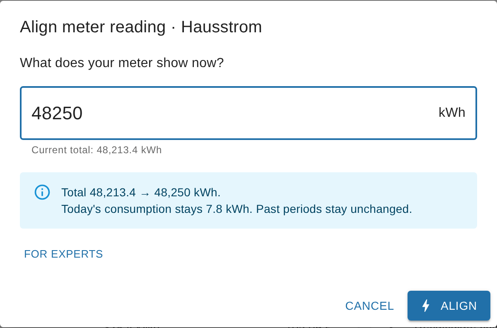
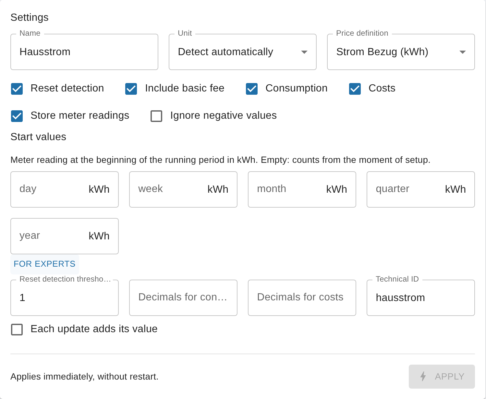
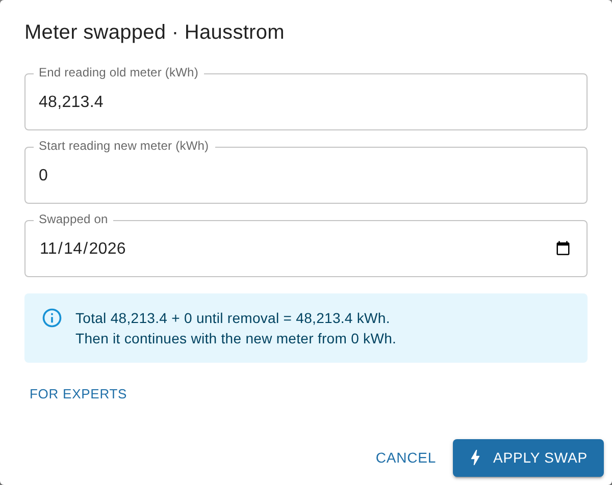

# Correcting meter readings and swapping meters

<!-- seite: gewicht=145; en=en/02.anleitungen/02.zaehlerstaende-korrigieren.md -->

## How do I correct wrong, too high or negative values after a reset?

<!-- abschnitt: prio=A; gewicht=54; readme=partial; cluster=meter-readings-18,cumulative-power-13,outputs-viz-26,periods-10,upgrade-migration-other-06; features=reset-manual-correction,source-start-values,output-cumulative-reading,reset-confirmation,source-hidden-reset-keys -->
<!-- muss beantworten: Instanz stoppen, Startwerte/cumulativeReading/valueAtDeviceReset setzen, vor Mitternacht korrigieren; abgeschlossene Perioden werden nicht neu berechnet. -->

**In short:** From v0.7.0, open the source in the SourceAnalytix instance settings, choose the action "Align meter reading" and enter the value your meter shows right now. SourceAnalytix does the rest immediately, without a restart. Up to v0.6.x you can only do it by hand (see below), and changing `cumulativeReading` alone is not enough.
<!-- quelle: issue=#640; issue=#1269; interview=1; code=lib/calculation.js:301-390@v0.6.1; forum=603844 -->

The reason: the total (`cumulativeReading`) is always the device value plus the offset (`valueAtDeviceReset`). If you change only the total, the next value either overwrites it or is taken for a reset. The action sets both values so that they match. The terms are explained under [What does "Device reset detected" mean and how does reset detection work?](../05.hintergrund/02.zaehler-reset.md#device-reset-detected-mean-reset).
<!-- quelle: code=lib/calculation.js:279-390@v0.6.1; code=main.js:3104@v0.6.1; interview=2 -->

### How to do it (from v0.7.0)

1. Under "Instances", open the settings of the SourceAnalytix instance, then open your source on the "Overview" tab.
2. Under "Actions", choose "Align meter reading".
3. At "What does your meter show now?", enter the reading you take from the meter.
4. Check the preview. It shows the old and the new total. Today's consumption and past periods stay unchanged.
5. Click "⚡ Align". The values apply immediately.
<!-- quelle: issue=#640; issue=#1269 -->

If SourceAnalytix itself notices that the total and the meter don't match, it lists this on the "Problems" tab with the suggestion "Align meter reading".
<!-- quelle: issue=#1269 -->

The action shifts all start values by the same amount as the total. A wrong jump that is already part of today's, this week's or this month's consumption therefore stays there. You remove that part separately via the start values, as described under [How to correct the start values](#values-negative-after-entering-start).
<!-- quelle: code=lib/source-actions.js:21-46; code=main.js:4124-4179 -->

### Repairing costs

> [!WARNING]
> Costs are booked continuously from the change in the total. A wrong jump upwards has therefore already been booked as costs at the price of that time, and lowering the total does not reduce the costs. Repair the costs after every correction.
<!-- quelle: code=main.js:964-975@v0.6.1 -->

**From v0.7.0:** For the source, choose the action "Recalculate costs from date" and enter the day the error started. SourceAnalytix recalculates the costs of all affected periods using the price history. Consumption stays the same. The preview first shows how many periods are affected. SourceAnalytix only knows the consumption per period, so it spreads it evenly over the period: if the price changes in the middle of a period, the consumption is split between the two prices in proportion to time. The action does not change values in a history such as InfluxDB ([#947](https://github.com/DrozmotiX/ioBroker.sourceanalytix/issues/947)).
<!-- quelle: issue=#947; issue=#1269; interview=14; code=lib/source-actions.js:235-243; code=main.js:4095 -->

**Up to v0.6.x:** You can reset the costs of the running periods. Stop the instance, clear the state `sourceanalytix.0.<device>.dynamicCostMemory`, and set the states `sourceanalytix.0.<device>.currentYear.costs.01_currentDay` to `05_currentYear` to 0 (for feed-in, `currentYear.earnings.…`). After the start, SourceAnalytix recalculates them from the total and the start values using the current price. A price change within the running period is lost this way.
<!-- quelle: code=main.js:827-831@ff9e352; code=main.js:917-966@ff9e352; code=main.js:752-769@ff9e352; code=main.js:796-798@ff9e352 -->

### Correct before midnight

At midnight, SourceAnalytix writes the values of the finished periods to `previousDay`, `previousWeek` and so on, and sets the start values to the total. Aligning does not recalculate these finished values or the archive under `<year>`. If you correct before midnight, the error stays limited to the current day. Values already written for yesterday or in the archive have to be changed by hand, as do values in a history such as InfluxDB.
<!-- quelle: code=main.js:2537-2605@v0.6.1; code=main.js:2572@v0.6.1; forum=698416 -->

### Up to v0.6.x: correcting by hand

1. Note the real meter reading and the current value of your source datapoint, both in the target unit (divide Wh by 1,000 if you calculate in kWh). Offset = real meter reading − device value. If your device already shows the real meter reading (for example an optical reader on the electricity meter), the offset is 0.
2. Stop the instance.
3. In the SourceAnalytix settings of the source datapoint, set the start values "Day" to "Year" to the total at the beginning of the period, at most the real meter reading. Save.
4. In the object of the source datapoint, under `common.custom.sourceanalytix.0`, set `valueAtDeviceReset` to the offset (Objects, expert mode, edit object).
5. Set `sourceanalytix.0.<device>.cumulativeReading` to the real meter reading.
6. Start the instance and repair the costs as described above.
<!-- quelle: code=main.js:1904-1912@v0.6.1; code=main.js:3397-3435@v0.6.1; code=admin/jsonCustom.json:186-253@v0.6.1; interview=12; forum=731991 -->

**From v0.6.2:** If the offset is higher than the total, for example because only `cumulativeReading` was lowered, the source keeps running and SourceAnalytix adjusts the offset itself with the next value. Up to v0.6.1, the source stopped with the error "Known valueAtDeviceReset > known cumulative value" ([#1257](https://github.com/DrozmotiX/ioBroker.sourceanalytix/issues/1257)).
<!-- quelle: issue=#1257; pr=#1274; code=main.js:1979-1991@ff9e352; code=main.js:3380-3389@ff9e352 -->

**See also:** [Negative values after entering start values](#values-negative-after-entering-start) · [Meter or device replaced](#replaced-meter-device-avoid-negative) · [Error "Known valueAtDeviceReset > known cumulative value"](../04.fehlerbehebung/01.log-meldungen.md#error-known-valueatdevicereset-known-cumulative) · [Previous periods (previous states)](../03.referenz/02.states-und-meldungen.md#yesterday-last-week-last-month)

## Why are my values negative after I entered start values?

<!-- abschnitt: prio=A; gewicht=27; readme=partial; cluster=cumulative-power-11,meter-readings-02,periods-05,meter-readings-08; features=source-start-values,calc-first-activation-start-values,calc-negative-values-cumulative,calc-consumption-formula,rollover-midnight-cron -->
<!-- muss beantworten: Typische Fehler bei Startwerten (Einheit, Zählerstand statt Periodenwert); Startwerte nachträglich korrigieren. -->

**In short:** At least one start value is larger than the current total. The consumption of a period is the total minus the start value, so it turns negative as soon as the start value is higher. Enter the total at the beginning of the period as the start value, in the target unit, and never more than the current `cumulativeReading`.
<!-- quelle: code=main.js:3192-3222@v0.6.1; code=main.js:2612@v0.6.1; forum=559320; forum=420634 -->

### The most common causes

| What was entered | What happens | Correct |
|---|---|---|
| The consumption of the period (for example 350 kWh for the year) instead of the meter reading | A small start value makes almost the whole meter reading look like consumption | The total at the beginning of the period, for example 12,300 kWh on 1 January |
| The meter reading in Wh (12,300,000) although the price definition calculates in kWh | The start value is a thousand times too large, consumption is strongly negative | A value in the target unit, so 12,300 kWh |
| The device value, although SourceAnalytix works with an offset after a reset | The start value doesn't match the total, consumption is too high or negative | Use the value from `cumulativeReading` as the reference, not the value of the device |
| A start value for "Year" or "Month" that is higher than the one for "Day" | The longer period turns negative | "Day" is always the highest start value, see below |
| 0 in a field after the source was already running | The whole total shows up as consumption | SourceAnalytix only fills empty or 0 fields by itself on the first activation |
<!-- quelle: code=admin/jsonCustom.json:186-253@v0.6.1; code=main.js:3079-3096@v0.6.1; code=lib/calculation.js:199-221@v0.6.1; code=main.js:1904-1912@v0.6.1; interview=12; forum=1104554; forum=502434 -->

### How to correct the start values

1. Read the current total: from v0.7.0 in the source detail under "Total", otherwise in the state `sourceanalytix.0.<device>.cumulativeReading`.
2. In the source detail, scroll to the "Start values" section in the "Settings" area. Up to v0.6.x, the fields are in the custom settings dialog of the datapoint ("Objects" tab, wrench icon) under "Start values for the respective period".
3. For "Day", "Week", "Month", "Quarter" and "Year", enter the total at the beginning of that period, in the target unit.
   - If you don't know the reading at the beginning of a period, enter the current total. The period then starts at 0 now.
   - Every start value is at most as large as the current total.
   - "Day" is at least as large as all the others, because the day started last. "Month" is at least as large as "Quarter", and "Quarter" at least as large as "Year".
   - You sort "Week" by its first day: if the week began in the previous month or the previous year, its start value may be lower than that of "Month" or "Year".
   - Enter numbers without a thousands separator, with a comma or a dot as the decimal mark: `12475,5` or `12475.5`.
4. Click "⚡ Apply". You don't have to stop the instance for this.
5. With the next value from the source, SourceAnalytix recalculates the running periods. The values under `currentYear` are no longer negative.
<!-- quelle: code=main.js:2144-2200@v0.6.1; code=main.js:1990-1994@v0.6.1; code=main.js:3192-3222@v0.6.1; code=src-admin/src/SourceDetail.tsx:263-282; code=src-admin/src/SourceDetail.tsx:487-513; code=src-admin/src/SourceDetail.tsx:586-596; code=src-admin/src/api.ts:191-214; code=admin/jsonCustom.json:186-191@v0.6.1; issue=#1285; issue=#1287; interview=12; forum=248006 -->

> [!IMPORTANT]
> Start values only apply to the running period. At the next rollover (for example at midnight for "Day"), SourceAnalytix overwrites them with the then current total. New start values do not recalculate finished periods such as yesterday or last month.
<!-- quelle: code=main.js:2537-2605@v0.6.1; code=main.js:2572@v0.6.1; interview=12 -->

If the start value is fine and the total itself is wrong, changing the start values won't help. In that case, follow [Correcting wrong values](#correct-wrong-too-high-negative).
<!-- quelle: code=main.js:3192-3222@v0.6.1 -->

**From v0.7.0:** The source detail checks the start values the way the wizard does. Every changed start value has to match the current total and the order of the periods. Otherwise the field shows an error and "⚡ Apply" stays disabled. If a value only fits after dividing by 1000, the field says, for example, "Looks like Wh – did you mean 1.29 kWh?". The "Problems" tab also reports unsuitable start values as "Start value does not fit" with the suggestion "Check the start values: at most the current reading, in the calculation unit." ([#1267](https://github.com/DrozmotiX/ioBroker.sourceanalytix/issues/1267), [#1269](https://github.com/DrozmotiX/ioBroker.sourceanalytix/issues/1269)).
<!-- quelle: issue=#1267; issue=#1269; issue=#1285; interview=12; code=src-admin/src/SourceDetail.tsx:176-184; code=src-admin/src/SourceDetail.tsx:592; code=src-admin/src/api.ts:242-286; code=main.js:4583-4587; code=lib/source-overview.js:166-168; code=src-admin/src/i18n/de.json:85 -->

**See also:** [What do I enter for the start values (and in which unit)?](../01.erste-schritte/02.erster-zaehler.md#start-values-unit) · [Values or costs far too high or negative – is the unit right?](../04.fehlerbehebung/02.falsche-werte-und-bekannte-fehler.md#values-costs-far-too-high) · [The terms](../05.hintergrund/02.zaehler-reset.md#device-reset-detected-mean-reset)

## I replaced a meter or device: how do I avoid negative values?

<!-- abschnitt: prio=A; gewicht=25; readme=missing; cluster=meter-readings-17,cumulative-power-26,meter-readings-26; features=reset-confirmation,source-reset-detection,source-start-values,reset-manual-correction,source-hidden-reset-keys -->
<!-- muss beantworten: Zählertausch ohne Datenverlust: Reset bestätigen, Offset, Alias statt Gerät loggen. -->

**In short:** Leave reset detection switched on. If the new meter starts well below the old total, for example at 0, SourceAnalytix carries on counting by itself after two values. In all other cases, use the action "Meter swapped" in the instance settings (from v0.7.0), ideally before the new meter delivers its first value.
<!-- quelle: code=lib/calculation.js:279-390@v0.6.1; code=main.js:3036-3078@v0.6.1; issue=#1269; forum=592553; forum=861280 -->

### What SourceAnalytix does when a meter is swapped

| The new meter starts … | SourceAnalytix … | You … |
|---|---|---|
| well below the old total (by more than the threshold) | detects a reset, confirms it with the next value and carries on counting from the old total | don't have to do anything. The log says "Device reset detected …". |
| just below the old total (by no more than the threshold) | takes it for measurement noise and ignores the values until they exceed the old reading | use "Meter swapped". |
| at or above the old total | sees no reset and counts the jump as consumption | use "Meter swapped". |
<!-- quelle: code=lib/calculation.js:279-296@v0.6.1; code=lib/calculation.js:301-390@v0.6.1; forum=771152 -->

The terms total, offset and threshold are explained under [What does "Device reset detected" mean and how does reset detection work?](../05.hintergrund/02.zaehler-reset.md#device-reset-detected-mean-reset).

### How to do it (from v0.7.0)

1. Under "Instances", open the settings of the SourceAnalytix instance, then open your source on the "Overview" tab.
2. Under "Actions", choose "Meter swapped".
3. Enter the end reading of the old meter, the start reading of the new meter and the date of the swap.
4. Check the preview and click "⚡ Apply swap". The total continues from the old end reading, without a restart.
<!-- quelle: issue=#1269; interview=2 -->

If the new meter has already delivered values and the total has jumped, use "Align meter reading" instead and repair the costs as described under [Correcting wrong values](#correct-wrong-too-high-negative).
<!-- quelle: issue=#640; code=main.js:964-975@v0.6.1 -->

### Up to v0.6.x: setting the offset by hand

1. Stop the instance before the swap and note the total from `sourceanalytix.0.<device>.cumulativeReading`.
2. Swap the meter and note its start reading in the target unit.
3. Offset = old total − start reading of the new meter. If the new meter reads higher, the offset is negative. That is correct.
4. In the object of the source datapoint, under `common.custom.sourceanalytix.0`, set `valueAtDeviceReset` to this offset (Objects, expert mode, edit object) and start the instance.
<!-- quelle: code=main.js:1904-1912@v0.6.1; code=lib/calculation.js:301-390@v0.6.1; interview=2; forum=928900 -->

Example: the old total is 5,000 kWh, the new meter starts at 6,000 kWh, so the offset is −1,000. If the new meter later reports 6,010 kWh, `cumulativeReading` shows 5,010 kWh.
<!-- quelle: code=lib/calculation.js:301-390@v0.6.1 -->

**From v0.6.2:** If the offset after a swap is larger than the total, the source no longer stops. SourceAnalytix adjusts the offset itself with the next value ([#1257](https://github.com/DrozmotiX/ioBroker.sourceanalytix/issues/1257)).
<!-- quelle: issue=#1257; pr=#1274; code=main.js:3380-3389@ff9e352 -->

### Device replaced: use an alias instead of the device

If the new device gets a new datapoint (for example a new Shelly with a new ID), SourceAnalytix treats it as a new source with its own folder and its own start values. You can avoid this with an ioBroker alias:

1. Create an alias for the meter (for example under `alias.0`) that points to the datapoint of the device, and give it the unit of the meter.
2. Activate SourceAnalytix on the alias, not on the device.
3. When you replace the device, you only point the alias to the new datapoint. SourceAnalytix keeps its folder and its total.
4. For the meter reading of the new device, the table above then applies.
<!-- quelle: code=main.js:2085-2093@v0.6.1; code=main.js:3031-3078@v0.6.1; forum=860930; forum=1120113 -->

The "Name" field in the SourceAnalytix settings is only a display label, not an ioBroker alias. Switching a datapoint directly and taking the data along is planned for later ([#1271](https://github.com/DrozmotiX/ioBroker.sourceanalytix/issues/1271)).
<!-- quelle: code=admin/jsonCustom.json:12-21@v0.6.1; issue=#1271; interview=7 -->

> [!NOTE]
> Older guides in the forum mention the keys `cumulativeValue`, `previousDeviceReset` or `valueAtDeviceInit`. SourceAnalytix reads none of them. From v0.6.2, `valueAtDeviceInit` is no longer written either ([#1263](https://github.com/DrozmotiX/ioBroker.sourceanalytix/issues/1263)).
<!-- quelle: code=main.js:1904-1912@v0.6.1; code=main.js:3067-3070@v0.6.1; issue=#1263; pr=#1274; forum=1152707 -->

**See also:** [Correcting wrong values](#correct-wrong-too-high-negative) · [Name, alias and output ID](../03.referenz/01.einstellungen.md#name-datapoint-alias-output-id) · [Switching off a datapoint or starting over](05.betrieb-und-wartung.md#restart-datapoint-clean-up-old)

## My meter restarts at 0 after a power failure or every day: what do I set?

<!-- abschnitt: prio=A; gewicht=22; readme=partial; cluster=meter-readings-14,logs-install-04,setup-ui-25; features=source-reset-detection,reset-confirmation,source-threshold,log-reset-messages,source-power-integration -->
<!-- muss beantworten: Shelly/Tasmota/Steckdosen-Zähler; Meldung "Device reset detected"; Threshold und Reset-Erkennung passend einstellen. -->

**In short:** Usually nothing. Leave reset detection switched on and set the threshold lower than the amount your meter drops by when it restarts. SourceAnalytix then recognises the restart as a reset and carries on counting from the old total. From v0.7.0, you find both in the source detail under "Settings".
<!-- quelle: code=lib/calculation.js:279-390@v0.6.1; code=main.js:3036-3078@v0.6.1; code=main.js:1986@v0.6.1; code=src-admin/src/SourceDetail.tsx:84-91; code=src-admin/src/SourceDetail.tsx:423-439; code=src-admin/src/SourceDetail.tsx:529-533; forum=660139; forum=787115 -->

This applies to Shelly, Tasmota, sockets with an energy meter and any other device whose meter reading starts at 0 again after a power failure, a restart or at midnight. How detection works in detail is described under [What does "Device reset detected" mean and how does reset detection work?](../05.hintergrund/02.zaehler-reset.md#device-reset-detected-mean-reset).
<!-- quelle: forum=897463; forum=1013579; interview=4 -->

### How to do it (from v0.7.0)

1. Under "Instances", open the settings of the SourceAnalytix instance, then open your source on the "Overview" tab.
2. Under "Settings", tick "Reset detection".
3. Expand "For experts" and check "Reset detection threshold". The threshold is in the target unit, so for example in kWh, even if your device delivers Wh. SourceAnalytix ignores drops up to this size as measurement noise.
   - Meter that drops to 0 during a power failure: the default of 1 works as long as the meter reading is above 1 kWh.
   - Daily counter (drops to 0 every night): choose a value below your smallest daily consumption, for example 0.1 kWh.
   - Meter with small units such as m³: also choose a small threshold, for example 0.1 m³.
4. Click "⚡ Apply". The setting applies immediately, without a restart.
5. The next time the device restarts, the log first says "Waiting for another reading before confirming a possible device reset", and with the next value "Device reset detected … preserving cumulative value …". The total then carries on counting from the old reading.
<!-- quelle: code=src-admin/src/SourceDetail.tsx:374-598; code=lib/calculation.js:445-455; code=main.js:3573; code=main.js:3586; forum=787115 -->

When you add a source, the wizard asks "Does the value sometimes drop to 0, e.g. after a power failure?". Reset detection is only on if you answer "Yes". For Shelly and Tasmota datapoints, "Yes" is preselected, for all others "No". If it is off for a source that drops to 0, the "Problems" tab shows "Meter drops to 0, reset detection is off" with "⚡ Switch on" ([#1269](https://github.com/DrozmotiX/ioBroker.sourceanalytix/issues/1269)).
<!-- quelle: issue=#1269; code=src-admin/src/Wizard.tsx:121-130; code=src-admin/src/Wizard.tsx:179; code=lib/source-overview.js:163-165; code=src-admin/src/i18n/de.json -->

**Up to v0.6.x**, both settings are in the custom settings dialog of the datapoint ("Objects" tab, wrench icon) under "Calculation settings": "Device value reset detection Enabled" and "Threshold". From v0.7.0 they are no longer there ([#1286](https://github.com/DrozmotiX/ioBroker.sourceanalytix/issues/1286)).
<!-- quelle: code=admin/jsonCustom.json:138-159@v0.6.1; code=admin/jsonCustom.json:1-55; code=admin/i18n/de.json:22; code=admin/i18n/de.json:91; issue=#1286 -->

> [!WARNING]
> If the meter drops by less than the threshold, SourceAnalytix takes it for measurement noise and ignores all new values until they exceed the old reading again. For a daily counter with a threshold of 1 kWh and 0.6 kWh the day before, the first 0.6 kWh of the new day are missing. On a day with the same consumption, that is the whole day. So set the threshold lower than the smallest drop.
<!-- quelle: code=lib/calculation.js:279-296@v0.6.1; code=main.js:3061-3064@v0.6.1 -->

### Daily counters that start at 0 every night

Daily counters such as "Yield today" or "Consumption today" work. But with every reset, the small amount is missing that the device counted between its last value before the reset and its first value afterwards. If your device also offers a total counter that is never reset (for example "Total"), use that one instead.
<!-- quelle: interview=4; code=lib/calculation.js:348@v0.6.1; forum=990182 -->

### If SourceAnalytix wasn't running during the power failure

The total is stored in the state `cumulativeReading`. If the device restarted while SourceAnalytix was stopped, SourceAnalytix detects the reset with the first value after it starts. That works as long as the new device value plus the offset is still lower than the stored total by more than the threshold. If the device has already passed the old reading by then, the reset can no longer be detected. In that case, correct the total as described under [Correcting wrong values](#correct-wrong-too-high-negative).
<!-- quelle: code=main.js:1910@v0.6.1; code=main.js:3397-3435@v0.6.1; code=lib/calculation.js:301-390@v0.6.1 -->

### Power instead of a meter reading

A power source in W has no reset, because SourceAnalytix adds up the power into a meter reading itself. If the daily counter is too imprecise for you, you can use your device's power as the source instead. What to keep in mind is described under [Can SourceAnalytix calculate consumption and a meter reading from power (W)?](01.quellen-und-einheiten.md#sourceanalytix-compute-consumption-meter-reading).
<!-- quelle: code=main.js:3031@v0.6.1; code=main.js:3326-3395@v0.6.1; forum=660139 -->

**From v0.6.2:** Some devices briefly report 0 twice after a restart and then return to their old reading. Up to v0.6.1, the two zeros confirmed a reset, and the total doubled when the old reading came back. From v0.6.2, SourceAnalytix undoes the reset in this case ([#1258](https://github.com/DrozmotiX/ioBroker.sourceanalytix/issues/1258)).
<!-- quelle: issue=#1258; pr=#1274; code=lib/calculation.js:368-405@ff9e352 -->

**See also:** [What does "Device reset detected" mean and how does reset detection work?](../05.hintergrund/02.zaehler-reset.md#device-reset-detected-mean-reset) · [Threshold and switching off reset detection](../03.referenz/01.einstellungen.md#threshold-disabling-reset-detection-work) · [A counter that resets to 0 every day](../05.hintergrund/02.zaehler-reset.md#counter-reset-0-daily-happens)

## How do I apply my real meter reading (cumulativeReading, RAW object)?

<!-- abschnitt: prio=B; gewicht=17; readme=partial; cluster=meter-readings-23,cumulative-power-12,meter-readings-19; features=reset-manual-correction,output-cumulative-reading,source-start-values,source-hidden-reset-keys,calc-first-activation-start-values -->
<!-- muss beantworten: cumulativeReading und Roh-Objekt bearbeiten; warum das RAW-Objekt gesperrt wirkt. -->

**In short:** From v0.7.0, you no longer have to edit an object for this. In the instance settings, open the source, choose "Align meter reading" and enter the reading your meter shows. SourceAnalytix sets `cumulativeReading` and the offset `valueAtDeviceReset` so that they match, immediately and without a restart. If your device already shows the real meter reading, for example through an optical reader, there is nothing to do.
<!-- quelle: issue=#640; interview=1; code=lib/source-actions.js:21-46; code=main.js:4124-4179; code=src-admin/src/i18n/de.json -->

The steps are under [How do I correct wrong, too high or negative values after a reset?](#correct-wrong-too-high-negative). You can see the offset in the source detail under "For experts" as `valueAtDeviceReset`.
<!-- quelle: code=src-admin/src/SourceDetail.tsx:289-308 -->

### Why changing only cumulativeReading is not enough

The total is always the device value plus the offset. If you only write a new value to the state `sourceanalytix.0.<device>.cumulativeReading`, SourceAnalytix calculates device value plus the old offset again with the next value from the source. Your value therefore doesn't stick. The terms are explained under [The terms](../05.hintergrund/02.zaehler-reset.md#device-reset-detected-mean-reset).
<!-- quelle: code=lib/calculation.js:508-597; code=main.js:3560-3600; code=main.js:3104@v0.6.1; interview=2 -->

### Why the raw object seems locked

- **It is somewhere else than you'd expect.** The settings of a source are in the object of the source datapoint under `common.custom.sourceanalytix.0`, not in the folder `sourceanalytix.0`. That folder only holds the state `cumulativeReading`.
- **It needs expert mode.** You can only edit the object on the "Objects" tab with expert mode switched on, and the JSON has to stay valid: no stray comma, numbers without quotation marks (`12345.6`, not `"12345.6"`).
- **SourceAnalytix writes into it itself.** It writes the start values at every period rollover and the offset at every reset. A change you make while the instance is running can therefore be overwritten again immediately.
<!-- quelle: code=main.js:2780-2810; code=main.js:3586-3590; code=main.js:4066-4070; forum=798977; forum=964002 -->

From v0.7.0, the settings page never writes the offset either. Only SourceAnalytix itself and the actions "Align meter reading" and "Meter swapped" change it.
<!-- quelle: code=main.js:4555-4558; code=main.js:4124-4179 -->

**Up to v0.6.x**, the raw object is the only way: stop the instance, set `valueAtDeviceReset` and `cumulativeReading`, check the start values, start the instance. The steps are under [Up to v0.6.x: correcting by hand](#correct-wrong-too-high-negative).
<!-- quelle: code=main.js:1904-1912@v0.6.1; code=main.js:3397-3435@v0.6.1; forum=731991 -->

**See also:** [Why are meter readings cumulative?](../03.referenz/02.states-und-meldungen.md#meter-readings-cumulative) · [Meter or device replaced](#replaced-meter-device-avoid-negative)
