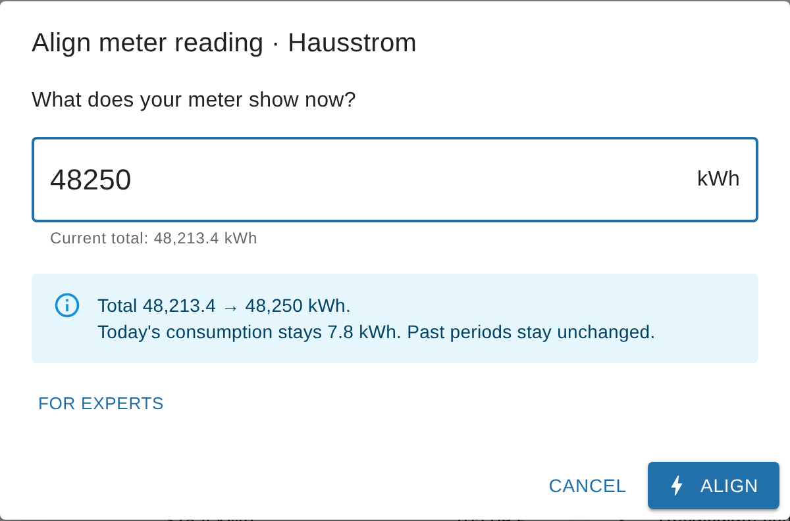
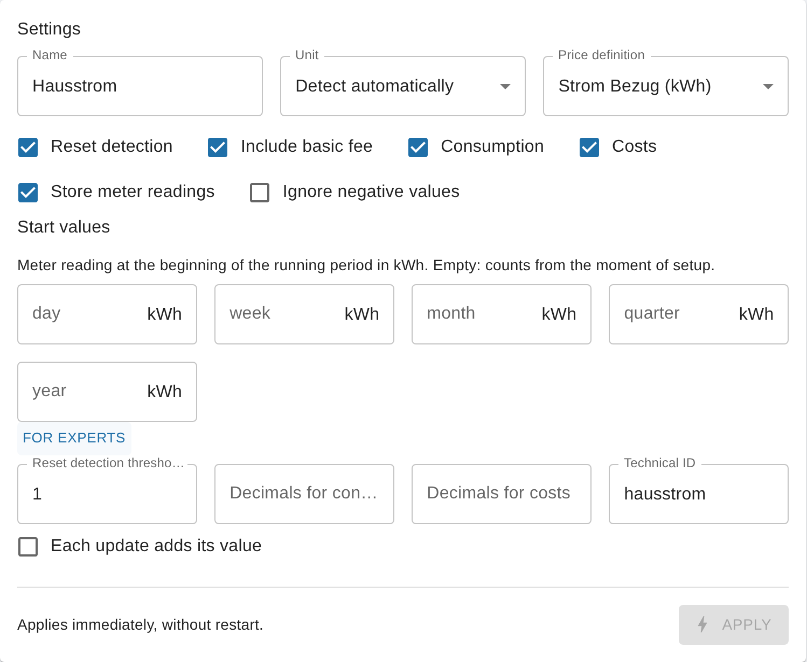
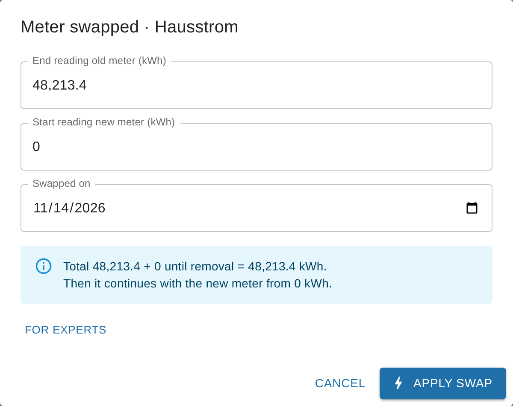

# Correcting meter readings and replacing meters

<!-- seite: gewicht=145; en=en/02.anleitungen/02.zaehlerstaende-korrigieren.md -->

## How do I correct wrong, too high or negative values after a reset?

<!-- abschnitt: prio=A; gewicht=54; readme=partial; cluster=meter-readings-18,cumulative-power-13,outputs-viz-26,periods-10,upgrade-migration-other-06; features=reset-manual-correction,source-start-values,output-cumulative-reading,reset-confirmation,source-hidden-reset-keys -->
<!-- muss beantworten: Instanz stoppen, Startwerte/cumulativeReading/valueAtDeviceReset setzen, vor Mitternacht korrigieren; abgeschlossene Perioden werden nicht neu berechnet. -->

With the source's "Align meter reading" action. You enter the reading your meter shows right now, and SourceAnalytix adjusts the total immediately, without a restart.
<!-- quelle: issue=#640; issue=#1269; interview=1; forum=603844 -->

1. In the instance settings, open the source on the "Overview" tab.
2. Under "Actions", choose "Align meter reading".
3. Enter the reading you took under "What does your meter show now?".
4. Check the preview with the old and new total and click "⚡ Align".
<!-- quelle: issue=#640; issue=#1269 -->

The action shifts the start values along with the total. A wrong jump that is already in today's or this month's consumption therefore stays. You remove it via the [start values](#values-negative-after-entering-start).
<!-- quelle: code=lib/source-actions.js; code=main.js -->

### Repairing costs

Costs are booked with every value, so a wrong jump is in the costs too. Afterwards, choose "Recalculate costs from date" with the day the error began. SourceAnalytix recalculates the costs with the price history; consumption stays the same.
<!-- quelle: issue=#947; issue=#1269; interview=14; code=lib/source-actions.js; code=main.js -->

### Yesterday and older periods

Aligning does not recalculate closed periods such as yesterday, last month or the archive under `<year>`. If you correct before midnight, the error stays limited to today. Change older values and values in a history such as InfluxDB by hand.
<!-- quelle: code=main.js; forum=698416 -->

**See also:** [Meter or device swapped](#replaced-meter-device-avoid-negative) · [Previous periods](../03.referenz/02.states-und-meldungen.md#yesterday-last-week-last-month)

## Why are my values negative after I entered start values?

<!-- abschnitt: prio=A; gewicht=27; readme=partial; cluster=cumulative-power-11,meter-readings-02,periods-05,meter-readings-08; features=source-start-values,calc-first-activation-start-values,calc-negative-values-cumulative,calc-consumption-formula,rollover-midnight-cron -->
<!-- muss beantworten: Typische Fehler bei Startwerten (Einheit, Zählerstand statt Periodenwert); Startwerte nachträglich korrigieren. -->

A start value is greater than the total. Consumption is total minus start value and then turns negative. The settings page no longer accepts such values, but they come from old entries or scripts.
<!-- quelle: code=main.js; code=src-admin/src/SourceDetail.tsx; forum=559320; forum=420634 -->

| Entered | Result | Correct |
|---|---|---|
| the period's consumption instead of a meter reading | almost the whole meter reading shows up as consumption | the reading at the start of the period |
| reading in Wh, price uses kWh | strongly negative | the value in kWh |
| the device value instead of the total | too high or negative | the source's "Total" as the reference |
| "Month" or "Year" above "Day" | the longer period turns negative | "Day" is the largest start value |
<!-- quelle: code=main.js; code=lib/calculation.js; interview=12; forum=1104554; forum=502434 -->

### Correcting the start values

1. Open the source. The "Total" is at the very top.
2. Under "Settings" › "Start values", enter the reading at the start of each period. If you don't know it, empty the field; the period then counts from now.
3. Click "⚡ Apply". If a value doesn't fit, the field shows an error and the button stays locked.
<!-- quelle: code=src-admin/src/SourceDetail.tsx; code=src-admin/src/api.ts; code=lib/calculation.js:404-413; issue=#1285; issue=#1302; interview=12; forum=248006 -->

Start values only apply until the next period rollover. If the total itself is wrong, use [Align meter reading](#correct-wrong-too-high-negative).
<!-- quelle: code=main.js; interview=12 -->

**See also:** [What do I enter for the start values?](../01.erste-schritte/02.erster-zaehler.md#start-values-unit) · [Values far too high or negative](../04.fehlerbehebung/02.falsche-werte-und-bekannte-fehler.md#values-costs-far-too-high)

## I replaced a meter or device: how do I avoid negative values?

<!-- abschnitt: prio=A; gewicht=25; readme=missing; cluster=meter-readings-17,cumulative-power-26,meter-readings-26; features=reset-confirmation,source-reset-detection,source-start-values,reset-manual-correction,source-hidden-reset-keys -->
<!-- muss beantworten: Zählertausch ohne Datenverlust: Reset bestätigen, Offset, Alias statt Gerät loggen. -->

With the "Meter swapped" action, ideally before the new meter delivers its first value. If the new meter starts at 0 and reset detection is on, SourceAnalytix keeps counting even without the action.
<!-- quelle: code=lib/calculation.js; code=main.js; issue=#1269; forum=592553; forum=861280 -->

1. Open the source and choose "Meter swapped" under "Actions".
2. Enter the final reading of the old meter, the starting reading of the new one and the date.
3. Check the preview and click "⚡ Apply swap". The total continues from the old final reading.
<!-- quelle: issue=#1269; interview=2 -->

If the new meter has already delivered values and the total has jumped, use "Align meter reading" and recalculate the costs, see [Correcting wrong values](#correct-wrong-too-high-negative).
<!-- quelle: issue=#640 -->

### New device with a new datapoint

A new datapoint, say a new Shelly, would be a new source. An alias avoids that: activate SourceAnalytix on an alias (for example under `alias.0`) and, when swapping, only point its target to the new device. Folders and total stay.
<!-- quelle: code=main.js; forum=860930; forum=1120113; interview=7 -->

**See also:** [What does "Device reset detected" mean?](../05.hintergrund/02.zaehler-reset.md#device-reset-detected-mean-reset) · [Name, alias and output ID](../03.referenz/01.einstellungen.md#name-datapoint-alias-output-id)

## My meter restarts at 0 after a power failure or every day: what do I set?

<!-- abschnitt: prio=A; gewicht=22; readme=partial; cluster=meter-readings-14,logs-install-04,setup-ui-25; features=source-reset-detection,reset-confirmation,source-threshold,log-reset-messages,source-power-integration -->
<!-- muss beantworten: Shelly/Tasmota/Steckdosen-Zähler; Meldung "Device reset detected"; Threshold und Reset-Erkennung passend einstellen. -->

Turn on "Reset detection" and set the threshold lower than the amount the meter drops by on a restart. SourceAnalytix then keeps counting on top of the old total. For Shelly and Tasmota, the wizard already suggests reset detection.
<!-- quelle: code=lib/calculation.js; code=src-admin/src/Wizard.tsx; code=src-admin/src/SourceDetail.tsx; forum=660139; forum=787115 -->

1. Open the source and set "Reset detection" under "Settings".
2. Check the "Reset detection threshold" under "For experts". It is in the unit of the price definition.
   - Meter that drops to 0 on a power failure: the default of 1 fits.
   - Daily counter: lower than your smallest daily consumption, for example 0.1 kWh.
   - Small units such as m³: for example 0.1 m³.
3. Click "⚡ Apply".
<!-- quelle: code=src-admin/src/SourceDetail.tsx; code=lib/calculation.js; forum=787115 -->

> [!WARNING]
> If the meter drops by less than the threshold, this counts as measurement jitter, and SourceAnalytix ignores new values until they exceed the old reading. With a daily counter and a threshold that is too large, part of the new day is lost this way.
<!-- quelle: code=lib/calculation.js -->

If a source without reset detection drops to 0, the "Problems" tab shows "Meter drops to 0, reset detection is off" with "⚡ Switch on". If there is a total counter next to the daily counter, use that one instead.
<!-- quelle: issue=#1269; code=lib/source-overview.js; interview=4; forum=990182 -->

**See also:** [What does "Device reset detected" mean?](../05.hintergrund/02.zaehler-reset.md#device-reset-detected-mean-reset) · [Threshold and turning off reset detection](../03.referenz/01.einstellungen.md#threshold-disabling-reset-detection-work)

## How do I apply my real meter reading (cumulativeReading, RAW object)?

<!-- abschnitt: prio=B; gewicht=17; readme=partial; cluster=meter-readings-23,cumulative-power-12,meter-readings-19; features=reset-manual-correction,output-cumulative-reading,source-start-values,source-hidden-reset-keys,calc-first-activation-start-values -->
<!-- muss beantworten: cumulativeReading und Roh-Objekt bearbeiten; warum das RAW-Objekt gesperrt wirkt. -->

With "Align meter reading", as described under [Correcting wrong values](#correct-wrong-too-high-negative). You don't need to edit any object for this. If your device already shows the real reading, say via an optical reading head, there is nothing to do.
<!-- quelle: issue=#640; interview=1; code=lib/source-actions.js; code=main.js -->

Changing only the `cumulativeReading` state does not stick. The total is always device value plus offset, and the next value recalculates it. The action sets both to match each other.
<!-- quelle: code=lib/calculation.js; code=main.js; interview=2 -->

**See also:** [What is cumulativeReading?](../03.referenz/02.states-und-meldungen.md#meter-readings-cumulative) · [The terms](../05.hintergrund/02.zaehler-reset.md#device-reset-detected-mean-reset)
