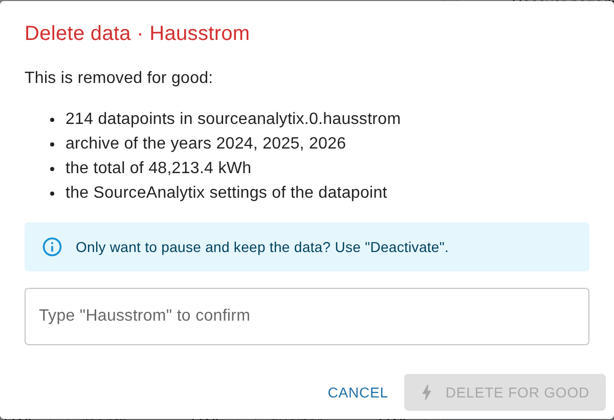
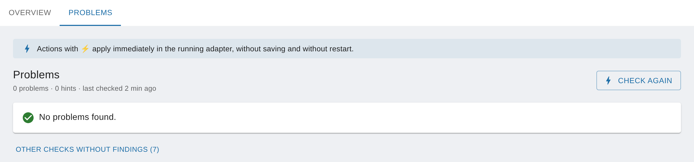
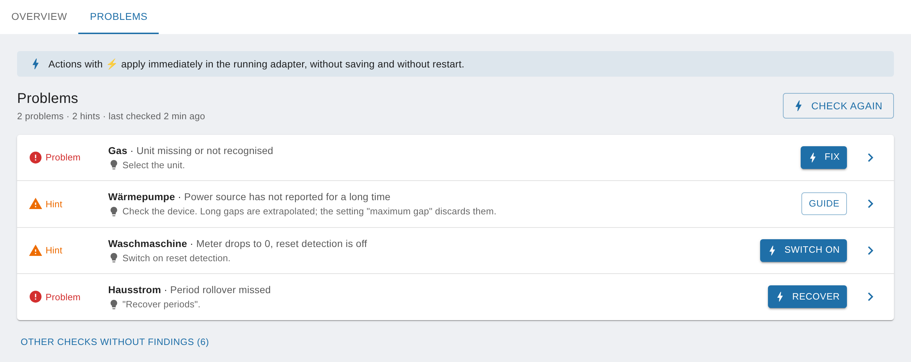

# Operation and maintenance

<!-- seite: gewicht=67; en=en/02.anleitungen/05.betrieb-und-wartung.md -->

<a id="update-sourceanalytix-downgrade"></a>

## How do I update SourceAnalytix (and what is a downgrade)?

<!-- abschnitt: prio=A; gewicht=23; readme=missing; cluster=upgrade-migration-other-18,upgrade-migration-other-22,upgrade-migration-other-19,upgrade-migration-other-13; features=req-versions,migration-output-id-default,migration-rounding-per-source,price-history-states -->
<!-- muss beantworten: Update nicht sichtbar, GitHub-Version, Versionssuffixe, Downgrade, Update-Risiken. -->

Like any adapter, on the "Adapters" tab, as long as the "latest" repository is active in the system settings. SourceAnalytix is not in "stable" yet, so you won't see an update there. Values and settings are kept during the update.
<!-- quelle: interview=21; forum=587033; forum=784125; forum=1361101; issue=#458; pr=#1276 -->

1. Make a backup.
2. In the system settings, choose "latest" under "Repositories".
3. On the "Adapters" tab, click the update button for SourceAnalytix.
4. Afterwards, check the "Problems" tab of the instance settings for anything reported.
<!-- quelle: interview=21; forum=587033; forum=866682; issue=#1269 -->

<!-- bild: Systemeinstellungen, Repository „latest" aktiv, und Update-Knopf bei SourceAnalytix im Reiter „Adapter" -->

From the console, use `iobroker upgrade sourceanalytix`, also only with "latest". If ioBroker offers no update, check the [requirements](../01.erste-schritte/01.installation.md#requirements-sourceanalytix-have-node-js). After an installation from GitHub, Admin shows no updates; install once from "latest" over it.
<!-- quelle: forum=784125; forum=487733; forum=552764; code=io-package.json -->

### Downgrade

A downgrade installs an older version over the existing one, for example if a new version has a bug on your system. Turn on expert mode on the "Adapters" tab and choose "Install specific version" for SourceAnalytix. In the console: `iobroker upgrade sourceanalytix@<version>`, without a "v" before the number.
<!-- quelle: forum=1105289; forum=412213; forum=224155 -->

> [!WARNING]
> An older version doesn't know newer settings and may write values differently. When in doubt, restore the backup instead of just changing the version.
<!-- quelle: forum=1105289; code=lib/output-id.js -->

Versions with a suffix such as `-beta.0` are pre-releases for testing. `0.8.0` is newer than `0.8.0-beta.0`.
<!-- quelle: forum=704956; forum=1267538 -->

**See also:** [Values are 0 after an update or restore](../04.fehlerbehebung/02.falsche-werte-und-bekannte-fehler.md#after-update-restore-values-0) · [Where is the data?](#data-back-up-move-new)

<a id="disable-datapoint-remove-sources-states"></a>

## How do I switch off a datapoint or remove sources and states?

<!-- abschnitt: prio=B; gewicht=15; readme=missing; cluster=setup-ui-02,logs-install-19,logs-install-21,outputs-viz-06; features=source-enable,output-state-deletion,year-statistics-archive,source-multi-edit,output-tree-layout -->
<!-- muss beantworten: Abschalten vs. Löschen; Massen-Aktivierung rückgängig; Fehler nach gelöschtem Gerät. -->

Open the source in the instance settings and choose "Deactivate" or "Delete data" under "Actions". "Deactivate" pauses the source and keeps everything. "Delete data" removes folders and settings for good.
<!-- quelle: code=src-admin/src/SourceDetail.tsx; code=src-admin/src/i18n/en.json; code=main.js; issue=#1265; issue=#1306 -->

| | "Deactivate" | "Delete data" |
|---|---|---|
| Folder `sourceanalytix.0.<device>` with all years | stays | is deleted |
| Source settings (price, start values, offset) | stay | are deleted |
| Undo | with "Activate" | not possible |
<!-- quelle: code=main.js; code=src-admin/src/i18n/en.json; issue=#1306 -->

When deleting, the dialog shows what will disappear. To confirm, type the source's name and click "Delete for good".
<!-- quelle: code=src-admin/src/Dialogs.tsx; code=main.js; issue=#1312 -->



> [!CAUTION]
> "Delete data" cannot be undone. If you only want to pause, use "Deactivate".
<!-- quelle: code=main.js; code=src-admin/src/i18n/en.json -->

### The switch on the datapoint on the "Objects" tab

You can switch it off for several datapoints at once, say after enabling many by mistake. This removes those sources' settings, including the start values; the folders with the values stay. To pause, "Deactivate" is the right way.
<!-- quelle: code=admin/jsonCustom.json; code=admin/i18n/en.json; issue=#1286; issue=#1306; forum=567100 -->

### Datapoint deleted

If you delete the source datapoint, SourceAnalytix switches the source off and keeps the values. The "Problems" tab reports "Datapoint no longer exists". A folder without a datapoint appears in the overview as "Folder without datapoint" and can be deleted there.
<!-- quelle: code=main.js; code=lib/source-overview.js; code=src-admin/src/i18n/en.json; forum=690622; forum=1212532; issue=#1009 -->

### Removing single periods

If you no longer want quarters, for example, turn the option off under "Main settings". The page asks first, because this year's states are deleted. States you delete by hand are recreated by SourceAnalytix as long as the option is on.
<!-- quelle: code=main.js; code=admin/jsonConfig.json; issue=#128; issue=#217; issue=#1311 -->

**See also:** [Starting over](#restart-datapoint-clean-up-old) · [Where is the data?](#data-back-up-move-new)

<a id="data-back-up-move-new"></a>

## Where is the data, how do I back it up and how do I move it?

<!-- abschnitt: prio=B; gewicht=12; readme=missing; cluster=upgrade-migration-other-01,upgrade-migration-other-04; features=output-tree-layout,output-cumulative-reading,source-start-values,rollover-missed-recovery-start -->
<!-- muss beantworten: Speicherort der States, Backup-Inhalt, Umzug auf neue Hardware. -->

In ioBroker itself; there is no separate database. A full ioBroker backup, for example with BackItUp, contains everything. To move, restore it on the new system, but not shortly before midnight.
<!-- quelle: code=main.js; interview=11c; forum=1157744; forum=457006 -->

| What | Where |
|---|---|
| Values of all periods and years | folder `sourceanalytix.0.<device>` |
| Source settings with start values and offset | object of the source datapoint, `common.custom.sourceanalytix.0` |
| Price definitions and options | instance settings |
| Price history | `sourceanalytix.0.priceHistory` and `basicPriceHistory` |
| Recorded history | your history adapter |
<!-- quelle: code=main.js -->

A backup of only `sourceanalytix.0` is not enough, because start values and offset are stored on the source datapoint. If ioBroker runs on Redis, include the Redis backup.
<!-- quelle: code=main.js; forum=430979; forum=533877; issue=#162; issue=#308 -->

### Moving to new hardware

1. Make a full backup on the old system.
2. Install ioBroker and SourceAnalytix on the new system and restore the backup.
3. Start the instance. It catches up missed period rollovers once.
4. Check the "Problems" tab and compare the total with your meter.
<!-- quelle: interview=11c; code=main.js; code=lib/source-overview.js; forum=905118; forum=1274816; forum=894627 -->



Recreating the sources on the new system does not replace the restore: SourceAnalytix then starts at 0. If the datapoint gets a new ID, it is a new source; the old folder stays as an archive.
<!-- quelle: forum=1253495; forum=229721; code=lib/calculation.js; interview=7 -->

**See also:** [ioBroker was off at midnight](#iobroker-was-down-midnight-recover) · [Values 0 after a restore](../04.fehlerbehebung/02.falsche-werte-und-bekannte-fehler.md#after-update-restore-values-0)

<a id="restart-datapoint-clean-up-old"></a>

## How do I start over with a datapoint and clean up old years?

<!-- abschnitt: prio=B; gewicht=10; readme=missing; cluster=meter-readings-24,logs-install-20; features=output-state-deletion,source-enable,calc-first-activation-start-values,source-hidden-reset-keys,log-first-activation -->
<!-- muss beantworten: States löschen, neu aktivieren, alte Jahres-/Wochenordner entfernen. -->

Delete the source's data with "Delete data" and create it again with "Add source", using "Count from now". All periods then start at 0. Deleting only the folder on the "Objects" tab is not enough, because the settings on the datapoint stay.
<!-- quelle: code=main.js; code=lib/calculation.js; code=src-admin/src/Wizard.tsx; interview=8; issue=#1265 -->

> [!CAUTION]
> This also removes the previous total. If you only want to repair wrong numbers, use [Align meter reading](02.zaehlerstaende-korrigieren.md#correct-wrong-too-high-negative).
<!-- quelle: code=src-admin/src/i18n/en.json; issue=#640 -->

### Cleaning up old years

Folders of closed years such as `sourceanalytix.0.<device>.2023` are pure history. You may delete them on the "Objects" tab. Keep `currentYear`, `cumulativeReading`, `periodMemory` and the current year's folder. "Recalculate costs from date" skips deleted years.
<!-- quelle: code=main.js; interview=8; forum=919699; forum=931836 -->

**See also:** [Start values](../01.erste-schritte/02.erster-zaehler.md#start-values-unit) · [Evaluating across several years](04.werte-auswerten.md#evaluate-across-years-adjusting-everything)

<a id="iobroker-was-down-midnight-recover"></a>

## ioBroker was off at midnight: how do I catch up the day rollover?

<!-- abschnitt: prio=B; gewicht=7; readme=covered; cluster=periods-01; features=rollover-missed-recovery-start,rollover-hourly-safety-check,rollover-recover-periods-button,rollover-sendto-recoverperiods,rollover-midnight-cron -->
<!-- muss beantworten: recoverPeriods per Button/sendTo; stündliche Sicherheitsprüfung. -->

Usually you don't have to. SourceAnalytix catches up missed rollovers on start and also checks every hour whether one is missing. It splits the consumption across midnight by time between the old and the new day.
<!-- quelle: code=main.js; code=lib/calculation.js; forum=560905; forum=859930; issue=#904; issue=#905; issue=#1260 -->

If a rollover is still missing, the "Problems" tab reports "Period rollover missed" with "Recover". The source's "Recover periods" action does the same. Both only affect that source.
<!-- quelle: code=lib/source-overview.js; code=src-admin/src/SourceDetail.tsx; code=src-admin/src/i18n/en.json; issue=#1292 -->



If the outage lasted several days, SourceAnalytix processes only one rollover; the days in between get no value of their own. Values that arrive during a rollover are processed afterwards, in order.
<!-- quelle: code=main.js; code=lib/calculation.js; issue=#1270 -->

### From a script or a VIS button

Write `true` to `sourceanalytix.0.info.recoverPeriods`, and SourceAnalytix catches up the rollovers of all sources. From a script, it also works for a single source:
<!-- quelle: code=main.js; issue=#1292 -->

```javascript
sendTo('sourceanalytix.0', 'recoverPeriods', {source: '<ID of the source datapoint>'}, result => {
    if (result.error) log(result.message, 'warn');
});
```

Without `source`, the call applies to all sources. The rollover follows the system time of the ioBroker host; if its time zone is wrong, SourceAnalytix rolls over at the wrong hour.
<!-- quelle: code=main.js; interview=13b -->

**See also:** [Yesterday, last week, last month](../03.referenz/02.states-und-meldungen.md#yesterday-last-week-last-month) · [Rollover at the wrong time](../04.fehlerbehebung/01.log-meldungen.md#midnight-crash-rollover-wrong-time)
