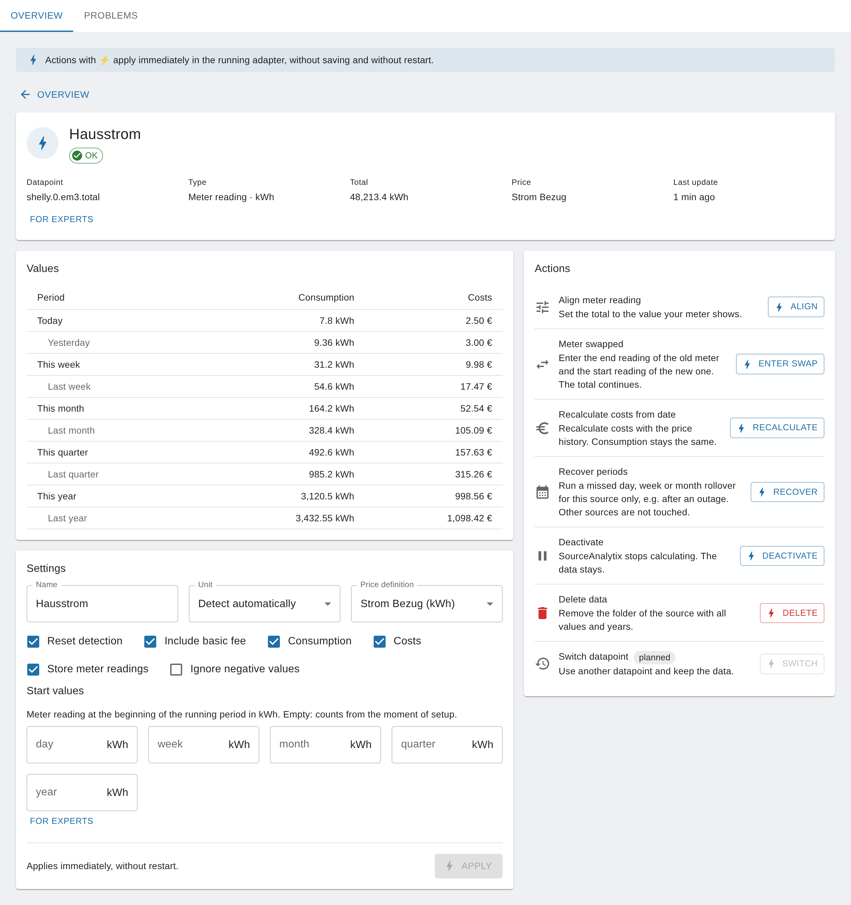

# Settings (instance and datapoint)

<!-- seite: gewicht=60; en=en/03.referenz/01.einstellungen.md -->

## Which units are supported (energy, volume, weight, length)?

<!-- abschnitt: prio=A; gewicht=23; readme=covered; cluster=outputs-viz-10,cumulative-power-03,upgrade-migration-other-25; features=supported-units,unit-detection-conversion,price-definitions-table -->
<!-- muss beantworten: Tabelle der Einheiten und Umrechnung; Einheiten außerhalb der Liste. -->

**In short:** SourceAnalytix knows 30 fixed units for power, energy, volume, mass and length. It converts only within the same quantity, plus between liters and cubic meters. Power is summed up over time to give energy.
<!-- quelle: code=lib/calculation.js:8-33@v0.6.1; code=lib/calculation.js:42-65@v0.6.1; code=main.js:2993-2996@v0.6.1 -->

| Quantity | Units | Converted to |
|---|---|---|
| Power | `GW`, `MW`, `kW`, `W`, `mW` | Energy (`GWh` to `mWh`), summed up over time |
| Energy | `GWh`, `MWh`, `kWh`, `Wh`, `mWh` | any other energy unit |
| Volume (cubic) | `km³`, `m³`, `dm³`, `cm³`, `mm³` | any other volume unit, including liters |
| Volume (liters) | `hl`, `l`, `dl`, `cl`, `ml` | any other volume unit, including cubic meters (1 `m³` = 1,000 `l`) |
| Mass | `t`, `kg`, `g` | any other mass unit |
| Length | `km`, `m`, `dm`, `cm`, `mm`, `µm`, `nm` | any other length unit |
<!-- quelle: code=lib/calculation.js:8-33@v0.6.1; code=lib/calculation.js:52-60@v0.6.1; code=admin/jsonConfig.json:186-225@v0.6.1; code=admin/jsonCustom.json:58@v0.6.1 -->

Up to v0.6.1, the characters must be written exactly as shown: `m³` with a superscript 3, `l` in lowercase, `kWh` with a capital W. The spellings that are also recognized from v0.6.2 are listed further down.
<!-- quelle: code=main.js:1917-1924@v0.6.1; code=admin/jsonCustom.json:58@v0.6.1 -->

### Which unit applies where?

There are two units, and you need to know both:

| Setting | Meaning |
|---|---|
| "Unit" on the source (from v0.7.0 in the source detail, up to v0.6.x in the custom settings dialog of the datapoint under "Select Unit") | The unit in which the device **delivers** the value (source unit). The default is "Detect automatically": SourceAnalytix then uses the unit set on the datapoint's object. |
| "Unit" in the price definition | The unit in which SourceAnalytix **calculates and displays** (target unit). All consumption states, start values and the price per unit refer to it. |
<!-- quelle: code=admin/jsonCustom.json:52-66@v0.6.1; code=main.js:1914-1930@v0.6.1; code=main.js:1982-1983@v0.6.1; code=admin/jsonConfig.json:186-225@v0.6.1; code=src-admin/src/SourceDetail.tsx:388-404; code=src-admin/src/i18n/de.json:81 -->

Examples:

- Your water meter delivers `l`, the price definition uses `m³`: 1,000 `l` become 1 `m³`.
- Your electricity meter delivers `Wh`, the price definition uses `kWh`: 1,000 `Wh` become 1 `kWh`.
- Your smart plug delivers `W`, the price definition uses `kWh`: SourceAnalytix converts the power into energy over time.
<!-- quelle: code=lib/calculation.js:52-64@v0.6.1; code=main.js:2993-2996@v0.6.1; code=main.js:3019-3021@v0.6.1 -->

> [!IMPORTANT]
> For a power source (`W`, `kW` …), the price definition must use an energy unit (`kWh`, `Wh` …). If source and price definition don't fit together, for example `kg` and `kWh` or `kWh` and `W`, then up to v0.6.1 SourceAnalytix calculates nothing and writes `reading incorrect after conversion contact DEV` to the log with every value. With `W` and `m³` it calculates wrong values without any message. From v0.6.2 the datapoint does not start, and the log says `Unit <unit> of <datapoint> cannot be converted to unit <unit> of price definition <name>`.
<!-- quelle: code=lib/calculation.js:52-60@v0.6.1; code=main.js:2993-3009@v0.6.1; issue=#1278 -->

> [!WARNING]
> Up to v0.6.1, SourceAnalytix converts the units `km³`, `dm³`, `cm³`, `mm³`, `µm` and `nm` incorrectly whenever source and price definition use different units. For example, 1,000 `dm³` become 100 `m³` instead of 1 `m³`. For these units, choose the same unit in the price definition as on the datapoint. `m³`, the liter series and the conversion between `l` and `m³` are correct. The bug is fixed from v0.6.2 ([#1278](https://github.com/DrozmotiX/ioBroker.sourceanalytix/issues/1278)).
<!-- quelle: code=lib/calculation.js:64@v0.6.1; code=iobroker-adapter-helpers/definitions/units.js:43-50@0.0.8; code=iobroker-adapter-helpers/definitions/units.js:72-78@0.0.8; issue=#1278 -->

### Units outside the list

These are not supported:

- meter readings without a unit, such as pieces or pulses,
- time, for example operating hours in `h`,
- data sizes such as `MB` or `GB`,
- rates such as `m³/h`, `l/min` or `kg/h`,
- all other quantities, for example `%`, `hPa`, `V` or `A`.
<!-- quelle: code=lib/calculation.js:10-15@v0.6.1; code=admin/jsonCustom.json:58@v0.6.1; issue=#304; issue=#74 -->

If the datapoint has such a unit, or none at all, it does not start and the log says `No unit defined`. If the value is really in a supported unit and only the object is labeled wrongly, select the right unit yourself. From v0.7.0, do this in the source detail under "Unit", or in the "Problems" tab at "Unit missing or not recognised" with "Fix". Up to v0.6.x, use the custom settings dialog under "Select Unit". For the steps, see [Error "unit not supported" / "No unit defined"](../04.fehlerbehebung/01.log-meldungen.md#error-unit-not-supported-no).
<!-- quelle: code=main.js:1914-1930@v0.6.1; code=main.js:1954@v0.6.1; code=src-admin/src/SourceDetail.tsx:388-404; code=lib/source-overview.js:159; code=src-admin/src/i18n/de.json:114; code=src-admin/src/i18n/de.json:214 -->

**From v0.7.0**, pieces and pulses are added, see the next section. Time, data sizes, rates such as `m³/h` and all other quantities stay outside the list.
<!-- quelle: interview=19b; issue=#304; issue=#74 -->

### Pieces and pulses (from v0.7.0)

From v0.7.0 there are two more units ([#304](https://github.com/DrozmotiX/ioBroker.sourceanalytix/issues/304), [#74](https://github.com/DrozmotiX/ioBroker.sourceanalytix/issues/74)):

| Unit | Used for | Spellings recognized on the object |
|---|---|---|
| `piece` | Meter readings without a physical unit, for example burner starts, and pulse counters with the total number of pulses | `pcs`, `pc`, `pieces`, `Stk`, `Stück`, `imp`, `impulse`, `pulses` |
| `piece/min` | Pulses per minute, for example `pulses/min` on an ESPHome pulse counter. SourceAnalytix sums them up over time, like a power value. | `pulses/min`, `imp/min`, `pcs/min` |
<!-- quelle: issue=#304; issue=#74; code=lib/calculation.js -->

Here is how to use them. The fields for pulses are in the source detail: "Pulses per <unit>" in the "Settings" section, as soon as the source delivers in `piece` or `piece/min` and the price definition does not calculate in `piece`, and "Each update adds its value" under "For experts".
<!-- quelle: issue=#1285; code=src-admin/src/SourceDetail.tsx:173-175; code=src-admin/src/SourceDetail.tsx:473-484; code=src-admin/src/SourceDetail.tsx:560-570; code=src-admin/src/i18n/de.json:128; code=src-admin/src/i18n/de.json:216-217 -->

- **Just counting**, for example burner starts: Create a price definition with the unit `piece`. A price per piece is possible but not required.
- **Converting pulses to kWh or m³:** At "Pulses per <unit>", enter how many pulses make up one unit of the price definition. For example, `1000` for an electricity meter with 1000 imp/kWh and a price definition in kWh. Without this value the source does not start, and the log says `Unit piece of <datapoint> cannot be converted to unit kWh of price definition <name>`.
- **Every update is a pulse:** If the datapoint does not send a meter reading but an update for each pulse, for example `1`, `true` or `0.001` kWh, tick "Each update adds its value". Every update then counts, even if the value does not change ([#479](https://github.com/DrozmotiX/ioBroker.sourceanalytix/issues/479)). Negative values are ignored, and the value already in the datapoint when SourceAnalytix starts is not counted again.
<!-- quelle: issue=#74; issue=#479; code=lib/calculation.js; code=main.js -->

A source in `piece/min` and a source with "Each update adds its value" keep their total themselves, like a power source: it starts at 0, there is no reset detection, and you leave the start values empty. A source in `piece` with the total number of pulses behaves like a meter reading, with reset detection.
<!-- quelle: issue=#74; issue=#479; code=main.js -->

**From v0.6.2:** SourceAnalytix also recognizes variant spellings on the object ([#1264](https://github.com/DrozmotiX/ioBroker.sourceanalytix/issues/1264)): `m3`, `M3` and `m^3` count as `m³`, `kwh` and `KWH` as `kWh`, `L` as `l`. A spelling that matches two units is not reinterpreted: `mwh` could be `MWh` or `mWh`. Spelled-out names such as `Liter` or `Watt` are still not recognized. When a spelling is reinterpreted, the log says, for example, `Unit "m3" of <datapoint> is used as m³`. The settings dialog also accepts these spellings with "Detect automatically" ([#1278](https://github.com/DrozmotiX/ioBroker.sourceanalytix/issues/1278)).
<!-- quelle: issue=#1264; pr=#1274; issue=#1278; code=lib/calculation.js:76-98@main; code=main.js:1945-1965@main -->

**See also:** [Which unit do I set on the datapoint (kWh instead of Wh, m³ instead of liters)?](../02.anleitungen/01.quellen-und-einheiten.md#unit-datapoint-kwh-wh-m3) · [Start values and their unit](../01.erste-schritte/02.erster-zaehler.md#start-values-unit) · [How does SourceAnalytix convert watts to kWh?](../05.hintergrund/01.berechnung.md#sourceanalytix-convert-watts-kwh)

## Which instance settings are there (periods, decimals)?

<!-- abschnitt: prio=B; gewicht=10; readme=partial; cluster=outputs-viz-05,outputs-viz-02,prices-costs-12; features=current-year-weekday,rounding-instance-defaults,source-decimals,calc-rounding,current-year-months,year-statistics-archive,current-year-weeks,current-year-quarters,current-year-previous,price-definitions-table -->
<!-- muss beantworten: Wochen/Monate/Quartale speichern, Standard-Rundung; warum manche States fehlen. -->

**In short:** From v0.7.0, the SourceAnalytix instance settings have four tabs. In "Main settings" you decide which week, month and quarter states are created and how many decimals new sources get. If a state is missing, the matching option there is usually off, or "Consumption", "Costs" or "Store meter readings" is not ticked on the source.
<!-- quelle: code=admin/jsonConfig.json:1-334; code=admin/i18n/de.json:33; code=admin/i18n/de.json:53; code=admin/i18n/de.json:129-130; code=main.js:3219-3330; issue=#1269 -->

### The tabs (from v0.7.0)

| Tab | Content | When a change takes effect |
|---|---|---|
| "Overview" | All sources with status, total and the values for "Today", "Month" and "Year". "Add source" starts the wizard, a click on a source opens its source detail. | Actions marked with ⚡ immediately, without saving and without a restart |
| "Problems" | Checks all sources and suggests a fix for each finding | immediately |
| "Price definitions" | Table of prices, see [How is a price definition structured (categories, basic fee, decimal mark)?](#price-definition-structured-categories-base) | after "Save", the instance restarts |
| "Main settings" | Year statistics, current year, rounding (see below) | after "Save", the instance restarts |
<!-- quelle: code=admin/jsonConfig.json:5-38; code=admin/jsonConfig.json:39-196; code=admin/jsonConfig.json:197-332; code=src-admin/src/SourcesApp.tsx:207-237; code=src-admin/src/i18n/de.json:135; code=src-admin/src/i18n/de.json:165; issue=#1269 -->

"Overview" and "Problems" query the running instance. If it is stopped, they show "Instance is not running" and the immediate actions are locked. For what the source detail contains, see [What do the datapoint settings do (Costs, Consumption, Meter values)?](#datapoint-settings-costs-consumption-meter).
<!-- quelle: code=src-admin/src/i18n/de.json:163; code=src-admin/src/i18n/de.json:172-173; code=src-admin/src/SourceDetail.tsx:592 -->

**Up to v0.6.x** there are only the tabs "Main settings" and "Price definitions". You set up sources there in the custom settings dialog of the datapoint.
<!-- quelle: code=admin/jsonConfig.json:5-7@v0.6.1; code=admin/jsonConfig.json:142-143@v0.6.1 -->

### "Main settings" tab

| Section | Option | Default | What SourceAnalytix creates |
|---|---|---|---|
| "Year statistics" | "Weeks" | off | Archive `<device>.<year>.<category>.weeks.01` to `53` |
| "Year statistics" | "Months" | on | Archive `<device>.<year>.<category>.months.01_January` to `12_December` |
| "Year statistics" | "Quarters" | off | Archive `<device>.<year>.<category>.quarters.Q1` to `Q4` |
| "Current year" | "Weekday" | on | `currentYear.<category>.currentWeek.01_Monday` to `07_Sunday` |
| "Current year" | "Weeks" | on | `currentYear.<category>.weeks.01` to `53` |
| "Current year" | "Months" | on | `currentYear.<category>.months.01_January` to `12_December` |
| "Current year" | "Quarters" | on | `currentYear.<category>.quarters.Q1` to `Q4` |
| "Current year" | "Previous period" | on | `01_previousDay` to `05_previousYear`, with "Weekday" also `previousWeek.01_Monday` to `07_Sunday` |
| "Rounding" | "Decimals for consumption values" | 3 | Template for new sources |
| "Rounding" | "Decimals for cost values" | 2 | Template for new sources |
<!-- quelle: code=admin/jsonConfig.json:201-330; code=admin/i18n/de.json:17; code=admin/i18n/de.json:40; code=admin/i18n/de.json:52; code=admin/i18n/de.json:62; code=admin/i18n/de.json:81-84; code=admin/i18n/de.json:124-126; code=io-package.json:266-276; code=lib/calculation.js:393-433; code=main.js:2216-2235; issue=#1287 -->

**Up to v0.6.x**, the German interface calls the "Quarters" option "Viertel".
<!-- quelle: issue=#1287; code=admin/i18n/de.json:62 -->

`<category>` is `consumed` or `delivered` for consumption, `costs` or `earnings` for money, and `meterReadings` for meter readings. If any of the three "Year statistics" options is on, the year folder also contains the yearly totals `<year>.consumedCumulative` (or `deliveredCumulative`), `<year>.costsCumulative` (or `earningsCumulative`) and the meter reading `<year>.readingCumulative`. For what each state contains, see [Which week, month and quarter states and weekdays are there?](02.states-und-meldungen.md#week-month-quarter-states-weekdays).
<!-- quelle: code=main.js:2232-2235; code=main.js:1133-1138; code=main.js:1206-1211; code=main.js:3640-3645 -->

### Why some states are missing

- **The option is off.** SourceAnalytix then does not create the states. If you turn an option off, it deletes the existing states of the current year the next time the source starts, that is, when the instance restarts after you save.
- **The checkbox is missing on the source.** Consumption states exist only with "Consumption", cost states only with "Costs", meter readings only with "Store meter readings".
- **The week belongs to the next year.** From 29 to 31 December, calendar week 01 of the new year may already be running. It is not written under `currentYear.<category>.weeks`, see [Why does week 52/53 show values in the new year?](../05.hintergrund/03.perioden-und-zeit.md#week-52-53-have-values).
- **The first period rollover is still to come.** Until then, the previous-period states stay at 0, see [Where do I find yesterday, last week, last month (previous states)?](02.states-und-meldungen.md#yesterday-last-week-last-month).
<!-- quelle: code=main.js:29; code=main.js:2252-2264; code=main.js:2306-2315; code=main.js:3219-3330; code=main.js:1147; code=main.js:4022-4024; code=lib/calculation.js:393-433 -->

> [!WARNING]
> If you turn off "Weeks", "Months", "Quarters", "Weekday" or "Previous period", the values of the current year in these states are gone. Recordings in a history adapter and the year folders of earlier years are kept.
<!-- quelle: code=main.js:29; code=main.js:2216-2264; code=main.js:2306-2315 -->

### Decimals

The two values under "Rounding" are only a template. Each source takes them over once when it is created and stores its own decimals. If you change the template later, existing sources keep their value. From v0.7.0, you change a source's decimals in its source detail under "For experts": "Decimals for consumption" and "Decimals for costs".
<!-- quelle: code=admin/i18n/de.json:127; code=main.js:2000-2009; code=main.js:1932-1955; code=lib/calculation.js:273-275; code=src-admin/src/SourceDetail.tsx:534-543; code=src-admin/src/i18n/de.json:68-69 -->

- You can use 0 to 15. With -1, SourceAnalytix stores the value unrounded. Larger numbers count as 15, any negative number as -1.
- Only the states that are written get rounded. The total in `cumulativeReading` stays unrounded.
- Meter readings under `meterReadings` are rounded with the decimals for consumption values.
<!-- quelle: code=lib/calculation.js:257-264; code=lib/calculation.js:283-290; code=main.js:3633-3636; code=main.js:3670 -->

**See also:** [Why so many decimal places?](../04.fehlerbehebung/02.falsche-werte-und-bekannte-fehler.md#so-many-decimals) · [What happens at the turn of the year?](02.states-und-meldungen.md#happens-turn-year) · [How do I evaluate values across several years without adjusting everything every year?](../02.anleitungen/04.werte-auswerten.md#evaluate-across-years-adjusting-everything)

## What do the datapoint settings do (Costs, Consumption, Meter values)?

<!-- abschnitt: prio=B; gewicht=9; readme=partial; cluster=setup-ui-21,outputs-viz-25; features=source-meter-values,output-cumulative-reading,source-calc-costs,source-calc-consumption,output-state-deletion,source-enable,source-alias,source-output-id,source-price-definition,source-unit,source-basic-rate,source-average-power,source-ignore-negative,source-reset-detection,source-threshold,source-decimals,source-start-values,source-multi-edit,source-hidden-reset-keys -->
<!-- muss beantworten: Jede Option am Datenpunkt mit Wirkung und Voreinstellung; wann der Meter-Readings-Ordner leer bleibt. -->

**In short:** Each source has its own settings: price definition, unit and the checkboxes "Consumption", "Costs" and "Store meter readings", which decide which states are created. From v0.7.0, you set them in the wizard when you add the source and change them later in the source detail. "Apply" takes effect immediately, without a restart.
<!-- quelle: code=src-admin/src/SourceDetail.tsx:374-598; code=src-admin/src/Wizard.tsx:168-200; code=src-admin/src/i18n/de.json:40-41; code=main.js:4543-4600; issue=#1269 -->

### How to get to the settings (from v0.7.0)

1. Open the SourceAnalytix instance settings, "Overview" tab.
2. Click the source. At the top, the source detail shows datapoint, type, total, price and "Last update". Below are the sections "Values", "Settings" and "Actions".
3. Change the fields in the "Settings" section. More fields are under "For experts".
4. Click "Apply". If a field is invalid, the page marks it and saves nothing.
<!-- quelle: code=src-admin/src/SourceDetail.tsx:236-308; code=src-admin/src/SourceDetail.tsx:374-598; code=src-admin/src/i18n/de.json:47; code=src-admin/src/i18n/de.json:129; code=src-admin/src/i18n/de.json:149; code=src-admin/src/i18n/de.json:230-232; code=main.js:4558-4579 -->

### All settings of a source

The "Default" column shows what the wizard pre-fills. For those switching over, the last column gives the name of the field in the custom settings dialog of the datapoint up to v0.6.x.

| Setting (from v0.7.0) | Effect | Default | Up to v0.6.x in the custom settings dialog |
|---|---|---|---|
| "Name" | Display name of the source's folder. Does not change any state ID, see [How do I name the datapoint (alias, output ID)?](#name-datapoint-alias-output-id) | Name of the datapoint | "Name" |
| "Unit" | Unit in which the datapoint delivers. "Detect automatically" uses the unit on the object, see [Which units are supported (energy, volume, weight, length)?](#units-supported-energy-volume-weight) | detected unit | "Select Unit" |
| "Price definition" | Required. Sets the target unit and whether consumption and costs or feed-in and earnings are counted | – | "Select price definition" |
| "Consumption" | States under `currentYear.consumed` or `currentYear.delivered` | on | "Calculate consumption" |
| "Costs" | States under `currentYear.costs` or `currentYear.earnings` | on | "Calculate costs" |
| "Include basic fee" | Books the "Price per month" of the price definition into the costs. Works only with "Costs" | on, unless another source of the same price definition already books it | "Including basic rate" |
| "Store meter readings" | Meter readings per period under `currentYear.meterReadings` | on | "Store Meter Values" |
| "Reset detection" | Catches drops of the meter to 0, see [Threshold and turning off reset detection](#threshold-disabling-reset-detection-work) | depends on the answer to "Does the value sometimes drop to 0 …?" | "Device value reset detection Enabled" |
| "Ignore negative values" | Power only: Negative values count as 0 W, for example with inverters at night | off | "Ignore negative power values" |
| "Reset detection threshold (<unit>)" under "For experts" | Largest drop that still counts as measurement noise | 1 | "Threshold" |
| "Decimals for consumption" / "Decimals for costs" under "For experts" | Rounding of the states that are written, see [Instance settings](#instance-settings-exist-periods-decimals) | Template of the instance (3 / 2) | "Decimals for consumption values" / "… cost values" |
<!-- quelle: code=src-admin/src/SourceDetail.tsx:84-91; code=src-admin/src/SourceDetail.tsx:383-439; code=src-admin/src/SourceDetail.tsx:529-543; code=src-admin/src/Wizard.tsx:82-94; code=src-admin/src/Wizard.tsx:125; code=src-admin/src/Wizard.tsx:151-157; code=src-admin/src/Wizard.tsx:168-200; code=src-admin/src/i18n/de.json:68-69; code=src-admin/src/i18n/de.json:122-129; code=src-admin/src/i18n/de.json:161; code=src-admin/src/i18n/de.json:201; code=src-admin/src/i18n/de.json:293; code=src-admin/src/i18n/de.json:298; code=admin/jsonCustom.json:12-227@v0.6.1; code=admin/i18n/de.json:8-12; code=admin/i18n/de.json:22; code=admin/i18n/de.json:30; code=admin/i18n/de.json:66; code=admin/i18n/de.json:69; code=admin/i18n/de.json:74; code=admin/i18n/de.json:91; code=admin/i18n/de.json:122-126; code=main.js:2150-2177 -->

These settings appear only for matching sources, or the wizard does not ask for them. From v0.7.0 they are all in the source detail ([#1285](https://github.com/DrozmotiX/ioBroker.sourceanalytix/issues/1285)):

| Setting | Where in the source detail | Effect | Default |
|---|---|---|---|
| "Technical ID" | under "For experts", also in the wizard | Name of the folder `sourceanalytix.0.<device>`. Letters, digits, `_` and `-` are allowed. Changing it moves all values to the new folder, see [How do I name the datapoint (alias, output ID)?](#name-datapoint-alias-output-id) | derived from the name |
| "Average power values" | for power sources, also in the wizard | Calculates each interval with the average of the old and new value instead of the old value | off |
| "Maximum gap between power values (minutes)" | for power sources | Longer pauses without a new power value count as 0 ([#1266](https://github.com/DrozmotiX/ioBroker.sourceanalytix/issues/1266)) | empty = off |
| "Pulses per <unit>" | for sources in `piece` or `piece/min` whose price definition does not calculate in `piece` | Converts pulses into the target unit, for example `1000` for 1000 imp/kWh | empty |
| "Each update adds its value" | under "For experts" | Every update counts as an increment instead of a meter reading | off |
| "Start values" "Day" to "Year" | separate "Start values" section, in the wizard only for meter readings | Total at the beginning of the running period, see [Start values](../01.erste-schritte/02.erster-zaehler.md#start-values-unit) | empty = "Count from now" |
<!-- quelle: issue=#1285; issue=#1287; code=src-admin/src/SourceDetail.tsx:173-175; code=src-admin/src/SourceDetail.tsx:440-513; code=src-admin/src/SourceDetail.tsx:514-571; code=src-admin/src/Wizard.tsx:145-150; code=src-admin/src/Wizard.tsx:168-200; code=src-admin/src/Wizard.tsx:637-655; code=src-admin/src/Wizard.tsx:826-840; code=src-admin/src/i18n/de.json:89; code=src-admin/src/i18n/de.json:122; code=src-admin/src/i18n/de.json:128; code=src-admin/src/i18n/de.json:155-156; code=src-admin/src/i18n/de.json:180-181; code=src-admin/src/i18n/de.json:216-217; code=src-admin/src/i18n/de.json:251-252; issue=#1266; issue=#74; issue=#479 -->

You can enter numbers with a comma or a dot. A single comma or a single dot is always the decimal mark: `1.283` is read as 1.283, not as 1283. The source detail checks the start values like the wizard does. As long as a start value shows an error, "⚡ Apply" stays locked.
<!-- quelle: issue=#1285; issue=#1287; code=src-admin/src/api.ts:191-214; code=src-admin/src/SourceDetail.tsx:176-188; code=src-admin/src/SourceDetail.tsx:592 -->

**From v0.7.0:** In the custom settings dialog of the datapoint (tab "Objects", wrench icon) there is only the "enabled" checkbox, a hint and the button "Open SourceAnalytix settings". If you switch a source on there, SourceAnalytix sets "Consumption", "Costs", "Store meter readings" and "Reset detection" with threshold 1. Because no price definition is chosen yet, the source appears in the "Problems" tab with "No price definition selected". Existing settings stay unchanged ([#1286](https://github.com/DrozmotiX/ioBroker.sourceanalytix/issues/1286)).
<!-- quelle: issue=#1286; code=admin/jsonCustom.json:1-55; code=admin/i18n/de.json:146-147; code=lib/source-overview.js:56; code=src-admin/src/i18n/de.json:204 -->

**Up to v0.6.x:** If you add a new source in the custom settings dialog, "Calculate consumption", "Calculate costs" and "Store Meter Values" are not pre-ticked. Without these checkboxes, SourceAnalytix maintains only `cumulativeReading` and `statisticsJson`.
<!-- quelle: code=admin/jsonCustom.json:80-88@v0.6.1; code=admin/jsonCustom.json:98-106@v0.6.1; code=admin/jsonCustom.json:129-137@v0.6.1; code=main.js:3219-3330; code=main.js:2316-2321 -->

> [!WARNING]
> If you untick "Consumption", "Costs" or "Store meter readings" again, SourceAnalytix deletes the matching states of the source. Recordings in a history adapter are kept.
<!-- quelle: code=main.js:3254-3328; code=main.js:2424-2449 -->

### When the `meterReadings` folder stays empty

`meterReadings` holds the total at the end of a period, not the consumption. It stays empty or incomplete if:

- "Store meter readings" is off,
- you are looking for the current reading: There is no state `meterReadings.01_currentDay`, the current reading is in `cumulativeReading`,
- "Weekday", "Weeks", "Months", "Quarters" or "Previous period" are off in the instance settings, because meter readings are created only for these periods,
- the first period rollover is still to come: `01_previousDay` and the other previous periods are filled only then.
<!-- quelle: code=main.js:3280-3293; code=main.js:3667-3718; code=main.js:2600-2610; code=lib/calculation.js:393-433 -->

**Up to v0.6.1**, a meter reading of exactly 0 is not written under `meterReadings`. This is fixed from v0.6.2 ([#1253](https://github.com/DrozmotiX/ioBroker.sourceanalytix/issues/1253)).
<!-- quelle: issue=#1253; code=main.js:3672 -->

**Up to v0.6.x** there is no source detail. All settings are then in the custom settings dialog of the datapoint, as described in [Where do I configure SourceAnalytix for a datapoint?](../01.erste-schritte/02.erster-zaehler.md#configure-sourceanalytix-datapoint).
<!-- quelle: issue=#1269; code=admin/jsonCustom.json:1-252@v0.6.1 -->

**See also:** [Why are meter readings cumulative?](02.states-und-meldungen.md#meter-readings-cumulative) · [Which source types are there (meter, power)?](#source-types-exist-meter-power) · [Datapoint enabled but no folders are created](../04.fehlerbehebung/01.log-meldungen.md#datapoint-enabled-but-no-folders)

## How do the threshold and turning off reset detection work?

<!-- abschnitt: prio=B; gewicht=7; readme=covered; cluster=meter-readings-11,meter-readings-13; features=source-threshold,reset-jitter-ignore,reset-confirmation,source-reset-detection,reset-disabled-decrease,reset-rejected-glitch,reset-invalid-reading,reset-manual-correction,reset-dynamic-cost-tracker -->
<!-- muss beantworten: Reset-Erkennung pro Datenpunkt einstellen, Threshold und Jitter, abschalten. -->

**In short:** You set reset detection and its threshold separately for each source. Leave detection on if your meter can start at 0 after a restart or power failure. The threshold (default 1, in the target unit) is the largest drop that still counts as measurement noise. Turning detection off is meant only for sources that are allowed to drop on purpose.
<!-- quelle: code=main.js:2172; code=main.js:2176; code=lib/calculation.js:444-454; code=src-admin/src/SourceDetail.tsx:424-439; code=src-admin/src/SourceDetail.tsx:529-533 -->

### How to set it (from v0.7.0)

1. In the instance settings, "Overview" tab, open the source.
2. In the "Settings" section, tick or untick "Reset detection".
3. Click "For experts" and enter the threshold in the target unit under "Reset detection threshold (<unit>)", for example `0.5` for 0.5 kWh.
4. Click "Apply".
<!-- quelle: code=src-admin/src/SourceDetail.tsx:423-571; code=src-admin/src/SourceDetail.tsx:581-597; code=src-admin/src/i18n/de.json:126; code=src-admin/src/i18n/de.json:293 -->

When you add a source, the wizard asks: "Does the value sometimes drop to 0, e.g. after a power failure?" With "Yes", reset detection is on, with "No" it is off. "No" is preselected, and "Yes" for Shelly or Tasmota datapoints.
<!-- quelle: code=src-admin/src/Wizard.tsx:82; code=src-admin/src/Wizard.tsx:125; code=src-admin/src/Wizard.tsx:179; code=src-admin/src/i18n/de.json:230-231 -->

### What happens when the value drops

| Drop in the device value | Reset detection on | Reset detection off |
|---|---|---|
| at most the threshold | Measurement noise: The value is ignored, the total stays where it is | The total drops with it |
| more than the threshold | Possible reset: SourceAnalytix waits for the next value and then continues with a new offset | The total drops with it, and the consumption of the periods can go negative |
<!-- quelle: code=lib/calculation.js:444-454; code=main.js:3555-3604 -->

For the details of how a reset is confirmed, see [What does "Device reset detected" mean and how does reset detection work?](../05.hintergrund/02.zaehler-reset.md#device-reset-detected-mean-reset). Measurement noise appears only in the debug log ("Ignoring cumulative reading jitter").
<!-- quelle: code=main.js:3581-3584 -->

### Which threshold fits?

- **Larger than the normal noise** of the device, so that small drops don't count as a reset.
- **Smaller than the value the device starts from again after a reset or swap.** If a meter falls only slightly below its old value, it is otherwise not detected as a reset.
- **0** means: Every drop is a possible reset.
<!-- quelle: code=lib/calculation.js:444-454; code=main.js:3540; code=main.js:3563 -->

Threshold and reset detection work only for meter readings. For power sources (W), for `piece/min` and for "Each update adds its value", SourceAnalytix keeps the total itself, so there is no reset detection there. That is why the wizard does not show the threshold for power.
<!-- quelle: code=main.js:261-263; code=main.js:3509; code=src-admin/src/Wizard.tsx:695-703 -->

> [!WARNING]
> With "No" in the wizard, reset detection is off. If such a meter does drop to 0 once, the total drops with it and the values of the running periods turn negative. The "Problems" tab then reports "Meter drops to 0, reset detection is off" and offers "Switch on". To correct the values afterwards, see [Correct wrong values](../02.anleitungen/02.zaehlerstaende-korrigieren.md#correct-wrong-too-high-negative).
<!-- quelle: code=lib/source-overview.js:163-165; code=main.js:3598-3601; code=src-admin/src/i18n/de.json:120; code=src-admin/src/i18n/de.json:208 -->

**From v0.6.2:** The message "Cumulative reading for … decreased while reset detection is disabled" appears only in the debug log. Up to v0.6.1 it appeared in the info log with every drop ([#1262](https://github.com/DrozmotiX/ioBroker.sourceanalytix/issues/1262)).
<!-- quelle: issue=#1262; code=main.js:3601 -->

**Up to v0.6.x** you set both in the custom settings dialog of the datapoint: "Device value reset detection Enabled" (default on) and "Threshold" (default 1).
<!-- quelle: code=admin/jsonCustom.json:138-159@v0.6.1; code=admin/i18n/de.json:22; code=admin/i18n/de.json:91 -->

**See also:** [My meter starts at 0 after a power failure](../02.anleitungen/02.zaehlerstaende-korrigieren.md#meter-restarts-after-power-loss) · [Counter that is reset to 0 every day](../05.hintergrund/02.zaehler-reset.md#counter-reset-0-daily-happens) · [Meter or device replaced](../02.anleitungen/02.zaehlerstaende-korrigieren.md#replaced-meter-device-avoid-negative)

## How is a price definition structured (categories, basic fee, decimal mark)?

<!-- abschnitt: prio=B; gewicht=6; readme=missing; cluster=prices-costs-31,prices-costs-14,prices-costs-08; features=price-definitions-table,supported-units,source-price-definition,price-fixed,price-invalid-unit-price,price-scheduled-valid-from,price-state,price-tariff-selector,price-current-price-writable,price-split-over-intervals,price-basic-fee,price-history-states,price-dynamic-cost-memory,price-recalculate-unreachable -->
<!-- muss beantworten: Felder der Preisdefinition, Grundpreis anteilig oder voll, Komma/Punkt. -->

**In short:** A price definition is one row in the "Price definitions" tab of the instance settings. It has a freely chosen name ("Category"), a unit, a cost type and a price. Each source gets exactly one price definition. The monthly basic fee is booked in full, once per month, not pro rata per day.
<!-- quelle: code=admin/jsonConfig.json:39-196; code=main.js:1402-1478; code=lib/calculation.js:632-672 -->

### The fields

| Column | Meaning |
|---|---|
| "Category" | Name of the price definition, for example `electricity` or `heatpump`. You use it to select the price definition on the source. Each name may appear only once. |
| "Description" | Free text, just for you |
| "Cost Type" | "Costs" for consumption from the grid (consumption and costs) or "Earnings" for feed-in and earnings. Decides whether the values are under `consumed` and `costs` or under `delivered` and `earnings`. |
| "Unit" | The target unit: SourceAnalytix calculates and displays everything in it for the sources of this price definition |
| "Price source" | "Fixed price", "Datapoint" or "Tariff selector", see below |
| "Price per unit" | Price per target unit, for example `0.32` for 0.32 €/kWh |
| "Price state" | Only with "Datapoint" and "Tariff selector": the state that delivers the price or the tariff |
| "Active tariff price" | Only with "Tariff selector": price while the tariff is active |
| "Active selector value" | Only with "Tariff selector": value of the price state at which the tariff is active |
| "Valid from" | From when price and basic fee apply, starting at 0:00 of that day |
| "Price per month" | Basic fee per month |
<!-- quelle: code=admin/jsonConfig.json:52-193; code=admin/i18n/de.json:13; code=admin/i18n/de.json:15-16; code=admin/i18n/de.json:20; code=admin/i18n/de.json:23-26; code=admin/i18n/de.json:54-57; code=admin/i18n/de.json:70-72; code=admin/i18n/de.json:78; code=main.js:2158-2161; code=lib/dynamic-pricing.js:40-54 -->

If a category appears twice, only the last row counts. In state IDs, every character except letters, digits, `_` and `-` is replaced by `_`.
<!-- quelle: code=main.js:1412-1474; code=main.js:340-393 -->

### Price source

| "Price source" | Where the price comes from |
|---|---|
| "Fixed price" | From "Price per unit". A new price applies from "Valid from" or, without a date, from the moment you save. SourceAnalytix does not recalculate older values by itself. |
| "Datapoint" | From the "Price state", for example a dynamic electricity price in €/kWh. Every change is stored with its timestamp. If the state is empty at startup, "Price per unit" serves as a fallback. |
| "Tariff selector" | A state switches between "Price per unit" and "Active tariff price". Without an "Active selector value", the tariff counts as active for `true`, for a number other than 0 and for any text except `0`, `false`, `off`, `no`, `closed` or empty. With a selector value, the state must have exactly that value. |
<!-- quelle: code=main.js:1414-1452; code=main.js:401-445; code=main.js:2478-2500; code=lib/dynamic-pricing.js:63-76; code=admin/i18n/de.json:24; code=admin/i18n/de.json:70-71 -->

If the price changes between two values of the source, SourceAnalytix splits the consumption between the old and new price according to time. To change a price from a certain date and recalculate costs afterwards, see [Are calculated costs recalculated when I change the price, and how do I change it from a certain date?](../02.anleitungen/03.preise-und-kosten.md#costs-recalculated-change-price-change). Dynamic prices and day/night tariffs are explained in [Dynamic electricity price](../02.anleitungen/03.preise-und-kosten.md#use-dynamic-electricity-price-tibber) and [Day/night tariff](../02.anleitungen/03.preise-und-kosten.md#bill-day-night-tariff).
<!-- quelle: code=lib/dynamic-pricing.js:165-200; code=main.js:1000-1050 -->

### Basic fee: in full, once a month

- The "Price per month" is booked in full: once on the day it takes effect, then on the 1st of every month at 0:00. It is not spread over the days.
- In the daily and weekly values, the whole amount therefore appears only on the day and in the week of the booking.
- If you did not enter a "Valid from", the basic fee applies from 1 January of the current year when you first set up the source. The yearly value then includes all months since January.
- It counts only for sources with "Include basic fee" and "Costs". Each of these sources books it in full. If two sources of the same price definition have the checkbox ticked, it is counted twice.
<!-- quelle: code=lib/calculation.js:632-672; code=main.js:649-710; code=main.js:686-693; code=main.js:289-293; code=main.js:1713-1722 -->

**From v0.7.0:** If another source already books the basic fee of the same price definition, the wizard and the "Problems" tab warn you ("Basic fee is booked twice", with "Switch off here"). At startup, there is also a hint in the log ([#1268](https://github.com/DrozmotiX/ioBroker.sourceanalytix/issues/1268)). To assign the basic fee correctly, see [How do I include a monthly basic fee?](../02.anleitungen/03.preise-und-kosten.md#include-monthly-base-fee).
<!-- quelle: issue=#1268; code=lib/source-overview.js:177-192; code=src-admin/src/i18n/de.json:45; code=src-admin/src/i18n/de.json:119; code=src-admin/src/i18n/de.json:199; code=main.js:1720; issue=#1286 -->

### Comma or dot?

SourceAnalytix reads both: `0,32` and `0.32` give the same price. This applies to prices from the table, from a price state and to values written to `currentPrice`. Leave out the thousands separator. After saving, you can check that the price arrived correctly in the state `sourceanalytix.0.priceDefinitions.<category>.currentPrice`.
<!-- quelle: code=lib/dynamic-pricing.js:7-17; code=main.js:1416-1419; code=main.js:2510-2519; code=main.js:467-484 -->

> [!IMPORTANT]
> If a price is not a number, SourceAnalytix calculates with 0 and writes `Price definition <category> has no valid unit price …, using 0 to avoid invalid cost calculations` to the log. The costs then stay 0.
<!-- quelle: code=main.js:1454-1456; code=main.js:3660-3662 -->

A new or changed price definition takes effect only after "Save", which restarts the instance. Only then can you select it on a source.
<!-- quelle: code=main.js:114-115; code=main.js:1402-1478; code=src-admin/src/i18n/de.json:165 -->

**See also:** [How do I assign prices and create my own tariffs (e.g. heat pump)?](../02.anleitungen/03.preise-und-kosten.md#assign-prices-create-custom-tariffs) · [How can I read and set prices as states?](02.states-und-meldungen.md#prices-read-written-as-states) · [Costs stay 0](../04.fehlerbehebung/02.falsche-werte-und-bekannte-fehler.md#costs-stay-0-not-calculated)

## How do I name the datapoint (alias, output ID)?

<!-- abschnitt: prio=B; gewicht=5; readme=covered; cluster=setup-ui-23,outputs-viz-18; features=source-alias,source-output-id,migration-output-id-change,output-tree-layout -->
<!-- muss beantworten: Name und ID der erzeugten States; Folgen einer ID-Änderung. -->

**In short:** A source has two names. The "Name" is only the display name and you can change it at any time. The "Technical ID" is the folder `sourceanalytix.0.<device>` that holds all the source's states. It's best to set it when you add the source, because changing it later moves the whole folder, and you then have to adjust scripts, VIS and history queries.
<!-- quelle: code=main.js:2280-2296; code=lib/output-id.js:14-26; code=main.js:1810-1890; code=src-admin/src/i18n/de.json:161-162; code=admin/i18n/de.json:42-44 -->

| | "Name" | "Technical ID" |
|---|---|---|
| Affects | Display name of the folder and `source.name` in `statisticsJson` | State IDs: `sourceanalytix.0.<device>.cumulativeReading`, `sourceanalytix.0.<device>.currentYear.…` |
| In the wizard (from v0.7.0) | Step "Name" | under "For experts" in the step "Name"; pre-filled from the name, for example `house_power` from "House Power" |
| In the source detail (from v0.7.0) | "Name" under "Settings" | "Technical ID" under "Settings", "For experts" |
| Up to v0.6.x in the custom settings dialog | "Name" | "Output ID", pre-filled from the datapoint's ID, dots become `__` |
| Left empty | Name of the datapoint, without a name `No name known, please provide alias` | ID of the datapoint with `__` instead of dots |
<!-- quelle: code=main.js:2165; code=main.js:2280-2296; code=main.js:1251-1258; code=src-admin/src/Wizard.tsx:145-150; code=src-admin/src/Wizard.tsx:813-840; code=src-admin/src/api.ts:332-343; code=src-admin/src/SourceDetail.tsx:383-387; code=src-admin/src/SourceDetail.tsx:544-558; code=admin/jsonCustom.json:12-36@v0.6.1; code=lib/output-id.js:14-26; issue=#1285 -->

### Rules for the technical ID

- Letters, digits, `_` and `-` are allowed, up to 128 characters. The wizard's suggestion uses only lowercase letters, digits and `_`.
- The ID must be unique. If another source already uses it, you can't save ("Another source already uses this ID.").
- `info`, `priceDefinitions`, `priceHistory` and `basicPriceHistory` are reserved, because SourceAnalytix creates its own states there.
<!-- quelle: code=src-admin/src/Wizard.tsx:146-150; code=src-admin/src/i18n/de.json:89-90; code=lib/output-id.js:3-8; code=lib/output-id.js:32-47; code=src-admin/src/api.ts:332-343; code=main.js:4571-4579; issue=#1287 -->

### If you change the technical ID

You change the ID in the source's source detail under "For experts" in the "Technical ID" field and click "⚡ Apply". Below the field it then says "Applying moves all values to the new folder. Scripts, visualisations and history queries must be adjusted." SourceAnalytix copies the whole folder with all objects and values to the new ID, checks the copy and only then deletes the old folder. While it copies, the source does not calculate. The log says `Migrated SourceAnalytix output for <datapoint> from <old ID> to <new ID>`.
<!-- quelle: issue=#1285; code=src-admin/src/SourceDetail.tsx:544-558; code=src-admin/src/i18n/de.json:181; code=main.js:4550-4600; code=main.js:1810-1890; code=main.js:2558-2563; code=lib/output-id.js:98-114 -->

If that fails, SourceAnalytix keeps the old ID and reports `Cannot use output ID "<new ID>" for <datapoint>: <reason>; keeping "<old ID>"`. If the instance stops in the middle of the move, SourceAnalytix cleans up at the next start and tries again.
<!-- quelle: code=main.js:1903-1920; code=main.js:1580-1605 -->

> [!WARNING]
> After the move, scripts, VIS views, aliases and history queries still point to the old ID. Adjust them by hand. Values that a history adapter recorded before the move stay stored under the old ID.
<!-- quelle: code=admin/i18n/de.json:44; code=main.js:1810-1890 -->

Using a different datapoint as the source while keeping the data is not possible yet. In the source detail, the action "Switch datapoint" is therefore shown as "planned" ([#1271](https://github.com/DrozmotiX/ioBroker.sourceanalytix/issues/1271)).
<!-- quelle: code=src-admin/src/SourceDetail.tsx:658-665; code=src-admin/src/i18n/de.json:23-25; code=src-admin/src/i18n/de.json:199; issue=#1271; interview=7 -->

**See also:** [Where do I find my values (daily consumption today/yesterday)?](../01.erste-schritte/02.erster-zaehler.md#values-consumption-today-yesterday) · [Migrating from older versions and leftovers](02.states-und-meldungen.md#migrating-older-versions-legacy-settings) · [How do I read SourceAnalytix values in a script?](../02.anleitungen/04.werte-auswerten.md#read-sourceanalytix-values-script)

## Which source types are there (meter, power)?

<!-- abschnitt: prio=B; gewicht=0; readme=covered; cluster=; features=source-cumulative-meter,source-power-integration,unit-detection-conversion,supported-units,consumption-vs-delivery -->
<!-- muss beantworten: Kurzreferenz der Quelltypen; Details in Erste Schritte und Hintergrund. -->

**In short:** There are two kinds of sources. A **meter reading** keeps rising, and SourceAnalytix calculates the consumption from the difference. A **power** value shows the instantaneous reading, and SourceAnalytix sums it up over time and keeps the total itself. Which kind a source is follows from its unit.
<!-- quelle: code=lib/calculation.js:8-21; code=lib/calculation.js:160-163; code=main.js:249-263; code=src-admin/src/i18n/de.json:138-142 -->

| | Meter reading | Power |
|---|---|---|
| Units | Energy (`Wh`, `kWh` …), volume (`m³`, `l` …), mass, length, `piece` | Power (`W`, `kW` …) and `piece/min` |
| Display in the source detail (from v0.7.0) | "Meter reading · kWh" | "Power · W → kWh" |
| Total `cumulativeReading` | Device value + offset | starts at 0 and grows with every measurement |
| Reset detection and threshold | yes | no |
| Start values | possible | not needed, leave them empty |
| "Align meter reading" (from v0.7.0) | yes | yes |
| "Meter swapped" (from v0.7.0) | yes | no |
| Own options | – | "Ignore negative values", "Average power values", "Maximum gap between power values (minutes)" |
<!-- quelle: code=lib/calculation.js:8-21; code=src-admin/src/SourceDetail.tsx:267-274; code=src-admin/src/SourceDetail.tsx:603-619; code=src-admin/src/i18n/de.json:140-143; code=src-admin/src/i18n/de.json:99; code=main.js:3509; code=main.js:2148-2150; code=main.js:4192-4196; code=admin/i18n/de.json:8-9; code=admin/i18n/de.json:122-123; code=admin/i18n/de.json:136-137; issue=#1267 -->

A source with "Each update adds its value" behaves like a power source: SourceAnalytix keeps the total itself, and there is no reset detection and there are no start values.
<!-- quelle: code=main.js:2093-2097; code=main.js:261-263; issue=#479 -->

Whether consumption from the grid or feed-in is counted does not depend on the source type but on the "Cost Type" of the price definition: "Costs" fills `consumed` and `costs`, "Earnings" fills `delivered` and `earnings`.
<!-- quelle: code=main.js:2158-2161; code=main.js:3254-3268 -->

When you add a source, the wizard suggests the type from the unit in the step "Type". If a device delivers both, see [Which datapoint do I activate: meter (kWh) or power (W)?](../01.erste-schritte/02.erster-zaehler.md#datapoint-enable-meter-kwh-power) to decide which datapoint to use.
<!-- quelle: code=src-admin/src/Wizard.tsx:121-126; code=src-admin/src/i18n/de.json:144; code=src-admin/src/i18n/de.json:264 -->

**See also:** [How does SourceAnalytix convert watts to kWh?](../05.hintergrund/01.berechnung.md#sourceanalytix-convert-watts-kwh) · [Which units are supported (energy, volume, weight, length)?](#units-supported-energy-volume-weight) · [What does "Device reset detected" mean and how does reset detection work?](../05.hintergrund/02.zaehler-reset.md#device-reset-detected-mean-reset)
