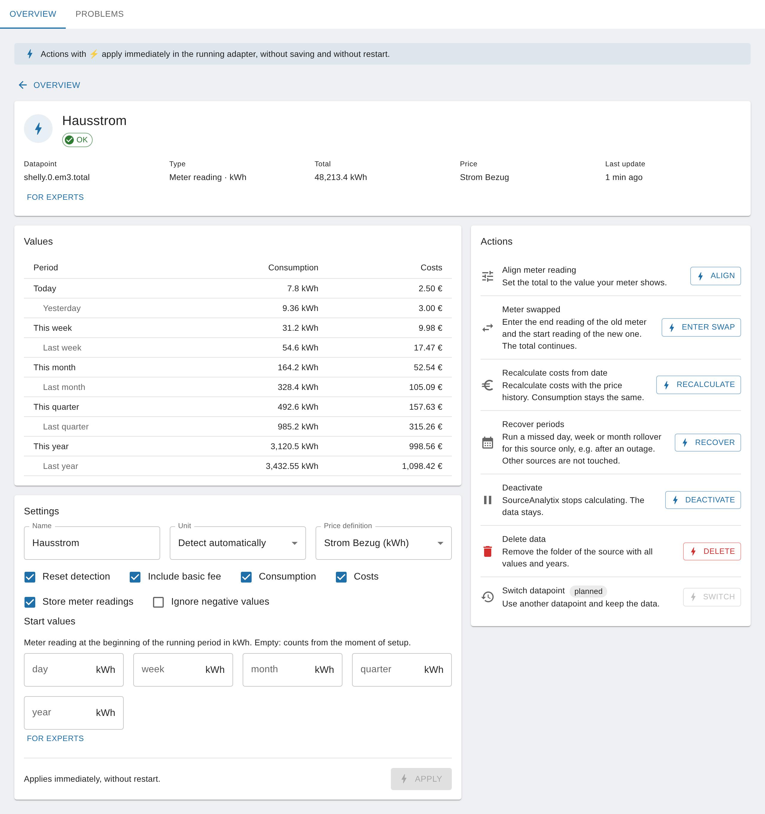

# Settings (instance and datapoint)

<!-- seite: gewicht=60; en=en/03.referenz/01.einstellungen.md -->

## Which units are supported (energy, volume, weight, length)?

<!-- abschnitt: prio=A; gewicht=23; readme=covered; cluster=outputs-viz-10,cumulative-power-03,upgrade-migration-other-25; features=supported-units,unit-detection-conversion,price-definitions-table -->
<!-- muss beantworten: Tabelle der Einheiten und Umrechnung; Einheiten außerhalb der Liste. -->

Power, energy, volume, mass, length and pieces. Conversion works within the same quantity and between litres and cubic metres. Power and pulses per minute are summed up over time.
<!-- quelle: code=lib/calculation.js; code=main.js -->

| Quantity | Units | Converts to |
|---|---|---|
| Power | `GW`, `MW`, `kW`, `W`, `mW` | energy, summed up over time |
| Energy | `GWh`, `MWh`, `kWh`, `Wh`, `mWh` | any energy unit |
| Volume | `km³`, `m³`, `dm³`, `cm³`, `mm³`, `hl`, `l`, `dl`, `cl`, `ml` | any volume unit (1 `m³` = 1,000 `l`) |
| Mass | `t`, `kg`, `g` | any mass unit |
| Length | `km`, `m`, `dm`, `cm`, `mm`, `µm`, `nm` | any length unit |
| Pieces | `piece` | any unit, with "Pulses per unit" |
| Pulses per minute | `piece/min` | like `piece`, summed up over time |
<!-- quelle: code=lib/calculation.js; issue=#1278; issue=#304; issue=#74 -->

On the object, SourceAnalytix also recognises spellings such as `m3`, `kwh`, `L`, `Stk` or `pulses/min`. Not supported are time (`h`), data volumes, rates such as `m³/h`, and quantities such as `%` or `V`.
<!-- quelle: code=lib/calculation.js; issue=#1264; issue=#304; issue=#74 -->

### Which unit applies where?

| Setting | Meaning |
|---|---|
| "Unit" on the source | the unit the datapoint **delivers**, usually detected automatically |
| "Unit" in the price definition | the unit SourceAnalytix **calculates and displays** in; start values and price refer to it |
<!-- quelle: code=main.js; code=src-admin/src/SourceDetail.tsx; code=src-admin/src/i18n/en.json -->

If the two don't fit together, say `kg` and `kWh`, the source does not start and the "Problems" tab reports it.
<!-- quelle: code=main.js; code=lib/source-overview.js; issue=#1278; issue=#1310 -->

### Pieces and pulses

- **Just counting**, for example burner starts: price definition in `piece`.
- **Pulses into kWh or m³:** enter "Pulses per unit", for example `1000` for 1000 imp/kWh. In the wizard the field is in the "Price" step, in the detail view under "Settings".
- **Every update is a pulse:** set "Each update adds its value" under "For experts". Then every update counts, even with the same value.
<!-- quelle: issue=#74; issue=#479; issue=#1313; code=src-admin/src/Wizard.tsx; code=src-admin/src/SourceDetail.tsx; code=lib/calculation.js -->

**See also:** [Which unit do I set on the datapoint?](../02.anleitungen/01.quellen-und-einheiten.md#unit-datapoint-kwh-wh-m3) · ["No unit defined" error](../04.fehlerbehebung/01.log-meldungen.md#error-unit-not-supported-no)

## Which instance settings are there (periods, decimals)?

<!-- abschnitt: prio=B; gewicht=10; readme=partial; cluster=outputs-viz-05,outputs-viz-02,prices-costs-12; features=current-year-weekday,rounding-instance-defaults,source-decimals,calc-rounding,current-year-months,year-statistics-archive,current-year-weeks,current-year-quarters,current-year-previous,price-definitions-table -->
<!-- muss beantworten: Wochen/Monate/Quartale speichern, Standard-Rundung; warum manche States fehlen. -->

Four tabs. "Main settings" decides which week, month and quarter states are created and how many decimals new sources get.
<!-- quelle: code=admin/jsonConfig.json; code=admin/i18n/en.json; issue=#1269 -->

| Tab | Content | Takes effect |
|---|---|---|
| "Overview" | all sources with values, "Add source", detail view | actions with ⚡ immediately |
| "Problems" | findings with a suggested fix | immediately |
| "Price definitions" | the price table | after "Save" (restart) |
| "Main settings" | periods and rounding | after "Save" (restart) |
<!-- quelle: code=admin/jsonConfig.json; code=src-admin/src/SourcesApp.tsx; code=src-admin/src/i18n/en.json -->

### The "Main settings" tab

| Section | Option | Default | Creates |
|---|---|---|---|
| "Year statistics" | "Weeks" | off | `<year>.<category>.weeks.01` to `53` |
| "Year statistics" | "Months" | on | `<year>.<category>.months.01_January` to `12_December` |
| "Year statistics" | "Quarters" | off | `<year>.<category>.quarters.Q1` to `Q4` |
| "Current year" | "Weekday" | on | `currentYear.<category>.currentWeek.01_Monday` to `07_Sunday` |
| "Current year" | "Weeks", "Months", "Quarters" | on | `currentYear.<category>.weeks`, `months`, `quarters` |
| "Current year" | "Previous period" | on | `01_previousDay` to `05_previousYear` |
| "Rounding" | decimals for consumption / costs | 3 / 2 | template for new sources |
<!-- quelle: code=admin/jsonConfig.json; code=admin/i18n/en.json; code=io-package.json; code=lib/calculation.js; code=main.js; issue=#1287 -->

> [!WARNING]
> If you turn a period option off, SourceAnalytix deletes those states of all sources for the current year when you save. The page asks first. Earlier years and recordings in the history adapter stay.
<!-- quelle: code=main.js; code=admin/jsonConfig.json; code=admin/i18n/en.json; issue=#1311 -->

If a state is missing, the option is usually off, or the source lacks "Consumption", "Costs" or "Store meter readings". Previous periods stay at 0 until the first period rollover.
<!-- quelle: code=main.js; code=lib/calculation.js -->

Each source takes over the decimals once when it is created. After that, change them in the detail view under "For experts". Allowed are 0 to 15; -1 means unrounded. `cumulativeReading` always stays unrounded.
<!-- quelle: code=main.js; code=lib/calculation.js; code=src-admin/src/SourceDetail.tsx -->

**See also:** [Why so many decimal places?](../04.fehlerbehebung/02.falsche-werte-und-bekannte-fehler.md#so-many-decimals) · [Evaluating across several years](../02.anleitungen/04.werte-auswerten.md#evaluate-across-years-adjusting-everything)

## What do the datapoint settings do (Costs, Consumption, Meter values)?

<!-- abschnitt: prio=B; gewicht=9; readme=partial; cluster=setup-ui-21,outputs-viz-25; features=source-meter-values,output-cumulative-reading,source-calc-costs,source-calc-consumption,output-state-deletion,source-enable,source-alias,source-output-id,source-price-definition,source-unit,source-basic-rate,source-average-power,source-ignore-negative,source-reset-detection,source-threshold,source-decimals,source-start-values,source-multi-edit,source-hidden-reset-keys -->
<!-- muss beantworten: Jede Option am Datenpunkt mit Wirkung und Voreinstellung; wann der Meter-Readings-Ordner leer bleibt. -->

They decide what SourceAnalytix calculates for the source and which states are created. You find them in the source's detail view under "Settings"; "⚡ Apply" takes effect immediately.
<!-- quelle: code=src-admin/src/SourceDetail.tsx; code=main.js; issue=#1269 -->

| Setting | Effect | Default |
|---|---|---|
| "Name" | display name, does not change any state ID | the datapoint's name |
| "Unit" | the unit the datapoint delivers | detected |
| "Price definition" | required; target unit, costs or earnings | – |
| "Consumption" | states under `consumed` or `delivered` | on |
| "Costs" | states under `costs` or `earnings` | on |
| "Include basic fee" | books the "Price per month" | on if no other source books it |
| "Store meter readings" | readings per period under `meterReadings` | on |
| "Reset detection" | catches drops to 0 | off, on for Shelly and Tasmota |
| "Ignore negative values" | power only: negative values count as 0 | off |
| "Average power values" | power only: average of two values | off |
| "Maximum gap between power values (minutes)" | power only: longer pauses count as 0 | empty = off |
| "Pulses per unit" | pieces only: conversion into the target unit | empty |
| "Start values" | reading at the start of the periods | empty = from now |
| For experts: "Reset detection threshold" | largest drop that counts as jitter | 1 |
| For experts: "Decimals for consumption" / "Decimals for costs" | rounding of the states | 3 / 2 |
| For experts: "Each update adds its value" | every update counts as an increase | off |
| For experts: "Technical ID" | folder `sourceanalytix.0.<device>` | from the name |
<!-- quelle: code=src-admin/src/SourceDetail.tsx; code=src-admin/src/Wizard.tsx; code=src-admin/src/i18n/en.json; code=main.js; issue=#1285; issue=#1266; issue=#74; issue=#479; interview=4 -->

Numbers work with a comma or a dot, without a thousands separator. The page marks invalid fields and does not save. If a change deletes data, for example switching off "Consumption" or "Costs" or switching between "Costs" and "Earnings", the page asks first with "Delete data?".
<!-- quelle: code=src-admin/src/api.ts; code=src-admin/src/SourceDetail.tsx; code=src-admin/src/i18n/en.json; issue=#1287; issue=#1311; issue=#1312 -->

On the datapoint on the "Objects" tab, there is only an on/off switch. Switching it off there removes the source's settings; to pause, use "Deactivate".
<!-- quelle: issue=#1286; issue=#1306; code=admin/jsonCustom.json; code=admin/i18n/en.json -->

### When `meterReadings` stays empty

`meterReadings` holds the total at the end of a period. The folder stays empty if "Store meter readings" is off, the instance's period options are off, or the first period rollover is still pending. The current reading is in `cumulativeReading`.
<!-- quelle: code=main.js; code=lib/calculation.js -->

**See also:** [Meter readings and cumulativeReading](02.states-und-meldungen.md#meter-readings-cumulative) · [Datapoint enabled, but no folders](../04.fehlerbehebung/01.log-meldungen.md#datapoint-enabled-but-no-folders)

## How do the threshold and turning off reset detection work?

<!-- abschnitt: prio=B; gewicht=7; readme=covered; cluster=meter-readings-11,meter-readings-13; features=source-threshold,reset-jitter-ignore,reset-confirmation,source-reset-detection,reset-disabled-decrease,reset-rejected-glitch,reset-invalid-reading,reset-manual-correction,reset-dynamic-cost-tracker -->
<!-- muss beantworten: Reset-Erkennung pro Datenpunkt einstellen, Threshold und Jitter, abschalten. -->

You set both per source: "Reset detection" under "Settings", the threshold under "For experts". The threshold (default 1, in the unit of the price definition) is the largest drop that still counts as measurement jitter.
<!-- quelle: code=main.js; code=lib/calculation.js; code=src-admin/src/SourceDetail.tsx -->

| Drop | Reset detection on | off |
|---|---|---|
| up to the threshold | is ignored | the total drops with it |
| larger | SourceAnalytix waits for the next value and then keeps counting | the total drops, periods can turn negative |
<!-- quelle: code=lib/calculation.js; code=main.js -->

The threshold must be larger than the device's noise and smaller than the reading it restarts with after a reset. 0 means every drop is a possible reset. Empty counts as the default of 1.
<!-- quelle: code=lib/calculation.js; code=main.js; issue=#1312 -->

Power, `piece/min` and "Each update adds its value" have no reset detection. If a source without reset detection drops to 0, the "Problems" tab reports "Meter drops to 0, reset detection is off" with "Switch on".
<!-- quelle: code=main.js; code=src-admin/src/Wizard.tsx; code=lib/source-overview.js; code=src-admin/src/i18n/en.json -->

**See also:** [Meter restarts at 0 after a power failure](../02.anleitungen/02.zaehlerstaende-korrigieren.md#meter-restarts-after-power-loss) · [What does "Device reset detected" mean?](../05.hintergrund/02.zaehler-reset.md#device-reset-detected-mean-reset)

## How is a price definition structured (categories, basic fee, decimal mark)?

<!-- abschnitt: prio=B; gewicht=6; readme=missing; cluster=prices-costs-31,prices-costs-14,prices-costs-08; features=price-definitions-table,supported-units,source-price-definition,price-fixed,price-invalid-unit-price,price-scheduled-valid-from,price-state,price-tariff-selector,price-current-price-writable,price-split-over-intervals,price-basic-fee,price-history-states,price-dynamic-cost-memory,price-recalculate-unreachable -->
<!-- muss beantworten: Felder der Preisdefinition, Grundpreis anteilig oder voll, Komma/Punkt. -->

As a row on the "Price definitions" tab with a name ("Category"), unit, cost type and price. Each source has exactly one. The basic fee is booked in full once a month, not pro rata per day.
<!-- quelle: code=admin/jsonConfig.json; code=main.js; code=lib/calculation.js -->

| Column | Meaning |
|---|---|
| "Category" | unique name, for example `Power`; not empty and not duplicated |
| "Description" | free text |
| "Cost Type" | "Costs" (`consumed`, `costs`) or "Earnings" (`delivered`, `earnings`) |
| "Unit" | the unit used for calculation and display |
| "Price source" | "Fixed price", "Datapoint" or "Tariff selector" |
| "Price per unit" | for example `0.32` for €0.32/kWh |
| "Price state" | state with the price or tariff |
| "Active tariff price", "Active selector value" | only with "Tariff selector" |
| "Valid from" | the prices apply from 0:00 on this day |
| "Price per month" | basic fee |
<!-- quelle: code=admin/jsonConfig.json; code=admin/i18n/en.json; code=main.js; code=lib/dynamic-pricing.js; issue=#1310 -->

Comma and dot both work, without a thousands separator. If a price is not a number, SourceAnalytix calculates with 0 and logs it. `sourceanalytix.0.priceDefinitions.<category>.currentPrice` shows whether it arrived correctly. Changes apply after "Save".
<!-- quelle: code=lib/dynamic-pricing.js; code=main.js -->

Details on price sources, "Valid from" and the basic fee are under [Prices and costs](../02.anleitungen/03.preise-und-kosten.md#costs-recalculated-change-price-change).

**See also:** [Prices as states](02.states-und-meldungen.md#prices-read-written-as-states) · [Costs stay 0](../04.fehlerbehebung/02.falsche-werte-und-bekannte-fehler.md#costs-stay-0-not-calculated)

## How do I name the datapoint (alias, output ID)?

<!-- abschnitt: prio=B; gewicht=5; readme=covered; cluster=setup-ui-23,outputs-viz-18; features=source-alias,source-output-id,migration-output-id-change,output-tree-layout -->
<!-- muss beantworten: Name und ID der erzeugten States; Folgen einer ID-Änderung. -->

A source has two names. The "Name" is for display only and can be changed at any time. The "Technical ID" is the folder `sourceanalytix.0.<device>` with all states; it is best set when you create the source.
<!-- quelle: code=main.js; code=lib/output-id.js; code=src-admin/src/i18n/en.json -->

The wizard derives the technical ID from the name, for example `house_power` from "House power", and otherwise falls back to the datapoint ID. Letters, digits, `_` and `-` are allowed. The ID must be unique; `info`, `priceDefinitions`, `priceHistory` and `basicPriceHistory` are reserved.
<!-- quelle: code=src-admin/src/Wizard.tsx; code=src-admin/src/api.ts; code=lib/output-id.js; issue=#1287; issue=#1313 -->

If you change the ID in the detail view under "For experts", SourceAnalytix copies the whole folder to the new ID and then deletes the old one. You have to adapt scripts, VIS views and history queries yourself; old recordings stay under the old ID.
<!-- quelle: issue=#1285; code=src-admin/src/SourceDetail.tsx; code=main.js; code=lib/output-id.js -->

**See also:** [Where do I find my values?](../01.erste-schritte/02.erster-zaehler.md#values-consumption-today-yesterday) · [Reading values in a script](../02.anleitungen/04.werte-auswerten.md#read-sourceanalytix-values-script)

## Which source types are there (meter, power)?

<!-- abschnitt: prio=B; gewicht=0; readme=covered; cluster=; features=source-cumulative-meter,source-power-integration,unit-detection-conversion,supported-units,consumption-vs-delivery -->
<!-- muss beantworten: Kurzreferenz der Quelltypen; Details in Erste Schritte und Hintergrund. -->

Two. A **meter reading** keeps rising, and consumption is the difference. A **power** value is an instantaneous value that SourceAnalytix sums up over time. The type follows from the unit.
<!-- quelle: code=lib/calculation.js; code=main.js; code=src-admin/src/i18n/en.json -->

| | Meter reading | Power |
|---|---|---|
| Units | energy, volume, mass, length, `piece` | power, `piece/min` |
| `cumulativeReading` | device value + offset | starts at 0 |
| Reset detection, start values | yes | no |
| "Meter swapped" | yes | no |
<!-- quelle: code=lib/calculation.js; code=src-admin/src/SourceDetail.tsx; code=main.js; issue=#1267 -->

"Each update adds its value" behaves like power. Whether import or feed-in is counted depends on the price definition's "Cost Type".
<!-- quelle: code=main.js; issue=#479 -->

**See also:** [Meter or power?](../01.erste-schritte/02.erster-zaehler.md#datapoint-enable-meter-kwh-power) · [Watts to kWh](../05.hintergrund/01.berechnung.md#sourceanalytix-convert-watts-kwh)
