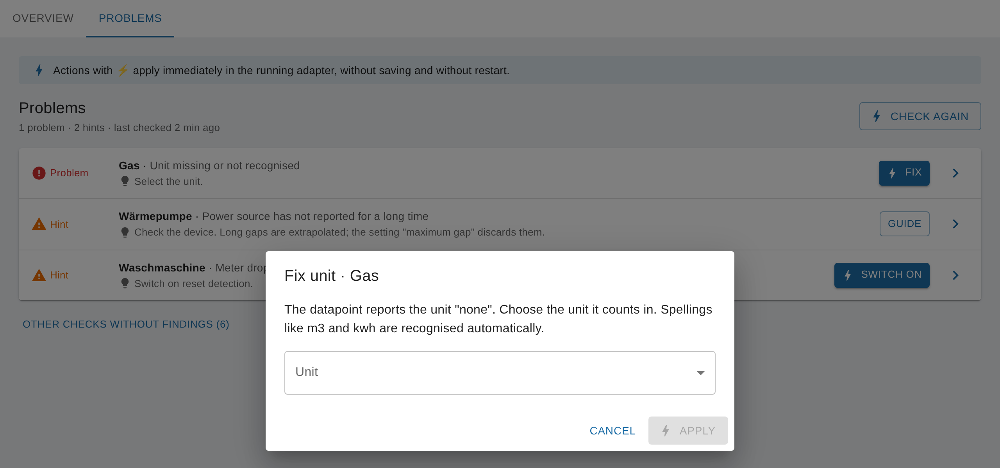

# Log messages and errors during setup

<!-- seite: gewicht=129; en=en/04.fehlerbehebung/01.log-meldungen.md -->

## "unit not supported" / "No unit defined" error – how do I set the unit?

<!-- abschnitt: prio=A; gewicht=32; readme=partial; cluster=outputs-viz-07,logs-install-10,setup-ui-13; features=source-unit,unit-detection-conversion,supported-units,log-source-config-errors -->
<!-- muss beantworten: Ursachen (Einheit am Datenpunkt fehlt oder unbekannt), Lösung, Verweis auf Referenz Einheiten. -->

SourceAnalytix finds no unit it can calculate with and skips the source. On the "Problems" tab, click "Fix" at "Unit missing or not recognised" and choose the unit the device delivers.
<!-- quelle: code=main.js; code=lib/source-overview.js; code=src-admin/src/SourcesApp.tsx; code=src-admin/src/i18n/en.json; issue=#1269 -->

The log shows `No unit defined for <datapoint>, cannot execute calculations !`.
<!-- quelle: code=main.js -->

Causes: the object has no unit (common with script datapoints), the unit is spelled out such as `Watt`, or the quantity is not supported, for example `%` or `h`. SourceAnalytix recognises spellings such as `m3` or `kwh` itself.
<!-- quelle: code=main.js; code=lib/calculation.js; issue=#1264 -->

> [!IMPORTANT]
> Choose the unit the device **delivers**, not the one you want to see. The display unit comes from the price definition. `kWh` instead of `Wh` makes all values 1,000 times too large.
<!-- quelle: code=main.js; code=lib/calculation.js -->

If the "Problems" tab instead reports "Unit does not match the price", say `kg` and `kWh`, choose a price definition with a matching unit.
<!-- quelle: code=main.js; code=lib/source-overview.js; code=src-admin/src/i18n/en.json; issue=#1278 -->

**See also:** [Which units are supported?](../03.referenz/01.einstellungen.md#units-supported-energy-volume-weight) · [Which unit on the datapoint?](../02.anleitungen/01.quellen-und-einheiten.md#unit-datapoint-kwh-wh-m3)

## "Known valueAtDeviceReset > known cumulative value" error

<!-- abschnitt: prio=B; gewicht=19; readme=missing; cluster=logs-install-06,periods-09,meter-readings-20; features=log-source-config-errors,source-hidden-reset-keys,reset-manual-correction,calc-first-activation-start-values,source-start-values -->
<!-- muss beantworten: Offset und cumulativeReading in Einklang bringen. -->

The stored offset is greater than the total. The source keeps running anyway, and SourceAnalytix realigns the offset itself with the next value. Check the source's "Total" afterwards.
<!-- quelle: code=main.js; issue=#1257 -->

This usually happens when `cumulativeReading` was lowered or deleted by hand, or when total and settings don't match after a restore. The message doesn't occur for power sources.
<!-- quelle: code=main.js; forum=558368; forum=602307; forum=959873; forum=1097776 -->

1. Open the source and compare the "Total" with your meter.
2. If it doesn't match, choose "Align meter reading" and enter the reading you took. You can also use "Align" on the "Problems" tab at "Total does not match the meter".
<!-- quelle: code=src-admin/src/SourceDetail.tsx; code=src-admin/src/Dialogs.tsx; code=lib/source-overview.js; code=main.js; issue=#640; issue=#1269 -->

The automatic realignment keeps counting from the stored total. If that was set to 0, it starts at 0 until you align it.
<!-- quelle: code=main.js -->

**See also:** [Correcting wrong values](../02.anleitungen/02.zaehlerstaende-korrigieren.md#correct-wrong-too-high-negative) · [Values are 0 after a restore](02.falsche-werte-und-bekannte-fehler.md#after-update-restore-values-0)

## "No cost type defined" error – price definition missing

<!-- abschnitt: prio=B; gewicht=17; readme=covered; cluster=logs-install-27,setup-ui-12; features=source-price-definition,log-source-config-errors,price-definitions-table -->
<!-- muss beantworten: Preisdefinition anlegen und zuordnen. -->

The source has no price definition. Every source needs one, even if you only want consumption, because it sets the unit. On the "Problems" tab, click "Choose price" and pick one under "Price definition".
<!-- quelle: code=main.js; code=lib/source-overview.js; code=src-admin/src/SourcesApp.tsx; code=src-admin/src/i18n/en.json; forum=214572; forum=769206 -->

The "Problems" tab distinguishes two cases:

- "No price definition selected", in the log `No cost type defined for <datapoint> …`. This is also the case if you switched the source on at the datapoint on the "Objects" tab.
- "Price definition no longer exists", in the log `Selected Type <name> does not exist in Price Definitions`, for example after renaming a category.
<!-- quelle: code=main.js; code=src-admin/src/i18n/en.json; issue=#1286 -->

If there is no suitable price yet, create it on the "Price definitions" tab and save. The source starts right after "⚡ Apply".
<!-- quelle: code=admin/jsonConfig.json; code=src-admin/src/SourceDetail.tsx; code=main.js -->

**See also:** [Price definition](../03.referenz/01.einstellungen.md#price-definition-structured-categories-base) · [Costs stay 0](02.falsche-werte-und-bekannte-fehler.md#costs-stay-0-not-calculated)

## "Initialization failed" / "Cannot handle calculations" / "reading incorrect" messages

<!-- abschnitt: prio=B; gewicht=13; readme=missing; cluster=logs-install-07,logs-install-08; features=log-startup-summary,log-source-config-errors,log-lifecycle-info,source-enable,source-hidden-reset-keys -->
<!-- muss beantworten: Bedeutung beim Start und bei Konvertierung; Ursachen prüfen. -->

These are summary messages: a source was not started. The cause is in the log lines before it and on the "Problems" tab, which suggests a fix.
<!-- quelle: code=main.js; code=lib/source-overview.js; forum=565033; forum=649964 -->

Common causes logged before it:

- `No unit defined …`: see [Unit missing](#error-unit-not-supported-no).
- `No cost type defined …` or `Selected Type … does not exist …`: see [Price definition missing](#error-no-cost-type-defined).
- `Unit … cannot be converted …` or `The data of … is stored in …`: unit and price definition don't match, see [Changing the unit later](../02.anleitungen/01.quellen-und-einheiten.md#unit-datapoint-kwh-wh-m3).
- `Cannot use output ID …`: the technical ID is invalid or taken, see [Name and output ID](../03.referenz/01.einstellungen.md#name-datapoint-alias-output-id).
<!-- quelle: code=main.js; issue=#1310 -->

Once you fix the cause and apply, the source starts without a restart.
<!-- quelle: code=main.js -->

The message `reading incorrect after conversion contact DEV` should not occur, because text and unsuitable units are caught earlier. If it does appear, report it as an issue with the whole log line.
<!-- quelle: code=main.js; issue=#1255; issue=#1278 -->

**See also:** [No folders or states](#datapoint-enabled-but-no-folders)

## Source delivers text instead of a number (string instead of number, decimal point)

<!-- abschnitt: prio=B; gewicht=12; readme=missing; cluster=logs-install-09,outputs-viz-32; features=log-calculation-errors,unit-detection-conversion,source-cumulative-meter,reset-invalid-reading,source-alias -->
<!-- muss beantworten: Quelle/Skript/Alias so umstellen, dass eine Zahl ankommt. -->

SourceAnalytix reads numbers in text itself, with a comma or a dot, for example `"12,5"`. It skips text with a unit or a thousands separator such as `"12,5 kWh"`. A datapoint of type number is the safest choice.
<!-- quelle: code=main.js; code=lib/dynamic-pricing.js; issue=#1255; issue=#1288 -->

The "Problems" tab then shows "Datapoint delivers text instead of a number", and the log `Value "<value>" of <datapoint> is not a number, reading ignored`.
<!-- quelle: code=lib/source-overview.js; code=src-admin/src/i18n/en.json; code=main.js -->

1. Check whether the source adapter also offers the value as a number.
2. Otherwise, create an alias of type number or a script with `parseFloat` that converts the text, with the device's unit.
3. Set up the new datapoint with "Add source" and take over the meter reading with "Align meter reading".
<!-- quelle: forum=559520; forum=590394; forum=1284986; forum=943059; forum=870108; issue=#468; interview=7; issue=#640 -->

**See also:** [Script datapoints](../02.anleitungen/01.quellen-und-einheiten.md#use-script-datapoints-unreliable-sources)

## Datapoint enabled, but no folders or states appear

<!-- abschnitt: prio=B; gewicht=10; readme=missing; cluster=setup-ui-15,setup-ui-27,cumulative-power-25; features=source-enable,log-source-config-errors,output-tree-layout,source-calc-consumption,source-price-definition -->
<!-- muss beantworten: Checkliste: Kostenart, Einheit, Meldungen, Aktivierung, Objektliste. -->

Almost always, SourceAnalytix rejected the source, usually because the price definition or unit is missing. On the "Overview" tab it then has the status "Problem", and the "Problems" tab shows the reason and the fix.
<!-- quelle: code=main.js; code=lib/source-overview.js; code=src-admin/src/i18n/en.json; forum=866427; forum=694176; issue=#1008 -->

1. **Is the instance running?** Otherwise SourceAnalytix doesn't calculate.
2. **Is the source listed in the "Overview"?** If not, it is set up for another instance. Create it with "Add source".
3. **Status "Deactivated"?** Choose "Activate" on the source.
4. **Status "Problem"?** The button on the "Problems" tab fixes it or takes you to the right place.
5. **Is "Consumption" on?** Without the tick, no consumption values are created.
<!-- quelle: code=src-admin/src/SourcesApp.tsx; code=src-admin/src/SourceDetail.tsx; code=src-admin/src/i18n/en.json; code=lib/source-overview.js; code=main.js -->

Once the source runs, the folder `sourceanalytix.0.<device>` appears immediately, and the values with the datapoint's next value. If the folder is missing on the "Objects" tab, reload the view and check the filters.
<!-- quelle: code=main.js; forum=694176; forum=1217092 -->

**See also:** [Where do I configure SourceAnalytix?](../01.erste-schritte/02.erster-zaehler.md#configure-sourceanalytix-datapoint)

## High CPU and memory load and too much log output

<!-- abschnitt: prio=B; gewicht=8; readme=missing; cluster=logs-install-14,logs-install-13; features=source-power-integration,source-average-power,other-object-subscription,calc-calc-block,log-startup-summary -->
<!-- muss beantworten: Anzahl Datenpunkte, Log-Level. -->

SourceAnalytix calculates with every new value of every source. Load mainly comes from sources that send very often. For less log output, set the instance to the "warn" level.
<!-- quelle: code=main.js; issue=#1233; pr=#1238; interview=5 -->

- Set a longer send interval in the source adapter, if possible.
- Use a meter reading instead of power if the device delivers both.
- Pause sources you don't need with "Deactivate".
<!-- quelle: code=main.js; code=src-admin/src/i18n/en.json; forum=411981; forum=294377; issue=#109 -->

You set the log level on the "Instances" tab in expert mode. If another adapter floods the log, that adapter's log level helps.
<!-- quelle: code=io-package.json; interview=5; forum=406676; forum=382814 -->

**See also:** [Object limit](#object-limit-warning-5000)

## Problems with installation and the Admin display

<!-- abschnitt: prio=B; gewicht=8; readme=missing; cluster=upgrade-migration-other-24,logs-install-25,setup-ui-10,setup-ui-28; features=req-admin-ui-i18n,req-versions -->
<!-- muss beantworten: GitHub-Installation 404/422, Adapter nach Neuinstallation nicht sichtbar, "nicht gepflegt", Multihost. -->

Install from the "latest" repository, not from GitHub, and check the [requirements](../01.erste-schritte/01.installation.md#requirements-sourceanalytix-have-node-js). If something is still missing in Admin, upload the files again with `iobroker upload sourceanalytix`.
<!-- quelle: interview=21; code=io-package.json; code=package.json; forum=311540; issue=#870 -->

| Symptom | Fix |
|---|---|
| GitHub installation fails with 404 or 422 | update js-controller or install from "latest" |
| no instance under "Instances" | create the instance |
| `Cannot load jsonConfig of sourceanalytix: Not exists` | `iobroker upload sourceanalytix`, reload the page |
| "Overview" empty, "Instance is not running" | start the instance, "Try again" |
| "not maintained" | comes from a GitHub installation, has no effect |
| Multihost: "admin not found" | install or update Admin on that host |
<!-- quelle: forum=635126; forum=656505; issue=#465; issue=#472; issue=#453; issue=#870; forum=311540; code=src-admin/src/i18n/en.json; forum=1318812; forum=1259911; code=io-package.json; forum=522269 -->

**See also:** [Installation](../01.erste-schritte/01.installation.md#install-sourceanalytix-create-instance) · [Update](../02.anleitungen/05.betrieb-und-wartung.md#update-sourceanalytix-downgrade)

## Midnight: crash or day rollover at the wrong time

<!-- abschnitt: prio=B; gewicht=5; readme=missing; cluster=logs-install-17,periods-28; features=rollover-midnight-cron,rollover-hourly-safety-check,rollover-missed-recovery-start,rollover-recover-periods-button -->
<!-- muss beantworten: ENOENT-Fehler, Zeitumstellung. -->

The rollover runs at 0:00 by the system time of the ioBroker host. If it comes at the wrong hour, the time zone there is wrong. A crash with `ENOENT` at midnight is caused by js-controller when it switches the log file; SourceAnalytix catches up the missed rollover by itself afterwards.
<!-- quelle: code=main.js; interview=13b; forum=892050; forum=965788 -->

If ioBroker runs in Docker on UTC, the day changes at 1:00 or 2:00 in Central Europe. Set the environment variable `TZ=Europe/Berlin` (or your own zone) and restart the container.
<!-- quelle: code=main.js; interview=13b; forum=516634; issue=#490 -->

If a rollover is missing, the "Problems" tab shows "Period rollover missed" with "Recover", see [ioBroker was off at midnight](../02.anleitungen/05.betrieb-und-wartung.md#iobroker-was-down-midnight-recover).
<!-- quelle: code=lib/source-overview.js; code=src-admin/src/i18n/en.json -->

## Object limit warning (5000)

<!-- abschnitt: prio=B; gewicht=3; readme=missing; cluster=logs-install-18,upgrade-migration-other-15; features=output-tree-layout,other-object-subscription,year-statistics-archive -->
<!-- muss beantworten: js-controller-Warnung und Anheben. -->

The warning comes from js-controller; SourceAnalytix itself has no limit. Every source creates many states. First check what you need:
<!-- quelle: forum=1343567; forum=1313361; code=main.js -->

- Turn off period options you don't use under "Main settings".
- Delete sources you no longer need with "Delete data".
- Delete old year folders.
<!-- quelle: code=admin/jsonConfig.json; code=main.js; code=src-admin/src/i18n/en.json; issue=#1265; interview=8 -->

If the number is intended, you can raise the limit in expert mode on the object `system.adapter.sourceanalytix.0`.
<!-- quelle: forum=1343567 -->

**See also:** [Instance settings](../03.referenz/01.einstellungen.md#instance-settings-exist-periods-decimals)

## Source adapter or history shows 0 or old values

<!-- abschnitt: prio=B; gewicht=2; readme=missing; cluster=logs-install-22,logs-install-23; features=source-enable,source-cumulative-meter,output-tree-layout -->
<!-- muss beantworten: Wechselwirkung mit Quell-Adapter und History. -->

Usually nothing arrives at the source datapoint any more. SourceAnalytix only reads it and never writes its value; a 0 in the source datapoint's history comes from the adapter or a script.
<!-- quelle: code=main.js; forum=1337092; forum=511730 -->

If the source adapter renamed its datapoints, SourceAnalytix keeps listening to the old one:

1. Check "Last update" on the source. If the old datapoint was deleted, the "Problems" tab reports "Datapoint no longer exists".
2. Create the new datapoint with "Add source" and take over the reading with "Align meter reading".
3. Point VIS and scripts to the new folder. The old one stays as an archive.
<!-- quelle: code=src-admin/src/SourceDetail.tsx; code=lib/source-overview.js; code=src-admin/src/i18n/en.json; interview=7; forum=1337092 -->
